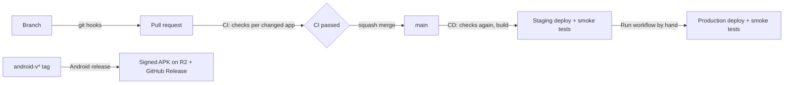

# CI/CD and code quality

How changes get from a branch to production, which checks guard each step, and how to run the
same checks locally. The tools themselves are listed in [tech-stack.md](tech-stack.md).

## Flow



1. Work on a branch named `<type>/<short-description>`, for example `feat/sign-in`. Commits to
   `main` are blocked by the pre-commit hook.
2. Open a pull request. Its title follows [Conventional Commits](#commit-messages), because the
   squash merge turns it into the commit on `main`.
3. CI runs. Merge once **CI passed** is green.
4. CD deploys the changed apps to staging and smoke-tests them.
5. Production deploys are started by hand for a commit that is already on staging.

## Workflows

| File | Runs on | What it does |
|---|---|---|
| `ci.yml` | Every pull request | Detects which apps changed, runs their checks, plus the repository checks below. Ends with **CI passed** |
| `cd.yml` | Push to `main`; by hand | Re-runs the checks for changed apps, deploys them to staging (API first, then web), smoke-tests both. By hand: deploys the chosen apps to staging or production |
| `release-android.yml` | `android-v*` tags | Android checks, then a signed release APK to R2 and a GitHub Release with its SHA-256 |
| `security.yml` | Mondays; by hand | `pnpm audit`, `cargo deny check advisories` and zizmor against `main`, so newly published advisories surface without a code change |
| `_web.yml`, `_api.yml`, `_android.yml` | Called by the workflows above | The per-app checks, shared so pull requests and deploys run exactly the same steps |

Path filters live in `.github/filters.yml`. A change to `ci.yml`, `cd.yml` or the filters runs
every app's checks.

### Checks per app

| | Web (`_web.yml`) | API (`_api.yml`) | Android (`_android.yml`) |
|---|---|---|---|
| Format | Biome | rustfmt | ktlint (Spotless) |
| Lint | Biome, warnings fail | Clippy with `pedantic`, warnings fail | Android Lint, warnings fail |
| Types | `tsc` (web and e2e) | compiler | compiler |
| Unused code and dependencies | Knip | cargo-shear | Android Lint |
| Dependency policy | Dependency review (pull requests) | cargo-deny: advisories, licenses, sources | Dependency review, Gradle dependency submission |
| Unit tests | Vitest + Testing Library, coverage | cargo-nextest with `#[sqlx::test]` against PostgreSQL 18 | JUnit |
| Generated files current | API types, route tree | `openapi.json` | |
| Build | Production build, reused by the e2e job | Release binary (CD only) | Debug APK, uploaded for reviewers |
| End-to-end | Playwright on desktop and mobile Chrome, axe accessibility scan | | |

Test results and coverage appear in each run's summary page. Playwright's HTML report, with
traces, screenshots and videos of failures, is uploaded as the `playwright-report` artifact.

### Repository checks (every pull request)

- **Pull request title:** commitlint, same rules as the commit-msg hook.
- **actionlint:** workflow syntax, expressions, and ShellCheck on every `run:` block.
- **zizmor:** workflow security (script injection, credential leaks, cache poisoning, unpinned
  actions, broad permissions). Medium and higher fail. Policy: `.github/zizmor.yml`.
- **ShellCheck** on `infra/azure/bin/*.sh` and the git hooks.
- **typos** spell check. Correct words that look like misspellings, such as Pakistani surnames
  and degree names, are listed in `.typos.toml`.
- **Dependency review:** fails on new dependencies with high or critical advisories, or under
  GPL or AGPL licenses.

## Running the checks locally

| What | Command (repository root) |
|---|---|
| All JavaScript checks: Biome, types, Knip, unit tests | `pnpm check` |
| Fix formatting and safe lint issues | `pnpm format` |
| Unit tests | `pnpm test` (coverage: `pnpm --filter @khandani/web test:coverage`) |
| End-to-end tests (builds the web app first) | `pnpm test:e2e` |
| End-to-end tests against a deployed site | `E2E_BASE_URL=https://staging.khandanirishta.app pnpm --filter @khandani/e2e e2e:smoke` |
| Playwright report of the last run | `pnpm --filter @khandani/e2e e2e:report` |
| API | `cargo fmt --check`, `cargo clippy --all-targets -- -D warnings`, `cargo nextest run` (or `cargo test`), `cargo deny check`, `cargo shear` (in `apps/api`, database running) |
| Android | `./gradlew spotlessCheck lintDebug testDebugUnitTest assembleDebug` (in `apps/android`); `./gradlew spotlessApply` fixes formatting |

First run of the end-to-end tests: `pnpm --filter @khandani/e2e exec playwright install chromium`.

API tests marked `#[sqlx::test]` create a throwaway database for each test, so they need
PostgreSQL (`pnpm db:start`) and `DATABASE_URL` from `apps/api/.env`. The cargo tools install
with `cargo install --locked cargo-nextest cargo-deny cargo-shear`.

## Git hooks

Installed by `pnpm install` (husky). They keep obvious problems out of commits; CI runs
everything again.

| Hook | Does |
|---|---|
| pre-commit | Blocks commits on `main`. Formats and lints staged files: Biome for JS, TS, JSON and CSS; rustfmt for Rust; ktlint for Kotlin. Rust and Kotlin are skipped with a warning when the toolchain isn't installed |
| commit-msg | Checks the message against Conventional Commits |
| pre-push | Type checks and unit tests for the JavaScript code |
| post-merge | Runs `pnpm install` when a pull changed `pnpm-lock.yaml` |

## Commit messages

[Conventional Commits](https://www.conventionalcommits.org), checked by commitlint
(`commitlint.config.mjs`):

```text
<type>(<optional scope>): <summary in the imperative, lower case>

<body: why the change was needed>
```

- Types: `feat`, `fix`, `perf`, `refactor`, `test`, `docs`, `build`, `ci`, `chore`, `style`, `revert`.
- Scopes: `web`, `api`, `android`, `e2e`, `contract`, `infra`, `ci`, `deps`, `deps-dev`, `docs`, `scripts`, `repo`.
- Examples: `feat(web): add the sign-in page`, `fix(api): return 404 for unknown profiles`.

## Deploying

- **Staging:** automatic for every merge to `main` that changes the web app or the API.
- **Production:** Actions > CD > Run workflow, branch `main`, environment `production`, then
  pick the apps. It re-runs the checks before deploying.
- **Android:** push a tag such as `android-v1.2.0` on a commit that is on `main`. The version
  name comes from the tag, the version code from the run number. The release job refuses tags
  that are not on `main` and tags older than the newest `android-v*` tag, so a late or re-run
  older release can't replace the latest download. If a publish fails part way, re-run the job.
- Deploys stay off until the repository variable `DEPLOY_ENABLED` is `true`. Secrets,
  variables (including `WEB_URL` for the smoke tests) and environments are listed in the
  [Azure runbook](../infra/azure/README.md#6-github-settings-for-deploys).

After each deploy, CD checks the API's `/readyz` through Cloudflare and runs the end-to-end
tests tagged `@smoke` against the web app. Tag a test with `{ tag: '@smoke' }` when it is safe
and quick to run against a live environment.

## Supply-chain safeguards

- Every action is pinned to a full commit SHA. Dependabot updates the SHA and its version
  comment; zizmor fails pull requests that add an unpinned action.
- `GITHUB_TOKEN` is read-only by default. The few jobs that write (dependency submission,
  GitHub Releases) ask for it in their own `permissions`.
- Checkouts don't keep credentials (`persist-credentials: false`).
- Pull requests only read caches; `main` writes them. Jobs holding deploy or signing
  credentials don't use caches at all.
- pnpm refuses versions published less than a day ago, and Dependabot waits 7 days after a
  release. Install scripts run only for packages listed under `allowBuilds` in
  `pnpm-workspace.yaml`.
- Lockfiles are enforced: `pnpm install --frozen-lockfile`, `cargo --locked`, and Gradle's
  wrapper checksum is validated.
- Downloaded tools (actionlint, cloudflared, the cargo tools) are pinned to a version and
  checked against a SHA-256.

## Recommended repository settings

These live in GitHub's settings, not in files:

- **Branch ruleset on `main`:** require a pull request, require the **CI passed** status
  check, block force pushes and deletions.
- **Merge button:** squash merging only, using the pull request title; delete branches after
  merge.
- **Code security:** Dependabot alerts and security updates, secret scanning with push
  protection (on), CodeQL default setup (JavaScript/TypeScript, Rust, Actions), private
  vulnerability reporting (for `.github/SECURITY.md`).
- **Actions:** require approval for workflows from outside contributors' forks.

## Keeping the pipeline current

Dependabot updates actions and all package ecosystems. These pins are updated by hand:

| What | Where |
|---|---|
| actionlint version and SHA-256 | `.github/workflows/ci.yml` |
| zizmor, typos, ShellCheck, cargo-deny, cargo-nextest, cargo-shear versions | `taiki-e/install-action` steps in `ci.yml`, `_api.yml`, `security.yml` |
| cloudflared version and SHA-256 | `.github/actions/deploy-api/action.yml` |
| ktlint and Compose rules | `apps/android/gradle/libs.versions.toml` (Dependabot sees the library, not the ktlint version) |
| Runner image | `runs-on: ubuntu-26.04` in every workflow, plus `.github/actionlint.yaml` |
