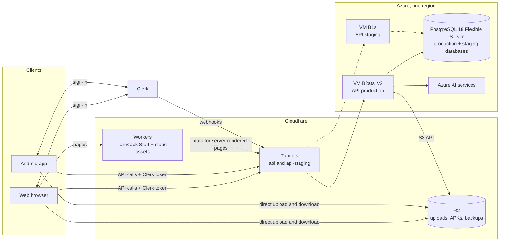

# Khandani Rishta: Tech Stack and Deployment

| | |
|---|---|
| Status | Repository scaffolded, no cloud resources provisioned yet. Each app has a minimal working skeleton; libraries in the tables below are added as the features that need them are built. |
| Last updated | 2026-11-20 |
| Scope | Technologies, hosting and deployment only. Product features, data model and business rules are out of scope and belong in separate documents. |
| Version policy | Latest stable release of everything. For managed services, the newest version the provider marks generally available. Lockfiles hold the exact versions. |
| Prices and limits | Checked on 2026-11-20. Re-check before relying on them. |

## 1. At a glance

| Layer | Choice | Runs on |
|---|---|---|
| API | Rust + Axum | Azure VMs: `B2ats_v2` (production), `B1s` (staging) |
| Database | PostgreSQL 18 | One Azure Database for PostgreSQL Flexible Server holding the production and staging databases; Docker locally |
| Web app | TanStack Start (React 19, TypeScript 7) | Cloudflare Workers |
| Android app | Kotlin + Jetpack Compose | Users' phones, APK served from Cloudflare R2 |
| Authentication | Clerk | Clerk (SaaS) |
| File storage | Cloudflare R2 (S3-compatible) | Cloudflare |
| DNS, TLS, CDN, WAF, API ingress | Cloudflare free plan + Cloudflare Tunnel | Cloudflare |
| Secrets | Env files, never committed | Each VM and developer machine; Cloudflare Workers secrets and GitHub Actions secrets where files can't be used |
| Errors and performance | Sentry | Sentry (SaaS) |
| App email | Resend (auth emails are sent by Clerk) | Resend (SaaS) |
| Push notifications | Firebase Cloud Messaging | Google |
| Moderation, PII detection, translation | Azure AI Content Safety, Azure AI Language, Azure AI Translator | Azure |
| Source control and CI/CD | GitHub (public repository during development) + GitHub Actions | GitHub |

## 2. Key decisions

| Decision | Why | Not chosen |
|---|---|---|
| Rust + Axum for the API | Very fast, small memory footprint (fits a 1 GiB VM), deploys as one binary | Node.js, Go |
| PostgreSQL as the only database | Relational data, rich filtering and full-text search in one engine; free managed tier on Azure | MongoDB, Cosmos DB |
| API and database in the same Azure region | Sub-millisecond queries; nothing crosses clouds on the request path | API and database with different providers |
| Azure VMs instead of Container Apps or App Service | Always on (no cold starts) and free for 12 months | Container Apps (cold starts when scaled to zero), App Service free tier (60 CPU minutes/day) |
| Staging on its own free VM (`B1s`) | Identical setup, scripts and deploy flow for both environments. `B1s` has its own 750 free hours a month | Heroku (a second deploy path), staging on the production VM |
| Staging database on the production database server | The free tier covers one Flexible Server. Staging traffic is tiny, and both environments run the same managed engine. Separate databases and login roles keep them apart | PostgreSQL installed on the staging VM (more isolation, more upkeep) |
| x86 VMs instead of Arm (`B2pts_v2`) | One `x86_64` binary for both VMs | Arm VM (kept as a fallback) |
| Cloudflare Workers for the web app | Free plan allows commercial use, renders at the edge, official TanStack Start support | Vercel Hobby (non-commercial use only) |
| Clerk for authentication | Official SDKs for TanStack Start and Android; free through the Student Pack; the API verifies tokens locally | Building auth in Rust |
| Cloudflare R2 for files | Free egress; 10 GB and 10 million reads a month free with no end date; S3-compatible; independent of the Azure subscription (comparison in section 11) | Azure Blob Storage free allowance |
| No Redis at launch | One API instance per environment, so an in-process cache, rate limiter and pub/sub are faster and free; Azure's cheapest Redis is about $12/month | Azure Managed Redis |
| Env files for secrets | Simplest option, no extra service | Doppler or another secrets manager |
| Public repository during development | Unlimited free minutes on GitHub-hosted runners. The repository becomes private when development is complete | Private from day one (3,000 Actions minutes a month on GitHub Pro) |
| Native Kotlin for mobile | Android only for now, distributed outside the Play Store | React Native, Flutter |

## 3. Architecture



Dotted lines are the staging path, which mirrors production on a smaller VM.

Request paths:

1. **Pages:** the browser loads the web app from Cloudflare Workers. Static assets come from Cloudflare's edge. Public pages are rendered on the Worker, signed-in screens render in the browser.
2. **API:** the browser and the Android app call `https://api.<domain>/v1/...` with a Clerk session token. Cloudflare forwards the request through the production Tunnel to Axum on the production VM, which queries PostgreSQL in the same region.
3. **Files:** the API hands out short-lived presigned URLs. Clients upload to and download from R2 directly, so file bytes never pass through the VMs.
4. **Auth:** Clerk handles sign-in on both clients. The API verifies Clerk tokens locally and receives Clerk webhooks to keep its own user records in sync.

Ground rules:

- The API is the only component that talks to PostgreSQL. The web app has no database access and no business logic of its own.
- The API is stateless apart from in-memory caches, so it can move to another host without code changes (see section 22).

## 4. Environments

| | Local | Staging | Production |
|---|---|---|---|
| Web | Vite dev server (`pnpm dev`) | Workers `staging` environment at `staging.<domain>` | Workers at `<domain>` and `www.<domain>` |
| API | `cargo run` on port 8787 | Azure VM `B1s` at `api-staging.<domain>` | Azure VM `B2ats_v2` at `api.<domain>` |
| Database | PostgreSQL 18 in Docker | `khandani_staging` database on the shared Flexible Server | `khandani_prod` database on the shared Flexible Server |
| Files | R2 bucket `kr-dev-media` | R2 bucket `kr-staging-media` | R2 bucket `kr-prod-media` |
| Auth | Clerk Development instance | Clerk Development instance | Clerk Production instance |
| Secrets | Each app's `.env` file | `/etc/khandani/api.env` on the staging VM | `/etc/khandani/api.env` on the production VM |
| Deploys | n/a | Automatic on merge to `main` | Manual, for a commit that already runs on staging |

## 5. Repository layout

One GitHub repository, public during development:

```text
khandani-rishta/
├── apps/
│   ├── api/                Rust (Axum) service
│   ├── web/                TanStack Start app
│   └── android/            Android Studio (Gradle) project
├── packages/
│   └── api-contract/       openapi.json exported from the API, plus TypeScript client generation
├── e2e/                    Playwright end-to-end tests
├── infra/
│   ├── azure/              cloud-init, systemd units, deploy and backup scripts, env file templates, runbook
│   └── local/              docker-compose.yml for local PostgreSQL
├── docs/
│   └── tech-stack.md       this document
├── package.json            pnpm workspace root (Biome, shared scripts)
├── pnpm-workspace.yaml     apps/web and packages/api-contract
├── biome.json              lint and format rules for the TypeScript code
└── .github/
    ├── actions/deploy-api/ deploy steps shared by both VMs
    ├── workflows/          ci.yml, cd.yml, release-android.yml, security.yml, reusable _*.yml
    └── dependabot.yml
```

Each app commits an `.env.example`. Real env files are git-ignored (section 15).

## 6. Backend API

### Toolchain

- Rust stable (1.100 at time of writing), edition 2024, pinned in `rust-toolchain.toml` and moved to each new stable release.
- Build target `x86_64-unknown-linux-gnu`, built on GitHub's `ubuntu-26.04` runner. That is the same Ubuntu release as the VMs, so one binary runs on both.
- TLS through rustls only (no OpenSSL dependency).
- Release profile: `lto = "thin"`, `codegen-units = 1`, `strip = true`.

### Libraries

| Concern | Crate | Version (2026-11) |
|---|---|---|
| Async runtime | `tokio` | 1.54 |
| HTTP server, routing, WebSockets | `axum` (with the `ws` feature) | 0.8 |
| Middleware | `tower`, `tower-http` (CORS, compression, timeouts, request ID, tracing, panic catching) | 0.5, 0.7 |
| PostgreSQL access and migrations | `sqlx` (Postgres, rustls, compile-time checked queries) | 0.9 |
| JSON | `serde`, `serde_json` | 1.x |
| Input validation | `garde` | 0.23 |
| Clerk token verification | `jsonwebtoken`, with Clerk's JWKS cached in memory | 12 |
| Clerk webhook signatures | `svix` | 2.10 |
| Outbound HTTP (Resend, FCM, Azure AI) | `reqwest` (rustls) | 0.13 |
| FCM service-account token | `gcp_auth` | 0.12 |
| R2 through the S3 API | `aws-sdk-s3` | 1.x |
| IDs | `uuid` (v7, time-ordered) | 1.29 |
| In-process cache | `moka` | 0.12 |
| Rate limiting | `tower_governor` | 0.8 |
| OpenAPI spec | `utoipa`, `utoipa-axum` | 6.0, 0.3 |
| Logs and traces | `tracing`, `tracing-subscriber` (JSON output on staging and production) | 0.1, 0.3 |
| Error tracking | `sentry`, `sentry-tower` | 0.49 |
| Error types | `thiserror`, `anyhow` | 2.x, 1.x |
| Image processing | `image` | 0.25 |
| Local `.env` loading | `dotenvy` (local only) | 0.15 |

### Runtime shape

- One binary runs everything as Tokio tasks: the HTTP and WebSocket server, a background job worker and scheduled maintenance tasks.
- Migrations are embedded with `sqlx::migrate!` and run at startup, before the server accepts traffic.
- Background jobs live in a PostgreSQL table and are claimed with `FOR UPDATE SKIP LOCKED`. No Redis, no message broker.
- Real-time updates use Axum WebSockets with in-process fan-out over Tokio channels. Clients ping every 30 seconds because Cloudflare closes idle connections.
- Caching uses `moka`, always with a size cap (`max_capacity`), because each VM has 1 GiB of RAM.
- Rate limits use `tower_governor` in memory, keyed by Clerk user ID, or by client IP from Cloudflare's `CF-Connecting-IP` header.
- The cache, rate limiter and pub/sub sit behind small traits, so Redis (or Valkey) can replace them once we run more than one API instance.

### API conventions

- All routes live under `/v1`. Installed Android builds stay around for a long time, so breaking changes need a new version.
- OpenAPI 3.1 spec generated by `utoipa` and exported by CI to `packages/api-contract/openapi.json`.
- CORS allows only the web origins of the current environment.
- Response compression is on, which also reduces Azure egress.
- Health endpoints: `GET /healthz` (process is up) and `GET /readyz` (database is reachable).
- Every request gets a request ID that appears in logs and in Sentry events.
- Listens on `127.0.0.1:8080` on both VMs, reachable only through the Tunnel.

### Tests

- `cargo nextest` in CI (`cargo test` works too), with `#[sqlx::test]` creating a throwaway database per test.
- `cargo fmt --check`, `cargo clippy -- -D warnings` with the `pedantic` group, `cargo deny check` and `cargo shear` in CI.

## 7. Database

| | |
|---|---|
| Engine | PostgreSQL 18 everywhere, the newest major version Azure Flexible Server offers as generally available. PostgreSQL 19 is out upstream; upgrade in place once Azure offers it as GA |
| Server | One Flexible Server, Burstable `B1MS` (1 vCore, 2 GiB RAM), 32 GiB storage, no high availability, same region as the VMs |
| Databases | `khandani_prod` and `khandani_staging`. Each has its own login role that can only connect to its own database (`CONNECT` revoked from `PUBLIC`) |
| Local | `postgres:18` Docker image from `infra/local/docker-compose.yml` |
| Connection | Direct on port 5432 with TLS required. The firewall allows only the two VMs' public IPs, plus a temporary admin IP when needed |
| Pool size | Production max 10, staging max 5 (the server allows about 50 connections) |
| IDs | UUIDv7, generated in Rust with `uuid` (PostgreSQL 18 also has `uuidv7()`) |
| Search | PostgreSQL full-text search plus `pg_trgm`. No separate search engine |
| Extensions | `pg_trgm` and `pg_stat_statements`; `postgis` only if location search is needed. On Azure, allow-list them first in the `azure.extensions` server parameter |
| Storage growth | Auto-grow off, to stay inside the free 32 GiB. Alert at 80% used |

Sharing one server: staging uses the same CPU, memory and connections as production. Keep load tests local, keep staging data small, and never give the staging role access to `khandani_prod`.

Backups:

1. **Azure automatic backups:** 7-day point-in-time restore of the whole server (both databases), inside the free 32 GiB of backup storage.
2. **Nightly dump outside Azure:** a systemd timer on the production VM runs `pg_dump` (custom format) of `khandani_prod` and uploads it to the R2 bucket `kr-backups` with `rclone`. An R2 lifecycle rule deletes dumps after 30 days. This copy lives outside Azure on purpose, so it survives if the student subscription is disabled.
3. Practice a full restore into a local database before launch.

## 8. Web app

| Concern | Choice | Version (2026-11) |
|---|---|---|
| Framework | TanStack Start with file-based TanStack Router | 1.x |
| UI library | React | 19 |
| Language | TypeScript (native compiler), strict mode | 7.0 |
| Build | Vite + `@cloudflare/vite-plugin` | Vite 8, plugin 1.x |
| Deploy CLI | Wrangler (project dev dependency) | 4 |
| Server state | TanStack Query | 5 |
| Forms and validation | TanStack Form + Zod | 1.x, 4 |
| Styling and components | Tailwind CSS + shadcn/ui (Radix primitives, Lucide icons) | Tailwind 4 |
| API client | `openapi-fetch`, with types generated by `openapi-typescript` from `packages/api-contract/openapi.json` | 0.17, 7 |
| Auth | `@clerk/tanstack-react-start` | 1.x |
| Translations | `i18next` + `react-i18next` (English bundled per namespace, Urdu added later; 20 section 6) | 27, 18 |
| Long lists | `@tanstack/react-virtual` (chat histories) | 3 |
| Toasts | `sonner` (through the shadcn/ui wrapper) | 2 |
| Font | Inter, self-hosted through `@fontsource-variable/inter` (no third-party font host) | 5 |
| Error tracking | `@sentry/tanstackstart-react` + `@sentry/cloudflare` (Sentry's TanStack Start on Workers setup, currently beta) | 11.x |
| Lint and format | Biome, plus Knip for unused files, exports and dependencies | 2, 6 |
| Tests | Vitest with Testing Library (unit), Playwright with axe (end-to-end on every pull request, smoke tests after each deploy) | 5, 1.x |
| API mocking | Mock Service Worker: the mock API behind unit tests, `vite --mode mock` and the mocked end-to-end journeys (development only, never in a production build) | 3 |
| Package manager | pnpm, as a workspace with `apps/web` and `packages/api-contract` | 12 |
| Tooling runtime | Node.js LTS. The deployed app runs on the Workers runtime, not Node.js | 26 |

TypeScript 7.0 ships without a programmatic API. Following TanStack's official examples, the `typescript` package name points to TypeScript 6 (`@typescript/typescript6`) for tools that import the compiler, such as `openapi-typescript`, while the `tsc` command runs TypeScript 7 (installed as `@typescript/native`).

pnpm holds back package versions younger than its minimum release age. Approved exceptions are listed in `pnpm-workspace.yaml`, and packages allowed to run install scripts are listed under `allowBuilds`.

Rendering:

- Public pages are server-rendered or prerendered on the Worker for SEO and fast first paint.
- Signed-in screens use TanStack Start's selective SSR (`ssr: false`) and render in the browser. Their data is per-user anyway, and this keeps each request well inside the Workers Free CPU limit.
- The browser calls the API directly at `api.<domain>`. Server functions only fetch data for server-rendered pages, forwarding the user's Clerk token.

Cloudflare Workers hosting:

- Free plan: 100,000 requests/day, 10 ms of CPU time per request, 128 MB of memory. Static asset requests are free and unlimited.
- If Workers report CPU-limit errors (error 1102) or we approach the daily request cap, upgrade to Workers Paid ($5/month).
- Staging and production are separate Wrangler environments, each with its own variables and custom domain.
- The Wrangler `compatibility_date` is set to the scaffold date and moved forward during upgrades.

## 9. Android app

| Concern | Choice | Version (2026-11) |
|---|---|---|
| Language | Kotlin | 2.4 |
| UI | Jetpack Compose with Material 3 (Compose BOM) | BOM 2026.11 |
| Build | Android Gradle Plugin, Gradle (Kotlin DSL), version catalog (`gradle/libs.versions.toml`) | AGP 9.4 (the newest the installed Android Studio supports), Gradle 9.9 |
| JDK | Gradle runs on JDK 25, downloaded automatically (`gradle/gradle-daemon-jvm.properties`) | |
| SDK levels | `minSdk 26` (Android 8.0; Clerk needs 24 or higher). `compileSdk` 37.2 (Android 17 QPR2, required by the current Compose libraries). `targetSdk` 37 (Android 17) | |
| Architecture | Single activity, MVVM (ViewModel + Kotlin Coroutines and Flow) | |
| Dependency injection | Hilt, with KSP for code generation | 2.60, KSP 2.3 |
| Navigation | Navigation 3 (back stack of serializable keys) | 1.2 |
| Networking | Retrofit + OkHttp + kotlinx.serialization. An OkHttp interceptor adds the Clerk token | 3.0, 5.5, 1.13 |
| API client | Generated from `openapi.json` with OpenAPI Generator (`kotlin` generator, `jvm-retrofit2` library, kotlinx.serialization) | |
| Images | Coil | 3.6 |
| Local storage | DataStore. Room only if offline caching becomes necessary | |
| Auth | Clerk Android SDK (`com.clerk:clerk-android-ui`, which includes `clerk-android-api`) | 1.4 |
| Push | Firebase Cloud Messaging (Firebase BOM) | 35.2 |
| Crash and error reporting | Sentry Android SDK | 8.x |
| Lint and tests | Android Lint (warnings as errors), ktlint with the Compose rules (through Spotless), JUnit, Compose UI tests | ktlint 1.8 |

Distribution (no Play Store for now):

- On an `android-v*` tag, CI builds a signed release APK and uploads it to the public R2 bucket, served at `download.<domain>`, and attaches it to a GitHub Release. The version name comes from the tag and the version code from the workflow run number, so every release installs over the previous one.
- The app checks the API for the latest version and prompts users to update.
- One release keystore for the life of the app, stored in 1Password and as an encrypted GitHub Actions secret. Losing it means users must uninstall and reinstall to get updates.
- Register on the Android Developer Console for developer verification before it is enforced in our users' countries (rolling out globally in 2027). Without it, users can only install through Android's advanced sideloading flow.
- Users must allow "Install unknown apps", and Play Protect may warn about sideloaded apps.
- FCM needs Google Play services on the device (missing on some Huawei phones).
- Moving to the Play Store later needs a Play Console account and AAB builds signed with the same key.

## 10. Authentication (Clerk)

- Clerk runs sign-up, sign-in, sessions, email verification, Google sign-in and MFA for both clients. Its built-in bot protection (Cloudflare Turnstile) guards sign-ups.
- **Instances:** Development (local and staging) and Production. The Production instance needs Clerk-provided DNS records on our domain (Frontend API, Account Portal and email records).
- **Web:** `@clerk/tanstack-react-start`.
- **Android:** Clerk Android SDK, with the Native API enabled in the Clerk dashboard.
- **Tokens:** Clerk session tokens are short-lived JWTs (about 60 seconds) that the SDKs refresh automatically. Clients send them as `Authorization: Bearer <token>`.
- **Verification in the API (no network call per request):** check the signature against Clerk's JWKS (cached in memory, or the PEM public key from an environment variable), then check `exp`, `nbf`, `iss` and, when present, `azp` against our web origins.
- **User sync:** Clerk webhooks (`user.created`, `user.updated`, `user.deleted`) arrive at `POST /webhooks/clerk` on each environment's API and are verified with the `svix` crate. For local development, expose the local API with a `cloudflared` quick tunnel.
- **Plan:** Pro through the Student Pack while enrolled, then the free plan (50,000 monthly retained users per app).
- Product data stays in our PostgreSQL. Clerk only holds identity.

## 11. File storage (Cloudflare R2)

| Bucket | Access | Contents |
|---|---|---|
| `kr-dev-media`, `kr-staging-media`, `kr-prod-media` | Private, presigned URLs only | User uploads, one bucket per environment |
| `kr-public` | Public through the custom domain `download.<domain>` | APKs and other public files |
| `kr-backups` | Private, 30-day lifecycle rule | Nightly database dumps |

- Create the buckets with the location hint closest to most users (for example Asia-Pacific).
- The API signs short-lived upload and download URLs with `aws-sdk-s3` against R2's S3 endpoint, and clients transfer files directly. Presigned URLs work only on the S3 endpoint, not on custom domains.
- Bucket CORS allows `PUT` and `GET` from our web origins. Android isn't subject to CORS.
- The API re-encodes uploaded images with the `image` crate, which also strips embedded metadata such as GPS location.
- Enabling R2 can require a payment method on the Cloudflare account, even when usage stays inside the free tier.

### Why R2 instead of the Azure Blob Storage free allowance

| | Cloudflare R2 (free tier) | Azure Blob Storage (Azure for Students free allowance) |
|---|---|---|
| Storage | 10 GB | 5 GB (hot tier) |
| Writes per month | 1,000,000 | 10,000 |
| Reads per month | 10,000,000 | 20,000 |
| Downloads to users (egress) | Free, unlimited | Counts against Azure's 15 GB/month free egress, shared with the API, then billed per GB |
| How long it lasts | No end date | 12 months |
| If the Azure subscription is disabled | Unaffected | Files become unreachable |
| API | S3-compatible (`aws-sdk-s3`, `rclone` and most tools) | Azure-specific Blob API |

Example: 100 daily users who each open 50 photos make about 150,000 reads and 22 GB of downloads a month (at about 150 KB per photo). That is far past Azure's free reads and egress, but about 1.5% of R2's free reads with no egress cost.

## 12. Azure infrastructure (production and staging)

Subscription: Azure for Students ($100 credit plus free services for 12 months). Everything sits in one resource group, `rg-khandani`, in one region. Resource names carry the environment, for example `vm-khandani-prod` and `vm-khandani-staging`.

**Region:** check the subscription's allowed regions first (Azure portal > Policy > Assignments > "Allowed resource deployment regions"). Prefer Central India, then UAE North, then the nearest allowed region that offers `B2ats_v2`, `B1s` and PostgreSQL Flexible Server `B1MS`. Create the Azure AI resources in the same region, or the nearest one that offers them.

| Resource | Configuration | Free allowance used |
|---|---|---|
| VM, production | `Standard_B2ats_v2` (2 vCPU AMD, 1 GiB RAM), Ubuntu Server 26.04 LTS | 750 hours/month of B2ats v2 |
| VM, staging | `Standard_B1s` (1 vCPU, 1 GiB RAM), Ubuntu Server 26.04 LTS | 750 hours/month of B1s |
| OS disks | Premium SSD, **64 GiB (P6)** on each VM. Not the 30 GiB default, which is billed | 2 x P6 disks (both used) |
| Public IPs | One Standard static IP per VM, used for outbound traffic and first-time SSH only | 1,500 IP hours (both used) |
| Network security groups | No inbound rules after bootstrap (the Tunnels connect outbound) | |
| PostgreSQL | One Flexible Server `B1MS`, PostgreSQL 18, 32 GiB, no HA, locally redundant backups kept 7 days, holding `khandani_prod` and `khandani_staging` | 750 hours of B1MS, 32 GiB storage, 32 GiB backup |
| Azure AI Content Safety | Free tier (F0) for image and text moderation | Free tier |
| Azure AI Language | PII detection in text | 5,000 text records/month |
| Azure AI Translator | Text translation | 2 million characters/month |
| Cost Management | Budget alert at $5 | |

- The two VMs use all of the free OS disk and public IP allowance. A third VM or an extra disk would be billed.
- The free-services list tracks `B1s` and `B2ats v2` as separate 750-hour meters. A few days after creating the VMs, check Cost Management to confirm both show $0.
- Quotas: `B2ats_v2` counts against "Standard Basv2 Family vCPUs" and `B1s` against "Standard BS Family vCPUs". Check both under Subscriptions > Usage + quotas for the region (3 vCPUs in total).
- If `B2ats_v2` can't be created, use `B1s` for production too, or `B2pts_v2` (Arm; the public repository gets free Arm runners for an `aarch64` build).
- The free allowances last 12 months from Azure account creation. Outbound data transfer is free up to 15 GB/month, shared by both VMs.

### On the VMs

Both VMs get the same setup. Only the env file, the Tunnel hostnames and the backup timer differ.

| Component | Details |
|---|---|
| `khandani-api.service` | systemd unit running `/opt/khandani/current/khandani-api` as an unprivileged user, with `EnvironmentFile=/etc/khandani/api.env` and `Restart=always` |
| `cloudflared.service` | A remotely managed Tunnel, installed with its token. Hostnames are set in the Cloudflare dashboard. Production: `api.<domain>` and `ssh.<domain>`. Staging: `api-staging.<domain>` and `ssh-staging.<domain>`. The API route points to `http://localhost:8080`, the SSH route to `ssh://localhost:22` behind Cloudflare Access |
| `pg-backup.timer` | Production VM only: nightly `pg_dump` of `khandani_prod`, uploaded to R2 `kr-backups` with `rclone` |
| Env files | `/etc/khandani/api.env` on both VMs, plus `/etc/khandani/backup.env` on production. Owned by root, readable only by the service's group, edited over SSH (section 15) |
| OS upkeep | `unattended-upgrades` for security patches, a 2 GiB swap file, journald capped at 1 GiB |

Rough memory budget per VM (1 GiB): Ubuntu about 300 MB, `cloudflared` about 50 MB, the API 50 to 200 MB, the rest as headroom, backed by swap.

### Deploy flow (same for both environments)

1. GitHub Actions builds and tests the release binary.
2. The deploy job reaches the VM's SSH hostname through Cloudflare Access with a service token.
3. It uploads the binary to `/opt/khandani/releases/<git-sha>/`, points the `current` symlink at the new release and restarts the service (about one second of downtime). Deploys never touch the env file.
4. It polls `GET /readyz`. On failure it points `current` back to the previous release and restarts again.

Staging deploys on every merge to `main`. Production deploys the same commit when triggered manually (section 16).

## 13. Edge, DNS and domain (Cloudflare)

Domain: the free first-year domain from the Student Pack (Name.com, Namecheap `.me` or `.TECH`) or a paid `.com`. Either way, the nameservers point to Cloudflare (free plan).

| Hostname | Target | Purpose |
|---|---|---|
| `<domain>`, `www` | Workers custom domain | Web app, production |
| `staging` | Workers custom domain (staging environment) | Web app, staging |
| `api` | Cloudflare Tunnel to the production VM | Production API |
| `api-staging` | Cloudflare Tunnel to the staging VM | Staging API |
| `ssh`, `ssh-staging` | Cloudflare Tunnel + Cloudflare Access | Admin and CI access to each VM |
| `download` | R2 custom domain (`kr-public`) | APK downloads |
| Clerk records (`clerk`, `accounts`, email) | Values from the Clerk dashboard | Clerk Production instance |
| SPF, DKIM, DMARC | Values from Resend | App email from our domain |

- TLS terminates at Cloudflare (Universal SSL). The Tunnels are encrypted all the way to the VMs, so the VMs hold no certificates.
- Enabled on the zone: Always Use HTTPS, HSTS, the free managed WAF rules and DDoS protection.
- Cloudflare Access (Zero Trust free plan, up to 50 users) protects both SSH hostnames.

## 14. Supporting services

| Service | Used for | Plan | Cost |
|---|---|---|---|
| Clerk | Authentication | Pro through the Student Pack, then free (50,000 monthly retained users) | $0 |
| Sentry | Errors and performance for the API, web and Android | Student Pack plan (50K errors, 100K transactions), 1 year, renewable | $0 |
| Resend | App email (auth emails come from Clerk) | Free: 3,000/month, 100/day, 3 domains | $0 |
| Firebase Cloud Messaging | Android push notifications | Free | $0 |
| Azure AI services | Moderation, PII detection, translation | Free tiers (section 12) | $0 |
| GitHub | Code, Actions, Dependabot, secret scanning | Public repository: unlimited minutes on GitHub-hosted runners. Once private: GitHub Pro through the Student Pack (3,000 minutes a month) | $0 |
| 1Password | Backup copies of env files, Android keystore, recovery codes | Student Pack (2 years) | $0 |

## 15. Secrets and configuration (env files)

There is no secrets manager. Everything that runs on a machine we control reads its own env file. Cloudflare Workers and GitHub Actions can't read our files, so they keep secrets in their own encrypted stores.

| Where | Lives in | Notes |
|---|---|---|
| API, local | `apps/api/.env` | Loaded by `dotenvy` |
| API, staging and production | `/etc/khandani/api.env` on each VM | Loaded by systemd (`EnvironmentFile=`). Owned by root, mode `640`, group of the service user. Edit over SSH, then `systemctl restart khandani-api`. Template: `infra/azure/env/api.env.example` |
| Database backups, production | `/etc/khandani/backup.env` on the production VM | PostgreSQL and R2 credentials for the nightly dump. Template: `infra/azure/env/backup.env.example` |
| Web, local | `apps/web/.dev.vars` | Read by the Cloudflare Vite plugin during `pnpm dev` |
| Web, staging and production | Cloudflare Workers secrets | Uploaded from your local copy with `wrangler secret put` per environment. Non-secret settings live in the Wrangler config |
| Android | `apps/android/local.properties` | API base URL and Clerk publishable key (neither is secret). Release signing values come from CI |
| CI | GitHub Actions environment secrets and variables (`staging`, `production`) | Cloudflare API token, Cloudflare Access service tokens, deploy SSH key, Android keystore and passwords. The full list is in `infra/azure/README.md` |

Rules:

- Every app commits an `.env.example` listing every variable with placeholder values.
- `.gitignore` covers `.env`, `.env.*` (except `.env.example`), `.dev.vars`, `local.properties`, `*.jks`, `*.keystore` and cloudflared credential files.
- Keep a copy of each environment's env file in 1Password, so the VMs are never the only copy.
- If a secret is ever committed, rotate it immediately. The repository is public, so assume it has been seen.

## 16. Source control and CI/CD (GitHub)

### Repository

- Public during development, because GitHub-hosted runners are free with unlimited minutes for public repositories.
- Private once development is complete. After that, Actions minutes come from GitHub Pro (3,000 a month while the Student Pack lasts, 2,000 on GitHub Free).
- Making it private later doesn't take anything back: existing clones and public forks keep the code and its full history. Treat everything committed as public forever.
- No license file. Without one, the code is visible but all rights stay reserved, so others have no permission to reuse it.

### Public-repository safeguards

- Secret scanning with push protection on (free for public repositories).
- Settings > Actions: require approval before workflows run for fork pull requests from outside contributors.
- Deploy workflows run only on `push` to `main` and on `workflow_dispatch`, never on `pull_request_target`. Fork pull requests never receive secrets.
- The default `GITHUB_TOKEN` permission is read-only. Jobs request more only when they need it.
- CodeQL code scanning through the "default setup" in repository settings, while the repository is public (it needs a paid plan once private).
- Actions are pinned to full commit SHAs, and Dependabot keeps them updated.

### Workflows

The full pipeline, with every check and how to run it locally, is described in [ci-cd.md](ci-cd.md).

| Workflow | Runs when | Does |
|---|---|---|
| `ci.yml` | Every pull request | Runs the checks for the apps the pull request touches (path filters in `.github/filters.yml`), plus repository checks: pull request title (commitlint), actionlint, zizmor, ShellCheck, typos and dependency review. One gate job, **CI passed**, is the required status check |
| `cd.yml` | Push to `main`; manual dispatch | Re-runs the checks for changed apps, deploys them to staging (API first, then web) and smoke-tests both. Manual dispatch deploys the chosen apps to staging or production |
| `release-android.yml` | `android-v*` tags | Android checks, then a signed release APK to R2 and a GitHub Release with its SHA-256 |
| `security.yml` | Weekly; manual dispatch | `pnpm audit`, `cargo deny check advisories` and zizmor against `main` |
| `_web.yml`, `_api.yml`, `_android.yml` | Called by the workflows above | Web: Biome, type check, Knip, Vitest with coverage, build, Playwright end-to-end tests against that build. API: rustfmt, cargo-shear, cargo-deny, Clippy (pedantic), cargo-nextest against a PostgreSQL 18 service container, `openapi.json` drift check, release build on `ubuntu-26.04`. Android: ktlint (Spotless), Android Lint with warnings as errors, unit tests, debug APK |

- Branching: feature branch, pull request, protected `main`, squash merges. Commit messages and pull request titles follow Conventional Commits, checked by commitlint in a git hook and in CI.
- Git hooks (husky, lint-staged): block commits on `main`, format and lint staged files, check commit messages, run type checks and unit tests before a push.
- Production deploys are manual: run CD on `main` with environment `production`. They use a GitHub Environment named `production` for their secrets. This works the same before and after the repository goes private (required-reviewer rules on private repositories need GitHub Enterprise).
- Deploy jobs stay off until the repository variable `DEPLOY_ENABLED` is `true`, so CI can build and test before any infrastructure exists.
- The API deploy steps live in one composite action (`.github/actions/deploy-api`) shared by staging and production. Node.js and pnpm setup lives in another (`.github/actions/setup-node-pnpm`).
- Dependabot opens weekly update pull requests for Cargo, npm, Gradle and GitHub Actions, waiting 7 days after each release. Minor and patch updates are grouped; major updates come one per pull request.
- Caches: pull requests read them, `main` writes them, and jobs holding deploy or signing credentials use none. Rust builds are cached between runs, which matters once Actions minutes are limited.
- `sqlx` query metadata (`.sqlx/`, from `cargo sqlx prepare`) is committed so builds don't need a live database.

## 17. Observability

| Signal | Tool |
|---|---|
| Errors and performance traces | Sentry: `sentry` + `sentry-tower` (API), `@sentry/tanstackstart-react` + `@sentry/cloudflare` (web), Sentry Android SDK |
| API logs | `tracing` JSON logs in journald on each VM (`journalctl -u khandani-api`) |
| VM and database metrics | Azure Monitor platform metrics: CPU, CPU credits remaining, disk, network, database connections and storage |
| Slow queries | `pg_stat_statements` |
| Spend | Azure Cost Management budget alert, plus the Cloudflare usage page |
| Uptime | No external uptime monitor for now. Sentry reports errors as they happen |

No log-shipping agent on the VMs. It would compete for RAM on 1 GiB machines.

## 18. Security baseline

- TLS everywhere, with HSTS on all web hostnames.
- No inbound ports open on either VM. All traffic, including SSH, arrives through Cloudflare Tunnel and Cloudflare Access. SSH accepts keys only.
- PostgreSQL accepts connections only from the two VMs' IPs, over TLS, with one login role per environment.
- Secrets live only in git-ignored env files, Workers secrets and GitHub Actions secrets, never in the repository (section 15).
- Public-repository safeguards from section 16.
- Every API route requires a valid Clerk token, except health checks and signature-verified webhooks.
- API rate limits (`tower_governor`) plus Clerk's bot protection on sign-up.
- Uploaded images are re-encoded on the server, which strips EXIF data including GPS location.
- Dependency checks: Dependabot alerts, dependency review on pull requests, `cargo deny` and `pnpm audit` (weekly), and a 1-day minimum release age for npm packages.
- Workflow security: zizmor on every pull request, actions pinned to commit SHAs, read-only `GITHUB_TOKEN` by default.
- Automatic security updates on both VMs.

## 19. Local development (Windows 11)

| Tool | Purpose |
|---|---|
| `rustup` (stable, MSVC toolchain) with Visual Studio C++ Build Tools | Rust |
| `sqlx-cli` | Migrations and `cargo sqlx prepare` |
| Docker Desktop (WSL 2 backend) | Local PostgreSQL 18 |
| Node.js 26 LTS and pnpm | Web tooling |
| Android Studio (latest stable) | Android app |
| Azure CLI, `cloudflared`, GitHub CLI | Operations |

`pnpm bootstrap` in the repository root starts PostgreSQL, the API and the web app in one terminal, and restarts the API when its code changes. Without a local Rust install, it builds and runs the API in the `rust` Docker image.

Secrets come from each app's git-ignored env file (section 15). Optional: develop the API inside WSL 2 (Ubuntu) for a Linux setup closer to production.

## 20. Monthly cost

| Item | Covered by | Monthly cost | Until |
|---|---|---|---|
| Azure: 2 VMs, 2 OS disks, 2 public IPs, PostgreSQL server, 15 GB egress | Azure free services | $0 | 12 months after Azure account creation |
| Azure AI free tiers | Free tiers | $0 | While the subscription is active |
| Cloudflare DNS, Workers Free, Tunnel, Access, R2 within the free tier | Free plans | $0 | Ongoing |
| GitHub Actions | Public repository | $0 | Until the repository goes private, then GitHub Pro minutes |
| Clerk, Sentry, GitHub Pro, 1Password | Student Pack | $0 | While enrolled, or per offer term |
| Resend, Firebase Cloud Messaging | Free plans | $0 | Ongoing |
| Domain | Student Pack | $0 | First year, then the registrar's renewal price |
| **Total** | | **$0** | |

First likely paid items: Workers Paid ($5/month) if Workers limits are hit, R2 storage beyond 10 GB ($0.015/GB-month), the domain renewal, and Azure egress beyond 15 GB/month.

The Heroku student credit isn't used in this plan. It stays available as the year-2 fallback (section 22).

## 21. Limits to watch

| Limit | Value | Mitigation |
|---|---|---|
| Workers CPU per request (Free) | 10 ms | Render signed-in screens in the browser; upgrade to Workers Paid |
| Workers requests (Free) | 100,000/day | Workers Paid |
| Azure outbound data | 15 GB/month free, shared by both VMs | Files go directly between clients and R2; API compression on |
| Free disk and IP allowance | Fully used by the two VMs | No third VM or extra disks |
| VM memory | 1 GiB per VM | Swap file, capped caches, no extra agents |
| VM CPU | Burstable and credit-based; `B1s` has the lower baseline | Watch "CPU Credits Remaining" in Azure Monitor |
| PostgreSQL storage | 32 GiB free, shared by both databases | Alert at 80%; keep staging data small |
| PostgreSQL CPU and connections | 1 vCore and about 50 connections, shared with staging | Pools of 10 (production) and 5 (staging); no load tests on staging |
| R2 free tier | 10 GB, 1M writes, 10M reads per month | Monitor in the Cloudflare dashboard |
| Resend free tier | 100 emails/day | Batch or digest; Resend Pro when needed |
| Idle WebSockets | Closed by Cloudflare when idle | 30-second pings |
| GitHub Actions once private | 3,000 minutes/month (GitHub Pro) | Path filters and cached Rust builds |
| Azure free services | End after 12 months, for both environments at once | Section 22 |

## 22. After the Azure free year

Both environments run on the same free allowances, so they end together. Options, in order of preference:

1. If still a student, renew Azure for Students and check which free allowances still apply. Pay for the rest from the new credit.
2. Move production to Heroku with the student credit, if its 24 months are still running: Basic dyno + Postgres Essential-1 (10 GB) is about $16/month, $3 over the credit. This needs a Dockerfile for the API (Heroku's container stack). Staging would pause until there's budget for it.
3. Stay on Azure and pay. Estimate with the Azure pricing calculator first.

Moving is a deploy change, not a rewrite: `pg_dump` and `pg_restore`, point `api.<domain>` at the new host, copy the env file.

### Key dates

| Event | Date |
|---|---|
| Azure for Students activated | TBD |
| Azure credit and free allowances end | Activation + 12 months |
| Heroku student credit starts (if activated) | TBD |
| Heroku student credit ends | Start + 24 months |
| Repository goes private | When development is complete |
| Domain renewal | TBD |
| Android developer verification enforced globally | 2027 |

## 23. Open decisions

1. **Azure region:** depends on the subscription's allowed regions (section 12).
2. **Domain:** name and TLD.
3. **Languages:** English only, or English and Urdu (right-to-left). This decides the i18n setup on web and Android.
4. **Phone sign-in:** Clerk SMS availability and price in our users' countries.
5. **Payments:** provider, if any paid features. Depends on which countries the provider supports.
6. **Play Store:** later. Needs a Play Console account and AAB builds.
7. **Android application ID:** the scaffold uses `com.khandanirishta.app`. Confirm it before the first public APK, because it can't change after users install the app.

## 24. References

- [GitHub Student Developer Pack](https://education.github.com/pack)
- [Azure for Students](https://azure.microsoft.com/en-us/free/students/)
- [Azure PostgreSQL Flexible Server supported versions](https://learn.microsoft.com/azure/postgresql/flexible-server/concepts-supported-versions)
- [Cloudflare: TanStack Start on Workers](https://developers.cloudflare.com/workers/framework-guides/web-apps/tanstack-start/)
- [Cloudflare Workers limits](https://developers.cloudflare.com/workers/platform/limits/)
- [Cloudflare R2 pricing](https://developers.cloudflare.com/r2/pricing/)
- [TanStack Start hosting](https://tanstack.com/start/latest/docs/framework/react/guide/hosting)
- [TypeScript 7.0 announcement](https://devblogs.microsoft.com/typescript/announcing-typescript-7-0/)
- [Clerk pricing](https://clerk.com/pricing)
- [Clerk Android quickstart](https://clerk.com/docs/android/getting-started/quickstart)
- [Clerk manual JWT verification](https://clerk.com/docs/guides/sessions/manual-jwt-verification)
- [Sentry: TanStack Start on Cloudflare](https://docs.sentry.io/platforms/javascript/guides/tanstackstart-react/cloudflare/)
- [Resend sending limits](https://resend.com/docs/knowledge-base/resend-sending-limits)
- [GitHub: Ubuntu 26.04 runner image](https://github.blog/changelog/2026-09-17-ubuntu-26-generally-available-and-latest-migration)
- [GitHub: managing deployment environments](https://docs.github.com/actions/managing-workflow-runs-and-deployments/managing-deployments/managing-environments-for-deployment)
- [Android developer verification](https://developer.android.com/developer-verification/guides)
- [Vercel Hobby plan](https://vercel.com/docs/plans/hobby)
- [Heroku pricing](https://www.heroku.com/pricing)
