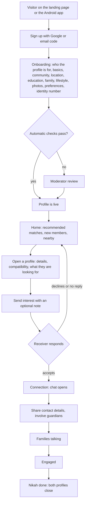

# 01. Product Overview

| | |
|---|---|
| Status | Design complete, not implemented |
| Related | [02-decisions-and-feasibility.md](02-decisions-and-feasibility.md) for why each choice was made, [03-domain-model.md](03-domain-model.md) for vocabulary |

## 1. What Khandani Rishta is

Khandani Rishta is a matrimonial platform for Pakistani families, at home and abroad. A person, or a family member acting for them, creates a profile, is shown compatible profiles of the opposite gender, sends an interest (a rishta request), and, once the other side accepts, the two can chat, involve their families and move towards nikah.

It is a marriage platform, not a dating app. Everything in the product assumes serious intent, family involvement and a need for privacy.

It runs as a web app and an Android app on one shared API (see `docs/tech-stack.md`).

## 2. Who uses it

| Persona | Situation | What they need most |
|---|---|---|
| **The candidate** (Hira, 26, Lahore, software engineer) | Looking for herself, with her parents' knowledge | Control over who sees her photos and details, relevant matches, no harassment |
| **The parent** (Mr Tariq, 58, Faisalabad) | Manages a profile for his son or daughter | A simple flow, family and caste details, a contact number for the other family, large readable screens |
| **The overseas Pakistani** (Bilal, 31, Manchester) | Looking for a match in Pakistan or in the diaspora | Location and relocation filters, residency status, trust signals on both sides |
| **The remarrying member** (Sana, 34, Karachi, divorced, one child) | Second marriage | Honest status fields, respectful filters, not being shown to people who would refuse |
| **The moderator** | Staff | Fast review queues, clear rules, an audit trail |

## 3. Product principles

1. **Family first.** Profiles may be run by a parent, sibling, relative or friend, and say so openly. Family background, home and guardian contact are first-class fields.
2. **Privacy is the member's choice.** Every sensitive item (photos, name, caste, income, family details, contact numbers, activity) has its own control, enforced on the server. Nothing is public: there are no profile pages without sign-in.
3. **Honest profiles.** Identity number at sign-up, one profile per identity document, free manual verification, clear badges, and a fast report path.
4. **Mutual fit, not volume.** A recommendation is good only if each side fits the other's preferences. Must-haves always exclude. When there is nobody left to show, the product says so and suggests which preference to relax.
5. **Respect.** No chat before an interest is accepted. Declines are quiet. Limits prevent mass messaging. Wording is modest and family-appropriate.
6. **Free and fair.** Everything is free at launch. Safety and verification are never sold. No fake counters, no invented urgency, no hidden renewals.
7. **Two clients, one behaviour.** The web app and the Android app implement the same screens and rules.

## 4. The journey

## 5. Feature map

"Launch" is the first public release. Later phases are ordered in [21-implementation-roadmap.md](21-implementation-roadmap.md).

| Area | At launch | Later | Specified in |
|---|---|---|---|
| Sign-up and sign-in | Google, email code | Phone OTP | 06 |
| Who the profile is for | Self, parent, sibling, relative, friend | Several profiles under one account; guardian co-access | 07, 02 |
| Profile | Basics, religion and sect, caste and sub-caste (optional), languages, location and origin, education, career, income, family, home, religious practice, lifestyle, hobbies, about text | Audio introduction, printable biodata sheet | 07, 08 |
| Photos | Up to 6, moderated, four visibility modes, blur, access requests | Viewer watermark | 08, 09 |
| Partner preferences | 18 dimensions, each with an importance from "must have" to "nice to have" | Preferences learned from behaviour | 07, 10 |
| Privacy | Discovery visibility, who may send interests, name display, photo visibility, per-group field visibility, private browsing, activity and read-receipt switches | Hide from specific phone contacts | 09 |
| Identity and trust | Identity number at onboarding, manual selfie check, manual identity document check, badges | OCR assistance, external verification service | 12 |
| Discovery | Recommendations with a compatibility percentage and reasons, search with filters, saved searches, new members, nearby, visitors, shortlist, "not interested" | Daily picks, alerts for saved searches by email | 10 |
| Interests | Send with a note, accept, decline quietly, withdraw, expiry, daily limits | | 11 |
| Chat | Text chat after acceptance, typing, read receipts, safety notices | Photos and voice notes, in-app calls | 11, 13 |
| Contact sharing | Explicit, per connection, own or guardian contact, revocable | | 09, 11 |
| Towards nikah | Stages confirmed by both sides (families talking, engaged, nikah done), nikah guide page | Success stories, directory of nikah services | 11 |
| Safety | Report, block, text and photo moderation, sanctions, scam warnings in chat | Behaviour ratings after a connection ends | 13 |
| Notifications | In-app feed, Android push, essential emails, weekly match digest | Web push | 14 |
| Staff | Review queues, reports, users, castes, settings, audit log | Moderator performance reports | 18 |
| Languages | English | Urdu with right-to-left layout | 20 |
| Payments | None | Optional paid extras that never touch safety or verification | 02 |

## 6. What the reference apps taught us

Findings from Dil Ka Rishta, Shaadi.com, Muzz, Simple Rishta and others, and what this product does about them.

| Observation | Our response |
|---|---|
| Three photo modes are understood by users: public, revealed on match, always blurred with requests | Four modes (`members`, `interests_and_connections`, `connections`, `approved_only`), chosen during onboarding |
| "Profile created by" is standard and trusted | `managed_by` is asked first and shown on every profile |
| Must-have versus nice-to-have preferences work well | Importance per dimension; must-haves are hard filters in both directions |
| Users complain that paid filters are ignored and random profiles appear | Must-haves always exclude; the pool-exhausted state is shown honestly with suggestions |
| Users complain about marriage bureaus and agents posing as individuals | Not allowed; a report reason and a ban reason |
| Users complain that "verification" was tied to a fee | Verification is free, forever |
| Users complain about surprise renewals, altered plans and ignored deletion requests | No payments at launch; deletion is self-service and real, with a stated 30-day grace period |
| Married men posing as single is a common harm | One profile per identity document, an "already married" report reason, and an explicit `married` status that is shown only to women who opt in |
| Pressure to move to WhatsApp, followed by money requests | Contact stays hidden until a member chooses to share it; chat shows a safety notice next to risky messages |
| Selfie checks compared with profile photos are the norm | Live selfie with a daily gesture, reviewed by a moderator |
| Screenshot blocking is expected on mobile | The Android app blocks screenshots on profile, photo and chat screens |
| A wali or chaperone option builds trust | Guardian contact can be shared at launch; guardian co-access is planned |
| Complexion and caste filters attract criticism | Complexion is an optional display field and is never a filter or a matching input. Caste is optional, privacy-controlled, and available as a preference because families ask for it (see 02) |
| Mandatory fields first, optional later reduces drop-off | Five mandatory steps, then skippable ones; progress is saved on the server |

## 7. Non-goals

- Not a dating or casual-chat product. No swiping deck, no same-gender discovery, no "nearby right now".
- No public or search-engine-indexed member profiles.
- No conducting of nikah, no legal services, no marriage registration. The nikah guide is general information only.
- No human matchmaker service and no marriage bureau accounts.
- No horoscope, zodiac or astrology matching.
- No iOS app at launch.
- No video or voice calling at launch.
- No in-app payments at launch.

## 8. How success is measured

| Measure | Definition | Why it matters |
|---|---|---|
| Onboarding completion | Profiles reaching `active` divided by sign-ups | Friction of the flow |
| Profile quality | Median `completeness`; share of active profiles with an approved photo; share with any verification | Trust in what members see |
| Interest acceptance rate | Accepted interests divided by interests sent | Quality of matching |
| Time to first connection | Median days from activation to first connection | Liquidity |
| Conversations that continue | Connections with at least 10 messages from each side | Real engagement |
| Stage progress | Connections reaching `families_talking`, `engaged`, `nikah_done` | The actual goal |
| Safety | Reports per 1,000 active members; median time to resolve a report | Health of the community |
| Balance | Ratio of active male to active female profiles; median interests received per profile by gender | Fair attention |

The SQL behind the staff dashboard version of these numbers is in 18 section 9.

## 9. Launch scope in one paragraph

A member can sign up with Google or email, complete onboarding in about five minutes, get an identity number on file, upload moderated photos with a chosen privacy mode, receive ranked and explained matches, search and save searches, send and answer interests within fair limits, chat in real time after acceptance, share contact details deliberately, move a connection through its stages, control every privacy setting, block and report, pause, close or delete the account, and get push notifications on Android. Staff can review profiles, photos, text, verification requests and reports, sanction accounts, manage castes and settings, and see an audit trail.
