# 03. Domain Model

| | |
|---|---|
| Status | Design complete, not implemented |
| Related | [04-database-schema.md](04-database-schema.md) for tables, [09-privacy-and-visibility.md](09-privacy-and-visibility.md) for who sees what |

This document defines the vocabulary, the entities and how they relate, every lifecycle (state machine), the rules that must always hold, and the numeric limits. Other documents refer to the names defined here.

## 1. Vocabulary

| Term | Meaning |
|---|---|
| User | A person with a login. Mirrors one Clerk user. Table `users`. |
| Profile | The marriage candidate's page. One per user at launch. Table `profiles`. |
| Candidate | The person the profile describes: the one who would get married. |
| Manager | The user who operates the profile. The candidate when `managed_by = 'self'`, otherwise a parent, sibling, relative or friend. |
| Member | A user whose profile is `active` or `paused`. "Other members" always means members of the opposite gender. |
| Viewer | The profile on whose behalf a request is made. |
| Owner | The profile being looked at or acted upon. |
| Interest | A rishta request from one profile to another. Sometimes shown in the UI as "Send interest" / "Rishta request". |
| Connection | The result of an accepted interest. It unlocks chat and connection-level visibility. |
| Stage | How far a connection has progressed: `chatting`, `families_talking`, `engaged`, `nikah_done`. |
| Shortlist | A private bookmark of a profile. |
| Pass | "Not interested": hides a profile from the viewer's lists for 180 days. |
| Block | Makes two profiles invisible to each other everywhere. |
| Photo access | Per-viewer permission to see an owner's unblurred photos. |
| Contact share | An owner's explicit decision to reveal phone, WhatsApp, email or guardian contact to one connection. |
| Guardian | A family member whose contact can be shared in place of, or alongside, the candidate's own (wali, parent, brother). |
| Must-have | A partner preference with importance `must`. It is a hard filter (dealbreaker). |
| Compatibility (`compat`) | A whole number from 0 to 100 shown as "N% match". Defined in [10-matching-and-discovery.md](10-matching-and-discovery.md). |
| Moderator / Admin | Staff users with `users.role` of `moderator` or `admin`. |
| Gate | The single value returned by `GET /v1/me` that tells a client which area of the app the user may enter. |

## 2. Entities and relationships

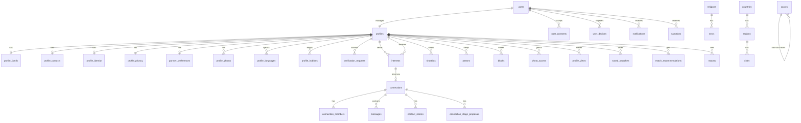

Two layers are kept strictly apart:

- **Account layer** (`users`): identity, role, account status, consents, devices, notification settings. Keyed by `user_id`.
- **Candidate layer** (`profiles` and everything attached): what other members see and interact with. Keyed by `profile_id`.

The API resolves the "current profile" from the authenticated user. Interaction tables never store a `user_id`.

## 3. Actors

| Actor | How identified | What they can do |
|---|---|---|
| Visitor | No session | Public pages only (landing, safety, legal, download). |
| Signed-in user without a finished profile | Clerk session, `profiles.status = 'draft'` | Onboarding only. |
| Member | Clerk session, profile `active` or `paused` | The product. |
| Moderator | `users.role = 'moderator'` | Member abilities plus the review queues and reports in the admin console. |
| Admin | `users.role = 'admin'` | Moderator abilities plus bans, role changes, reference data, settings and releases. |
| System | Background jobs | Expiry, cleanup, notifications, matching refresh. |

Staff roles are set directly in the database for the first admin (see 18 section 2) and by an admin afterwards. A staff user may also have an ordinary profile.

## 4. Lifecycles

Every status column in the schema follows one of the state machines below. A transition that is not listed is not allowed; the API returns `409 invalid_state`.

### 4.1 User account (`users.status`)

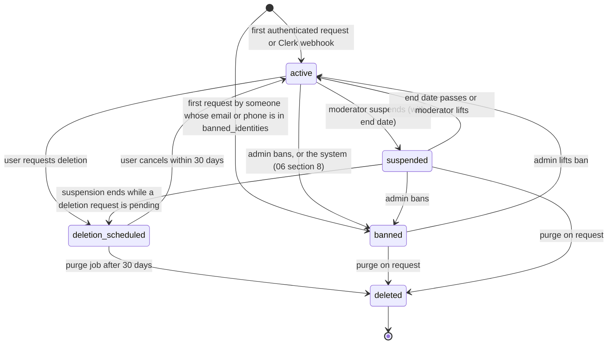

| Status | Effect |
|---|---|
| `active` | Normal. |
| `suspended` | Cannot use the product until `suspended_until`. Profile is hidden. Sees the "Account suspended" screen with the reason and end date. Like a banned user, a suspended user may ask for their data to be deleted: the status stays `suspended` and only `purge_after` is set, so cancelling the deletion never lifts the suspension (06 section 9). |
| `banned` | Permanent. Profile is hidden and connections are ended. The API refuses the user on every request, and the user's Clerk sessions are revoked (06 section 8). Identity document, phone and email hashes go into `banned_identities`. A banned user may still ask for their data to be deleted: the status stays `banned` and only `purge_after` is set (06 section 9). |
| `deletion_scheduled` | Profile is hidden immediately. Signing in shows "Your account will be deleted on DATE" with a "Keep my account" button. |
| `deleted` | Tombstone row. PII is gone (04 section 12). |

### 4.2 Profile (`profiles.status`)

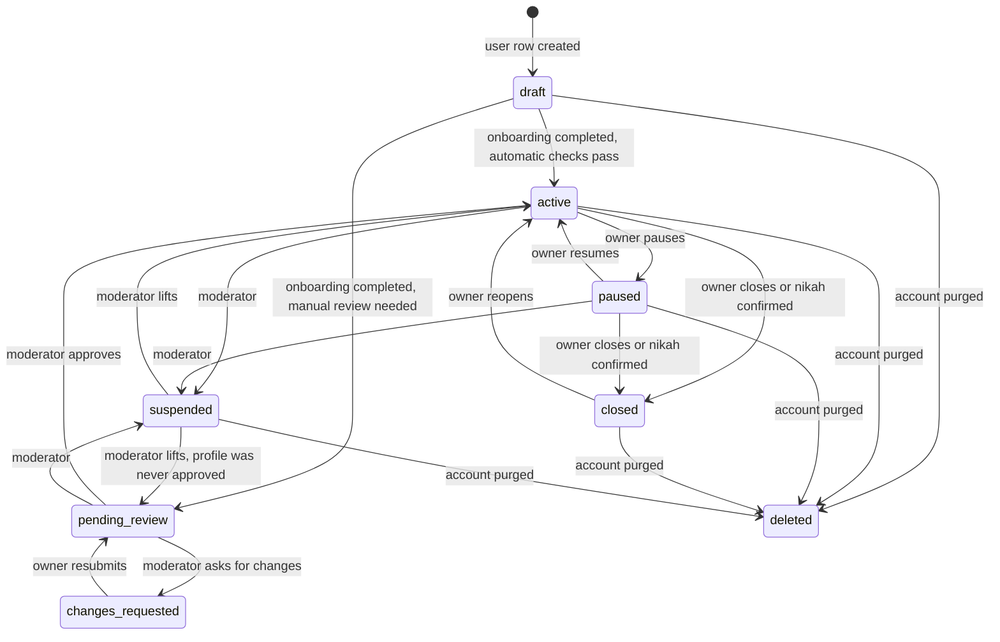

| Status | Visible to other members | Meaning |
|---|---|---|
| `draft` | No | Onboarding not finished. |
| `pending_review` | No | Waiting for a moderator. Only happens when `moderation.profile_review` is `manual` or an automatic check flagged the profile. |
| `changes_requested` | No | A moderator rejected the profile. `status_reason` tells the owner what to fix. |
| `active` | Yes | Live. |
| `paused` | Only to existing connections and to members with a pending interest in either direction | Owner is taking a break. Pending interests are kept and can still be answered. |
| `closed` | Only to existing connections, read-only | Owner found a match or stopped searching. |
| `suspended` | No | Hidden by a moderator. Always goes together with `users.status = 'suspended'` or `'banned'`. |
| `deleted` | No | Tombstone. |

Rules:

- Entering `active` for the first time sets `first_activated_at`. This timestamp drives the "New" badge (first 7 days).
- Entering `paused` sets `paused_at`. Entering `closed` sets `closed_at` and `closed_reason`.
- Leaving `active` for `closed`, `suspended` or `deleted` sets every `pending` interest sent or received by the profile to `expired`. Leaving for `paused` keeps them.
- Reopening a `closed` profile whose connection reached `nikah_done` requires the owner to type a confirmation, and ends that connection with reason `other`.
- Editing an `active` profile never moves it back to review. Only the changed free text is held (4.5) and changed photos are reviewed (4.4).

### 4.3 Onboarding (`profiles.onboarding_step`)

`onboarding_step` is the first step the owner has not yet completed. Steps are completed in order with `POST /v1/me/onboarding/continue`. The owner may go back and edit earlier steps at any time; that never moves the pointer backwards.

```mermaid
stateDiagram-v2
    direction LR
    [*] --> account_for
    account_for --> basics
    basics --> community
    community --> location
    location --> education_career
    education_career --> family
    family --> lifestyle
    lifestyle --> photos
    photos --> preferences
    preferences --> identity
    identity --> review
    review --> done: POST /v1/me/onboarding/complete
    done --> [*]
```

| Step | Can be skipped | Requirement checked by `continue` |
|---|---|---|
| `account_for` | No | `managed_by` set, required consents recorded |
| `basics` | No | All required basics fields set, candidate is 18 or older |
| `community` | No | `religion_code` and `mother_tongue_code` set; `sect_code` set when the religion has sects |
| `location` | No | `country_code` and a city set |
| `education_career` | No | `education_level_code` and `employment_type` set |
| `family` | Yes | None |
| `lifestyle` | Yes | None |
| `photos` | Yes, unless `onboarding.photo_required` is true | At least one photo not `rejected` or `failed`, when required |
| `preferences` | No | `partner_preferences` row exists. The form is prefilled with the defaults of 07 section 12 and the row is created by the first `PUT /v1/me/preferences`. |
| `identity` | Yes, unless `onboarding.identity_required` is true | `profile_identity` row exists, when required |
| `review` | No | Completed by `POST /v1/me/onboarding/complete`, which re-validates everything |

The table gives the unconditional requirement of each step. Conditional requirements (for example `manager_name` when the profile is not managed by the candidate, `region_id` with a typed city, `residency_status` when living abroad, `current_wives_count` with `married`) are listed per step in [07-onboarding.md](07-onboarding.md), and `continue` checks those as well.

### 4.4 Photo (`profile_photos.status`)

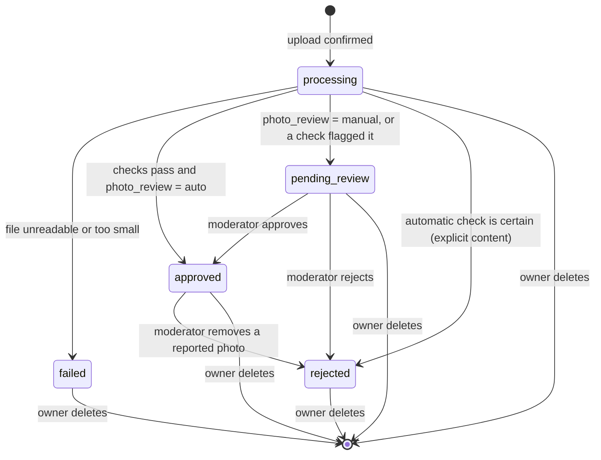

- Only `approved` photos are shown to other members. The owner sees all of their own photos with a status label.
- When the first photo becomes `approved` it becomes primary automatically.
- When the primary photo is deleted, the approved photo with the lowest `position` becomes primary.
- Changing which photo is primary clears `profiles.is_photo_verified` (see 12 section 4).

### 4.5 Moderated text (`about_me_status`, `about_family_status`, `notes_status`)

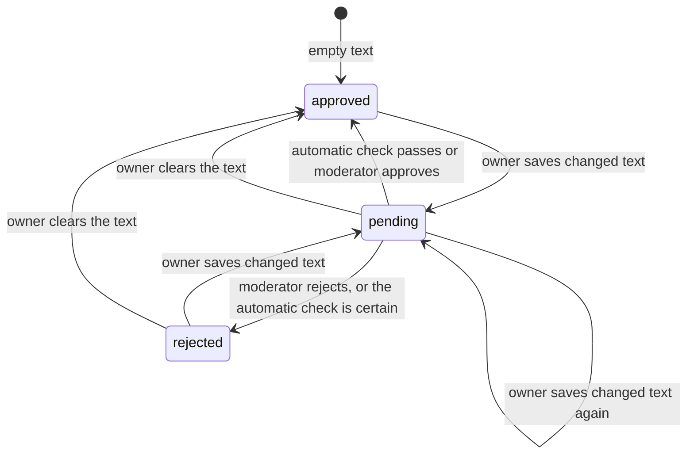

- While `pending` or `rejected`, other members do not see the text. The owner sees it with an "Under review" or "Not approved" label.
- Text that contains a phone number, email address, link or social handle never reaches `pending`: the save itself fails with a validation error (see 13 section 3).

### 4.6 Verification (`verification_requests.status`, `profile_identity.status`)

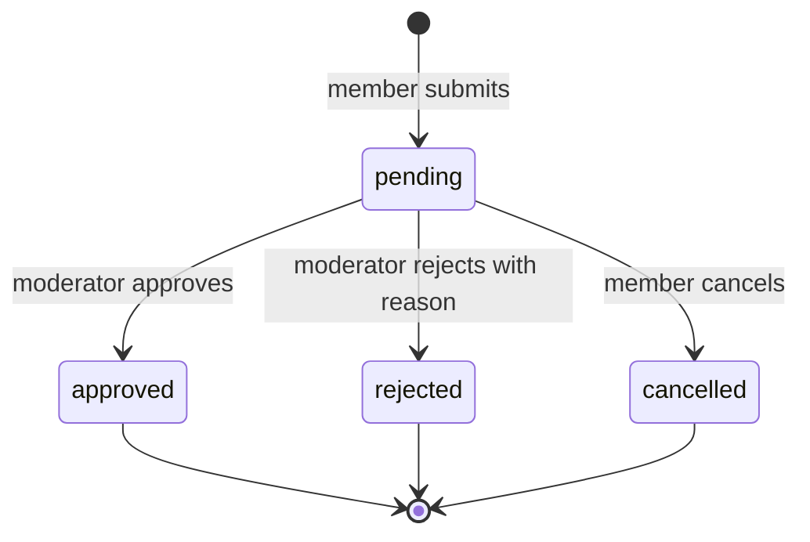

Effects:

| Request kind | On `pending` | On `approved` | On `rejected` | On `cancelled` |
|---|---|---|---|---|
| `id_document` | `profile_identity.status = 'pending'` | `profile_identity.status = 'verified'`, `profiles.is_id_verified = true` | `profile_identity.status = 'rejected'` | `profile_identity.status = 'unverified'` |
| `selfie` | Nothing | `profiles.is_photo_verified = true` | Nothing | Nothing |

Saving a different identity number while the status is `rejected` sets it back to `unverified` (12 section 3).

A member may submit again after a rejection. At most one `pending` request per kind (unique index).

### 4.7 Interest (`interests.status`)

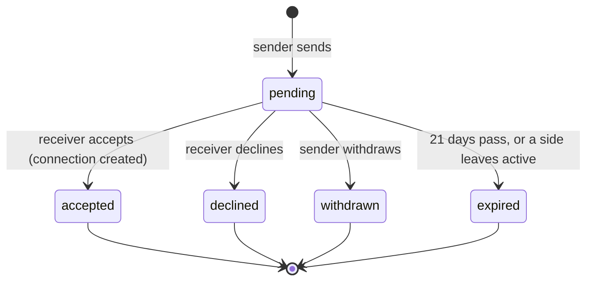

Rules:

- **Mutual interest:** if A sends an interest to B while B already has a `pending` interest to A, no new row is created. B's interest is accepted on A's behalf and the connection is created.
- **Decline is quiet:** the sender is not notified. The sender's "Sent" list shows the interest as "No response" until it would have expired, then as "Closed". The sender never sees the word "declined".
- **Cooldown before sending again to the same profile:** 90 days after `declined`, 30 days after `expired`, 7 days after `withdrawn`. The cooldown binds only the member who sent the interest. It counts from `responded_at` for `declined` and `withdrawn`, and from `expires_at` for `expired`. When an interest is expired early because a profile left `active`, `expires_at` is set to that moment.
- A block between the pair sets a `pending` interest to `withdrawn` (if the blocker sent it) or `declined` (if the blocker received it).
- Accepting, declining or withdrawing sets `responded_at`.

### 4.8 Connection (`connections.status`, `connections.stage`)

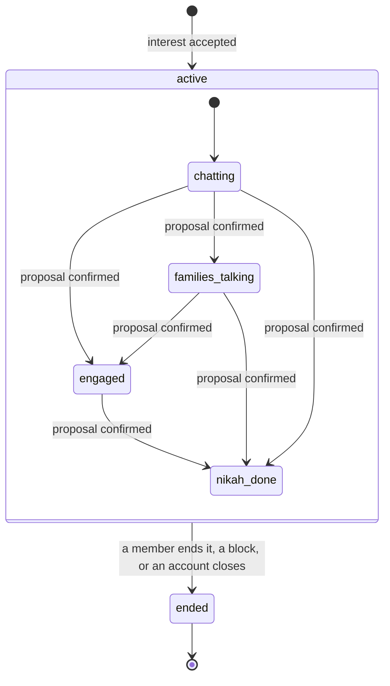

Rules:

- A stage only moves forward, and only when one member proposes it and the other confirms (`connection_stage_proposals`). One `pending` proposal per connection.
- Reaching `engaged` prompts both members to pause their profiles (a suggestion, not automatic).
- Reaching `nikah_done` closes both profiles automatically with `closed_reason = 'found_match_here'`. The connection stays `active` so the couple can still read their chat; it is read-only from then on, because closed profiles cannot send messages (section 5). Each member's other active connections are ended with `ended_reason = 'found_someone_else'`.
- Ending a connection revokes both contact shares and both photo access grants between the pair, and posts a `connection_ended` system message. The chat becomes read-only for both and disappears from the default chat list (it stays under "Ended").
- After a connection ends, either member may send a new interest only after 90 days.
- An `ended` connection never becomes `active` again. A new accepted interest creates a new connection row.

### 4.9 Photo access (`photo_access.status`)

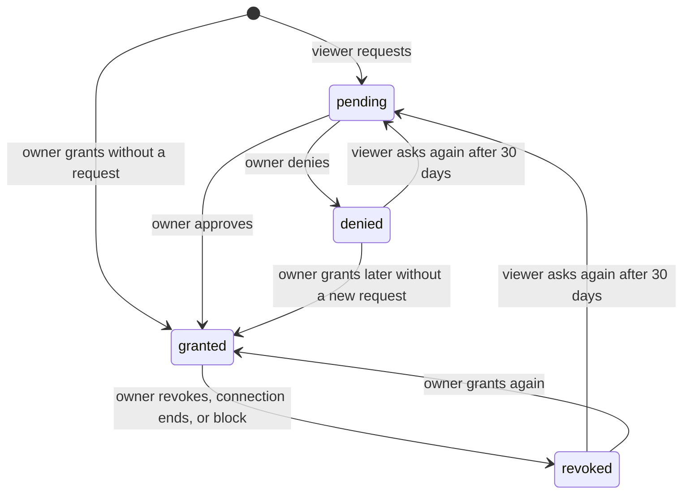

A request is only possible when the owner's `allow_photo_requests` is true and the viewer cannot already see the photos.

### 4.10 Contact share (`contact_shares.status`)

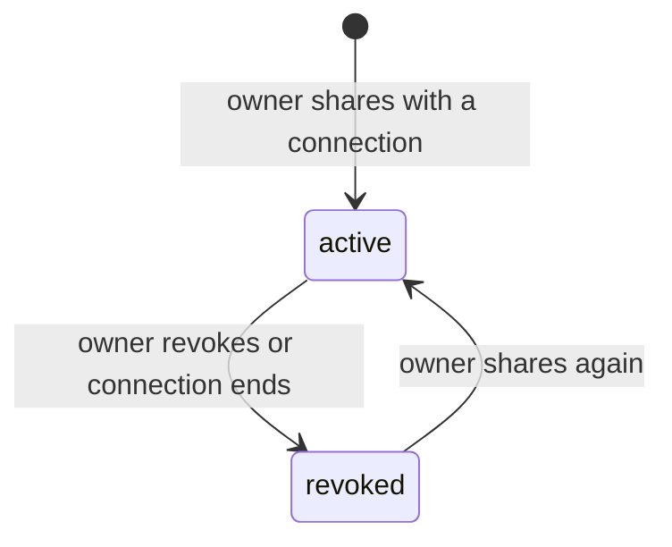

Revoking hides the details from then on. The UI tells the owner plainly that the other member may already have saved them.

### 4.11 Report (`reports.status`)

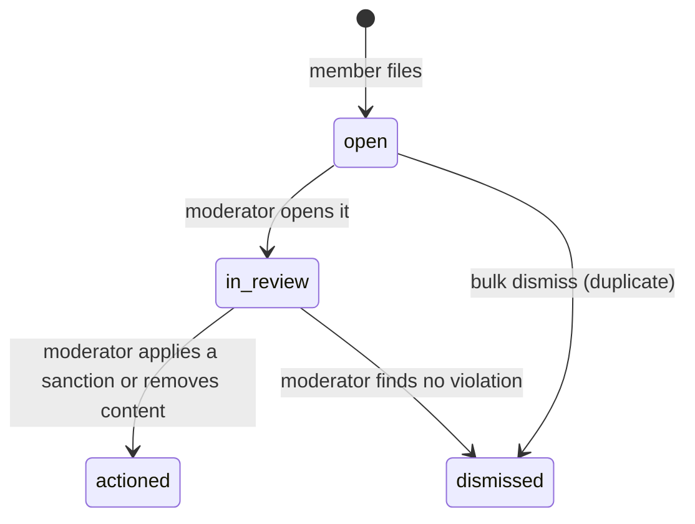

Filing a report never changes anything for the reported member by itself. The reporter is offered a block in the same dialog.

## 5. What each profile status may do

Checked by the API on every request. A request that fails the check gets `403` with the error code shown in the last column of section 5.1.

| Capability | `draft` | `pending_review` | `changes_requested` | `active` | `paused` | `closed` | `suspended` |
|---|---|---|---|---|---|---|---|
| Edit own profile, photos, preferences, privacy, contacts | Yes | Yes | Yes | Yes | Yes | Yes | No |
| Submit verification | Yes | Yes | Yes | Yes | Yes | No | No |
| Home, recommendations, search, open any eligible profile | No | No | No | Yes | No | No | No |
| Open the profile of a connection or of an interest counterpart | No | No | No | Yes | Yes | Yes | No |
| Send interest, shortlist, pass, request photos | No | No | No | Yes | No | No | No |
| Accept or decline a received interest | No | No | No | Yes | Yes | No | No |
| Read existing chats | No | No | No | Yes | Yes | Yes | No |
| Send messages, share contact, propose a stage | No | No | No | Yes | Yes | No | No |
| End a connection, block, report | No | No | No | Yes | Yes | Yes | No |
| Pause, resume, close, reopen | No | No | No | Yes | Yes | Yes | No |
| Notifications, settings, delete account | Yes | Yes | Yes | Yes | Yes | Yes | Delete only |

### 5.1 Gate

`GET /v1/me` returns one `gate` value. Clients route on it and nothing else. Evaluate the rows top to bottom and return the first that matches.

| Order | Condition | `gate` | Client goes to | API error for product routes |
|---|---|---|---|---|
| 1 | `users.status = 'banned'` | `banned` | Account blocked screen | `account_banned` |
| 2 | `users.status = 'suspended'` | `suspended` | Account blocked screen | `account_suspended` |
| 3 | `users.status = 'deletion_scheduled'` | `deletion_scheduled` | Deletion pending screen | `account_deletion_scheduled` |
| 4 | Current legal document versions not all accepted, and `profiles.status <> 'draft'` | `consent_required` | Updated terms screen | `consent_required` |
| 5 | `profiles.status = 'draft'` | `onboarding` | Onboarding at `onboarding_step` | `onboarding_required` |
| 6 | `profiles.status = 'changes_requested'` | `changes_requested` | Fix-your-profile screen | `profile_not_active` |
| 7 | `profiles.status = 'pending_review'` | `pending_review` | Under-review screen | `profile_not_active` |
| 8 | Otherwise (`active`, `paused`, `closed`) | `ok` | The app | Per capability: `profile_not_active` |

## 6. Derived values

These are computed by the API, never stored (except where noted).

| Value | Definition |
|---|---|
| Age | Whole years between `date_of_birth` and today in `Asia/Karachi`. |
| Relation tier | The relationship of a viewer to an owner. Exactly one of: `self`; `connection` (an `active` connection exists); `interest_from_owner` (the owner has a `pending` interest to the viewer); `interest_to_owner` (the viewer has a `pending` interest to the owner); `member` (none of these). Evaluate in this order. If either has blocked the other, the owner does not exist for the viewer (`404`). |
| Display name | Depends on the owner's `name_display` and the tier. Rules in 09 section 4. |
| Is new | `first_activated_at` is within the last 7 days. |
| Is online | The profile has an open WebSocket, or `last_active_at` is within the last 5 minutes. Shown only if the owner's `show_online_status` is true. |
| Last active label | One of `online`, `today`, `this_week`, `this_month`, `earlier`. Never an exact time. Shown only if `show_last_active` is true. |
| Badges | `phone_verified` (`profiles.is_phone_verified`), `photo_verified` (`is_photo_verified`), `id_verified` (`is_id_verified`), `new` (is new). |
| Completeness | Stored in `profiles.completeness`. Formula in 08 section 6. |
| Unread chats | The number of the profile's `active`, unmuted connections whose `connection_members.unread_count` is greater than 0. This is `Me.counters.unread_chats`. |

## 7. Limits and settings

All numbers that product rules depend on live in the `app_settings` table so an admin can change them without a deploy. The API reads them through a cached accessor (refresh every 60 seconds) and falls back to the default below when a key is missing. Seed the table with these defaults.

| Key | Default | Meaning |
|---|---|---|
| `limits.interests_per_day` | `10` | Interests a profile may send per day (day boundary in `Asia/Karachi`). |
| `limits.interests_per_day_verified` | `20` | Same, for profiles with `is_id_verified` or `is_photo_verified`. |
| `limits.pending_interests_max` | `50` | Maximum `pending` sent interests at one time. |
| `limits.profile_views_per_day` | `150` | Distinct profiles a member may open per day. |
| `limits.photo_requests_per_day` | `10` | Photo access requests per day. |
| `limits.messages_per_minute` | `20` | Chat messages per sender per minute. |
| `limits.messages_per_day` | `500` | Chat messages per sender per day. |
| `limits.reports_per_day` | `10` | Reports per reporter per day. |
| `limits.photos_max` | `6` | Photos per profile. |
| `limits.saved_searches_max` | `10` | Saved searches per profile. |
| `limits.active_connections_max` | `30` | Active connections per profile. Accepting or sending beyond this is refused. |
| `interest.expiry_days` | `21` | Days until a `pending` interest expires. |
| `interest.cooldown_after_decline_days` | `90` | Wait before sending again after a decline. |
| `interest.cooldown_after_expiry_days` | `30` | Wait after expiry. |
| `interest.cooldown_after_withdraw_days` | `7` | Wait after the sender withdrew. |
| `connection.cooldown_after_end_days` | `90` | Wait before a new interest after a connection ended. |
| `pass.duration_days` | `180` | How long a pass hides a profile. |
| `photo_access.retry_days` | `30` | Wait before asking again after denial or revocation. |
| `moderation.profile_review` | `"auto"` | `"auto"` or `"manual"`. |
| `moderation.photo_review` | `"manual"` | `"auto"` or `"manual"`. Manual at launch while volume is low. |
| `moderation.text_review` | `"auto"` | `"auto"` or `"manual"`. |
| `onboarding.identity_required` | `true` | Whether the identity number step can be skipped. |
| `onboarding.photo_required` | `false` | Whether at least one photo is needed to finish onboarding. |
| `matching.candidate_pool_size` | `600` | Candidates fetched from SQL per refresh. |
| `matching.recommendations_size` | `200` | Rows kept in `match_recommendations` per profile. |
| `matching.refresh_hours` | `24` | Age after which recommendations are recomputed on next request. |
| `account.deletion_grace_days` | `30` | Days between a deletion request and the purge. |
| `verification.media_retention_days` | `30` | Days verification images are kept after a decision. |
| `legal.terms_version` | `"2026-11-20"` | Current Terms of Use version. |
| `legal.privacy_version` | `"2026-11-20"` | Current Privacy Policy version. |
| `legal.guidelines_version` | `"2026-11-20"` | Current Community Guidelines version. |
| `support.email` | `"support@khandanirishta.app"` | Shown on blocked screens and in emails. |
| `announcement.banner` | `null` | Optional object `{ "text_en": "...", "text_ur": "...", "url": "..." }` shown at the top of the home screen. |

Fixed limits that are part of validation and are not settings: text lengths (schema `CHECK`s), 6 additional languages, 10 hobbies, 200 shortlist entries, preference array sizes (04 section 5.6), photo file rules (08 section 5).

## 8. Invariants

Rules that must hold at all times. Each should have at least one automated test.

1. **Opposite gender only.** A member can only see, search, contact or be shown profiles of the other gender. Staff routes are exempt.
2. **Adults only.** No profile leaves `draft` unless the candidate is 18 or older.
3. **Blocks are absolute.** If either profile has blocked the other, each is absent from every list, search, recommendation, profile fetch, interest and notification for the other. Fetching returns `404`, the same as a profile that does not exist.
4. **Contact details stay private.** Columns of `profile_contacts` and `users.email` / `users.phone_e164` appear in a response to another member only through an `active` contact share.
5. **Identity numbers never leave.** No API response, log line or error report contains an identity document number. Moderators see the decrypted number only on the verification review screen, and that access is written to the audit log.
6. **Privacy is enforced on the server.** A field the viewer may not see is absent from the response (null plus an entry in `locked`). Clients never receive data in order to hide it.
7. **Photos are private objects.** Photo bytes are only reachable through short-lived signed URLs. A viewer who may not see a photo receives the URL of the blurred variant, which is a separate, irreversibly blurred file.
8. **One open relationship per pair.** At most one `pending` interest per ordered pair, at most one `active` connection per pair, and no `pending` interest between a pair that has an `active` connection.
9. **Chat needs a connection.** A message can only be created in an `active` connection by one of its two members.
10. **Second marriages are opt-in.** A profile with `marital_status = 'married'` is shown only to viewers whose `partner_preferences.marital_statuses` contains `married`.
11. **Must-haves exclude.** A candidate who fails one of the viewer's must-have preferences never appears in the viewer's recommendations.
12. **One profile per identity document.** `profile_identity.number_hash` is unique, and a number present in `banned_identities` cannot be registered.
13. **Every staff action is recorded.** Any state change made through an admin route writes one `admin_audit_log` row in the same transaction.
14. **Counters agree with data.** `connection_members.unread_count` equals the number of messages in the connection from the other member with an id greater than `last_read_message_id`.
15. **Locked facts.** `gender` and `date_of_birth` cannot be changed by the owner after onboarding is completed. `first_name` and `last_name` cannot be changed after `is_id_verified` becomes true. Changes go through support (an admin action).
