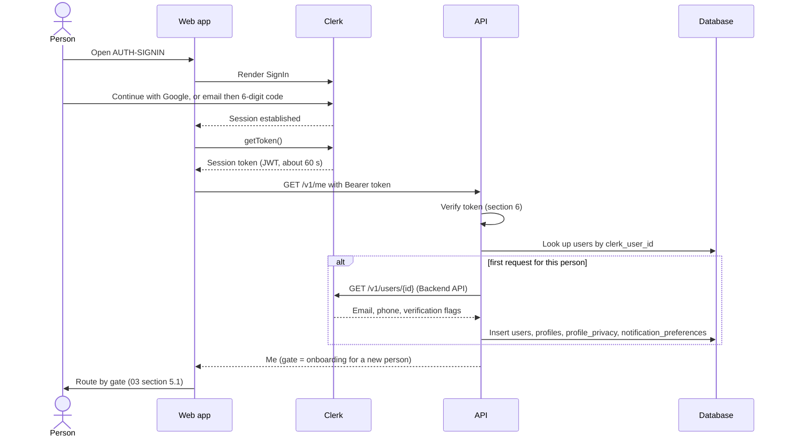
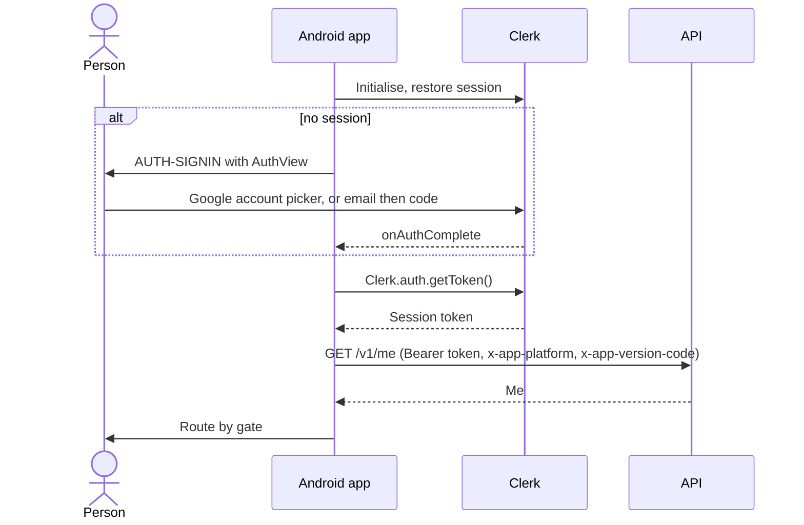

# 06. Authentication and Accounts

| | |
|---|---|
| Status | Design complete, not implemented |
| Related | [03-domain-model.md](03-domain-model.md) sections 4.1 and 5.1, [04-database-schema.md](04-database-schema.md) sections 4 and 12, [15-api-contract.md](15-api-contract.md) sections 3 and 6, [17-web-app.md](17-web-app.md), [22-android-app.md](22-android-app.md), `docs/tech-stack.md` section 10 |

This document covers how a person signs in, how the API recognises them, how account state is kept, and how accounts are suspended, banned and deleted.

## 1. Principles

1. **Clerk owns identity and sessions.** Sign-up, sign-in, email verification, Google sign-in, session cookies and tokens are Clerk's job. The clients use Clerk's prebuilt components. The project writes no login forms.
2. **The API database owns everything else.** Account status, role, the profile, consents and the gate live in PostgreSQL. Clerk holds no product data. Clerk `publicMetadata`, `privateMetadata` and `unsafeMetadata` are not used.
3. **The API is the authority for what a user may do.** A valid Clerk token proves who the caller is and nothing more. Whether the caller is banned, suspended, onboarded or active is decided by the API on every request from its own database.
4. **One routing signal.** Clients decide where to send the user from `Me.gate` returned by `GET /v1/me` (03 section 5.1) and from nothing else.
5. **No dependence on webhook timing.** The API creates its user row on the first authenticated request. Webhooks only keep that row in sync afterwards.
6. **The design must work on Clerk's free plan.** The project has the Pro plan through the Student Pack for now, but nothing here depends on a paid feature (section 2.3).

## 2. Clerk configuration

There are two Clerk instances: **Development** (used by local machines and by staging) and **Production**. Apply the checklist to both unless a column says otherwise.

### 2.1 Checklist

| Area | Setting | Development | Production |
|---|---|---|---|
| Email | Email address as an identifier | On, required | On, required |
| Email | Verify at sign-up | On, by email verification code | Same |
| Email | Sign in with email verification code | On | On |
| Email | Email verification link | Off | Off |
| Password | Password | Off | Off |
| Phone | Phone number | Off | Off at launch (section 11) |
| Username | Username | Off | Off |
| Name | First and last name fields | Off (names are collected in onboarding and belong to the candidate) | Off |
| Social | Google | On, Clerk's shared development credentials | On, with custom credentials (section 4.3) |
| Social | Any other provider | Off | Off |
| Passkeys, MFA | All | Off | Off |
| Restrictions | Sign-up mode | Public | Public |
| Restrictions | Block disposable email addresses | On | On |
| Restrictions | Block email subaddresses | On | On |
| Attack protection | Bot sign-up protection | On (default) | On (default) |
| Attack protection | Account lockout | Default (10 failed attempts, 1 hour) | Default |
| User model | Allow users to delete their accounts | Off | Off |
| User model | Allow users to change their email address | On | On |
| Legal | Require express consent to legal documents | Off (the onboarding step records consents, 07 section 3) | Off |
| Sessions | Maximum lifetime | Default (7 days) | Default (7 days) |
| Sessions | Inactivity timeout | Off | Off |
| Sessions | Multi-session | Off | Off |
| Sessions | Customise session token | No custom claims | No custom claims |
| Sessions | Session token version | 2 | 2 |
| Native applications | Native API | On | On |
| Native applications | Android app | Package `com.khandanirishta.app` with the debug SHA-256 fingerprint | Same package with the release SHA-256 fingerprint |
| Webhooks | Endpoint | The `cloudflared` quick tunnel URL of the developer plus `https://api-staging.<domain>/webhooks/clerk` | `https://api.<domain>/webhooks/clerk` |
| Webhooks | Subscribed events | `user.created`, `user.updated`, `user.deleted` | Same |
| Domains | Frontend API, Account Portal and email DNS records | Not needed | The records Clerk lists, added in Cloudflare |
| Paths | Sign-in URL, sign-up URL, redirect after sign-in | The routes defined in 17 | Same |

After creating each webhook endpoint, copy its signing secret into `CLERK_WEBHOOK_SECRET` of the matching environment. A developer's quick tunnel and staging are separate endpoints with separate secrets.

### 2.2 Why these choices

| Choice | Reason |
|---|---|
| Google plus email code, no passwords | Nearly every Android user in Pakistan has a Google account. Email codes need no password to forget or leak. Fewer support requests. |
| Clerk's self-delete off | Deletion must go through the API so the 30-day grace period and the data purge happen (section 9). |
| Clerk's consent checkbox off | Consents are recorded with document versions in `user_consents` during onboarding. A second checkbox would only add friction. |
| Names off in Clerk | The account holder may be a parent. The names that matter are the candidate's and are collected in onboarding. |
| No custom claims | The API reads everything it needs from its own database, so the token stays small and nothing can go stale. |

### 2.3 Paid features that are not relied on

| Clerk feature | Plan needed | What the design does instead |
|---|---|---|
| SMS codes (phone sign-in) | Pro, plus per-SMS fees, plus Pakistan enabled by hand | Not used at launch (section 11) |
| User bans through Clerk | Pro | The API refuses banned users itself and revokes their sessions (section 8). The Clerk ban call is optional behind `CLERK_BAN_ENABLED`. |
| Custom session duration | Pro | The default 7-day lifetime is accepted (section 10) |
| MFA, passkeys | Pro | Not offered |
| Allowlist and blocklist | Pro | `banned_identities` in the API database |
| Custom email templates | Pro | Clerk's default verification email is accepted |

## 3. Web: sign-up and sign-in

### 3.1 Pieces

| Piece | What | Where |
|---|---|---|
| Package | `@clerk/tanstack-react-start` | `apps/web` |
| Provider | `<ClerkProvider>` wrapping the app | `src/routes/__root.tsx` |
| Request middleware | `clerkMiddleware()` from `@clerk/tanstack-react-start/server` | `src/start.ts`. Follow Clerk's TanStack Start quickstart exactly, including the CSRF middleware it asks for. |
| Sign-in screen | `<SignIn />` (the combined sign-in-or-sign-up component) | `AUTH-SIGNIN` |
| Conditional rendering | `<Show when="signed-in">` and `<Show when="signed-out">` | Public header and landing page |
| Token for API calls | `useAuth().getToken()` | The API client middleware (3.3) |
| Sign out | `useClerk().signOut()` | `SET-ACCOUNT` and the account menu |
| Manage sign-in methods | `<UserProfile />` | Opened from `SET-ACCOUNT` (section 12) |

There is no separate sign-up screen. `<SignIn />` creates the account when the email or Google account is new. Buttons labelled "Create profile" and "Sign in" both lead to `AUTH-SIGNIN`.

### 3.2 Flow



Rules:

1. After Clerk reports a session, the web app always calls `GET /v1/me` before showing anything behind sign-in. While it is loading, show the app shell with a spinner.
2. The app routes by `Me.gate`: `onboarding` goes to the step named by `profile.onboarding_step`; `ok` goes to `APP-HOME`; the other gates go to the matching `GATE-*` screen.
3. A signed-in person who opens `AUTH-SIGNIN` or `PUB-HOME` is sent on by the same rule.
4. A signed-out person who opens a screen behind sign-in is sent to `AUTH-SIGNIN`, and returned to the screen they asked for after signing in (only if the gate is `ok`; otherwise the gate wins).
5. Route paths, the redirect parameter and the layout guards are defined in 17.

### 3.3 API client

One `openapi-fetch` client is used for every call. Its middleware:

```text
onRequest:
    token = await getToken()                 // Clerk caches and refreshes it
    if token is null: sign out locally and go to AUTH-SIGNIN
    set header Authorization: Bearer <token>

onResponse:
    if status is 401 and this request has not been retried:
        token = await getToken({ skipCache: true })
        retry the request once with the new token
    if status is still 401:
        signOut(), go to AUTH-SIGNIN
    if status is 403 and error.code is a gate code
       (account_banned, account_suspended, account_deletion_scheduled,
        consent_required, onboarding_required, profile_not_active):
        refetch GET /v1/me and route by the new gate
```

The token is never stored by the app. It is fetched from Clerk for every request (Clerk returns its cached copy until shortly before expiry).

### 3.4 Server-rendered pages

Public pages are rendered on the Worker. They need no user data. The only server-side use of Clerk is `auth()` from `@clerk/tanstack-react-start/server` to learn whether a visitor is signed in, so that `PUB-HOME` can redirect signed-in visitors into the app without a flash. Screens behind sign-in render in the browser and are protected by the API, not by the Worker.

## 4. Android: sign-up and sign-in

### 4.1 Pieces

| Piece | What |
|---|---|
| Artifact | `com.clerk:clerk-android-ui` (includes `clerk-android-api`), already in the version catalogue |
| Initialisation | Initialise Clerk with the publishable key in `KhandaniApplication.onCreate()`. The root composable waits for `Clerk.isInitialized` before deciding what to show. |
| Sign-in screen | The `AuthView` composable on `AUTH-SIGNIN`. It decides between sign-in and sign-up by itself and offers the methods enabled in the dashboard. |
| Token for API calls | `Clerk.auth.getToken()` inside an OkHttp interceptor (4.2) |
| Sign out | `Clerk.auth.signOut()` |
| Manage sign-in methods | `UserProfileView`, opened from `SET-ACCOUNT` |
| Account deletion | Never through `UserProfileView`. The delete row does not appear because self-delete is off in the dashboard. Deletion is the app's own flow (section 9). |

Exact class and function names follow the Clerk Android SDK version pinned in `gradle/libs.versions.toml`. Check them against that version's quickstart before coding; the names above are those of version 1.4.

### 4.2 Flow



The OkHttp interceptor:

```text
intercept(chain):
    token = runBlocking { Clerk.auth.getToken() }        // cached by the SDK
    if token is missing: proceed without the header (the API answers 401)
    request = chain.request() with headers
        Authorization: Bearer <token>
        x-app-platform: android
        x-app-version-code: <BuildConfig.VERSION_CODE>
    response = chain.proceed(request)
    if response.code is 401 and not yet retried:
        token = runBlocking { Clerk.auth.getToken(GetTokenOptions(skipCache = true)) }
        retry once
    return response
```

A second 401 emits a "signed out" event that the root composable turns into `Clerk.auth.signOut()` and navigation to `AUTH-SIGNIN`. A 403 with a gate code triggers a refetch of `GET /v1/me`, as on the web. A 426 shows `GATE-UPGRADE`.

### 4.3 Google sign-in setup

Native Google sign-in needs the project's own Google credentials, in development too (Clerk's shared credentials work only for the web flow).

| Step | Where | What |
|---|---|---|
| 1 | Google Cloud console | Create an OAuth client of type **Web application**. Add the Authorised Redirect URI that Clerk shows for the Google connection. |
| 2 | Google Cloud console | Create an OAuth client of type **Android** with package `com.khandanirishta.app` and the **SHA-1** fingerprint of the signing certificate. One client per certificate: debug, release, and later the Play App Signing key. |
| 3 | Clerk dashboard, Google connection | Turn on "Use custom credentials" and paste the **Web** client's id and secret. |
| 4 | Clerk dashboard, Native applications | Register the Android app with its package name and the **SHA-256** fingerprints (debug and release). |
| 5 | Google Cloud console | Configure the OAuth consent screen with the app name, support email and the domain. |

Remember the split: Google Cloud wants SHA-1, Clerk wants SHA-256. Do this once per Clerk instance, with separate Google clients for Development and Production.

### 4.4 Native sign-up is not challenged

Clerk's bot challenge does not run for native apps. Compensating controls: disposable-email and subaddress blocking (dashboard), the `Unauthenticated` and `Writes` rate limits (15 section 3.1), one profile per identity document, and manual photo review at launch.

## 5. User provisioning

The API creates its rows for a Clerk user the first time that user makes any authenticated request. In practice this is `GET /v1/me`, but the logic lives in the authentication layer and runs for whichever request comes first.

### 5.1 Algorithm

```text
resolve_account(claims) -> AccountSnapshot

1. key = claims.sub                                   // Clerk user id
2. If the snapshot cache has key: return it.          // section 6.3
3. SELECT the users row WHERE clerk_user_id = key, with its profile.
4. If found: build the snapshot, cache it, return it.
5. Not found: provision.
   a. clerk_user = GET {CLERK_API_BASE_URL}/users/{key}
        Authorization: Bearer CLERK_SECRET_KEY
        timeout 5 s, one retry
        on failure: answer 503 service_unavailable (do not create a half-filled row)
   b. Extract email, email_verified, phone_e164, phone_verified (section 7.4).
   c. banned = banned_identities contains ('email', hash(email))
               OR ('phone', hash(phone_e164))         // 13 section 9
   d. In one transaction:
        INSERT INTO users (id, clerk_user_id, email, email_verified, phone_e164, phone_verified,
                           status, status_reason)
            VALUES (new uuid v7, key, ..., 'banned' if banned else 'active',
                    'This account cannot be used.' if banned else NULL)
            ON CONFLICT (clerk_user_id) DO NOTHING
            RETURNING id;
        If no row was returned: another request won the race. ROLLBACK and go to step 3.
        INSERT INTO profiles (id, user_id, public_code, is_phone_verified)
            VALUES (new uuid v7, user id, generated code, phone_verified);
        INSERT INTO profile_privacy (profile_id) VALUES (profile id);
        INSERT INTO notification_preferences (user_id) VALUES (user id);
      COMMIT.
   e. Build the snapshot, cache it, return it.
```

### 5.2 Details

| Topic | Rule |
|---|---|
| `public_code` | `KR` plus 8 random characters from the Crockford base32 alphabet `0123456789ABCDEFGHJKMNPQRSTVWXYZ`. On a unique violation, generate again, at most 5 times. |
| New profile | `status = 'draft'`, `onboarding_step = 'account_for'`, everything else at its default. |
| Race | Two first requests at once (the app often fires several calls). `ON CONFLICT (clerk_user_id) DO NOTHING` plus the re-read makes both succeed with the same rows. |
| Clerk user missing | If the Backend API answers 404 for a `sub` with a valid token, answer `401 unauthenticated`. |
| Webhook arrives first | The `sync_clerk_user` job (section 7) runs the same provisioning, so the row may already exist. Step 3 finds it. |
| Hash for the ban check | `HMAC-SHA256(IDENTITY_HASH_PEPPER, "email:" + lowercase(trim(email)))` and `HMAC-SHA256(IDENTITY_HASH_PEPPER, "phone:" + phone_e164)`. |
| Banned at creation | The row is still created, as `banned`, so that the gate works and the person sees `GATE-BLOCKED` instead of an endless error. |

## 6. Token verification

### 6.1 The token

A Clerk session token is an RS256 JWT that lives about 60 seconds. The Clerk SDKs refresh it. Claims used:

| Claim | Use |
|---|---|
| `sub` | Clerk user id. Maps to `users.clerk_user_id`. |
| `iss` | Must equal `CLERK_ISSUER` (the instance's Frontend API URL). |
| `exp`, `nbf` | Validity window. |
| `azp` | The web origin that requested the token. Present for browser tokens, may be absent for Android. |
| `sts` | Session status. `pending` is rejected. |
| `sid` | Session id. Logged, not otherwise used. |

Every other claim is ignored.

### 6.2 Verification steps

Performed locally. No call to Clerk per request.

```text
authenticate(request) -> Claims or 401 unauthenticated

1. Read the Authorization header. It must be "Bearer <token>". Otherwise 401.
2. Decode the JWT header. alg must be RS256 (reject anything else, including "none"). kid must be present.
3. key = jwks.get(kid).
   If missing: refresh the JWKS, but at most once per 60 seconds for the whole process. Look again.
   Still missing: 401.
4. Verify the signature with the key.
5. exp and nbf must hold, with 30 seconds of leeway.
6. iss must equal CLERK_ISSUER exactly.
7. If azp is present, it must be one of CLERK_AUTHORIZED_PARTIES. If azp is absent, accept.
8. If sts is present and equals "pending": 401.
9. sub must be a non-empty string.
```

JWKS handling:

| Topic | Rule |
|---|---|
| Source | `CLERK_JWKS_URL`, defaulting to `<CLERK_ISSUER>/.well-known/jwks.json` |
| Load | At startup. If the fetch fails, the API still starts and retries on the first request. |
| Cache | In memory, all keys by `kid`. Refreshed every 60 minutes in the background and on an unknown `kid` (step 3). |
| Library | `jsonwebtoken` with `Validation::new(Algorithm::RS256)`, `leeway = 30`, `set_issuer`, and `validate_aud = false` |

Every failure returns the same `401 unauthenticated` body. The precise reason is logged at `debug` level with the request id, never returned.

### 6.3 Account snapshot

After the token is accepted, the API needs the caller's account state. It is cached briefly to avoid a query per request.

```text
AccountSnapshot {
    user_id, profile_id,
    role,                    // member | moderator | admin
    user_status,             // active | suspended | banned | deletion_scheduled | deleted
    profile_status,          // draft | pending_review | changes_requested | active | paused | closed | suspended
    gender,                  // needed by the opposite-gender rule
    consents_current         // terms, privacy and community_guidelines accepted at the current versions
}
```

| Topic | Rule |
|---|---|
| Cache | `moka`, key `clerk_user_id`, time to live 30 seconds, `max_capacity` 10,000 |
| Invalidation | Call `accounts.invalidate(user_id)` in the same request, after commit, from every handler or job that changes `users.status`, `users.role`, `profiles.status`, `profiles.gender` or `user_consents`. With one API process this makes changes take effect at once. |
| Deleted user | A snapshot with `user_status = 'deleted'` answers `401 unauthenticated`. |
| Second API instance later | Replace the cache invalidation with a pub/sub message, or shorten the time to live. Not needed now. |

### 6.4 Extractor layering

Each access level of 15 section 3 is an Axum extractor that wraps the one before it. A handler takes the extractor for its level as an argument.

```text
Claims        = authenticate(request)                                   -> 401 unauthenticated
Auth          = Claims + resolve_account()                              -> level "auth"
Open          = Auth where
                  user_status == banned               -> 403 account_banned
                  user_status == suspended            -> 403 account_suspended
                  user_status == deletion_scheduled   -> 403 account_deletion_scheduled
                  profile_status == suspended         -> 403 account_suspended
Connected     = Open where
                  profile_status == draft             -> 403 onboarding_required
                  not consents_current                -> 403 consent_required
                  profile_status in (pending_review, changes_requested) -> 403 profile_not_active
                  // remaining: active, paused, closed
Engage        = Connected where profile_status in (active, paused)      -> 403 profile_not_active
Browse        = Connected where profile_status == active                -> 403 profile_not_active
Moderator     = Auth where user_status == active
                       and role in (moderator, admin)                   -> 403 forbidden
Admin         = Auth where user_status == active and role == admin      -> 403 forbidden
```

Order of the checks inside `Connected` follows the gate table in 03 section 5.1: consent is checked only when the profile has left `draft`.

Two cross-cutting steps run in middleware before the extractors:

1. **Android version check.** If `x-app-platform: android` and `x-app-version-code` is lower than the newest `app_releases.min_supported_version_code`, answer `426 upgrade_required` for every `/v1` route except `/v1/meta/*`. The newest release row is cached for 5 minutes.
2. **Activity stamp.** After a request with the `Auth` level or higher succeeds, set `users.last_seen_at` and `profiles.last_active_at` to now, at most once every 5 minutes per profile (a `moka` entry per profile id with a 5-minute time to live decides whether to write). The write is fire-and-forget and never fails the request.

## 7. Webhooks

`POST /webhooks/clerk` keeps `users` in sync with changes made on Clerk's side. It is outside `/v1`, takes no bearer token, and is authenticated by its Svix signature.

### 7.1 Handler

```text
1. Read the raw body bytes (limit 256 KB). Do not parse before verifying.
2. Verify with the svix crate: Webhook::new(CLERK_WEBHOOK_SECRET).verify(body, headers).
   This checks svix-id, svix-timestamp, svix-signature and rejects timestamps
   more than 5 minutes from now. On failure: 400 bad_request.
3. INSERT INTO webhook_events (id, source, event_type) VALUES (svix-id, 'clerk', type)
   ON CONFLICT (id) DO NOTHING.
   If no row was inserted, this delivery was already handled: answer 204.
4. Parse the envelope { type, data }.
5. Dispatch (7.2). Dispatch only enqueues a job, so the handler is fast.
6. Answer 204.
```

Clerk retries failed deliveries for about a day and may deliver out of order or twice. Steps 3 and 7.3 make that harmless.

### 7.2 Events

| Event | Action |
|---|---|
| `user.created` | Enqueue `sync_clerk_user` with payload `{ "clerk_user_id": data.id }` and `dedupe_key = data.id` |
| `user.updated` | Same |
| `user.deleted` | Enqueue `sync_clerk_user` with payload `{ "clerk_user_id": data.id, "deleted": true }` and `dedupe_key = data.id + ":deleted"` |
| Anything else | Ignore, answer 204 |

### 7.3 The `sync_clerk_user` job

The job fetches the current state from Clerk instead of trusting the event payload. The newest state always wins, so old or reordered events cannot overwrite newer data. This is how stale events are ignored; no timestamp comparison is needed.

```text
sync_clerk_user(clerk_user_id, deleted = false)

If deleted:
    user = SELECT ... WHERE clerk_user_id = clerk_user_id
    If no user, or user.status is 'deleted': done.      // includes our own purge, whose row is 'deleted:<id>'
    Otherwise the account was removed on Clerk's side (dashboard or Clerk API), not by us:
        UPDATE users SET deletion_requested_at = now(), purge_after = now(),
                         status = 'deletion_scheduled' unless it is 'banned' or 'suspended'   // a sanctioned user keeps that status (section 9.4)
        invalidate the snapshot, close the user's sockets
        enqueue purge_accounts to run now
    Done.

Otherwise:
    clerk_user = GET {CLERK_API_BASE_URL}/users/{clerk_user_id}
    If 404: done (a deleted event will follow or has been handled).
    user = SELECT ... WHERE clerk_user_id = clerk_user_id
    If no user: run the provisioning of section 5.1 step 5 with clerk_user. Done.
    Map fields (7.4) and UPDATE users only if something differs.
    UPDATE profiles SET is_phone_verified = <phone_verified> WHERE user_id = user.id
        (only if it differs; also set match_stale = true when it changes).
    If the new email or phone hash is in banned_identities and user.status is 'active':
        apply a ban (section 8) with reason "This account cannot be used."
    invalidate the snapshot.
```

### 7.4 Field mapping

The Backend API user object and the webhook `data` have the same shape.

| `users` column | From the Clerk user |
|---|---|
| `clerk_user_id` | `id` |
| `email` | `email_address` of the entry in `email_addresses[]` whose `id` equals `primary_email_address_id`; `NULL` when there is none. Stored in lowercase. |
| `email_verified` | That entry's `verification.status == "verified"` |
| `phone_e164` | `phone_number` of the entry in `phone_numbers[]` whose `id` equals `primary_phone_number_id`; `NULL` when there is none |
| `phone_verified` | That entry's `verification.status == "verified"` |

Nothing else is copied. Clerk's `first_name`, `last_name`, `image_url`, `banned` and `locked` are ignored: the profile holds the candidate's name and photos, and the database is the authority for bans.

### 7.5 Local development

The local API is not reachable from Clerk. To receive webhooks locally, run `cloudflared tunnel --url http://localhost:8787`, add the printed `https://<random>.trycloudflare.com/webhooks/clerk` as an endpoint in the Development instance, and put its signing secret in `apps/api/.env`. The URL changes on every run, so update the endpoint each time. Without the tunnel the app still works: provisioning does not need webhooks, and only email changes made in Clerk would go unnoticed.

## 8. Suspension, ban and session revocation

The database is the authority. A sanction takes effect the moment the transaction commits and the snapshot is invalidated, whatever Clerk thinks.

### 8.1 Applying a suspension or ban

Triggered by `POST /v1/admin/users/{user_id}/suspend` or `/ban` (18 section 5), or by the system in section 7.3. When the system applies a sanction, `sanctions.created_by` is `NULL` and no `admin_audit_log` row is written (the audit log records staff actions only).

```text
In one transaction:
  1. INSERT INTO sanctions (user_id, type, reason, report_id, ends_at, created_by)
       type = 'suspension' with ends_at = now() + days, or 'ban' with ends_at NULL
  2. UPDATE users SET status = 'suspended' | 'banned', status_reason = reason,
                      suspended_until = ends_at (NULL for a ban)
  3. If profiles.status is active, paused or pending_review: set it to 'suspended'.
     Set every pending interest sent or received by the profile to 'expired'.   // 03 section 4.2
  4. Ban only:
       - End every active connection of the profile with ended_reason = 'account_closed'
         (with the effects of 03 section 4.8).
       - INSERT INTO banned_identities, ON CONFLICT DO NOTHING:
           ('identity_document', profile_identity.number_hash)   if the profile has one
           ('email', hash(users.email))                           if set
           ('phone', hash(users.phone_e164))                      if set
  5. INSERT INTO admin_audit_log (action 'user.suspend' or 'user.ban').
After commit:
  6. accounts.invalidate(user_id)
  7. Send the WebSocket event gate.changed to the user's sockets, then close them (19 section 4).
  8. Enqueue revoke_clerk_sessions { "clerk_user_id": ..., "ban": true for a ban, false for a suspension }
  9. Enqueue send_email with the template for the sanction (14).
```

### 8.2 The `revoke_clerk_sessions` job

```text
1. GET  {CLERK_API_BASE_URL}/sessions?user_id={clerk_user_id}&status=active&limit=100
2. For each session: POST {CLERK_API_BASE_URL}/sessions/{session_id}/revoke
3. If payload.ban is true and CLERK_BAN_ENABLED: POST {CLERK_API_BASE_URL}/users/{clerk_user_id}/ban
   A 402 (plan does not include bans) is logged once and treated as success.
```

Revoking sessions signs the person out of every device. It is a courtesy, not the control: on the free plan a suspended person can sign in again and obtain a new token. Every request they make is still refused by the `Open` extractor, and `GET /v1/me` tells the client to show `GATE-BLOCKED`.

A token issued before the revocation stays valid at Clerk for up to 60 seconds. That is why the API checks account status itself on every request and never trusts the token alone.

### 8.3 Lifting

| Action | Steps |
|---|---|
| Suspension ends by time | The `lift_suspensions` job (every 15 minutes) finds users with `status = 'suspended'` and `suspended_until <= now()` and lifts each one. |
| Moderator lifts a suspension | `POST /v1/admin/users/{user_id}/unsuspend` |
| Admin lifts a ban | `POST /v1/admin/users/{user_id}/unban` |

Lifting, in one transaction:

1. `UPDATE users SET status = 'active', status_reason = NULL, suspended_until = NULL`.
2. Set `revoked_at` and `revoked_by` on the open sanction when a person lifted it (not when it ran out).
3. If `profiles.status = 'suspended'`: set it to `active` when `first_activated_at` is not null, otherwise to `pending_review` (the profile was suspended before it was ever approved). Set `match_stale = true`.
4. Unban only: delete the `banned_identities` rows that step 4 of 8.1 inserted for this user (match on the same hashes), and, when `CLERK_BAN_ENABLED` is true, call `POST /users/{id}/unban`.
5. Audit entry (`user.unsuspend` or `user.unban`; the job writes none).
6. After commit: invalidate the snapshot.

Connections ended by a ban are not restored.

### 8.4 What the person sees

`GATE-BLOCKED`, driven by `Me.user`:

| Status | Title | Body | Actions |
|---|---|---|---|
| `suspended` | Your account is suspended | "Reason: {status_reason}. Your account will be available again on {suspended_until, formatted in the user's time zone}." | Contact support (mailto `config.support_email`), Sign out, Delete my data (`POST /v1/me/deletion`) |
| `banned` | Your account has been closed | "Reason: {status_reason}. If you believe this is a mistake, email us." | Contact support, Sign out, Delete my data (`POST /v1/me/deletion`) |

A warning (`sanctions.type = 'warning'`) changes no status. It creates an `account_warning` notification and an email.

## 9. Account deletion and purge

Deletion always goes through the API. Clerk's own delete is switched off.

### 9.1 Member flow

| Step | Screen | What happens |
|---|---|---|
| 1 | `SET-ACCOUNT` | The member chooses "Delete account". The screen first offers the gentler options: "Pause my profile" and "Close my profile". |
| 2 | Confirmation sheet | Shows the copy of 9.5, an optional reason field (free text, up to 300 characters), and a text field in which the member must type `DELETE`. |
| 3 | | `POST /v1/me/deletion` with `{ "reason": "...", "confirm": "DELETE" }` |
| 4 | `GATE-DELETION` | "Your account will be deleted on {purge_after}. Until then you can change your mind." Buttons: "Keep my account" (`DELETE /v1/me/deletion`), "Sign out". |

### 9.2 Immediate effects of the request

In one transaction:

1. `UPDATE users SET status = 'deletion_scheduled', deletion_requested_at = now(), purge_after = now() + account.deletion_grace_days`.
2. `profiles.status` is left as it is, so that cancelling restores the exact previous state.
3. Audit is not needed (a member action). The optional reason is logged at `info` level with the user id and nothing else.

After commit: invalidate the snapshot, close the user's sockets, enqueue `send_email` with template `account_deletion` in its scheduled form (the date and how to cancel; 14 section 5).

The profile disappears for everyone else at once, without a status change, because every visibility and discovery query requires `users.status = 'active'` for the owner (09 section 2). During the grace period:

| Thing | Behaviour |
|---|---|
| The member | Every product route answers `403 account_deletion_scheduled`. Only the routes with access level `auth` work (15 section 6): `GET /v1/me`, `DELETE /v1/me/deletion`, `POST /v1/me/deletion`, device removal and `POST /v1/events`. |
| Clerk sessions | Not revoked. The member must be able to sign in to cancel. |
| Connections | Stay as they are. The other member sees the chat with the profile shown as unavailable. The other member cannot send new messages while the account is unavailable (`invalid_state` with `other_unavailable`, 15 section 12). |
| Pending interests | Stay until they expire normally. |
| Notifications | No push is sent to the member (`send_push` skips users who are not `active`, 19 section 2.6). Email follows 19 section 2.7, which skips only `deleted` users, so the `account_deletion` emails are sent. |

### 9.3 Cancelling

`DELETE /v1/me/deletion`: set `status = 'active'`, clear `deletion_requested_at` and `purge_after`, set `profiles.match_stale = true`, invalidate the snapshot. Send the `account_deletion` email in its cancelled form. Everything is as it was.

### 9.4 The purge

The `purge_accounts` job runs daily at 03:00 (19 section 3.3), enqueues itself again while users remain, and also runs whenever section 7.3 enqueues it.

```text
1. SELECT id FROM users
   WHERE status IN ('deletion_scheduled', 'banned', 'suspended') AND purge_after <= now()
   ORDER BY purge_after LIMIT 20 FOR UPDATE SKIP LOCKED
2. For each user, in its own transaction, run steps 1 to 6 of 04 section 12 in that order.
   Before step 6 replaces clerk_user_id, remember the original value.
3. After that transaction commits:
     enqueue delete_clerk_user { "clerk_user_id": <original value> }
     enqueue delete_objects with the prefixes
         photos/{profile_id}/
         tmp/photos/{profile_id}/
         verification/{profile_id}/
         exports/{user_id}/
     accounts.invalidate(user_id)
4. A failure on one user is logged and does not stop the others. The job is retried by the queue.
```

`delete_clerk_user` calls `DELETE {CLERK_API_BASE_URL}/users/{clerk_user_id}`. A 404 is success (the user is already gone). Clerk then emits `user.deleted`; the sync job finds no matching row (the `clerk_user_id` is now `deleted:<id>`) and does nothing.

A banned or suspended user may also ask for deletion (the button on `GATE-BLOCKED`), with one difference that keeps the sanction in force: `POST /v1/me/deletion` for a user whose status is `banned` or `suspended` sets `deletion_requested_at` and `purge_after` but leaves the status unchanged. `DELETE /v1/me/deletion` clears the two timestamps and also leaves the status alone. The purge job therefore selects users where `purge_after <= now()` and `status` is `deletion_scheduled`, `banned` or `suspended`. The gate stays `banned` or `suspended` throughout; `GATE-BLOCKED` shows "Your data will be deleted on {purge_after}" when `purge_after` is set. If a suspension ends while a deletion is pending, the status becomes `deletion_scheduled` instead of `active`, so the deletion still happens and can still be cancelled. The `banned_identities` rows stay after the purge, which is the point of them.

A person who registers again after a purge is a new Clerk user and gets new rows. Nothing links them to the old account except a `banned_identities` match.

### 9.5 Copy shown before confirming

> **Delete your account?**
>
> - Your profile is hidden from everyone as soon as you confirm.
> - You have 30 days to change your mind. Sign in again and choose "Keep my account".
> - After 30 days we permanently delete your profile, photos, preferences, contact details, identity number and verification images.
> - Messages you sent are removed. People you chatted with will see "Member no longer available" and "Message removed".
> - We keep a minimal record for up to 2 years to protect other members: reports and moderation decisions about the account, and the dates you accepted our terms. If the account was banned, a scrambled fingerprint of the identity number, email and phone stays on a block list. It cannot be turned back into the original.
> - Looking for a break instead? You can pause your profile and come back any time.

The numbers come from `account.deletion_grace_days` and 04 section 12. Do not hard-code "30" in the clients: compute the date from `Me.user.purge_after`.

## 10. Sign-out, devices and session lifetime

### 10.1 Sign-out

| Step | Web | Android |
|---|---|---|
| 1 | Close the WebSocket | Close the WebSocket |
| 2 | Nothing (web has no push at launch) | `DELETE /v1/me/devices/{push_token}` with the current FCM token. Ignore failures. |
| 3 | `useClerk().signOut()` | `Clerk.auth.signOut()` |
| 4 | Clear the TanStack Query cache | Clear in-memory state and the DataStore caches (reference data may stay) |
| 5 | Go to `PUB-HOME` | Go to `AUTH-SIGNIN` |

The device endpoint has access level `auth`, so it also works for a suspended or banned user.

### 10.2 Several devices

A person may be signed in on the web and on several phones at once. Each device has its own Clerk session and its own `user_devices` row. Clerk's multi-session setting (several accounts in one browser) is off and is unrelated to this.

### 10.3 Session lifetime

With Clerk's defaults a session lasts 7 days from sign-in, on the web and on Android. After that the person signs in again, which takes one tap with Google. This is accepted for launch. While the project has the Pro plan, the lifetime may be raised in the dashboard (for example to 90 days, and the separate native session lifetime likewise). No code depends on the value.

When the session ends while the app is open, `getToken()` returns nothing or the API answers 401 twice; both paths end at `AUTH-SIGNIN` (sections 3.3 and 4.2).

## 11. Phone numbers

Two different phone numbers exist. Do not confuse them.

| | Login phone | Contact phone |
|---|---|---|
| Column | `users.phone_e164`, `users.phone_verified` | `profile_contacts.phone_e164`, `whatsapp_e164`, `guardian_phone_e164` |
| Source | Clerk, after an SMS code | Typed by the member in `SET-CONTACTS` |
| Verified | Yes, by Clerk | No |
| Used for | The `phone_verified` badge (`profiles.is_phone_verified`) | Contact sharing with a connection (09 section 10) |
| At launch | Always empty, because phone is off in Clerk | Available |

At launch nobody has the `phone_verified` badge, and the clients simply do not show a badge that is false. No feature flag is needed.

### 11.1 Rollout checklist for phone verification (later)

Do these in order. Stop at the first step that fails.

1. Confirm the Clerk plan is Pro or higher. SMS is not available in production on the free plan.
2. In the Clerk dashboard, open the SMS settings and check that Pakistan (+92) can be enabled. Only the United States and Canada are enabled by default, and some countries need a higher plan tier. Enable Pakistan and the main diaspora countries (Saudi Arabia, United Arab Emirates, United Kingdom, United States, Canada, Australia).
3. Find the per-SMS price for Pakistan in the dashboard or from Clerk support. It is not published. Estimate the monthly cost at the expected number of verifications and get the product owner's approval.
4. Enable "Phone number" as an **optional** identifier with "Verify at sign-up" off. Do not make it required and do not enable phone as a sign-in method yet. Members add and verify a phone from `<UserProfile />` / `UserProfileView`.
5. Test with a real Pakistani number on staging: add the number, receive the code, confirm that `user.updated` arrives and that `profiles.is_phone_verified` becomes true.
6. Add a "Verify your phone" row to `ME-VERIFY` that opens Clerk's profile UI, and a nudge on `APP-HOME`.
7. Only after a month of stable delivery, consider enabling phone as a sign-in method.

WhatsApp codes are not offered by Clerk as a self-service feature and are not planned.

## 12. Changes made in Clerk

Members manage their sign-in methods in Clerk's prebuilt profile UI, opened from the "Sign-in and security" row of `SET-ACCOUNT`: `<UserProfile />` on the web, `UserProfileView` on Android. There they can add or change the email address, see the connected Google account and see active devices. The delete-account section is absent because self-delete is off.

| Change in Clerk | How it reaches the database |
|---|---|
| Primary email changed | `user.updated` webhook, then `sync_clerk_user` updates `users.email` and `email_verified` |
| Phone added or verified (after section 11) | Same, plus `profiles.is_phone_verified` |
| Session revoked from the device list | Nothing to sync. The next request from that device gets 401. |
| User deleted from the Clerk dashboard by staff | `user.deleted`, then an immediate purge (7.3). Staff should not do this: use the admin console. |
| User banned or locked in the Clerk dashboard | Ignored by the API. Use the admin console so the database knows. |

Product emails (interest received and so on) are sent to `users.email`. If a webhook is missed, the address is corrected by the next `user.updated` or by a manual `sync_clerk_user` job.

## 13. Environment variables

### 13.1 API (`apps/api/.env` locally, `/etc/khandani/api.env` on the servers)

| Variable | Secret | Example | Meaning |
|---|---|---|---|
| `CLERK_ISSUER` | No | `https://clerk.<domain>` (production), `https://<slug>.clerk.accounts.dev` (development) | Frontend API URL of the Clerk instance. Must equal the token's `iss`. No trailing slash. |
| `CLERK_JWKS_URL` | No | empty | Optional override. Defaults to `<CLERK_ISSUER>/.well-known/jwks.json`. |
| `CLERK_AUTHORIZED_PARTIES` | No | `https://<domain>,https://www.<domain>` | Comma-separated web origins accepted in `azp`. Locally `http://localhost:3000`. Usually the same list as `CORS_ALLOWED_ORIGINS`. |
| `CLERK_SECRET_KEY` | Yes | `sk_live_...` | Backend API key. Used for provisioning, sync, session revocation and user deletion. |
| `CLERK_API_BASE_URL` | No | `https://api.clerk.com/v1` | Backend API base. Overridden in tests to point at a mock. |
| `CLERK_WEBHOOK_SECRET` | Yes | `whsec_...` | Signing secret of this environment's webhook endpoint. |
| `CLERK_BAN_ENABLED` | No | `false` | `true` only when the Clerk plan includes user bans. |
| `IDENTITY_HASH_PEPPER` | Yes | 32 random bytes, base64 | Used here for the email and phone ban hashes. Defined in 20 section 2. |

Add all of them to `apps/api/.env.example` and `infra/azure/env/api.env.example` with placeholder values. `Config::from_env()` must fail at startup when `CLERK_ISSUER`, `CLERK_SECRET_KEY` or `CLERK_WEBHOOK_SECRET` is missing, except that `CLERK_WEBHOOK_SECRET` may be empty when `APP_ENV=local` (the webhook route then answers 400).

### 13.2 Web

| Variable | Secret | Where | Meaning |
|---|---|---|---|
| `VITE_CLERK_PUBLISHABLE_KEY` | No | `.env.local`, Wrangler `vars` | Clerk publishable key (`pk_test_...` or `pk_live_...`) |
| `CLERK_SECRET_KEY` | Yes | `.dev.vars` locally, `wrangler secret put` per environment | Used by `clerkMiddleware()` on the Worker |
| `CLERK_SIGN_IN_URL` | No | Wrangler `vars` | Path of `AUTH-SIGNIN` (value in 17 section 15) |
| `CLERK_SIGN_IN_FALLBACK_REDIRECT_URL`, `CLERK_SIGN_UP_FALLBACK_REDIRECT_URL` | No | Wrangler `vars` | Where Clerk sends the person after signing in or up when no redirect was requested (values in 17 section 15) |

### 13.3 Android

| Variable | Secret | Where | Meaning |
|---|---|---|---|
| `CLERK_PUBLISHABLE_KEY` | No | `apps/android/local.properties`, exposed through `BuildConfig` | Clerk publishable key of the instance the build talks to |
| `API_BASE_URL` | No | Same | Base URL of the API |

The other Android build values (`WEB_BASE_URL`, `SENTRY_DSN`) are listed in 22 section 14.

The publishable key is public by design. The release build uses the Production key; debug builds use the Development key.

## 14. Edge cases

| Case | Behaviour |
|---|---|
| Webhook arrives before the person's first request | `sync_clerk_user` provisions the rows. The first request finds them. |
| First request arrives before the webhook | Provisioning happens in the request. The later `sync_clerk_user` finds the row and only compares fields. |
| Several first requests at the same time | `ON CONFLICT (clerk_user_id) DO NOTHING` and the re-read. All succeed with the same rows. |
| Clerk Backend API is down during provisioning | `503 service_unavailable`. The client shows a retry screen. No partial rows are written. |
| Clerk Backend API is down afterwards | No effect on normal requests. Sync, revocation and deletion jobs retry with backoff. |
| JWKS fetch fails at startup | The API starts. Requests answer 401 until a fetch succeeds; each request may trigger one fetch per minute. `GET /readyz` does not depend on Clerk. |
| Clerk rotates its signing key | A token with an unknown `kid` triggers a refresh (rate-limited), then verifies. |
| Token expires while a request is in flight | The request was verified on arrival and completes. The next one carries a fresh token. |
| Clock skew between Clerk and the VM | 30 seconds of leeway on `exp` and `nbf`. The VMs run a time sync service. |
| Token from the Development instance sent to production | `iss` differs: 401. |
| Token requested by an unknown web origin | `azp` not in `CLERK_AUTHORIZED_PARTIES`: 401. |
| Android token without `azp` | Accepted. |
| Person signed in on two browser tabs | Both share the Clerk session. A gate change in one tab reaches the other through the `gate.changed` WebSocket event or the next 403. |
| Person banned while using the app | `gate.changed` is pushed and sockets are closed. Within the same second the snapshot is invalidated, so the next request gets `403 account_banned` and the client shows `GATE-BLOCKED`. |
| Person banned while offline | The next `GET /v1/me` returns `gate: banned`. |
| Suspended person signs in again after their sessions were revoked | Clerk allows it on the free plan. `GET /v1/me` returns `gate: suspended`. Nothing else works. |
| Person deleted in the Clerk dashboard by mistake | `user.deleted` starts an immediate purge. This cannot be undone. Staff must use the admin console instead. |
| Same person signs up twice, once with Google and once with an email code on the same address | Clerk links both methods to one user when the email is the same and verified. One `users` row. |
| Same person signs up with two different email addresses | Two Clerk users and two `users` rows. The second profile is stopped at the identity step by `identity_already_registered` (12 section 3). |
| Email of a banned person used for a new sign-up | Provisioning creates the row as `banned` (section 5.1 step c). |
| Webhook secret wrong or missing | The route answers 400 and Clerk retries. An alert-worthy log line is written once per minute at most. |
| The same webhook delivered twice | The second insert into `webhook_events` conflicts: 204 without work. |
| `user.updated` events out of order | Irrelevant: the job fetches the current state. |
| `sub` changes for a person | It never does within one Clerk instance. Moving users between instances is not supported. |
