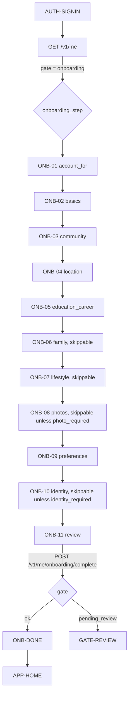

# 07. Onboarding

| | |
|---|---|
| Status | Design complete, not implemented |
| Related | [03-domain-model.md](03-domain-model.md) section 4.3 for the step state machine, [04-database-schema.md](04-database-schema.md) for columns, [15-api-contract.md](15-api-contract.md) section 7 for endpoints, [08-profile-and-photos.md](08-profile-and-photos.md) for photos and later editing, [05-reference-data.md](05-reference-data.md) for option labels, [12-verification-and-trust.md](12-verification-and-trust.md) section 3 and [13-safety-and-moderation.md](13-safety-and-moderation.md) section 3 for validation rules owned elsewhere |

Onboarding turns a newly signed-in user into a member with a complete, honest profile. It runs on the screens `ONB-01` to `ONB-11` and `ONB-DONE`. This document is the source of truth for every onboarding field: its control, label, whether it is required and how it is validated. The same field specifications are reused by `ME-EDIT` after onboarding (08 section 2).

## 1. Goals and principles

| # | Principle | What it means for the implementer |
|---|---|---|
| 1 | Mandatory first, optional later | Steps 1 to 5 hold everything matching cannot work without. Steps 6, 7 and 8 can be skipped. Nothing optional blocks a member from finishing. |
| 2 | The server holds the progress | Every step is saved through the API before the next one opens. No onboarding data is kept only on the device. |
| 3 | Resume anywhere | Signing in on another device or after a week continues at `Me.profile.onboarding_step`. |
| 4 | About five minutes | A member who skips the optional steps answers about 20 questions. Use pickers and defaults; avoid typing where a list exists. |
| 5 | One question style | Wording adapts to who manages the profile and to the candidate's gender (section 3.2). |
| 6 | Honest by design | Gender and date of birth are confirmed with a warning, the identity number is checked against the gender, and every free text is moderated. |
| 7 | Explain sensitive questions | Caste, income, identity number and photos each carry one line that says why it is asked and who can see it. |
| 8 | Same on web and Android | Same steps, same order, same labels, same validation messages. |

## 2. Flow overview

### 2.1 Diagram



### 2.2 Steps, screens and endpoints

| # | Step key | Screen | Group | Skippable | Saved with |
|---|---|---|---|---|---|
| 1 | `account_for` | `ONB-01` | About | No | `PUT /v1/me/profile/sections/account_for` |
| 2 | `basics` | `ONB-02` | About | No | `PUT /v1/me/profile/sections/basics` |
| 3 | `community` | `ONB-03` | About | No | `PUT /v1/me/profile/sections/community` |
| 4 | `location` | `ONB-04` | About | No | `PUT /v1/me/profile/sections/location` |
| 5 | `education_career` | `ONB-05` | Background | No | `PUT /v1/me/profile/sections/education_career` |
| 6 | `family` | `ONB-06` | Background | Yes | `PUT /v1/me/profile/sections/family` |
| 7 | `lifestyle` | `ONB-07` | Background | Yes | `PUT /v1/me/profile/sections/lifestyle` |
| 8 | `photos` | `ONB-08` | Photos and preferences | Yes, unless `Me.config.photo_required` | Photo endpoints (08 section 5) and `PATCH /v1/me/privacy` |
| 9 | `preferences` | `ONB-09` | Photos and preferences | No | `PUT /v1/me/preferences` |
| 10 | `identity` | `ONB-10` | Verify and finish | Yes, unless `Me.config.identity_required` | `PUT /v1/me/identity` |
| 11 | `review` | `ONB-11` | Verify and finish | No | `POST /v1/me/onboarding/complete` |

### 2.3 Progress indicator

- A bar at the top of every onboarding screen with four segments, one per group: "About" (steps 1 to 4), "Background" (steps 5 to 7), "Photos and preferences" (steps 8 and 9), "Verify and finish" (steps 10 and 11).
- Under the bar: the group name and "Step N of 11".
- A segment fills in proportion to the completed steps inside its group. Completed means the step index is lower than the index of `Me.profile.onboarding_step`.
- The indicator is display only. It is not a navigation control.

### 2.4 The per-step sequence

Every step screen follows the same sequence. `current` means `Me.profile.onboarding_step`.

1. **Load.** Fetch `GET /v1/me/profile` (cached, refetched when the screen opens) and `GET /v1/reference/bootstrap` (cached on disk). Step 9 also loads `GET /v1/me/preferences`. Step 8 also loads `GET /v1/me/photos` and `GET /v1/me/privacy`. Step 10 also loads `GET /v1/me/identity`. Show a form skeleton until loaded.
2. **Prefill.** Fill the form from the loaded section. A field never saved is empty, except where this document gives a default.
3. **Validate on the device.** On "Continue", run the client-side rules of the step. Show messages under the fields and move focus to the first invalid field. Do not call the API while a client-side rule fails.
4. **Save.** Call the step's endpoint from 2.2 with the whole section. On `validation_failed`, show each `fields[].message` under its field (match by `field`), and a summary line "Please check the highlighted fields." at the top.
5. **Continue.** Only when the step shown equals `current`: call `POST /v1/me/onboarding/continue` with `{ "step": "<step key>" }`. The response is `Me`; replace the cached `Me` with it.
6. **Navigate.** Open the screen of the next step.

Rules:

- While steps 4 and 5 run, the "Continue" button shows a spinner and all inputs are disabled. Double submission must be impossible.
- If the step shown is earlier than `current` (the member came back to edit it), skip step 5 of the sequence: save, then navigate to the next step screen.
- If `continue` answers `409 invalid_state`, another device moved on. Read `details.onboarding_step`, refetch `GET /v1/me` and open that step.
- If `continue` answers `validation_failed`, a requirement of the step is not met (03 section 4.3). Show the messages; they use the same field keys as the section.
- Any gate error code (03 section 5.1) from any call: refetch `GET /v1/me` and route by `gate` (16 section 3).

### 2.5 Navigation rules

| Situation | Behaviour |
|---|---|
| Opening onboarding | Go to the screen of `current`. |
| Opening a step later than `current` (typed URL, stale deep link) | Redirect to the screen of `current`. |
| Opening a step earlier than or equal to `current` | Allowed. |
| "Back" button | Opens the previous step's screen. It is hidden on `ONB-01`. It never calls the API. |
| System back (Android) or browser back | Same as the "Back" button. On `ONB-01` it leaves the app (Android) or does nothing special (web). |
| Unsaved changes when leaving a step by Back | Dialog: title "Discard changes?", body "What you entered on this step has not been saved.", buttons "Keep editing" and "Discard". |
| "Skip for now" (skippable steps only) | If the form is untouched: call `continue` directly. If the form has input: dialog "Save what you entered?" with "Save and continue" (runs the normal sequence) and "Skip without saving" (calls `continue` only). |
| Opened from `ONB-11` with an Edit link | The step opens in edit mode: the primary button reads "Save", it saves and returns to `ONB-11`, and `continue` is not called. |
| Sign-out in the middle | Offered in the overflow menu of every onboarding screen ("Sign out"). Everything saved so far stays on the server. Input on the open step that was not saved is lost. The next sign-in resumes at `current`. |
| Session expired (`401 unauthenticated`) | Go to `AUTH-SIGNIN`, then return to onboarding at `current`. |
| Offline | Banner "You are offline". "Continue" is disabled. Input stays in the form. |

### 2.6 Layout

- One column. On wide web the form sits in a centred card at most 560 px wide.
- Order on every step: progress indicator, title, one-line subtitle, fields, primary button "Continue", then "Skip for now" (skippable steps), then "Back".
- Required fields are not marked. Optional fields carry "(optional)" after the label.
- Selects with more than 8 options are searchable. Selects with 2 to 4 options are shown as radio cards or a segmented control.
- The on-screen keyboard type matches the field: text, number, email.

## 3. Step `account_for` (`ONB-01`)

Title: "Who is this profile for?" Subtitle: "Many profiles here are created by parents and family. Tell us who will be getting married."

### 3.1 Fields

| Field | Control | Label | Required | Options or validation |
|---|---|---|---|---|
| `managed_by` | Radio cards, one per line | "Who is this profile for?" | Yes | See the wording table below. |
| `manager_name` | Text | "Your name" | Yes, unless `managed_by = 'self'`. Hidden and sent as `null` for `self`. | 2 to 80 characters. Name rules of 13 section 3. Helper: "We use this when we contact you. It is not shown on the profile." |
| Consent 1 | Checkbox | "I agree to the Terms of Use, Privacy Policy and Community Guidelines." The three names are links to `PUB-TERMS`, `PUB-PRIVACY`, `PUB-GUIDELINES` (open in a new tab or an in-app browser). | Yes | Adds `terms`, `privacy`, `community_guidelines` to `consents`. |
| Consent 2 | Checkbox | For `self`: "I confirm that I am 18 years of age or older." Otherwise: "I confirm that the person this profile is for is 18 years of age or older." | Yes | Adds `age_declaration`. |
| Consent 3 | Checkbox | "I confirm that they know about this profile and agree to it being created." | Yes when `managed_by` is not `self`. Hidden for `self`. | Adds `candidate_consent`. |

Wording of the `managed_by` choices on this screen:

| Value | Choice text | Helper under the choice |
|---|---|---|
| `self` | "Myself" | "I am looking for my own life partner." |
| `parent` | "My son or daughter" | "I am a parent searching for my child." |
| `sibling` | "My brother or sister" | "I am searching for my sibling." |
| `relative` | "A relative" | "For example a niece, nephew or cousin." |
| `friend` | "A friend" | "I am helping a friend." |

These texts are used only on this screen. Everywhere else the value is shown with the label from `options.managed_by` (05 section 2).

Static text under the consents, small type: "Khandani Rishta is for marriage only. Marriage bureaus and paid agents may not create profiles."

### 3.2 Wording pattern for the rest of the product

From this step on, every question and helper text adapts to `managed_by` and, once known, `gender`. Labels in this document are written in the `self` form. The clients hold three variants of each such string (an ICU select on a `subject` argument) and choose one with this rule:

| `subject` argument | When |
|---|---|
| `self` | `managed_by = 'self'` |
| `male` | `managed_by` is not `self` and `gender = 'male'` |
| `female` | `managed_by` is not `self` and `gender = 'female'` |
| `unknown` | `managed_by` is not `self` and `gender` is not saved yet (only on `ONB-02`) |

| Word in the `self` form | `male` | `female` | `unknown` |
|---|---|---|---|
| you (subject) | he | she | they |
| you (object) | him | her | them |
| your | his | her | their |
| yourself | him | her | them |
| you are | he is | she is | they are |
| do you | does he | does she | do they |
| you have | he has | she has | they have |

Example: "What is your date of birth?" becomes "What is his date of birth?" for a profile managed by a parent for a son. Verb forms change with the subject ("Do you smoke?" becomes "Does she smoke?").

### 3.3 Request

```json
PUT /v1/me/profile/sections/account_for
{
  "managed_by": "parent",
  "manager_name": "Rukhsana Khan",
  "consents": ["terms", "privacy", "community_guidelines", "age_declaration", "candidate_consent"]
}
```

### 3.4 Rules enforced by the API

1. `managed_by` is one of the five values.
2. `manager_name` is required unless `managed_by = 'self'`. For `self` the API stores `NULL` whatever was sent.
3. Each entry of `consents` is recorded in `user_consents` with the request IP address and user agent. `terms`, `privacy` and `community_guidelines` use the versions in `legal.terms_version`, `legal.privacy_version` and `legal.guidelines_version`. `age_declaration` and `candidate_consent` use the value of `legal.terms_version`. A document already recorded at that version is ignored.
4. `continue` for this step requires recorded consents for `terms`, `privacy`, `community_guidelines` and `age_declaration`, plus `candidate_consent` when `managed_by` is not `self`. A missing one fails with `validation_failed`, field `consents`, code `required`.
5. After onboarding, changing `managed_by` from `self` to another value requires `candidate_consent` to be recorded or present in the same request (same error otherwise).

## 4. Step `basics` (`ONB-02`)

Title: "The basics". Subtitle: "These details appear on the profile and are used to find matches."

### 4.1 Fields

| Field | Control | Label | Required | Options or validation |
|---|---|---|---|---|
| `first_name` | Text, capitalised words | "First name" | Yes | 2 to 40 characters. Name rules of 13 section 3. |
| `last_name` | Text, capitalised words | "Last name" | Yes | 2 to 40 characters. Name rules of 13 section 3. Helper: "You choose how much of the name other members see in the privacy settings." |
| `gender` | Segmented control with two choices | "Gender" | Yes | `options.gender`: "Male", "Female". |
| `date_of_birth` | Three selects: day, month, year | "Date of birth" | Yes | A real calendar date. Age on today's date in `Asia/Karachi` is 18 to 80. The year list runs from the current year minus 80 to the current year minus 18, newest first. Helper: "Only the age is shown to others." |
| `marital_status` | Select | "Marital status" | Yes | `options.marital_status`. The value `married` is listed only when `gender = 'male'`. |
| `current_wives_count` | Stepper | "Number of current wives" | Yes when `marital_status = 'married'`. Hidden otherwise. | 1 to 3. |
| `children_status` | Radio cards | "Do you have children?" | Yes when `marital_status` is not `never_married`. Hidden otherwise. | `options.children_status`. |
| `children_count` | Stepper | "How many children?" | Yes when `children_status` is `living_with_me` or `not_living_with_me`. Hidden otherwise. | 1 to 15. |
| `height_cm` | Two selects: feet and inches | "Height" | Yes | 4 ft 0 in to 7 ft 0 in. See 4.3. |

Warning box above the "Continue" button, always visible on this step during onboarding:

> "Please check the gender and date of birth. They cannot be changed after the profile is created. If a mistake is found later, only our support team can correct it."

When `gender` is changed after it was saved once (still in onboarding), show a dialog before saving: "Change gender to {new value}? Answers that depend on gender will be cleared." with "Change" and "Cancel".

### 4.2 Rules enforced by the API

1. `first_name`, `last_name`: trimmed, inner whitespace collapsed to single spaces, 2 to 40 characters, name rules of 13 section 3.
2. `date_of_birth`: valid date; age at least 18 (field code `too_young`) and at most 80 (`out_of_range`).
3. `marital_status = 'married'` with `gender = 'female'` fails with `not_allowed`.
4. `current_wives_count` is required (1 to 3) when `marital_status = 'married'`, also while the profile is `draft`, because the schema constraint `profiles_wives_count_when_married` rejects `married` without a count. For any other status the API stores `NULL`.
5. When `marital_status = 'never_married'` the API stores `children_status = 'none'` and `children_count = NULL` whatever was sent. The clients send exactly those values.
6. When `children_status = 'none'` the API stores `children_count = NULL`. Otherwise `children_count` is required, 1 to 15.
7. `height_cm` is a whole number from 122 to 213.
8. While the profile is `draft`, a change of `gender` makes the API set `hijab` to `NULL` when the new gender is `male` and `beard` to `NULL` when the new gender is `female`, and reject the request with `not_allowed` on `marital_status` if the new gender is `female` and the status is `married`.
9. While the profile is `draft`, saving `gender = 'female'` sets `profile_privacy.photo_visibility = 'interests_and_connections'` if it still has the database default `members` (09 section 3.5). The value is never changed automatically after the owner has made a choice. The photos step always shows the choice explicitly (section 10).
10. After onboarding is completed, `gender` and `date_of_birth` are listed in `OwnProfile.locked_fields`. Sending a different value fails with field code `locked`.

### 4.3 Height conversion

The picker has a feet select (4, 5, 6, 7) and an inches select (0 to 11). When feet is 7 only 0 inches is offered.

- To store: `height_cm = round((feet * 12 + inches) * 2.54)`, rounding half up. 4 ft 0 in gives 122. 7 ft 0 in gives 213.
- To display a stored value: `total_inches = round(height_cm / 2.54)`, `feet = floor(total_inches / 12)`, `inches = total_inches mod 12`.
- Every picker value survives the round trip unchanged.
- Display format everywhere: `5 ft 6 in (168 cm)`.

## 5. Step `community` (`ONB-03`)

Title: "Religion and community". Subtitle: "Families often look for a match from a similar background. You decide what is shown."

### 5.1 Fields

| Field | Control | Label | Required | Options or validation |
|---|---|---|---|---|
| `religion_code` | Select | "Religion" | Yes | `religions` from the reference bootstrap. |
| `sect_code` | Select | "Sect" | Yes when the chosen religion has at least one entry in its `sects` list. Hidden when it has none. | The `sects` of the chosen religion. Changing the religion clears this field. |
| `caste_code`, `caste_other` | Searchable select with special entries | "Caste or biradari (optional)" | No | See 5.2. Helper: "Optional. You can hide it from other members in the privacy settings." |
| `sub_caste_code`, `sub_caste_other` | Select or text | "Sub-caste or clan (optional)" | No | See 5.2. Hidden until a caste is chosen or typed. |
| `mother_tongue_code` | Searchable select | "Mother tongue" | Yes | `languages`. |
| `language_codes` | Multi-select chips | "Other languages spoken (optional)" | No | `languages` without the chosen mother tongue. At most 6. |

### 5.2 Caste and sub-caste picker

The caste control is a searchable list built from `castes` (top-level entries only). Search matches `name` and every entry of `aliases`, ignoring case.

| List entry | Position | Effect |
|---|---|---|
| "Prefer not to say" | First | `caste_code = null`, `caste_other = null`, sub-caste fields cleared and hidden. |
| Each caste | Alphabetical by `name` after applying `sort_order` | `caste_code = <code>`, `caste_other = null`. |
| "Other (type your own)" | Last, and also offered when a search has no result ("Use 'typed text'") | Shows a text field labelled "Your caste or biradari". `caste_code = null`, `caste_other = <text>` (2 to 60 characters). |

The sub-caste control depends on the caste choice:

| Caste choice | Sub-caste control |
|---|---|
| Nothing or "Prefer not to say" | Hidden. Both sub-caste fields `null`. |
| A caste from the list that has `sub_castes` | Select with: "Not specified" (both `null`), each sub-caste (`sub_caste_code`), "Other (type your own)" (text field, `sub_caste_other`, 2 to 60 characters). |
| A caste from the list without `sub_castes` | Text field "Sub-caste or clan (optional)" writing `sub_caste_other`. |
| "Other (type your own)" | Text field "Sub-caste or clan (optional)" writing `sub_caste_other`. |

Changing the caste clears both sub-caste fields.

### 5.3 Rules enforced by the API

1. `religion_code` and `mother_tongue_code` must be active codes (`unknown_code`).
2. `sect_code` must belong to `religion_code` (`mismatch`). It is required when the religion has active sects, and must be `null` when it has none.
3. `caste_code` must be a top-level caste. `caste_code` and `caste_other` cannot both be set (`not_allowed`).
4. `sub_caste_code` requires `caste_code` and must have it as `parent_code` (`mismatch`). `sub_caste_code` and `sub_caste_other` cannot both be set. A sub-caste value without any caste value fails with `not_allowed`.
5. `caste_other` and `sub_caste_other` follow the free text rules of 13 section 3 (no contact details, no inappropriate words).
6. When `caste_other` or `sub_caste_other` is saved with a new value, the API upserts a `caste_suggestions` row (`normalized_name` is the lowercase text with single spaces; `parent_code` is `caste_code` for a sub-caste suggestion) and increases `usage_count`.
7. `language_codes`: active codes, at most 6 (`too_long`). The mother tongue and duplicates are removed silently.

## 6. Step `location` (`ONB-04`)

Title: "Where you live". Subtitle: "Your city is shown on the profile. The neighbourhood is private unless you choose otherwise."

### 6.1 Fields

| Field | Control | Label | Required | Options or validation |
|---|---|---|---|---|
| `country_code` | Searchable select | "Country of residence" | Yes | `countries`. Default: `PK` (Pakistan). Changing it clears region, city, `city_other` and `area`. |
| `region_id` | Select | "Province or state" | See rule 3 in 6.2 | `GET /v1/reference/regions?country_code=<country>`. Hidden when the country has no regions. Changing it clears the city. |
| `city_id` | Search field with result list | "City" | Yes, unless `city_other` is used | `GET /v1/reference/cities?country_code=<country>&region_id=<region>&q=<text>`. Before typing, the list shows the major cities returned without `q`. Debounce typing by 300 ms and send `q` from 2 characters. The last row is always "My city is not listed". |
| `city_other` | Text | "City name" | Yes when "My city is not listed" was chosen | 2 to 60 characters. Shown only in that case; `city_id` is then `null`. |
| `area` | Text | "Area or neighbourhood (optional)" | No | At most 80 characters. Helper: "For example Gulberg or DHA Phase 5. Only your connections see this unless you change it in the privacy settings." |
| `nationality_code` | Searchable select | "Nationality" | Yes on the screen (it always has a value) | `countries`. Default: `PK`. |
| `residency_status` | Select | "Residency status" | Yes when `country_code` differs from `nationality_code`. Hidden when they are equal. | `options.residency_status`, with `citizen` moved to the end of the list (it applies only to dual nationals here). |
| `origin_city_id` | Search field with result list | "Family's home town in Pakistan (optional)" | No | `GET /v1/reference/cities?country_code=PK&q=<text>`. Last row: "Not listed". Helper: "Where the family originally belongs, if different from the current city." |
| `origin_other` | Text | "Home town name" | No | At most 60 characters. Shown only after "Not listed"; `origin_city_id` is then `null`. |
| `relocation` | Radio cards | "Willing to move after marriage? (optional)" | No | `options.relocation`. |

When a city is picked from the result list, the client sets `region_id` from the city's `region_id` and shows it in the region select.

### 6.2 Rules enforced by the API

1. `country_code` is required and active.
2. Exactly one of `city_id` and `city_other` must be set for the step to continue. Both set fails with `not_allowed` on `city_other`.
3. When `city_id` is set, the city's `country_code` must equal `country_code` (`mismatch`), and the API overwrites `region_id` with the city's `region_id`. When `city_other` is used and the country has regions, `region_id` is required and must belong to the country.
4. When `country_code` equals `nationality_code`, the API stores `residency_status = 'citizen'` whatever was sent. Otherwise `residency_status` is required.
5. `origin_city_id` must be a city with `country_code = 'PK'` (`mismatch`). `origin_city_id` and `origin_other` cannot both be set.
6. `area`, `city_other`, `origin_other` follow the free text rules of 13 section 3.

## 7. Step `education_career` (`ONB-05`)

Title: "Education and career". Subtitle: "Workplace and institute names are private by default."

### 7.1 Fields

| Field | Control | Label | Required | Options or validation |
|---|---|---|---|---|
| `education_level_code` | Select | "Highest education" | Yes | `education_levels`, in `sort_order`. |
| `education_field_code` | Searchable select | "Field of study (optional)" | No | `education_fields`. |
| `degree_title` | Text | "Degree (optional)" | No | At most 80 characters. Placeholder: "For example BS Computer Science". |
| `institute_name` | Text | "University or institute (optional)" | No | At most 120 characters. Helper: "Shown to connections only unless you change it." |
| `employment_type` | Select | "Employment" | Yes | `options.employment_type`. |
| `profession_code` | Searchable select | "Profession (optional)" | No | `profession_categories`. Hidden for the employment types in rule 2 of 7.3. |
| `job_title` | Text | "Job title (optional)" | No | At most 80 characters. Hidden as above. |
| `employer_name` | Text | "Employer or business name (optional)" | No | At most 120 characters. Hidden as above. Helper: "Shown to connections only unless you change it." |
| `income_band_code` | Select | "Monthly income (optional)" | No | See 7.2. Hidden as above. Helper: "Shown to connections only unless you change it." |

### 7.2 Income band list

1. Pick a currency from the `country_code` saved in the location step, using the table in 05 section 10.3 (Pakistan gives PKR, the United Kingdom GBP, the United Arab Emirates AED, Saudi Arabia SAR, the United States USD, Canada CAD, Australia AUD, euro countries EUR, anything not listed USD). That table is the single source for the mapping.
2. Show the `income_bands` whose `currency_code` equals that currency, ordered by `rank`. If the list is empty for that currency, use `USD`.
3. The first entry is always "Prefer not to say" (`income_band_code = null`).
4. A text link "Change currency" under the field opens a list of the currencies present in `income_bands`. Choosing one reloads the band list and clears the selection.
5. When the saved `income_band_code` belongs to another currency than the computed one, open the list in the saved band's currency.

### 7.3 Rules enforced by the API

1. `education_level_code` and `employment_type` are required. All codes must be active.
2. When `employment_type` is `student`, `homemaker` or `not_working`, the API stores `NULL` in `profession_code`, `job_title`, `employer_name` and `income_band_code` whatever was sent. The clients hide those four fields and send `null`.
3. `degree_title`, `institute_name`, `job_title`, `employer_name` follow the free text rules of 13 section 3.

## 8. Step `family` (`ONB-06`, skippable)

Title: "Family". Subtitle: "Family background matters to most families here. Add what you are comfortable sharing. You can skip this and add it later."

Every field is optional. The form is divided into four groups with headings.

### 8.1 Fields

**Group "Parents"**

| Field | Control | Label | Options or validation |
|---|---|---|---|
| `father_status` | Segmented control | "Father" | `options.parent_status`. |
| `father_occupation` | Text | "Father's occupation" | At most 80 characters. Placeholder: "Current or former, for example Retired government officer". |
| `mother_status` | Segmented control | "Mother" | `options.parent_status`. |
| `mother_occupation` | Text | "Mother's occupation" | At most 80 characters. Placeholder: "For example Homemaker". |

**Group "Siblings"**

| Field | Control | Label | Options or validation |
|---|---|---|---|
| `brothers_count` | Stepper | "Brothers" | 0 to 15. |
| `brothers_married` | Stepper | "Married brothers" | 0 to `brothers_count`. Shown when `brothers_count` is 1 or more. Sent as `null` when hidden. |
| `sisters_count` | Stepper | "Sisters" | 0 to 15. |
| `sisters_married` | Stepper | "Married sisters" | 0 to `sisters_count`. Shown when `sisters_count` is 1 or more. Sent as `null` when hidden. |

A stepper that was never touched sends `null`, not 0. Show an empty stepper as "Not set" with a plus button.

**Group "Family background"**

| Field | Control | Label | Options or validation |
|---|---|---|---|
| `family_type` | Segmented control | "Family type" | `options.family_type`. |
| `family_class` | Select | "Family status" | `options.family_class`. |
| `family_values` | Select | "Family values" | `options.family_values`. |
| Toggle (not stored) | Switch | "My family lives in a different city" | Off by default. On when `family_country_code` or `family_city_id` is set. Turning it off sends both as `null`. |
| `family_country_code` | Searchable select | "Family's country" | `countries`. Shown when the toggle is on. Default: `PK`. |
| `family_city_id` | Search field | "Family's city" | `GET /v1/reference/cities?country_code=<family country>&q=<text>`. Shown when the toggle is on. |

**Group "Home"**

| Field | Control | Label | Options or validation |
|---|---|---|---|
| `home_ownership` | Select | "Family home" | `options.home_ownership`. |
| `home_type` | Select | "Type of home" | `options.home_type`. |
| `home_size_value` | Number | "Size" | Greater than 0, at most 2 decimal places, at most 99,999.99. |
| `home_size_unit` | Select | "Unit" | `options.home_size_unit`. Default selection when the size is first typed: `marla` when the country of residence is `PK`, otherwise `sq_ft`. |

Helper under the group: "Home details are shown to connections only unless you change it."

**Free text**

| Field | Control | Label | Options or validation |
|---|---|---|---|
| `about_family` | Multi-line text with a character counter | "About the family (optional)" | At most 1,000 characters. If not empty, at least 30 characters. Free text rules of 13 section 3. Helper: "A few lines about the family: where it comes from, what the parents and siblings do. This text is reviewed before others can see it." |

### 8.2 Rules enforced by the API

1. `brothers_married` cannot exceed `brothers_count`, and `sisters_married` cannot exceed `sisters_count` (`out_of_range`). A married count without a total count fails with `required` on the total.
2. `home_size_value` and `home_size_unit` are set together or both `null` (`required` on the missing one).
3. `family_city_id` requires `family_country_code` and must be in that country (`mismatch`).
4. Saving a changed, non-empty `about_family` sets `about_family_status = 'pending'` and enqueues `moderate_text` (03 section 4.5). An empty value sets the status to `approved`.
5. The API creates the `profile_family` row on the first save of this section.

## 9. Step `lifestyle` (`ONB-07`, skippable)

Title: "Faith, lifestyle and about you". Subtitle: "These answers help families see how you live and what you hope for. You can skip this and add it later."

Every field is optional. The form has five groups.

### 9.1 Fields

**Group "Religious practice"**

| Field | Control | Label | Shown when | Options |
|---|---|---|---|---|
| `religiosity` | Select | "How religious are you?" | Always | `options.religiosity`. |
| `prayer_frequency` | Select | "Prayers" | `religion_code = 'islam'` | `options.prayer_frequency`. |
| `hijab` | Select | "Hijab" | `religion_code = 'islam'` and `gender = 'female'` | `options.hijab`. |
| `beard` | Select | "Beard" | `religion_code = 'islam'` and `gender = 'male'` | `options.beard`. |
| `religious_education` | Select | "Religious education" | `religion_code = 'islam'` | `options.religious_education`. |
| `smoking` | Select | "Do you smoke?" | Always | `options.smoking`. |

A field that is not shown is sent as `null`.

**Group "Plans after marriage"**

| Field | Control | Label | Options |
|---|---|---|---|
| `living_arrangement` | Radio cards | "Where do you expect to live after marriage?" | `options.living_arrangement`. |
| `work_after_marriage` | Radio cards | Female profile: "Do you plan to work after marriage?" Male profile: "Are you comfortable with your wife working after marriage?" | `options.work_after_marriage`. |
| `marriage_timeline` | Select | "When do you hope to marry?" | `options.marriage_timeline`. |
| `jahez_stance` | Radio cards | "View on jahez (dowry)" | `options.jahez_stance`. |

**Group "Appearance and health (optional)"**, collapsed by default with the heading as the expand control

| Field | Control | Label | Options or validation |
|---|---|---|---|
| `weight_kg` | Number | "Weight in kg" | Whole number, 30 to 200. |
| `complexion` | Select | "Complexion" | `options.complexion`. |
| `body_type` | Select | "Build" | `options.body_type`. |
| `blood_group` | Select | "Blood group" | `options.blood_group`. |
| `disability` | Select | "Any disability or long-term health condition?" | `options.disability`. |
| `disability_details` | Text | "Details" | At most 300 characters. Shown when `disability` is set and is not `none`. Sent as `null` otherwise. |

Helper under the group: "Blood group and health details are shown to connections only unless you change it."

**Group "Hobbies and interests"**

| Field | Control | Label | Options or validation |
|---|---|---|---|
| `hobby_codes` | Chips grouped under the `category` of each hobby | "Hobbies and interests" | `hobbies`. At most 10. When 10 are selected the other chips are disabled and a line reads "You can choose up to 10." |

**Group "About you"**

| Field | Control | Label | Options or validation |
|---|---|---|---|
| `about_me` | Multi-line text with a character counter | "About you" | At most 1,500 characters. If not empty, at least 50 characters. Free text rules of 13 section 3. Helper: "Profiles with a few honest lines get far more responses. This text is reviewed before others can see it. Do not include phone numbers or social media names." |

### 9.2 Writing prompts

Shown as three tappable lines above the `about_me` field. Tapping a prompt does not insert text; it only stays highlighted as a guide.

1. "What matters most to you in life and in a marriage?"
2. "How would your family or friends describe you?"
3. "What does a normal week look like: work, family, faith and free time?"

### 9.3 "Help me write" starter

A button "Help me write" under the `about_me` field builds a draft on the device from the answers already entered, using the fixed template below. It never calls the API. If the field already has text, ask first: "Replace what you have written?" with "Replace" and "Cancel". The member is expected to edit the draft; it is saved only by the normal "Continue" or "Save".

Build the draft by joining the sentences that apply, in order, separated by one space.

| # | Condition | `self` form | Third-person form (`subject` is `male` or `female`) |
|---|---|---|---|
| 1a | `job_title` or `profession_code` is set | "I am a {age}-year-old {job} living in {city}." | "{first_name} is a {age}-year-old {job} living in {city}." |
| 1b | Otherwise | "I am {age} years old and live in {city}." | "{first_name} is {age} years old and lives in {city}." |
| 2a | `education_field_code` is set | "I have completed {education_level} in {education_field}." | "{He/She} has completed {education_level} in {education_field}." |
| 2b | Otherwise | "I have completed {education_level}." | "{He/She} has completed {education_level}." |
| 3 | `religiosity = 'very_practising'` | "My faith is central to my life." | "{His/Her} faith is central to {his/her} life." |
| 3 | `religiosity = 'practising'` | "I practise my faith and try to live by it." | "{He/She} practises {his/her} faith and tries to live by it." |
| 3 | `religiosity = 'moderately_practising'` | "I am moderate in my religious practice." | "{He/She} is moderate in religious practice." |
| 4 | Saved `family_type = 'joint'` | "I come from a close joint family." | "{He/She} comes from a close joint family." |
| 4 | Saved `family_type = 'nuclear'` | "I come from a close-knit family." | "{He/She} comes from a close-knit family." |
| 5 | One or more hobbies selected | "In my free time I enjoy {hobbies}." | "In {his/her} free time {he/she} enjoys {hobbies}." |
| 6 | Always | "I am looking for a life partner who shares my values and wants to build a respectful and caring home." | "We are looking for a life partner for {him/her} who shares our family's values and wants to build a respectful and caring home." |

Placeholders:

| Placeholder | Value |
|---|---|
| `{age}` | Computed from `date_of_birth`. |
| `{job}` | `job_title` in lowercase if set, otherwise the lowercase `name` of the profession category. |
| `{city}` | The city name, or `city_other`. |
| `{education_level}`, `{education_field}` | The `name` of the reference rows. |
| `{hobbies}` | The lowercase names of the first three selected hobbies: "a", "a and b", or "a, b and c". |
| `{first_name}`, `{He/She}`, `{his/her}`, `{him/her}` | From the profile, following section 3.2. |

Sentence 3 is left out for `not_practising` and when `religiosity` is not set.

### 9.4 Rules enforced by the API

1. `hijab` must be `null` for a male profile and `beard` must be `null` for a female profile (`not_allowed`).
2. `weight_kg` is a whole number from 30 to 200 (`out_of_range`).
3. `disability_details` is stored as `NULL` when `disability` is `null` or `none`.
4. `hobby_codes`: active codes, at most 10 (`too_long`), duplicates removed. The API replaces the rows of `profile_hobbies` with the list.
5. `about_me`: if not empty, 50 to 1,500 characters after trimming (`too_short`, `too_long`), free text rules of 13 section 3 (`contains_contact_info`, `inappropriate`). A changed, non-empty value sets `about_me_status = 'pending'` and enqueues `moderate_text`. An empty value sets the status to `approved`.

## 10. Step `photos` (`ONB-08`)

Title: "Photos". Subtitle: "A clear photo is the first thing a family looks at. You control who can see it."

### 10.1 Content

1. **Photo grid.** `Me.config.photos_max` slots (6 at launch). The first slot is labelled "Main photo". An empty slot shows a plus sign and opens the picker (gallery or camera). A filled slot shows the photo with its status label and a remove button. The upload flow, statuses and messages are specified in 08 section 5.2 and 5.5 and are identical here.
2. **Photo rules.** The "Do" and "Do not" list of 13 section 4.1, shown next to the grid, followed by the line "Every photo is reviewed before others can see it."
3. **Photo privacy choice.** Heading: "Who can see the photos?" Four radio cards. Exactly one is always selected. The initial selection is the value returned by `GET /v1/me/privacy`. The card titles and explanations are the labels and helper texts of `photo_visibility` in 09 section 3.2, repeated here for convenience:

| `photo_visibility` value | Card title | Card explanation |
|---|---|---|
| `members` | "All members" | "Every member who can open your profile sees your photos." |
| `interests_and_connections` | "People I show interest in" | "Photos are blurred. They become clear for people you send an interest to and for your connections." |
| `connections` | "Connections only" | "Photos are blurred until you and the other person are connected." |
| `approved_only` | "Only people I approve" | "Photos are blurred for everyone. You approve each person who may see them, including connections." |

Line under the cards: "A blurred photo cannot be made clear by anyone but you. You can change this at any time in the privacy settings."

### 10.2 Actions

| Control | Behaviour |
|---|---|
| "Continue" | 1. `PATCH /v1/me/privacy` with `{ "photo_visibility": "<selected>" }` (always sent, even when unchanged, so the choice is explicit). 2. `POST /v1/me/onboarding/continue` with `{ "step": "photos" }`. 3. Open `ONB-09`. Photos still in `processing` or `pending_review` do not block. |
| "Add photos later" (the skip control of this step) | Shown when `Me.config.photo_required` is false and the grid is empty. Dialog: title "Continue without a photo?", body "Profiles with a photo receive far more interest. You can add photos at any time.", buttons "Add a photo" and "Continue without". "Continue without" performs the same two calls as "Continue". |

When `photo_required` is true and the profile has no photo that is not `rejected` or `failed`, `continue` fails with `validation_failed` (field `photos`, code `required`). Message: "Add at least one photo to continue."

## 11. Step `preferences` (`ONB-09`)

Title: "Who are you looking for?" Subtitle: "We filled in sensible starting values. Change anything, then continue. You can refine this later."

The same form is the screen `ME-PREFS` after onboarding.

### 11.1 Loading and saving

- Load `GET /v1/me/preferences`. When no row exists yet, the API returns the defaults of section 12.
- "Continue" always calls `PUT /v1/me/preferences` with the full `Preferences` object, even when the member changed nothing. This creates the row that the step requires. Then it calls `continue`.
- After onboarding (`ME-PREFS`) the button reads "Save" and only calls `PUT`.

### 11.2 Form layout

The form has two tiers. Tier 1 ("Essentials") is always visible. Tier 2 is behind a control labelled "More preferences" and is collapsed by default. Each row is one matching dimension: a value control and an importance control.

| Tier | Dimension key | Row label | Value control | Columns written |
|---|---|---|---|---|
| 1 | `age` | "Age" | Range slider with two handles, 18 to 80, showing "25 to 32 years" | `age_min`, `age_max` |
| 1 | `marital_status` | "Marital status" | Multi-select chips from `options.marital_status`. The value `married` (label from 05) is listed only when the candidate is female. | `marital_statuses` |
| 1 | `religion` | "Religion" | Multi-select from `religions` | `religion_codes` |
| 1 | `sect` | "Sect" | Multi-select of the sects of the selected religions. Hidden when no religion is selected or none of them has sects. | `sect_codes` |
| 1 | `location` | "Location" | Three stacked multi-selects: "Countries" (`countries`), "Provinces or states" (regions of the selected countries, loaded with `GET /v1/reference/regions`), "Cities" (search with `GET /v1/reference/cities`). The second and third are behind a text link "Add specific provinces or cities". | `country_codes`, `region_ids`, `city_ids` |
| 1 | `education` | "Education" | Select "At least ..." with one entry per distinct `rank` of `education_levels` (05 section 7), first entry "Any" | `education_min_rank` (the chosen `rank`, or `null`) |
| 2 | `height` | "Height" | Range slider with two handles, 4 ft 0 in to 7 ft 0 in, with a "No preference" switch that sends both as `null` | `height_min_cm`, `height_max_cm` |
| 2 | `children` | "Children" | Radio: `options.children_acceptance` | `children_acceptance` |
| 2 | `caste` | "Caste or biradari" | Multi-select of top-level `castes`, searchable | `caste_codes` |
| 2 | `mother_tongue` | "Mother tongue" | Multi-select from `languages` | `mother_tongue_codes` |
| 2 | `profession` | "Employment and profession" | Two multi-selects: "Employment" (`options.employment_type`) and "Profession" (`profession_categories`) | `employment_types`, `profession_codes` |
| 2 | `income` | "Monthly income" | Select "At least ..." listing the PKR `income_bands` by `rank` with the label form of 05 section 10.3 ("At least 100,000 PKR a month or the equivalent abroad"), first entry "Any" | `income_min_rank` (the `rank` of the chosen band, or `null`) |
| 2 | `religiosity` | "Religious practice" | Multi-select chips from `options.religiosity` | `religiosity_levels` |
| 2 | `appearance` | Candidate is male: "Hijab". Candidate is female: "Beard". | Multi-select chips from `options.hijab` (candidate male) or `options.beard` (candidate female) | `hijab_types` or `beard_types`. The other array is sent empty. |
| 2 | `family` | "Family" | Two multi-select chip rows: "Family values" (`options.family_values`) and "Family type" (`options.family_type`) | `family_values`, `family_types` |
| 2 | `living_arrangement` | "Living after marriage" | Multi-select chips from `options.living_arrangement` | `living_arrangements` |
| 2 | `work_after_marriage` | Candidate is male: "Wife working after marriage". Candidate is female: "His view on wife working". | Multi-select chips from `options.work_after_marriage` | `work_after_marriage_options` |
| 2 | `smoking` | "Smoking" | Multi-select chips from `options.smoking` | `smoking_options` |

Under tier 2: a multi-line text field "Anything else you are looking for (optional)" writing `notes`, at most 1,000 characters, at least 30 if not empty, free text rules of 13 section 3. Helper: "Shown on the profile after review."

"No preference" for a multi-select is the empty selection, shown as the chip "Any". For the age slider, the full range 18 to 80 means no preference.

### 11.3 Importance control

Each row has a four-way segmented control bound to the row's `_importance` column.

| Value | Label |
|---|---|
| `must` | "Must have" |
| `high` | "Very important" |
| `medium` | "Important" |
| `low` | "Nice to have" |

Rules:

1. When a row has no preference (empty selection, "Any", `null` bounds, or the full age range), its importance control is disabled and shown greyed. The stored importance value is kept and sent unchanged.
2. When any row is set to "Must have", show this note directly under that row: "Must have: members who do not fit, or who have not filled in this detail, are never shown as matches." The note updates live as the control changes.
3. When 5 or more rows are set to "Must have", show a warning at the top of the form: "You have {n} must-haves. This can leave very few matches. Keep must-haves for true dealbreakers."
4. A sticky summary line above the button reads "{n} must-haves" and updates live.

### 11.4 Rules enforced by the API

1. `age_min` and `age_max` are 18 to 80 and `age_min <= age_max`.
2. `height_min_cm` and `height_max_cm`, when set, are 122 to 213 and min is not above max. One may be set without the other.
3. Every code in every array must be a valid value of the matching profile column or an active reference code (`unknown_code`). `caste_codes` holds top-level castes only.
4. `marital_statuses` may contain `married` only when the candidate is female (`not_allowed`).
5. `hijab_types` is stored empty when the candidate is female. `beard_types` is stored empty when the candidate is male.
6. Array limits: 30 castes, 20 cities, 20 regions, 20 countries, 20 professions (`too_long`). `region_ids` must belong to a country in `country_codes` when `country_codes` is not empty, and `city_ids` likewise (`mismatch`).
7. Every `_importance` value is one of `must`, `high`, `medium`, `low`.
8. A changed, non-empty `notes` sets `notes_status = 'pending'` and enqueues `moderate_text`.
9. Saving sets `profiles.match_stale = true`.

## 12. Preference defaults

These are the values `GET /v1/me/preferences` returns while the profile has no `partner_preferences` row. They are computed from the profile at the time of the request. The row is created by the first `PUT /v1/me/preferences`. Once the row exists, later changes to the profile never change the stored preferences.

`own_age` is the candidate's age. If a value the default depends on is missing, use the fallback in the last column.

| Column | Default | Fallback |
|---|---|---|
| `age_min` | Male candidate: `max(18, own_age - 8)`. Female candidate: `max(18, own_age - 1)`. | `18` |
| `age_max` | Male candidate: `min(80, own_age + 1)`. Female candidate: `min(80, own_age + 8)`. | `80` |
| `age_importance` | `high` | |
| `height_min_cm` | `null` | |
| `height_max_cm` | `null` | |
| `height_importance` | `low` | |
| `marital_statuses` | `['never_married']` when the candidate's `marital_status` is `never_married`. Otherwise `['never_married', 'divorced', 'widowed', 'nikah_ended_before_rukhsati']`. Never contains `married` or `separated` by default. | `['never_married']` |
| `marital_status_importance` | `high` | |
| `children_acceptance` | `any` | |
| `children_importance` | `medium` | |
| `religion_codes` | `[own religion_code]` | `[]` |
| `religion_importance` | `must` | |
| `sect_codes` | `[]` | |
| `sect_importance` | `medium` | |
| `caste_codes` | `[]` | |
| `caste_importance` | `low` | |
| `mother_tongue_codes` | `[]` | |
| `mother_tongue_importance` | `low` | |
| `country_codes` | `[own country_code]` | `[]` |
| `region_ids` | `[]` | |
| `city_ids` | `[]` | |
| `location_importance` | `medium` | |
| `education_min_rank` | `null` | |
| `education_importance` | `medium` | |
| `employment_types` | `[]` | |
| `profession_codes` | `[]` | |
| `profession_importance` | `low` | |
| `income_min_rank` | `null` | |
| `income_importance` | `low` | |
| `religiosity_levels` | `[]` | |
| `religiosity_importance` | `medium` | |
| `hijab_types` | `[]` | |
| `beard_types` | `[]` | |
| `appearance_importance` | `low` | |
| `family_values` | `[]` | |
| `family_types` | `[]` | |
| `family_importance` | `low` | |
| `living_arrangements` | `[]` | |
| `living_arrangement_importance` | `low` | |
| `work_after_marriage_options` | `[]` | |
| `work_after_marriage_importance` | `low` | |
| `smoking_options` | `[]` | |
| `smoking_importance` | `low` | |
| `notes` | `null` | |

Worked examples:

| Candidate | `age_min` | `age_max` | `marital_statuses` | `religion_codes` | `country_codes` |
|---|---|---|---|---|---|
| Man, 29, never married, Muslim, lives in Pakistan | 21 | 30 | `['never_married']` | `['islam']` | `['PK']` |
| Woman, 26, never married, Muslim, lives in the United Kingdom | 25 | 34 | `['never_married']` | `['islam']` | `['GB']` |
| Man, 41, divorced, Muslim, lives in Pakistan | 33 | 42 | `['never_married', 'divorced', 'widowed', 'nikah_ended_before_rukhsati']` | `['islam']` | `['PK']` |
| Woman, 18, never married, Christian, lives in Pakistan | 18 | 26 | `['never_married']` | `['christianity']` | `['PK']` |

Matching uses the same defaults for a profile that has no row (10 section 3 and 4), so a profile is never treated as having no preferences.

## 13. Step `identity` (`ONB-10`)

Title: "Identity". Subtitle: "One profile per person keeps fake and duplicate profiles out."

### 13.1 Fields

| Field | Control | Label | Required | Options or validation |
|---|---|---|---|---|
| `document_type` | Select | "Document" | Yes | `options.document_type`. Default: see 13.2. |
| `number` | Text with an input mask | Depends on the document: "CNIC number", "NICOP number", "POC number", "Passport number" (with the wording pattern of 3.2, for example "His CNIC number") | Yes | Rules of 12 section 3. Input mask of 12 section 3.7. For `cnic`, `nicop` and `poc`: numeric keyboard, mask `#####-#######-#`, the hyphens are inserted automatically and are not sent (send 13 digits), and "Continue" is enabled only at 13 digits. For `passport`: 6 to 12 letters and digits, shown in capitals. |

The document must be the candidate's own, not the manager's. When `managed_by` is not `self`, show above the field: "Enter {first_name}'s number, not your own." The picker only preselects a type (13.2); the member may choose any of the four.

### 13.2 Default document type

| Nationality (`nationality_code`) | Country of residence (`country_code`) | Default |
|---|---|---|
| `PK` | `PK` | `cnic` |
| `PK` | Any other country | `nicop` |
| Any other nationality | Any | `passport` |

### 13.3 Reassurance copy

Shown directly above the number field. The text is the consent text owned by 12 section 2.2, repeated here so the screen is complete. The member confirms by submitting the form; there is no extra checkbox.

> **Why we ask for the CNIC number**
>
> We ask for the candidate's CNIC (or NICOP, POC or passport) number so that each person can have only one profile, and so that anyone removed for bad behaviour cannot come back.
>
> - It is never shown on the profile or to any other member.
> - It is stored encrypted. Only the last four digits are ever displayed, and only to you.
> - We do not share it with anyone outside Khandani Rishta.
> - It is deleted when the account is deleted.

The three points the copy must always make are: why it is asked (one profile per person, and bans that last), that nobody else ever sees it, and how it is protected (encrypted, last four digits only). How the protection works technically is in 12 section 2.3.

### 13.4 Saving

`PUT /v1/me/identity` with `{ "document_type": "...", "number": "..." }`, then `continue`. The messages are those of 12 sections 3.3 and 3.4.

| Response | What the client shows |
|---|---|
| `200` with `IdentitySummary` | Proceed. |
| `validation_failed`, field `number`, code `required` | Under the field: "Enter the number." |
| `validation_failed`, field `number`, code `invalid` | Under the field. CNIC, NICOP, POC with the wrong length: "A CNIC number has 13 digits." CNIC, NICOP with an impossible value: "This does not look like a valid CNIC number." Passport: "A passport number has 6 to 12 letters and digits." The client shows the API's `message` for this code, because one code covers several rules. |
| `validation_failed`, field `number`, code `mismatch` | Under the field: "This number does not match the gender on the profile. Please check the number and the gender. If both are correct, contact support." With a text link "Go back to the basics step" while the profile is `draft`. |
| `409 identity_already_registered` | Dialog: title "Already registered", body "This number is already registered with another profile. If you believe this is a mistake, contact support." with the support address `Me.config.support_email` as a link, button "OK". |
| `409 invalid_state` | Message at the top: "This document is being verified or is already verified, so it cannot be changed here." (A pending verification request must be cancelled first, 12 section 3.6. This cannot happen during a first pass through onboarding.) |

### 13.5 Returning to the step

The number is never returned by the API. When `GET /v1/me/identity` returns a summary, show the document type and `number_masked` as read-only text with a "Change" link. "Change" reveals the empty fields again. "Continue" with the read-only view only calls `continue`.

### 13.6 Skipping

- When `Me.config.identity_required` is true there is no skip control, and `continue` fails with `validation_failed` (field `number`, code `required`, message "Enter the identity number to continue.") until an identity exists. If the gender is somehow missing, `PUT /v1/me/identity` answers `409 invalid_state` (12 section 3.3); the client then opens `ONB-02`.
- When it is false, "Skip for now" is shown with the line: "You can add it later from the verification screen. Profiles without it cannot be verified."

### 13.7 Note about verification

Under the form: "Later you can verify the profile with a photo of the document and a selfie from the verification screen. Verified profiles are trusted more and can send more interests each day." This points to `ME-VERIFY` (12). No document image is asked for during onboarding.

## 14. Step `review` (`ONB-11`) and completion

Title: "Review and finish". Subtitle: "Check everything once. You can still edit after the profile is created, except the gender and date of birth."

### 14.1 Content

One summary card per row below. Each card lists label and value pairs, read from `GET /v1/me/profile`, `GET /v1/me/preferences`, `GET /v1/me/privacy` and `GET /v1/me/identity`. Each card has an "Edit" link that opens the step in edit mode (2.5).

| Card | Shows | Edit opens |
|---|---|---|
| "Profile for" | `managed_by` label, `manager_name` | `ONB-01` |
| "Basics" | Full name, gender, date of birth and age, marital status, children, height | `ONB-02` |
| "Religion and community" | Religion, sect, caste, sub-caste, mother tongue, other languages | `ONB-03` |
| "Location" | City, region, country, area, nationality, residency status, home town, relocation | `ONB-04` |
| "Education and career" | All set fields of the section | `ONB-05` |
| "Family" | All set fields, or "Not added yet" with the link text "Add" | `ONB-06` |
| "Faith, lifestyle and about" | All set fields, the first 200 characters of `about_me`, or "Not added yet" with "Add" | `ONB-07` |
| "Photos" | Thumbnails with status labels, and the chosen photo privacy as its card title from 10.1; or "No photos yet" with "Add" | `ONB-08` |
| "Looking for" | One line per dimension that has a preference, with a "Must have" tag where the importance is `must` | `ONB-09` |
| "Identity" | Document type and `number_masked`, or "Not added" with "Add" | `ONB-10` |

Values that are private by default (area, income, institute, employer, home, health) carry a small lock icon and the tooltip "Private by default".

The warning box from 4.1 about gender and date of birth is repeated above the button.

### 14.2 Completing

Primary button: "Create my profile". It calls `POST /v1/me/onboarding/complete` (no body).

| Response | Behaviour |
|---|---|
| `200` with `Me`, `gate = 'ok'` | Replace the cached `Me`. Open `ONB-DONE`. |
| `200` with `Me`, `gate = 'pending_review'` | Replace the cached `Me`. Open `GATE-REVIEW`. |
| `validation_failed` | Show "Some details are missing." and open the step that owns the first entry of `fields` (mapping in 14.3) in edit mode with the messages shown. |
| `409 invalid_state` | Refetch `GET /v1/me` and route by `gate`. |
| Any other gate value in the returned `Me` | Route by `gate` (16 section 3). |

### 14.3 Field to step mapping for completion errors

| `fields[].field` starts with or equals | Step |
|---|---|
| `managed_by`, `manager_name`, `consents` | `account_for` |
| `first_name`, `last_name`, `gender`, `date_of_birth`, `marital_status`, `current_wives_count`, `children_status`, `children_count`, `height_cm` | `basics` |
| `religion_code`, `sect_code`, `caste_code`, `caste_other`, `sub_caste_code`, `sub_caste_other`, `mother_tongue_code`, `language_codes` | `community` |
| `country_code`, `region_id`, `city_id`, `city_other`, `area`, `nationality_code`, `residency_status`, `origin_city_id`, `origin_other`, `relocation` | `location` |
| `education_level_code`, `education_field_code`, `degree_title`, `institute_name`, `employment_type`, `profession_code`, `job_title`, `employer_name`, `income_band_code` | `education_career` |
| `photos` | `photos` |
| `number`, `document_type` | `identity` |

## 15. `ONB-DONE` and the first-run experience

`ONB-DONE` is shown once, immediately after a completion that results in `gate = 'ok'`.

### 15.1 Content

1. Title: "Mubarak! The profile is live." Subtitle: "Members who fit your preferences can now find it. Here are three things that make a real difference."
2. Three action cards. Each opens its target and returns to `ONB-DONE` when the member comes back.

| Card | Shown when | Title | Text | Target |
|---|---|---|---|---|
| Photos | The profile has no photo that is not `rejected` or `failed` | "Add a photo" | "Profiles with a photo receive far more interest." | `ME-PHOTOS` |
| Verify | `OwnProfile.verification.id_verified` is false and no `id_document` request is pending | "Verify your identity" | "Verified profiles are trusted more and can send more interests each day." | `ME-VERIFY` |
| Privacy | Always | "Review your privacy" | "Choose who sees your photos, name and family details." | `SET-PRIVACY` |

3. Primary button: "See my matches". It opens `APP-HOME` and replaces the navigation history so that Back does not return to onboarding.

### 15.2 First run on `APP-HOME`

- The first time `APP-HOME` opens after `ONB-DONE`, recommendations may still be computing (`is_refreshing` on `GET /v1/recommendations`). `APP-HOME` handles this as specified in 16 section 6.
- A one-time, dismissible tip card at the top of `APP-HOME`: "Tip: open a profile and send an interest. If it is accepted you can chat. Your contact details stay private until you choose to share them." The dismissal is stored on the device only.
- On Android, the system notification permission is requested after the member dismisses this tip or opens `APP-HOME` for the second time, never during onboarding. See 22.

### 15.3 When completion leads to review

When `gate = 'pending_review'`, `ONB-DONE` is not shown. `GATE-REVIEW` offers the same three actions (16 section 6). When a moderator approves the profile, the member receives a `profile_approved` notification and lands on `APP-HOME` with the tip card above.

## 16. Validation message catalogue

One row per rule. The "Checked by" column says where the rule runs: C for the client before the request, A for the API. Every rule checked by the client is also checked by the API. The message is the English text; clients store it under an i18n key and prefer their own text for a known `field` and `code`, falling back to the API's `message`.

### 16.1 `account_for`

| Field | Rule | Code | Checked by | Message |
|---|---|---|---|---|
| `managed_by` | Must be chosen | `required` | C, A | "Choose who this profile is for." |
| `manager_name` | Required unless for myself | `required` | C, A | "Enter your name." |
| `manager_name` | 2 to 80 characters | `too_short`, `too_long` | C, A | "Enter a name of 2 to 80 characters." |
| `manager_name` | Name rules | `invalid` | A | "Use letters only. Numbers and symbols are not allowed in a name." |
| `consents` | Consent 1 ticked | `required` | C, A | "Please agree to the Terms of Use, Privacy Policy and Community Guidelines." |
| `consents` | Consent 2 ticked | `required` | C, A | "Please confirm the age statement." |
| `consents` | Consent 3 ticked when shown | `required` | C, A | "Please confirm that they agree to this profile." |

### 16.2 `basics`

| Field | Rule | Code | Checked by | Message |
|---|---|---|---|---|
| `first_name` | Required | `required` | C, A | "Enter the first name." |
| `first_name` | 2 to 40 characters | `too_short`, `too_long` | C, A | "The first name must be 2 to 40 characters." |
| `first_name` | Name rules | `invalid` | A | "Use letters only. Numbers and symbols are not allowed in a name." |
| `last_name` | Required | `required` | C, A | "Enter the last name." |
| `last_name` | 2 to 40 characters | `too_short`, `too_long` | C, A | "The last name must be 2 to 40 characters." |
| `last_name` | Name rules | `invalid` | A | "Use letters only. Numbers and symbols are not allowed in a name." |
| `first_name`, `last_name` | Changed after identity verification | `locked` | A | "The name cannot be changed after identity verification. Contact support to correct it." |
| `gender` | Required | `required` | C, A | "Select a gender." |
| `gender` | Changed after onboarding | `locked` | A | "The gender cannot be changed. Contact support if it is wrong." |
| `date_of_birth` | Required | `required` | C, A | "Enter the date of birth." |
| `date_of_birth` | Real date | `invalid` | C, A | "Enter a real date." |
| `date_of_birth` | Age at least 18 | `too_young` | C, A | `self`: "You must be at least 18 years old to use Khandani Rishta." Others: "The person the profile is for must be at least 18 years old." |
| `date_of_birth` | Age at most 80 | `out_of_range` | C, A | "Please check the year of birth." |
| `date_of_birth` | Changed after onboarding | `locked` | A | "The date of birth cannot be changed. Contact support if it is wrong." |
| `marital_status` | Required | `required` | C, A | "Select a marital status." |
| `marital_status` | `married` on a female profile | `not_allowed` | A | "This option is not available for this profile." |
| `current_wives_count` | Required when married | `required` | C, A | "Select the number of current wives." |
| `current_wives_count` | 1 to 3 | `out_of_range` | C, A | "Choose 1, 2 or 3." |
| `children_status` | Required unless never married | `required` | C, A | "Tell us whether there are children." |
| `children_count` | Required when there are children | `required` | C, A | "Enter the number of children." |
| `children_count` | 1 to 15 | `out_of_range` | C, A | "Enter a number from 1 to 15." |
| `height_cm` | Required | `required` | C, A | "Select a height." |
| `height_cm` | 122 to 213 | `out_of_range` | A | "Choose a height between 4 ft 0 in and 7 ft 0 in." |

### 16.3 `community`

| Field | Rule | Code | Checked by | Message |
|---|---|---|---|---|
| `religion_code` | Required | `required` | C, A | "Select a religion." |
| `sect_code` | Required when the religion has sects | `required` | C, A | "Select a sect." |
| `sect_code` | Belongs to the religion | `mismatch` | A | "This sect does not belong to the selected religion." |
| `caste_other` | 2 to 60 characters | `too_short`, `too_long` | C, A | "Enter 2 to 60 characters." |
| `caste_other` | Not together with a listed caste | `not_allowed` | A | "Choose a caste from the list or type your own, not both." |
| `caste_other`, `sub_caste_other` | Free text rules | `contains_contact_info`, `inappropriate` | A | "Enter only the caste or clan name." |
| `sub_caste_code` | Belongs to the caste | `mismatch` | A | "This sub-caste does not belong to the selected caste." |
| `sub_caste_code`, `sub_caste_other` | Needs a caste | `not_allowed` | C, A | "Choose a caste first." |
| `sub_caste_other` | 2 to 60 characters | `too_short`, `too_long` | C, A | "Enter 2 to 60 characters." |
| `mother_tongue_code` | Required | `required` | C, A | "Select a mother tongue." |
| `language_codes` | At most 6 | `too_long` | C, A | "Choose up to 6 languages." |
| Any code field | Unknown or retired code | `unknown_code` | A | "This option is no longer available. Please choose another." |

### 16.4 `location`

| Field | Rule | Code | Checked by | Message |
|---|---|---|---|---|
| `country_code` | Required | `required` | C, A | "Select a country." |
| `city_id` | City or typed city required | `required` | C, A | "Select a city, or choose 'My city is not listed' and type it." |
| `city_id` | City is in the selected country | `mismatch` | A | "This city is not in the selected country." |
| `city_other` | 2 to 60 characters | `too_short`, `too_long` | C, A | "Enter 2 to 60 characters." |
| `city_other` | Not together with a listed city | `not_allowed` | A | "Choose a city from the list or type one, not both." |
| `region_id` | Required with a typed city when the country has regions | `required` | C, A | "Select a province or state." |
| `region_id` | Belongs to the country | `mismatch` | A | "This province or state is not in the selected country." |
| `area` | At most 80 characters | `too_long` | C, A | "Keep it under 80 characters." |
| `area`, `city_other`, `origin_other` | Free text rules | `contains_contact_info`, `inappropriate` | A | "Enter only the place name." |
| `residency_status` | Required when country and nationality differ | `required` | C, A | "Select a residency status." |
| `origin_city_id` | City is in Pakistan | `mismatch` | A | "Choose a city in Pakistan." |
| `origin_other` | At most 60 characters | `too_long` | C, A | "Keep it under 60 characters." |

### 16.5 `education_career`

| Field | Rule | Code | Checked by | Message |
|---|---|---|---|---|
| `education_level_code` | Required | `required` | C, A | "Select the highest education." |
| `employment_type` | Required | `required` | C, A | "Select an employment type." |
| `degree_title`, `job_title` | At most 80 characters | `too_long` | C, A | "Keep it under 80 characters." |
| `institute_name`, `employer_name` | At most 120 characters | `too_long` | C, A | "Keep it under 120 characters." |
| `degree_title`, `institute_name`, `job_title`, `employer_name` | Free text rules | `contains_contact_info` | A | "Please remove phone numbers, email addresses, links and social media names." |
| The same four fields | Free text rules | `inappropriate` | A | "This text contains words that are not allowed. Please rephrase." |

### 16.6 `family`

| Field | Rule | Code | Checked by | Message |
|---|---|---|---|---|
| `brothers_married` | Not more than brothers | `out_of_range` | C, A | "Married brothers cannot be more than the number of brothers." |
| `sisters_married` | Not more than sisters | `out_of_range` | C, A | "Married sisters cannot be more than the number of sisters." |
| `brothers_count`, `sisters_count` | 0 to 15 | `out_of_range` | C, A | "Enter a number from 0 to 15." |
| `father_occupation`, `mother_occupation` | At most 80 characters | `too_long` | C, A | "Keep it under 80 characters." |
| `home_size_value` | Greater than 0 | `out_of_range` | C, A | "Enter a size greater than 0." |
| `home_size_value`, `home_size_unit` | Both or neither | `required` | C, A | "Enter both the size and the unit." |
| `family_city_id` | City is in the family's country | `mismatch` | A | "This city is not in the selected country." |
| `about_family` | At least 30 characters if not empty | `too_short` | C, A | "Write at least 30 characters, or leave it empty for now." |
| `about_family` | At most 1,000 characters | `too_long` | C, A | "Keep it under 1,000 characters." |
| `about_family` | Free text rules | `contains_contact_info` | A | "Please remove phone numbers, email addresses, links and social media names. Contact details are shared only through contact sharing." |
| `about_family` | Free text rules | `inappropriate` | A | "This text contains words that are not allowed. Please rephrase." |

### 16.7 `lifestyle`

| Field | Rule | Code | Checked by | Message |
|---|---|---|---|---|
| `hijab` | Female profiles only | `not_allowed` | A | "This option is not available for this profile." |
| `beard` | Male profiles only | `not_allowed` | A | "This option is not available for this profile." |
| `weight_kg` | 30 to 200 | `out_of_range` | C, A | "Enter a weight between 30 and 200 kg." |
| `disability_details` | At most 300 characters | `too_long` | C, A | "Keep it under 300 characters." |
| `hobby_codes` | At most 10 | `too_long` | C, A | "Choose up to 10 hobbies." |
| `about_me` | At least 50 characters if not empty | `too_short` | C, A | "Write at least 50 characters, or leave it empty for now." |
| `about_me` | At most 1,500 characters | `too_long` | C, A | "Keep it under 1,500 characters." |
| `about_me` | Free text rules | `contains_contact_info` | A | "Please remove phone numbers, email addresses, links and social media names. Contact details are shared only through contact sharing." |
| `about_me` | Free text rules | `inappropriate` | A | "This text contains words that are not allowed. Please rephrase." |

### 16.8 `photos`, `preferences`, `identity`

| Field | Rule | Code | Checked by | Message |
|---|---|---|---|---|
| `photos` | At least one photo when required | `required` | C, A | "Add at least one photo to continue." |
| `age_min`, `age_max` | 18 to 80 | `out_of_range` | C, A | "Ages must be between 18 and 80." |
| `age_min` | Not above `age_max` | `invalid` | C, A | "The minimum age cannot be more than the maximum age." |
| `height_min_cm` | Not above `height_max_cm` | `invalid` | C, A | "The minimum height cannot be more than the maximum height." |
| `marital_statuses` | `married` only for a female candidate | `not_allowed` | A | "This option is not available for this profile." |
| `caste_codes` | At most 30 | `too_long` | C, A | "Choose up to 30 castes." |
| `country_codes`, `region_ids`, `city_ids`, `profession_codes` | At most 20 | `too_long` | C, A | "Choose up to 20." |
| `region_ids`, `city_ids` | Inside a selected country | `mismatch` | A | "This place is not in one of the selected countries." |
| `notes` | At least 30 characters if not empty | `too_short` | C, A | "Write at least 30 characters, or leave it empty." |
| `notes` | At most 1,000 characters | `too_long` | C, A | "Keep it under 1,000 characters." |
| `notes` | Free text rules | `contains_contact_info`, `inappropriate` | A | Same messages as `about_me`. |
| `number` | Required when identity is required (`continue` without an identity) | `required` | C, A | "Enter the identity number to continue." |
| `number` | Not empty | `required` | C, A | "Enter the number." |
| `number` | CNIC, NICOP, POC: exactly 13 digits | `invalid` | C, A | "A CNIC number has 13 digits." |
| `number` | CNIC, NICOP: first digit 1 to 8, not a repeated or sequential dummy number | `invalid` | A | "This does not look like a valid CNIC number." |
| `number` | Passport: 6 to 12 letters and digits with at least one digit | `invalid` | C, A | "A passport number has 6 to 12 letters and digits." |
| `number` | CNIC, NICOP: last digit agrees with the gender | `mismatch` | A | "This number does not match the gender on the profile. Please check the number and the gender. If both are correct, contact support." |

The identity rules and their messages are owned by 12 section 3.3. If the two documents ever differ, 12 wins.

### 16.9 Messages for non-field errors during onboarding

| Error code | Message |
|---|---|
| `identity_already_registered` | See 13.4. |
| `rate_limited` | "You are going a little fast. Please wait a moment and try again." |
| `payload_too_large` | "This file is too large. Choose a photo under 10 MB." |
| `limit_reached` (photos) | "You have reached the maximum number of photos." |
| `internal_error`, `service_unavailable`, network failure | "Something went wrong on our side. Your earlier steps are saved. Please try again." with a "Try again" button and the request id in small type. |

## 17. Funnel events

Clients record these events with `POST /v1/events` (15 section 6; the mechanism is described in 20 section 8.3). Events are batched: send at most 20 per call, and never block the screen on the call. No event may contain personal data: no names, dates of birth, identity numbers, free text or photo URLs. The platform comes from the request header. Events never include the profile id or the `public_code`.

Property values must be strings of at most 100 characters, numbers or booleans, with at most 10 properties per event. Lists are sent as one comma-separated string, cut to 100 characters.

| Event name | When | Properties |
|---|---|---|
| `onboarding_started` | The first onboarding screen opens for a profile whose `onboarding_step` is `account_for` | None |
| `onboarding_step_viewed` | A step screen is shown | `step`, `mode` (`flow` or `edit`) |
| `onboarding_step_completed` | `continue` succeeded for a step | `step`, `duration_ms` (from viewed to completed), `managed_by` |
| `onboarding_step_skipped` | A skippable step was continued without saving anything | `step` |
| `onboarding_validation_failed` | A save or `continue` returned `validation_failed` | `step`, `fields` (field keys, comma-separated), `codes` (field error codes, comma-separated) |
| `onboarding_help_me_write_used` | The "Help me write" button inserted a draft | None |
| `onboarding_photo_privacy_chosen` | "Continue" on the photos step | `photo_visibility`, `photo_count` |
| `onboarding_completed` | `POST /v1/me/onboarding/complete` succeeded | `result_gate` (`ok` or `pending_review`), `total_duration_ms`, `skipped_steps` (step keys, comma-separated) |
| `onboarding_signed_out` | "Sign out" used on an onboarding screen | `step` |

Abandonment is not a client event. It is measured on the server with a query, so it also covers members who simply close the app:

```sql
-- Draft profiles by the step they stopped at, with no activity for more than 24 hours
SELECT onboarding_step, count(*) AS profiles
FROM profiles
WHERE status = 'draft'
  AND updated_at < now() - interval '24 hours'
GROUP BY onboarding_step
ORDER BY min(array_position(
    ARRAY['account_for','basics','community','location','education_career',
          'family','lifestyle','photos','preferences','identity','review'], onboarding_step));
```

The staff overview (18 section 9) shows accounts created and onboarding completed. The query above gives the step-by-step drop when it is needed.
