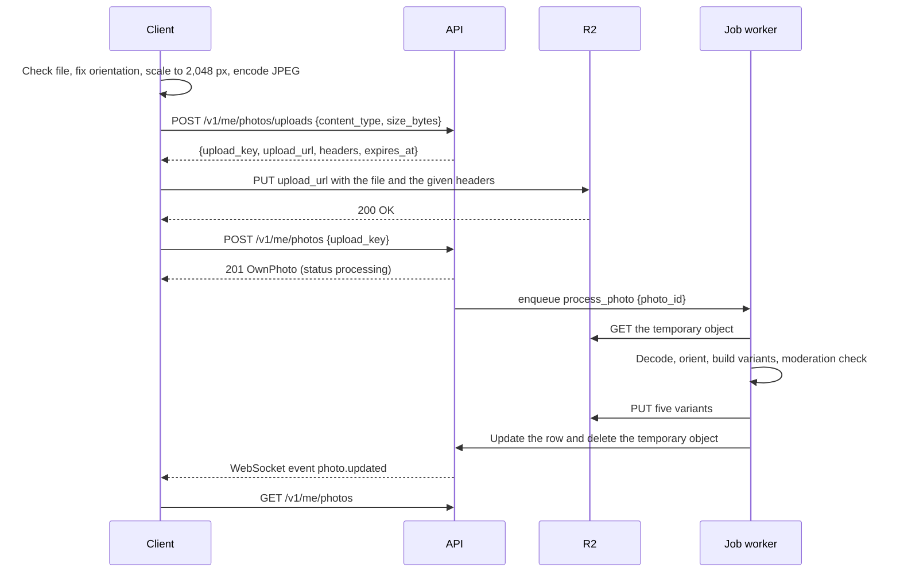

# 08. Profile and Photos

| | |
|---|---|
| Status | Design complete, not implemented |
| Related | [07-onboarding.md](07-onboarding.md) for field specifications, [09-privacy-and-visibility.md](09-privacy-and-visibility.md) for who sees what, [13-safety-and-moderation.md](13-safety-and-moderation.md) for text and photo moderation, [15-api-contract.md](15-api-contract.md) sections 7 and 8, [16-screens-and-flows.md](16-screens-and-flows.md) for the other screens, [19-jobs-and-realtime.md](19-jobs-and-realtime.md) for the job runner |

This document covers what a member does with their own profile after onboarding: viewing it (`ME-PROFILE`), editing it (`ME-EDIT`), contact details (`SET-CONTACTS`), the preview, photos (`ME-PHOTOS` and the whole photo pipeline), the completeness score, and pausing or closing the profile.

## 1. `ME-PROFILE`

**Purpose:** the member's own profile at a glance, with its status, what is missing, and a way into every editable part.

**Who can open it:** access level `open` (15 section 3). Reachable under the gates `ok`, `pending_review` and `changes_requested`. Under the gate `onboarding` the onboarding screens are used instead.

**Entry points:** the "Me" destination of the primary navigation; the completeness card on `APP-HOME`; the buttons on `GATE-REVIEW` and `GATE-CHANGES`; notifications about profile or text moderation.

**Data loaded:** `GET /v1/me/profile` (on open and after every save), `GET /v1/me/preferences`, `GET /v1/me/privacy`. `Me` comes from the cached `GET /v1/me`.

### 1.1 Content, top to bottom

| # | Block | Content |
|---|---|---|
| 1 | Header | Primary photo (`OwnProfile.photos` entry with `is_primary`, `medium_url`; a neutral placeholder when there is none; tap opens `ME-PHOTOS`). Full name (`basics.first_name` and `basics.last_name`). Age and city. Badges from `OwnProfile.verification` (ID verified, Photo verified, Phone verified). |
| 2 | Profile code | `public_code` with a copy control. Helper: "Your profile code. Give it to a family so they can find this profile." |
| 3 | Status banner | One banner chosen from 1.2, or none. |
| 4 | Completeness card | A ring with `completeness` and the line "The profile is {n}% complete". Under it, at most three hint rows from `missing` (section 6.2). Hidden when `completeness` is 100. |
| 5 | Preview button | "See how others see this profile" (section 4). |
| 6 | Section cards | The cards of 1.3 in that order. |

### 1.2 Status banners

Exactly one banner is shown, chosen by `OwnProfile.status`.

| `status` | Banner text | Banner action |
|---|---|---|
| `active` | None | |
| `paused` | "The profile is paused. Members cannot find it. Your connections can still chat with you." | "Resume" calls `POST /v1/me/profile/resume` |
| `closed` | "The profile is closed. Members cannot find it and new messages cannot be sent." | "Reopen" (section 7.4) |
| `pending_review` | "The profile is being reviewed. This usually takes less than a day. You can keep improving it in the meantime." | None |
| `changes_requested` | "Changes are needed before the profile can go live:" followed by `status_reason` | "Resubmit for review" calls `POST /v1/me/profile/resubmit`, then routes by the returned `gate` |

### 1.3 Section cards

Each card has a title, a two or three line summary of the saved values (or "Not added yet"), and one control.

| Card title | Summary | Control | Opens |
|---|---|---|---|
| "Photos" | Thumbnails of up to 3 photos, the count, and the label of the current `photo_visibility` (09 section 3.2) | "Manage" | `ME-PHOTOS` |
| "Basics" | Gender, age, marital status, height | "Edit" | `ME-EDIT` with `section = basics` |
| "Religion and community" | Religion, sect, caste, mother tongue | "Edit" | `ME-EDIT` with `section = community` |
| "Location" | City, region, country | "Edit" | `ME-EDIT` with `section = location` |
| "Education and career" | Education level, profession or employment | "Edit" | `ME-EDIT` with `section = education_career` |
| "Family" | Parents, sibling counts, family type | "Edit" or "Add" | `ME-EDIT` with `section = family` |
| "Faith, lifestyle and about" | Religiosity, the first 120 characters of `about_me` | "Edit" or "Add" | `ME-EDIT` with `section = lifestyle` |
| "Looking for" | Age range, number of must-haves | "Edit" | `ME-PREFS` |
| "Verification" | The three verification states | "Open" | `ME-VERIFY` |
| "Contact details" | "Added" or "Not added yet". Never the values themselves. | "Edit" or "Add" | `SET-CONTACTS` |
| "Profile managed by" | The `managed_by` label and `manager_name` | "Edit" | `ME-EDIT` with `section = account_for` |
| "Privacy" | Photo privacy title and name display title | "Open" | `SET-PRIVACY` |

### 1.4 Moderated text labels

The three moderated texts show a label next to the text wherever the owner sees it (`ME-PROFILE`, `ME-EDIT`, `ME-PREFS`, the preview). The status comes from `OwnProfile.text_status`.

| Text | Status key | `pending` label | `rejected` label |
|---|---|---|---|
| `about_me` | `text_status.about_me` | "Under review. Other members will see this text once it is approved." | "Not approved. This text is hidden from other members. Please edit it." |
| `about_family` | `text_status.about_family` | Same | Same |
| Partner notes (`Preferences.notes`) | `text_status.partner_notes` | Same | Same |

`approved` shows no label.

### 1.5 States

| State | Behaviour |
|---|---|
| Loading | Skeleton of the header and four cards. |
| Error | Full-screen error with "Try again" and the request id (16 section 1). |
| Empty | Not possible: a profile always exists. |

## 2. Editing rules (`ME-EDIT`)

**Purpose:** edit one section of the own profile after onboarding.

**Who can open it:** access level `open`.

**Parameter:** `section`, one of `account_for`, `basics`, `community`, `location`, `education_career`, `family`, `lifestyle`. Contact details have their own screen (section 3). Preferences use `ME-PREFS` (07 section 11). Photos use `ME-PHOTOS` (section 5.5).

**Form:** the same form component, fields, labels, option sources, conditional logic and messages as the onboarding step of the same name: 07 sections 3 to 9. The field tables are not repeated here. Differences from onboarding are listed in 2.1.

**Data loaded:** `GET /v1/me/profile` is refetched every time the screen opens (never use a cached copy to fill the form) and `GET /v1/reference/bootstrap` from the cache.

**Saving:** "Save" calls `PUT /v1/me/profile/sections/{section}` with the whole section. On success: replace the cached `OwnProfile` with the response, show the toast "Saved", go back to the previous screen. "Cancel" and Back ask "Discard changes?" when the form has unsaved input (07 section 2.5).

### 2.1 Differences from onboarding

| # | Rule |
|---|---|
| 1 | `POST /v1/me/onboarding/continue` is never called. |
| 2 | Required fields can no longer be cleared. The form does not allow it, and the API answers `validation_failed` with field code `required`. Required fields are those of 03 section 4.3 and the conditional ones in 07 (for example `children_status` unless never married). |
| 3 | Fields listed in `OwnProfile.locked_fields` are read-only (2.2). |
| 4 | On `account_for`, the three consent checkboxes are not shown, with one exception: when the member changes `managed_by` from `self` to another value, consent 3 of 07 section 3.1 is shown and must be ticked. The request then carries `"consents": ["candidate_consent"]`. |
| 5 | The gender and date of birth warning of 07 section 4.1 is not shown, because both are locked. |
| 6 | The "Skip for now" control does not exist. |

### 2.2 Locked fields

`OwnProfile.locked_fields` holds field keys. After onboarding it always contains `gender` and `date_of_birth`. After identity verification it also contains `first_name` and `last_name` (03 section 8 rule 15).

- A locked field is shown as read-only text with a lock icon.
- Under it: "This cannot be changed here. If it is wrong, write to {Me.config.support_email} and include your profile code {public_code}." The email address is a `mailto:` link with the subject "Correction request {public_code}".
- The client sends the current value of every locked field unchanged. A different value fails with field code `locked`.

### 2.3 What a save does

| Change | Effect on the server | What the client does after the save |
|---|---|---|
| Any section | `completeness` recomputed (section 6.3). `profiles.match_stale = true`. | Invalidate the cached `Me`, home data, recommendations and search results so they are refetched when next shown. |
| `about_me`, `about_family` changed to a new non-empty value | The text status becomes `pending` and a `moderate_text` job is enqueued. Other members stop seeing the previous text immediately and see nothing until the new text is approved (03 section 4.5). | Show the `pending` label (1.4). Before saving, the form shows under each of these fields: "Changes are reviewed before other members can see them." |
| `about_me`, `about_family` cleared | Status `approved`, nothing shown. | |
| A field used by matching (anything in `basics`, `community`, `location`, `education_career`, the family type and values, the lifestyle selects) | Recommendations are recomputed on the next request (10 section 8). | None beyond the invalidation above. |
| `religion_code` changed | `sect_code` must be valid for the new religion or the save fails (07 section 5.3 rule 2). The form clears the sect when the religion changes. Partner preferences are not changed. | After the save, dialog: "You changed the religion. Your partner preferences still list the previous one. Review them now?" with "Review" (opens `ME-PREFS`) and "Later". |
| `country_code` changed | Partner preferences are not changed. | After the save, the same dialog with the text "You changed the country. Your partner preferences still list the previous one. Review them now?" |
| `caste_other` or `sub_caste_other` set | A `caste_suggestions` row is upserted (07 section 5.3). | None. |
| `marital_status` changed to or from `married` | Visibility to other members changes at once (10 section 3). | None. |
| `managed_by` changed | The "managed by" line on the public profile changes. | None. |

Editing never moves an `active` profile back to review. Under the gate `changes_requested`, saving does not resubmit by itself: the member uses "Resubmit for review" on `ME-PROFILE` or `GATE-CHANGES`.

### 2.4 Concurrency

- A section is replaced as a whole. The last save wins.
- Because the form is always filled from a fresh `GET /v1/me/profile`, a stale device cannot silently overwrite newer data with old values unless both devices edit the same section at the same moment. That case is accepted.
- The response of the `PUT` is the new truth. The client never merges local state into it.

### 2.5 Errors

| Error | Behaviour |
|---|---|
| `validation_failed` | Messages under the fields (07 section 16), summary line at the top. |
| `account_suspended`, `account_banned`, other gate codes | Refetch `GET /v1/me` and route by `gate`. |
| `rate_limited` | Toast: "You are going a little fast. Please wait a moment and try again." |
| Network failure, `internal_error` | Inline error above the button with "Try again". The form keeps its input. |

## 3. Contact details (`SET-CONTACTS`)

**Purpose:** store the phone numbers, email and guardian contact that the member may later share with a connection.

**Who can open it:** access level `open`.

**Entry points:** `SET-HOME`; the "Contact details" card on `ME-PROFILE`; the contact share dialog on `APP-CONNECTION` when a value is missing (3.5); the `add_contact_details` nudge on `APP-HOME`.

**Data loaded:** `GET /v1/me/profile` (the `contacts` section).

**Saving:** `PUT /v1/me/profile/sections/contacts` with the whole `ContactsSection`. Returns `OwnProfile`.

### 3.1 Explanation shown at the top

> "These details are private. No member can see them until you choose to share them with a specific connection, and you can stop sharing at any time."

### 3.2 Fields

| Field | Control | Label | Required | Validation |
|---|---|---|---|---|
| `phone_e164` | Phone control (3.3) | "Mobile number" | No | E.164 (3.3). |
| `whatsapp_e164` | Phone control, preceded by a checkbox "Same as mobile number" | "WhatsApp number" | No | E.164 (3.3). When the checkbox is ticked the control is hidden and the client sends the value of `phone_e164`. |
| `contact_email` | Email field | "Email address" | No | At most 254 characters. One `@`, at least one character before it, a dot in the domain part, no spaces. |
| `preferred_contact` | Two radio cards | "Who should families contact first?" | Yes. Default `self`. | `self`: "Me directly". `guardian`: "My guardian". |
| `guardian_name` | Text | "Guardian's name" | See 3.4 | 2 to 80 characters, name rules of 13 section 3. |
| `guardian_relation` | Select | "Relation to the candidate" | See 3.4 | `options.guardian_relation`. |
| `guardian_phone_e164` | Phone control | "Guardian's mobile number" | See 3.4 | E.164 (3.3). |
| `best_time_to_call` | Text | "Best time to call (optional)" | No | At most 80 characters. Placeholder: "For example evenings after 7 pm". |

When `Me.user.phone_verified` is true and `phone_e164` is empty, show a one-tap suggestion under the field: "Use {Me.user.phone_e164}". Tapping fills the field; nothing is saved until "Save".

When `OwnProfile.account_for.managed_by` is not `self`, show this hint above the guardian group: "You are managing this profile. You can enter your own details as the guardian."

### 3.3 Phone control and E.164 rules

The control has a dial-code picker and a national number field.

1. The dial-code picker lists `countries` that have a `dial_code`, showing the country name and the code. Default: `+92`.
2. The national number field accepts digits, spaces and hyphens. Its keyboard is numeric.
3. To build the stored value: remove spaces and hyphens, remove one leading `0`, and prefix the dial code. Example: `+92` and `0300 1234567` gives `+923001234567`.
4. The result must match `^\+[1-9][0-9]{7,14}$`.
5. Extra rule for the dial code `+92`: the national part must be exactly 10 digits and start with `3` (a Pakistani mobile number). Placeholder for `+92`: `3XX XXXXXXX`.
6. To display a stored value: find the longest dial code in `countries` that prefixes the value, show it in the picker and the remainder in the field. For `+92` format the remainder as `3XX XXXXXXX`.
7. An empty national field means the value is `null`.

The API applies rules 4 and 5 again. These contact fields are the only place where phone numbers and email addresses are allowed in member input; the free text rules of 13 section 3 do not apply to `phone_e164`, `whatsapp_e164`, `guardian_phone_e164` and `contact_email`. They do apply to `best_time_to_call` and `guardian_name`.

### 3.4 Guardian rules

1. The three guardian fields are required together: if any of `guardian_name`, `guardian_relation`, `guardian_phone_e164` has a value, all three must have one.
2. When `preferred_contact = 'guardian'`, all three are required.
3. When `preferred_contact = 'self'` and all three are empty, the guardian group is collapsed under the link "Add a guardian's contact".

### 3.5 Coming from the contact share dialog

`PUT /v1/connections/{connection_id}/contact-share` fails with `validation_failed` and field code `required` when a selected item has no value (15 section 12). The failing `field` is `share_phone`, `share_whatsapp`, `share_email` or `share_guardian`.

1. The dialog shows: "Add your {item} first." with the button "Add now".
2. "Add now" opens `SET-CONTACTS` with two parameters: `focus` (the field to focus: `phone_e164`, `whatsapp_e164`, `contact_email` or `guardian_name`) and `return_connection_id`.
3. After a successful save with `return_connection_id` present, the client goes back to `APP-CONNECTION` for that connection and reopens the contact share dialog with the member's earlier selection.

The dialog also avoids the round trip where it can: it disables the checkbox of any item whose value is missing in the cached `OwnProfile.contacts` and shows "Add" next to it, which performs steps 2 and 3.

### 3.6 Effect of changing values that are already shared

A contact share always shows the current values (15 section 4.7, `SharedContact`). The form therefore warns, when the member has at least one `active` contact share (known from `my_contact_share` on the connections list) and changes or clears a value:

> "Connections you are sharing your contact details with will see the updated details."

Clearing a shared value is allowed. The share stays `active` and simply shows less.

### 3.7 Validation messages

| Field | Rule | Code | Message |
|---|---|---|---|
| `phone_e164`, `whatsapp_e164`, `guardian_phone_e164` | E.164 format | `invalid` | "Enter a valid phone number with the country code." |
| The same three | `+92` number is a 10 digit mobile number starting with 3 | `invalid` | "Enter a valid mobile number, for example 300 1234567." |
| `contact_email` | Email format | `invalid` | "Enter a valid email address." |
| `contact_email` | At most 254 characters | `too_long` | "This email address is too long." |
| `guardian_name`, `guardian_relation`, `guardian_phone_e164` | Required together, or required by `preferred_contact = 'guardian'` | `required` | "Enter the guardian's name, relation and mobile number." |
| `guardian_name` | 2 to 80 characters, name rules | `too_short`, `too_long`, `invalid` | "Enter a name of 2 to 80 characters, letters only." |
| `best_time_to_call` | At most 80 characters | `too_long` | "Keep it under 80 characters." |
| `preferred_contact` | One of `self`, `guardian` | `invalid` | "Choose who families should contact first." |

## 4. Preview: "See how others see this profile"

**Purpose:** let the member check the effect of their privacy settings before anyone else sees the profile.

**Entry point:** the preview button on `ME-PROFILE`, and the link "Preview" at the top of `SET-PRIVACY`.

**Layout:** the same component as `APP-PROFILE` (16 section 6), in read-only mode, with a two-way switch at the top:

| Switch position | Meaning | Tier used |
|---|---|---|
| "A member" (default) | A member of the opposite gender who has no relation to this profile | `member` |
| "A connection" | A member whose interest was accepted | `connection` |

### 4.1 How the preview is built

The preview comes from the server, from the same code that serves real viewers, so it can never drift from what members actually see.

| Switch position | Request |
|---|---|
| "A member" | `GET /v1/me/profile/preview?as=member` |
| "A connection" | `GET /v1/me/profile/preview?as=connection` |

The response is a `ProfileDetail` (15 section 4.6) of the member's own profile, already reduced by the rules of 09 for the chosen tier:

| Part | What the response contains |
|---|---|
| `display_name` | Reduced by `name_display` for the tier (09 section 4) |
| Field groups | Hidden groups are `null` and listed in `locked` (09 section 5). The client shows the same placeholders as on `APP-PROFILE`. |
| Photos | Only `approved` photos, as the real clear or blurred files that tier would receive (09 section 6). For the tier `member` the server assumes no interest was sent and no access was granted. |
| Moderated texts | Present only when their status is `approved`. For a text that is `pending` or `rejected` the client adds the owner-only note "Hidden until approved" from `OwnProfile.text_status`. |
| `last_active`, `is_online` | Present only when the matching privacy switch is on |
| `looking_for` | The lines built from the member's preferences, with `viewer_matches` always `null`, so no ticks are drawn |
| `compatibility`, `card.compat`, `card.reasons` | `null` or empty. The compatibility block is not shown. |
| `relation` | Neutral. In place of the action bar a banner reads "This is a preview. Other members see the buttons to send an interest here." |

### 4.2 Rules

1. The preview is read-only. No control on it changes anything.
2. Switching the position refetches with the other `as` value. Changing a privacy setting and returning to the preview refetches as well.
3. The clients contain no visibility logic of their own. They render the response with the `APP-PROFILE` component.
4. The preview states clearly at the top: "Preview as: {switch position}".
5. The endpoint works in every profile status. If the profile is not `active`, an extra line reads "The profile is not visible to members right now ({status label})."

## 5. Photos

### 5.1 File rules

| Rule | Value |
|---|---|
| Accepted formats | JPEG, PNG, WebP. Detected from the file content on the server, not from the file name. |
| Maximum upload size | 10 MB (the size of the file sent to R2, after the client-side step below). |
| Minimum dimensions | 400 by 400 pixels. |
| Maximum dimensions accepted by the server | 8,000 pixels on either side and 25 megapixels in total. |
| Client-side preparation | Before upload the client corrects the orientation, scales the image so the long side is at most 2,048 pixels (never enlarging), and re-encodes it as JPEG at quality 90. This removes embedded metadata on the device and keeps uploads small. |
| Photos per profile | At most `limits.photos_max` (6) photos whose status is not `rejected` or `failed`. |
| Content | One person, the candidate, face clearly visible. The full content rules are in 13 section 4. |

Client-side checks before any request:

| Check | Message |
|---|---|
| The picked file is not JPEG, PNG or WebP | "Choose a JPEG, PNG or WebP photo." |
| The picked file is larger than 30 MB | "This file is too large. Choose a smaller photo." |
| Either side is under 400 pixels | "This photo is too small. Choose one that is at least 400 by 400 pixels." |
| The prepared file is still over 10 MB | "This file is too large. Choose a photo under 10 MB." |
| The profile is at the photo limit | The add control is disabled with the caption "You have reached the maximum of {photos_max} photos." |

Platform notes for the preparation step: on the web use `createImageBitmap(file, { imageOrientation: 'from-image' })`, draw to a canvas of the target size, and export with `canvas.toBlob(callback, 'image/jpeg', 0.9)`. On Android decode with `BitmapFactory` (using `inSampleSize` to stay within memory), rotate according to `ExifInterface`, scale, and compress to JPEG at quality 90. If preparation fails on the device, upload the original file when it passes the checks above.

### 5.2 Upload flow

Step by step, for the client:

| # | Step | Detail |
|---|---|---|
| 1 | Pick | From the gallery or the camera. Several files may be picked at once, up to the free slots. |
| 2 | Prepare | 5.1. Show the local image in its slot immediately with the label "Uploading..." and a progress bar. |
| 3 | Request an upload URL | `POST /v1/me/photos/uploads` with `{ "content_type": "image/jpeg", "size_bytes": <n> }`. Errors: `payload_too_large`, `limit_reached` (messages in 5.1), `rate_limited` ("You have uploaded many photos in a short time. Please try again later."). |
| 4 | Upload | `PUT upload_url` with the file as the body and exactly the returned `headers`. Report progress from the request's upload progress. No `Authorization` header is sent to R2. |
| 5 | Confirm | `POST /v1/me/photos` with `{ "upload_key": "..." }`. The slot label changes to "Processing...". |
| 6 | Wait | Listen for the `photo.updated` WebSocket event for that photo id. Without a live socket, poll `GET /v1/me/photos` every 3 seconds for the first minute, then every 15 seconds, and stop when no photo is `processing`. |
| 7 | Show the result | The slot shows the processed thumbnail and the status label of 5.5. |

Rules:

1. **Concurrency:** at most 2 uploads run at the same time. Others wait in their slots with the label "Waiting...".
2. **Retry of the upload (step 4):** on a network error retry up to 2 times with the same URL while `expires_at` has not passed. After that, or after expiry, go back to step 3. After 3 failed rounds show "Upload failed" on the slot with a "Try again" control.
3. **Retry of the confirmation (step 5):** safe to repeat. The API treats a second confirmation of the same `upload_key` as the same photo and returns the existing `OwnPhoto` with `200`.
4. **Cancel:** a cancel control on a slot that is uploading aborts the `PUT` and frees the slot. Nothing else is needed: unconfirmed temporary objects are removed by the `cleanup_uploads` job after 24 hours.
5. **Leaving the screen:** uploads in step 4 continue while the app stays open. If the app is closed mid-upload, the upload is lost and the slot is empty next time.
6. **Order:** a new photo gets `position` one higher than the current highest.

What the API does:

| Endpoint | Server behaviour |
|---|---|
| `POST /v1/me/photos/uploads` | Checks the count limit and `size_bytes`. Generates the key `tmp/photos/{profile_id}/{uuid}` and a presigned `PUT` URL valid for 10 minutes that signs the `Content-Type` header. |
| `POST /v1/me/photos` | Checks that `upload_key` starts with `tmp/photos/{caller's profile_id}/`. Sends a `HEAD` request to R2: the object must exist (`not_found` otherwise) and be at most 10 MB (otherwise the object is deleted and the answer is `payload_too_large`). Checks the count limit again. If a `profile_photos` row with this `upload_key` already exists, returns it. Otherwise inserts the row with `status = 'processing'` and enqueues `process_photo` with the payload `{ "photo_id": "<uuid>" }`. |

### 5.3 The `process_photo` job

Runs in the API process as a background job (19 section 2). CPU-heavy work runs inside `tokio::task::spawn_blocking`.

| # | Step | Detail | On failure |
|---|---|---|---|
| 1 | Load | Read the `profile_photos` row. If its status is not `processing`, stop (the job already ran). | |
| 2 | Download | `GET` the object at `upload_key` into memory. | Retry the job (transient). |
| 3 | Identify | Detect the format from the first bytes: JPEG, PNG or WebP. | Any other content: status `failed`. |
| 4 | Read dimensions | Read width and height from the header without decoding (`ImageReader::into_dimensions`). Reject when either side is under 400, either side is over 8,000, or width times height is over 25,000,000. | Status `failed`. |
| 5 | Decode | Decode with the `image` crate, with `Limits` set to `max_image_width = 8000`, `max_image_height = 8000`, `max_alloc = 128 MiB`. | Status `failed`. |
| 6 | Orient | Read the EXIF orientation from the decoder and apply it (`DynamicImage::apply_orientation`). | Ignore a missing or invalid tag. |
| 7 | Flatten | Convert to 8-bit RGB. Images with transparency are composited over white. | |
| 8 | Build variants | The five variants in the table below. | |
| 9 | Moderate | Send the `medium` variant to the automatic check of 13 section 4.2. Its result is one of `clean`, `flag`, `reject`, `unavailable`. | A failed call, an exhausted quota or a missing configuration counts as `unavailable`. |
| 10 | Store | `PUT` the five files to R2 with `Content-Type: image/jpeg` and `Cache-Control: private, max-age=3600`. | Retry the job. |
| 11 | Decide the status | See the decision table below. Write the keys, `width` and `height` (of the `large` variant), the raw moderation result in `moderation`, and the status, in one transaction with the side effects. | |
| 12 | Clean up | Delete the temporary object at `upload_key`. | Enqueue `delete_objects` with the key. |
| 13 | Notify | Publish the `photo.updated` WebSocket event to the owner (payload in 19 section 4). | |

Variants. Resizing never enlarges an image; a source smaller than the target keeps its size. All files are JPEG. Re-encoding drops every kind of embedded metadata, including GPS location.

| Variant | Column | R2 key | How it is made | JPEG quality |
|---|---|---|---|---|
| Large | `key_large` | `photos/{profile_id}/{photo_id}/large.jpg` | Fit inside 1,600 by 1,600, keeping the aspect ratio, Lanczos3 filter | 82 |
| Medium | `key_medium` | `photos/{profile_id}/{photo_id}/medium.jpg` | Fit inside 800 by 800, keeping the aspect ratio, Lanczos3 filter | 80 |
| Thumb | `key_thumb` | `photos/{profile_id}/{photo_id}/thumb.jpg` | Scale and centre crop to exactly 320 by 320 (`resize_to_fill`) | 78 |
| Blurred medium | `key_blur_medium` | `photos/{profile_id}/{photo_id}/blur_medium.jpg` | Take the medium variant, shrink it to 48 pixels wide (aspect ratio kept, Triangle filter), apply a Gaussian blur with sigma 3.0, enlarge back to the medium variant's dimensions with the Triangle filter | 60 |
| Blurred thumb | `key_blur_thumb` | `photos/{profile_id}/{photo_id}/blur_thumb.jpg` | Take the thumb variant, shrink it to 48 by 48, apply the same blur, enlarge back to 320 by 320 | 60 |

The blurred variants hold no detail beyond a 48 pixel wide image. They cannot be sharpened back into a recognisable face.

Status decision (03 section 4.4; the thresholds that produce each result are in 13 section 4.2):

| Check result | `moderation.photo_review` | New status | `rejection_reason` |
|---|---|---|---|
| `reject` | Any | `rejected` | `inappropriate` |
| `flag` | Any | `pending_review` | |
| `unavailable` | Any | `pending_review` | |
| `clean` | `manual` | `pending_review` | |
| `clean` | `auto` | `approved` | |

Side effects, in the same transaction as the status change:

| New status | Side effects |
|---|---|
| `approved` | If the profile has no primary photo, set `is_primary = true` on this one. Set `profiles.has_approved_photo = true`. Recompute `completeness`. Set `match_stale = true`. No feed notification for an automatic approval (14 section 2, event 20); the owner learns through `photo.updated`. |
| `rejected` (automatic) | Create a `photo_rejected` notification (14 section 2, event 21). Enqueue `delete_objects` for `key_large`, `key_medium` and `key_thumb` with `run_at` 30 days later (kept that long in case of an appeal). The repeat-offender rule of 13 section 4.2 applies. |
| `pending_review` | None. The photo appears in the moderator queue (18). |
| `failed` | Enqueue `delete_objects` for the temporary object. |

A moderator's later decision (`POST /v1/admin/photos/{photo_id}/approve` or `/reject`) applies the same side effects as the `approved` and `rejected` rows, and creates a `photo_approved` or `photo_rejected` notification (14 section 2, events 19 and 21).

Retries: transient failures (R2 or network errors in steps 2, 10) use the job runner's retry policy (19). When the job is out of attempts, the row is set to `failed`.

Resource limits on a host with 1 GiB of memory:

1. The worker runs at most one `process_photo` job at a time, whatever its overall concurrency is.
2. A typical upload (2,048 pixels on the long side) needs about 13 MB decoded. The worst accepted case (25 megapixels) needs about 75 MB decoded plus the variants.
3. All buffers are dropped before the upload step starts, except the five encoded files (under 1 MB together).
4. Target time per photo: under 3 seconds.

### 5.4 URL signing

Photo files are private R2 objects. Clients receive presigned `GET` URLs in the `thumb_url`, `medium_url` and `large_url` fields of `OwnPhoto` and `PhotoView`.

| # | Rule |
|---|---|
| 1 | URLs are created with the `aws-sdk-s3` presigner against the R2 S3 endpoint (`https://<account_id>.r2.cloudflarestorage.com`). Presigned URLs do not work on R2 custom domains. |
| 2 | Every URL is valid for 2 hours (`expires_in = 7200` seconds). |
| 3 | The signing time is the current time in UTC truncated to the start of the hour (`PresigningConfig::builder().start_time(hour_start).expires_in(7200 s)`). The signature therefore depends only on the key and the hour, so the API returns the identical URL for the same file throughout the hour. Browsers and image caches can reuse the downloaded file. |
| 4 | Because of rule 3, a URL handed out at any moment is still valid for at least 60 minutes. This is the guarantee stated in 15 section 4.4. |
| 5 | Objects are stored with `Cache-Control: private, max-age=3600` (set at upload in 5.3 step 10), so a browser keeps a file for up to an hour without asking again. |
| 6 | Only keys the viewer is allowed to see are ever signed. The decision is made by the visibility rules of 09 section 6. A viewer who sees the photos clearly gets `key_thumb`, `key_medium`, `key_large`. A viewer who does not gets `key_blur_thumb` in `thumb_url`, `key_blur_medium` in `medium_url`, `large_url: null`, and `is_blurred: true`. The clear keys are never sent to that viewer in any field. |
| 7 | The owner always gets the clear keys of their own photos, including photos that are `pending_review` or `rejected`. Photos that are `processing` or `failed` have `null` URLs. |
| 8 | Signing is local computation (an HMAC per URL) and makes no network call. Signing three URLs for each of 50 cards is acceptable on every list endpoint. |
| 9 | Signed URLs are never written to logs, error reports or analytics events. |
| 10 | No `response-content-disposition` parameter is added. The API offers no download endpoint. |

Client rules:

1. Do not store photo URLs beyond 60 minutes. Data older than that must be refetched before its images are shown.
2. If an image request fails with HTTP 403 (expired URL), refetch the query that supplied the URL once, then show the placeholder if it fails again.
3. On Android, give the image loader a cache key that is the URL without its query string, so the hourly change of signature does not discard cached images (22). On the web the browser cache is keyed by the full URL, so each image is downloaded at most once per hour.
4. Never offer a save, share or download control for another member's photo. On the web, disable dragging and the context menu on photo elements. Android screens that show other members' photos use `FLAG_SECURE` (09 section 6).

R2 bucket settings required: private bucket; CORS allowing `PUT` and `GET` from the web origins of the environment (`PUT` is needed for direct uploads; `` loads do not need CORS).

### 5.5 `ME-PHOTOS`

**Purpose:** add, order and remove the member's own photos and see their review status.

**Who can open it:** access level `open`.

**Entry points:** the "Photos" card and the header photo on `ME-PROFILE`; the `add_photo` nudge; `ONB-DONE`; `GATE-REVIEW`; photo notifications.

**Data loaded:** `GET /v1/me/photos` on open and after every change; `GET /v1/me/privacy` for the privacy line; `Me.config.photos_max`.

**Content, top to bottom:**

| # | Block | Content |
|---|---|---|
| 1 | Privacy line | "Who can see the photos: {label of the current `photo_visibility`, 09 section 3.2}" with the link "Change" to `SET-PRIVACY`. |
| 2 | Photo grid | `photos_max` slots, 3 per row on narrow screens. Filled slots come first, ordered by `position`. The primary photo carries the label "Main photo". Each filled slot shows `thumb_url` and, when the status is not `approved`, a status label over the image. Empty slots show a plus sign. |
| 3 | Rejection messages | Under the grid, one line per `rejected` or `failed` photo with its message and a "Remove" control. |
| 4 | Photo rules | The "Do" and "Do not" list of 13 section 4.1. |

Status labels on a slot:

| `status` | Label on the slot | Seen by other members |
|---|---|---|
| `processing` | "Processing..." | No |
| `pending_review` | "In review" | No |
| `approved` | None (or "Main photo" on the primary one) | Yes, according to the photo privacy |
| `rejected` | "Not approved" | No |
| `failed` | "Could not be read" | No |

Rejection messages:

| Photo | Message shown in block 3 |
|---|---|
| Status `rejected` | The member-facing message for its `rejection_reason`, from the table "Member-facing message per reason" in 13 section 4.3 (for example, for `low_quality`: "This photo is too blurry or too dark. Please upload a clearer one."). A text link "Photo guidelines" scrolls to block 4. |
| Status `failed` | "This file could not be read. Upload a JPEG, PNG or WebP photo of at least 400 by 400 pixels." |

The short labels of `options.photo_rejection_reason` (05 section 2.43) are used by the admin console and in notifications; this screen uses the full messages of 13.

**Actions:**

| Control | Endpoint | On success | On error |
|---|---|---|---|
| Tap an empty slot | The upload flow of 5.2 | The slot fills and progresses through the labels | Messages of 5.1 and 5.2 |
| Tap a filled slot | None | Opens the own photo full screen (`large_url`) with the controls below | |
| "Make main photo" (on an `approved` photo that is not primary) | `PATCH /v1/me/photos/{photo_id}` with `{ "is_primary": true }` | Replace the list with the response. Toast "Main photo changed." | `invalid_state`: toast "Only an approved photo can be the main photo." |
| Reorder (drag a slot on the web; long-press and drag on Android; each slot's menu also has "Move earlier" and "Move later" for members who cannot drag) | `PUT /v1/me/photos/order` with `{ "photo_ids": [...] }` listing every photo once in the new order | Replace the list with the response | Restore the previous order and show "Could not save the new order. Try again." |
| "Remove" | `DELETE /v1/me/photos/{photo_id}` after the confirmation "Remove this photo?" with "Remove" and "Cancel" | Refetch the list. Toast "Photo removed." | Generic error toast |

Rules:

1. **Photo-verified warning.** When `OwnProfile.verification.photo_verified` is true, "Make main photo" and removing the current main photo first show: title "This removes the Photo verified badge", body "The badge belongs to the current main photo. After the change you can verify again from the verification screen.", buttons "Continue" and "Cancel". This reflects 03 section 4.4; 12 section 4.6.
2. **Removing the main photo.** The approved photo with the lowest `position` becomes the main photo automatically (03 section 4.4). If no approved photo remains, `has_approved_photo` becomes false and the profile shows a placeholder to others.
3. **Reordering** does not change which photo is the main one. Other members always see the main photo first, then the rest by `position`.
4. **Optimistic updates** are not used on this screen. Every change waits for the server.
5. **Live updates.** A `photo.updated` event refetches the list.

**States:**

| State | Behaviour |
|---|---|
| Loading | Grid of grey slots. |
| Empty | All slots empty. Above the grid: "No photos yet. Profiles with a photo receive far more interest." |
| Error | Full-screen error with "Try again" and the request id. |

### 5.6 Storage budget

Estimated size of one processed photo (typical portrait from a phone):

| File | Typical size |
|---|---|
| `large.jpg` | 260 KB |
| `medium.jpg` | 85 KB |
| `thumb.jpg` | 18 KB |
| `blur_medium.jpg` | 12 KB |
| `blur_thumb.jpg` | 4 KB |
| **Total per photo** | **about 380 KB** |

What the R2 free tier holds (10 GB of storage, 1 million write operations and 10 million read operations a month):

| Question | Answer |
|---|---|
| Photos that fit in 10 GB | About 26,000 |
| Profiles at an average of 3 photos | About 8,700 |
| Profiles when every profile uses all 6 slots | About 4,300 |
| Write operations per photo | 6 (1 temporary upload and 5 variants). 1 million writes cover about 166,000 photos a month. |
| Read operations | One per image shown and not cached. A member viewing 100 cards a day uses about 3,000 reads a month for thumbnails; 10 million reads cover about 3,000 such members, more with the hourly cache of 5.4. |

Verification images (12) and data exports use the same bucket and are deleted on a schedule, so they do not change these numbers materially. When storage passes 8 GB, the first measure is to lower the `large` variant to 1,280 pixels for new uploads; the second is the paid tier (20 section on capacity).

## 6. Completeness

`profiles.completeness` is a whole number from 0 to 100. It is shown to the owner, used for the hints on `ME-PROFILE` and the `complete_profile` nudge on `APP-HOME`, and used as one input of match ranking (10).

### 6.1 Points table

The score is the sum of the points of every item whose rule is met. The points add up to exactly 100.

| # | Item key | Points | Rule (met when) |
|---|---|---|---|
| 1 | `core` | 20 | Every field required by the `profiles_required_when_submitted` constraint is set (04 section 5.1). Always met once onboarding is completed. |
| 2 | `photo` | 15 | `has_approved_photo` is true. |
| 3 | `more_photos` | 5 | The profile has 3 or more `approved` photos. |
| 4 | `about_me` | 10 | `about_me` has 100 or more characters and `about_me_status` is not `rejected`. |
| 5 | `education_details` | 5 | `education_field_code` is set, and at least one of `degree_title` and `institute_name` is set. |
| 6 | `career_details` | 5 | `profession_code` is set, or `employment_type` is `student`, `homemaker` or `not_working`. |
| 7 | `income` | 3 | `income_band_code` is set, or `employment_type` is `student`, `homemaker` or `not_working`. |
| 8 | `family` | 10 | At least 6 of these 8 `profile_family` columns are set: `father_status`, `mother_status`, `brothers_count`, `sisters_count`, `family_type`, `family_class`, `family_values`, `home_ownership`. |
| 9 | `religious_practice` | 5 | `religiosity` is set, and either `prayer_frequency` is set or `religion_code` is not `islam`. |
| 10 | `plans` | 5 | `living_arrangement`, `work_after_marriage` and `marriage_timeline` are all set. |
| 11 | `relocation` | 2 | `relocation` is set. |
| 12 | `hobbies` | 3 | The profile has 3 or more rows in `profile_hobbies`. |
| 13 | `partner_preferences` | 4 | A `partner_preferences` row exists. |
| 14 | `identity` | 3 | A `profile_identity` row exists. |
| 15 | `id_verified` | 3 | `is_id_verified` is true. |
| 16 | `photo_verified` | 2 | `is_photo_verified` is true. |
| | **Total** | **100** | |

Caste, complexion, weight, blood group and other sensitive optional fields are deliberately not part of the score: members are never pushed to state them.

### 6.2 The `missing` list

`OwnProfile.missing` holds the item keys of 6.1 whose rule is not met.

Order: by points, highest first; items with equal points keep the order of the table. Three items are left out while the item they depend on is itself missing:

| Item | Left out while this is missing |
|---|---|
| `more_photos` | `photo` |
| `photo_verified` | `photo` |
| `id_verified` | `identity` |

The full order when everything is missing is therefore: `core`, `photo`, `about_me`, `family`, `education_details`, `career_details`, `religious_practice`, `plans`, `partner_preferences`, `income`, `hobbies`, `identity`, `relocation`. Then, as their dependencies are met: `more_photos` (5 points, after `about_me` and `family`), `id_verified` (3 points, after `identity`), `photo_verified` (2 points, last).

The clients show the first three entries as hint rows:

| Key | Hint text | Opens |
|---|---|---|
| `core` | "Finish the required details" | Onboarding at the current step |
| `photo` | "Add a photo" | `ME-PHOTOS` |
| `more_photos` | "Add more photos (3 or more work best)" | `ME-PHOTOS` |
| `about_me` | "Write a few lines about yourself (100 characters or more)" | `ME-EDIT` with `section = lifestyle` |
| `family` | "Add family details" | `ME-EDIT` with `section = family` |
| `education_details` | "Add the field of study and degree" | `ME-EDIT` with `section = education_career` |
| `career_details` | "Add the profession" | `ME-EDIT` with `section = education_career` |
| `income` | "Add the monthly income (kept private by default)" | `ME-EDIT` with `section = education_career` |
| `religious_practice` | "Add religious practice" | `ME-EDIT` with `section = lifestyle` |
| `plans` | "Add plans after marriage" | `ME-EDIT` with `section = lifestyle` |
| `relocation` | "Say whether you would relocate" | `ME-EDIT` with `section = location` |
| `hobbies` | "Choose at least 3 hobbies" | `ME-EDIT` with `section = lifestyle` |
| `partner_preferences` | "Set your partner preferences" | `ME-PREFS` |
| `identity` | "Add the identity number" | `ME-VERIFY` |
| `id_verified` | "Verify your identity" | `ME-VERIFY-ID` |
| `photo_verified` | "Verify your photo with a selfie" | `ME-VERIFY-SELFIE` |

### 6.3 When it is recomputed

One function, `compute_completeness(profile_id)`, reads the rows and returns the score and the `missing` list. It is called, and `profiles.completeness` updated, in the same transaction as each of these events:

| Event | Where |
|---|---|
| Any `PUT /v1/me/profile/sections/{section}` | 15 section 7 |
| `PUT /v1/me/preferences` | 15 section 7 |
| `PUT /v1/me/identity` | 15 section 7 |
| `POST /v1/me/onboarding/complete` | 15 section 7 |
| A photo becomes `approved`, an approved photo is deleted, or a moderator rejects a photo | 5.3, 15 sections 8 and 16 |
| A verification request is approved, or `is_photo_verified` is cleared because the main photo changed | 12 |
| A moderator rejects or approves `about_me` | 15 section 16 |
| An admin corrects a locked field | 15 section 16 |

`missing` is not stored. It is computed when `GET /v1/me/profile` is answered.

### 6.4 Worked examples

**Example A: a member who has just finished onboarding and skipped the optional steps.** Private job with a profession chosen, no field of study, no income, no family, no lifestyle answers, no photo, preferences saved, identity number entered.

| Item | Met | Points |
|---|---|---|
| `core` | Yes | 20 |
| `career_details` | Yes | 5 |
| `partner_preferences` | Yes | 4 |
| `identity` | Yes | 3 |
| Everything else | No | 0 |
| **Score** | | **32** |

`missing` is: `photo`, `about_me`, `family`, `education_details`, `religious_practice`, `plans`, `income`, `hobbies`, `id_verified`, `relocation`. The hints shown are "Add a photo", "Write a few lines about yourself (100 characters or more)" and "Add family details".

**Example B: an engaged member.** Everything filled in, two approved photos, identity number entered but no verification done.

| Item | Met | Points |
|---|---|---|
| All items except the three below | Yes | 90 |
| `more_photos` | No (2 photos) | 0 |
| `id_verified` | No | 0 |
| `photo_verified` | No | 0 |
| **Score** | | **90** |

`missing` is: `more_photos`, `id_verified`, `photo_verified`.

### 6.5 Relation to the home nudges

`GET /v1/home` returns at most three `nudges` (15 section 10). They are defined only in 10 section 10.1. Its conditions reuse the items of 6.1 (for example, `add_about_me` applies while the `about_me` item is not met) and `profiles.completeness` (`complete_profile` applies under 70). The texts and targets of the nudge cards are in 16 section 6.4.

## 7. Profile status actions (`SET-ACCOUNT`)

The "Profile status" group on `SET-ACCOUNT` shows the current status in words and the actions allowed from it. All four endpoints return `Me`; the client replaces its cached `Me` and re-routes if the `gate` changed. Effects follow 03 section 4.2.

| Current status | Status line | Actions offered |
|---|---|---|
| `active` | "The profile is live." | "Pause the profile", "Close the profile" |
| `paused` | "The profile is paused." | "Resume the profile", "Close the profile" |
| `closed` | "The profile is closed." | "Reopen the profile" |
| `pending_review`, `changes_requested` | "The profile is not live yet." | None |

### 7.1 Pause

- Control: "Pause the profile".
- Confirmation: title "Pause the profile?", body "While it is paused: members cannot find the profile or send new interests. Interests you have already received stay open and you can still answer them. You can still chat with your connections. You cannot browse matches or send interests. You can resume at any time.", buttons "Pause" and "Cancel".
- Call: `POST /v1/me/profile/pause`.
- After: toast "The profile is paused."
- Error `invalid_state`: refetch `GET /v1/me`.

### 7.2 Resume

- Control: "Resume the profile". No confirmation.
- Call: `POST /v1/me/profile/resume`.
- After: toast "The profile is live again."

### 7.3 Close

- Control: "Close the profile".
- Dialog: title "Close the profile?". A required single choice "Why are you closing it?":

| `reason` | Choice text |
|---|---|
| `found_match_here` | "I found a match on Khandani Rishta" |
| `found_match_elsewhere` | "I found a match elsewhere" |
| `taking_a_break` | "I am taking a long break" |
| `other` | "Another reason" |

- Body under the choices: "Closing hides the profile from everyone except your connections. All open interests, sent and received, are closed. You can read your chats but cannot send messages. You can reopen the profile later."
- Buttons: "Close the profile" and "Cancel".
- Call: `POST /v1/me/profile/close` with `{ "reason": "<reason>" }`.
- After: toast "The profile is closed." When the reason was `found_match_here`, show once: "Mubarak! If the match is one of your connections, you can mark the engagement or nikah on that connection." with the button "Open my connections" (`APP-CHATS`).

Closing is different from deleting the account. The account, chats and data stay. Account deletion is specified in 06 section 9 and on `SET-ACCOUNT` in 16 section 6.

### 7.4 Reopen

- Control: "Reopen the profile".
- Ordinary case: confirmation with the title "Reopen the profile?", body "The profile becomes visible to members again.", buttons "Reopen" and "Cancel".
- After a confirmed nikah: before showing the dialog the client loads `GET /v1/connections?filter=active`. If any connection has `stage = 'nikah_done'`, the dialog instead reads: title "Reopen after a nikah?", body "This profile was closed after a nikah was confirmed with {other.display_name}. Reopening ends that connection. Type REOPEN to confirm.", a text field, and a "Reopen" button that is enabled only when the field contains exactly `REOPEN`.
- Call in both cases: `POST /v1/me/profile/reopen` with `{ "confirm": true }`.
- After: toast "The profile is live again."

## 8. Biodata sheet (later phase)

Families in Pakistan commonly exchange a one-page "biodata" or "rishta CV" on paper or by message. A later phase adds a way for a member to produce one from their own profile. It is not part of the first release and has no schema or API impact.

| Topic | Outline |
|---|---|
| Entry point | A button "Create a biodata sheet" on `ME-PROFILE`. |
| Content | Name, age, height, marital status, religion and sect, caste (if stated), education, profession, city, family summary (parents, siblings, family type), a short "about" paragraph, the main photo (optional), and the profile code with the line "Find this profile on Khandani Rishta". |
| Never included | The identity number, income (unless the member ticks it), and anything from `profile_contacts` unless the member ticks each item. |
| Choices before creating | A checklist of the blocks to include, each off or on, with photo and contact details off by default. |
| Production | Built on the device from `OwnProfile` as a single A4 page: a print stylesheet and the browser's print-to-PDF on the web; a `PdfDocument` on Android. No server rendering, no stored file. |
| Sharing | The system share sheet. The app shows a reminder first: "Anyone who receives this sheet can pass it on. Include only what you are comfortable sharing." |
| Languages | English first, Urdu when the second language phase ships. |
