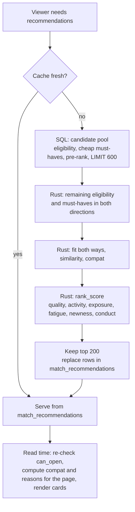

# 10. Matching and Discovery

| | |
|---|---|
| Status | Design complete, not implemented |
| Related | [03-domain-model.md](03-domain-model.md) for limits and invariants, [04-database-schema.md](04-database-schema.md) sections 5.6 and 8, [07-onboarding.md](07-onboarding.md) section 12 for preference defaults, [09-privacy-and-visibility.md](09-privacy-and-visibility.md) for who may see whom, [15-api-contract.md](15-api-contract.md) section 10 |

This document defines how the product decides which profiles a member sees, in what order, with what "N% match" number, and why. It covers recommendations, search and the home lists.

## 1. Goals and principles

| # | Principle | What it means in practice |
|---|---|---|
| 1 | **Mutual fit** | A good match satisfies both people. The score combines how well the candidate fits the viewer and how well the viewer fits the candidate. A one-sided fit scores low. |
| 2 | **Must-haves really exclude** | A preference marked `must` is a hard filter. A profile that fails it is never recommended, however good the rest is. |
| 3 | **Honest when empty** | When few or no profiles pass the must-haves, the product says so and shows which must-have to loosen. It never pads the list with profiles that break a must-have. |
| 4 | **Fair attention** | Ranking spreads attention: popular profiles are dampened so they are not flooded, new members get a short boost, and profiles a viewer keeps skipping sink. |
| 5 | **Explainable** | Every full-size card shows up to three plain reasons, the smaller cards show the percentage (16 section 1.5), and the profile page shows a line-by-line comparison in both directions. |
| 6 | **Private by construction** | Values a member hides from other members take no part in matching or search (09 section 5.4). |
| 7 | **One implementation** | All scoring is a set of pure Rust functions in `apps/api/src/matching/`. Recommendations, search, the home lists and the profile page call the same functions. |
| 8 | **Free-tier sized** | One SQL query per refresh, scoring in memory, results cached in `match_recommendations`. No search engine, no vector store. |

## 2. Pipeline



Terms: V is the viewer's profile, C is a candidate profile. "Subject" is the profile being tested against someone's preferences.

## 3. Eligibility and must-haves

### 3.1 Eligibility rules

A candidate C is eligible for viewer V's **recommendations** only when every rule holds.

| Rule | Condition | Where enforced |
|---|---|---|
| E1 | `C.gender <> V.gender` | SQL |
| E2 | `C.status = 'active'` and C's `users.status = 'active'` | SQL |
| E3 | No `blocks` row in either direction | SQL |
| E4 | No `passes` row from V to C with `expires_at > now()` | SQL |
| E5 | No connection between V and C that is `active`, or that ended less than `connection.cooldown_after_end_days` (90) days ago | SQL |
| E6 | No `pending` interest in either direction | SQL |
| E7 | No interest in either direction that was `declined` less than 90 days ago, `expired` less than 30 days ago, or `withdrawn` less than 7 days ago (the three `interest.cooldown_*` settings) | SQL |
| E8 | C's `discovery_visibility` permits V: `everyone` always; `preference_match` only when `passes_must_haves(C.prefs, V)`; `hidden` never | SQL for `hidden`, Rust for the rest |
| E9 | Second-marriage rule, both directions: if `C.marital_status = 'married'` then V's `marital_statuses` contains `married`; if `V.marital_status = 'married'` then C's `marital_statuses` contains `married`. An empty array does not contain it. | SQL |
| M1 | `passes_must_haves(V.prefs, C)` | Partly SQL (age, religion), fully re-checked in Rust |
| M2 | `passes_must_haves(C.prefs, V)` | Rust |

E7 uses both directions on purpose: a member who declined someone should not be shown that person again as a recommendation during the cooldown.

**Search** uses E1 to E9 but not M1 or M2 (section 9). **Opening a profile** uses 09 section 2, which contains E1, E2, E3, E8 and E9.

### 3.2 `passes_must_haves`

```text
fn passes_must_haves(prefs: &Preferences, subject: &Subject) -> bool:
    for d in DIMENSIONS:                      // the 18 keys of section 4
        if importance(prefs, d) != Must: continue
        if !is_set(prefs, d, subject):  continue      // no preference stated: ignored
        if !must_test(prefs, d, subject): return false
    return true
```

Rules:

1. `is_set` and `must_test` for each dimension are defined in section 4.
2. **Unknown fails.** If the subject's value for the dimension is unknown (null, or not matchable because the subject hides the group from members, 09 section 5.4), `must_test` is false.
3. **Not set is ignored.** A dimension marked `must` with no values chosen filters nothing.
4. A profile with no `partner_preferences` row is treated as having the default preferences of 07 section 12 (which include religion as a must-have). In practice every profile that has finished onboarding has a row, because the `preferences` step saves one.
5. The function is symmetric in use: it is called once with (V's preferences, C) and once with (C's preferences, V).

`Subject` is a struct holding the matchable view of a profile: every column used in section 4, with the hidden groups already replaced by `None`. Build it in exactly one place (`Subject::from_rows`) so the privacy rule cannot be forgotten.

## 4. Dimensions

There are 18 dimensions. The key of each equals the prefix of its `_importance` column in `partner_preferences`.

### 4.1 Weights

`weight(d) = base_weight(d) * multiplier(importance)`.

| Importance | Multiplier | Also a hard filter |
|---|---|---|
| `must` | 1.5 | Yes |
| `high` | 1.5 | No |
| `medium` | 1.0 | No |
| `low` | 0.5 | No |

| Dimension | Base weight | Dimension | Base weight |
|---|---|---|---|
| `religion` | 10 | `profession` | 5 |
| `age` | 9 | `income` | 5 |
| `sect` | 8 | `family` | 5 |
| `marital_status` | 8 | `mother_tongue` | 4 |
| `location` | 7 | `living_arrangement` | 4 |
| `education` | 7 | `height` | 3 |
| `religiosity` | 6 | `appearance` | 3 |
| `children` | 6 | `work_after_marriage` | 3 |
| `caste` | 5 | `smoking` | 2 |

Base weights are constants in code (`matching/weights.rs`), not settings.

### 4.2 Ordered scales

Used for "adjacent" partial credit and for similarity.

| Scale | Order (1 is lowest) |
|---|---|
| `religiosity` | `not_practising` 1, `moderately_practising` 2, `practising` 3, `very_practising` 4 |
| `family_values` | `liberal` 1, `moderate` 2, `traditional` 3, `religious` 4 |
| `prayer_frequency` | `rarely` 1, `jummah_only` 2, `sometimes` 3, `most_prayers` 4, `five_times` 5 |
| `marriage_timeline` | `within_6_months` 1, `within_1_year` 2, `within_2_years` 3 (`not_decided` has no position) |
| Education | `education_levels.rank` |
| Income | `income_bands.rank` |

Two values are **adjacent** when their positions differ by exactly 1.

### 4.3 General scoring rules

1. Every sub-score `s` is a number from 0 to 1.
2. If a dimension is not set (`is_set` false), it is skipped: it adds nothing to the numerator or the denominator.
3. If the dimension is set but the subject's value is **unknown**, `s = 0.5`. (For a `must` dimension the candidate was already excluded by section 3.2.)
4. "In the set" means the subject's value is an element of the preference array.
5. Age is the whole number of years on today's date in `Asia/Karachi`.

### 4.4 Dimension table

| Key | Preference columns | Subject value | Set when | Sub-score `s` | Must test |
|---|---|---|---|---|---|
| `age` | `age_min`, `age_max` | Age from `date_of_birth` | Not (`age_min = 18` and `age_max = 80`) | 1 inside the range. Outside: `max(0, 1 - 0.2 * k)`, `k` = years beyond the nearer bound | Inside the range |
| `height` | `height_min_cm`, `height_max_cm` | `height_cm` | At least one bound is not null (a null bound is open) | 1 inside. Outside: `max(0, 1 - 0.1 * k)`, `k` = cm beyond the nearer bound | Inside the range |
| `marital_status` | `marital_statuses` | `marital_status` | Array not empty | 1 if in the set, else 0 | In the set |
| `children` | `children_acceptance` | `children_status`. Null counts as `none` when `marital_status = 'never_married'`, otherwise unknown | Value is not `any` | `none`: 1 if subject is `none`, else 0. `not_living_with_partner`: 1 if subject is `none` or `not_living_with_me`, else 0 | `s = 1` |
| `religion` | `religion_codes` | `religion_code` | Array not empty | 1 if in the set, else 0 | In the set |
| `sect` | `sect_codes` | `sect_code` (null is unknown) | Array not empty | 1 if in the set, else 0 | In the set |
| `caste` | `caste_codes` (top-level codes) | `caste_code`, only when the subject's `caste_visibility = 'members'`. A subject with only `caste_other`, with no caste, or hiding caste is unknown | Array not empty | 1 if in the set, else 0 | In the set |
| `mother_tongue` | `mother_tongue_codes` | `mother_tongue_code`, and `profile_languages` for partial credit | Array not empty | 1 if the mother tongue is in the set. 0.5 if not, but one of the subject's other languages is. Else 0 | Mother tongue in the set |
| `location` | `country_codes`, `region_ids`, `city_ids` | `country_code`, `region_id`, `city_id`, `relocation` | Any of the three arrays not empty | See 4.5 | `s = 1.0` |
| `education` | `education_min_rank` | Rank of `education_level_code` | Not null | 1 if rank >= minimum. 0.5 if rank = minimum - 1. Else 0 | rank >= minimum |
| `profession` | `employment_types`, `profession_codes` | `employment_type`, `profession_code` (null is unknown) | Either array not empty | Mean of the set parts. Part score: 1 if in the set, 0 if not, 0.5 if unknown | Every set part is in the set |
| `income` | `income_min_rank` | Rank of `income_band_code`, only when the subject's `income_visibility = 'members'`; otherwise unknown | Not null | 1 if rank >= minimum. 0.5 if rank = minimum - 1. Else 0 | rank >= minimum |
| `religiosity` | `religiosity_levels` | `religiosity` (null is unknown) | Array not empty | 1 if in the set. 0.5 if adjacent to a listed level. Else 0 | In the set |
| `appearance` | `hijab_types` when the subject is female, `beard_types` when the subject is male | `hijab` or `beard` (null is unknown) | The array for the subject's gender is not empty | 1 if in the set, else 0 | In the set |
| `family` | `family_values`, `family_types` | `profile_family.family_values`, `family_type`, only when the subject's `family_visibility = 'members'`; otherwise unknown | Either array not empty | Mean of the set parts. Values part: 1 in the set, 0.5 adjacent, else 0. Type part: 1 in the set, else 0. Unknown part: 0.5 | Every set part scores 1 |
| `living_arrangement` | `living_arrangements` | `living_arrangement` (null is unknown) | Array not empty | 1 if in the set. 0.7 if not in the set but the subject is `flexible`. Else 0 | In the set |
| `work_after_marriage` | `work_after_marriage_options` | `work_after_marriage` (null is unknown) | Array not empty | 1 if in the set. 0.7 if not in the set but the subject is `flexible`. Else 0 | In the set |
| `smoking` | `smoking_options` | `smoking` (null is unknown) | Array not empty | 1 if in the set, else 0 | In the set |

### 4.5 Location sub-score

A listed country, region or city each fully accepts everything inside it. The arrays are a union.

```text
fn location_score(prefs, subject, geo) -> f32:
    if subject.city_id   in prefs.city_ids       { return 1.0 }
    if subject.region_id in prefs.region_ids     { return 1.0 }
    if subject.country   in prefs.country_codes  { return 1.0 }
    if subject.region_id in regions_of(prefs.city_ids)                         { return 0.7 }
    if subject.country in countries_of(prefs.city_ids) or
       subject.country in countries_of(prefs.region_ids)                       { return 0.4 }
    if subject.relocation in [abroad, anywhere]                                { return 0.3 }
    return 0.0
```

Notes:

1. `regions_of` and `countries_of` map listed city and region ids to their parents. Load the needed `cities` and `regions` rows once per scoring pass (one query for all ids found in the viewer's and the candidates' preferences).
2. A subject with `city_other` (no `city_id`) can still match by region or country.
3. The subject's `country_code` is required on every non-draft profile, so location is never unknown.
4. The 0.3 case is "lives in a different country from everything listed, but is willing to move abroad".

## 5. Fit and compatibility

### 5.1 Directional fit

```text
fn fit(prefs: &Preferences, subject: &Subject) -> f32:
    let (num, den) = (0.0, 0.0)
    for d in DIMENSIONS:
        if !is_set(prefs, d, subject): continue
        let w = base_weight(d) * multiplier(importance(prefs, d))
        num += w * score(prefs, d, subject)
        den += w
    if den == 0.0 { 0.75 } else { num / den }
```

`fit_VC = fit(V.prefs, C)` is how well the candidate fits the viewer. `fit_CV = fit(C.prefs, V)` is how well the viewer fits the candidate. With no preferences set at all, the fit is a neutral 0.75.

### 5.2 Similarity

Similarity measures shared background independent of stated preferences. It is symmetric. Each feature gives a value from 0 to 1, or is skipped when the needed data is missing on either side.

| Feature | Weight | Value |
|---|---|---|
| `place` | 3 | Same `city_id`: 1.0. Else same `region_id`: 0.6. Else same `origin_city_id` (both not null): 0.6. Else same `country_code`: 0.3. Else 0. |
| `mother_tongue` | 2 | Same mother tongue: 1.0. Else one speaks the other's mother tongue as an additional language: 0.3. Else 0. |
| `sect` | 2 | Skipped unless both `sect_code` are set. Same: 1.0. Different: 0. |
| `religiosity` | 2 | Skipped unless both set. `1 - abs(a - b) / 3` on the religiosity scale. |
| `education` | 2 | `1 - min(abs(rank_a - rank_b), 4) / 4`. |
| `age_gap` | 2 | `g` = man's age minus woman's age. 0 to 5: 1.0. 6 to 8, or -2 to -1: 0.7. 9 to 12, or -5 to -3: 0.4. Otherwise 0.1. |
| `caste` | 1.5 | Skipped unless both have a matchable `caste_code`. Same: 1.0. Different: 0. |
| `family_values` | 1.5 | Skipped unless both have matchable `family_values`. `1 - abs(a - b) / 3`. |
| `prayer` | 1 | Skipped unless both set. `1 - abs(a - b) / 4`. |
| `hobbies` | 1 | Skipped unless both have at least one hobby. `min(1, 2 * jaccard)` where `jaccard = shared / union`. |
| `marriage_timeline` | 1 | Skipped unless both set. If either is `not_decided`: 0.5. Else `1 - abs(a - b) / 2`. |
| `living_arrangement` | 1 | Skipped unless both set. Same: 1.0. Different but one is `flexible`: 0.7. Else 0. |

`similarity = sum(weight * value) / sum(weight)` over the features that were not skipped. If every feature is skipped, `similarity = 0.5`.

### 5.3 Compatibility

```text
compat = round(100 * (0.75 * sqrt(fit_VC * fit_CV) + 0.25 * similarity))
```

1. `round` is round half up to a whole number. Clamp to 0..100.
2. The geometric mean punishes one-sided fits: `fit_VC = 1.0` with `fit_CV = 0.25` gives 0.5, not 0.625.
3. `compat` is symmetric: V sees the same number on C's profile as C sees on V's. This holds because both fits and the similarity use only matchable values, never tier-dependent ones.
4. `compat` is the only matching number shown to members ("92% match"). It is never changed by ranking factors.
5. `Compatibility.viewer_fit = round(100 * fit_VC)` and `owner_fit = round(100 * fit_CV)`.

## 6. Ranking score

`rank_score` orders recommendations. It is never shown.

```text
rank_score = (compat / 100) * quality * activity * exposure * fatigue * newness * conduct
```

| Factor | Formula | Range |
|---|---|---|
| `quality` | `0.70 + 0.10 * completeness / 100 + 0.08 * has_approved_photo + 0.06 * is_id_verified + 0.04 * is_photo_verified + 0.02 * is_phone_verified` (booleans count as 0 or 1) | 0.70 to 1.00 |
| `activity` | By age of C's `last_active_at`: up to 24 hours 1.00; up to 7 days 0.95; up to 30 days 0.80; up to 90 days 0.50; older or null 0.30 | 0.30 to 1.00 |
| `exposure` | `max(0.5, 1 / (1 + p / 25))` where `p` = interests received by C with `status = 'pending'` and `created_at` within 14 days | 0.50 to 1.00 |
| `fatigue` | `max(0.5, 0.92 ^ shown_count)` where `shown_count` is the value on V's existing `match_recommendations` row for C, or 0 | 0.50 to 1.00 |
| `newness` | 1.10 when C's `first_activated_at` is within 7 days, else 1.00 | 1.00 or 1.10 |
| `conduct` | 0.80 when a report with `target_profile_id = C`, `status = 'actioned'` and `handled_at` within 90 days exists, else 1.00 | 0.80 or 1.00 |

Sort by `rank_score` descending. Ties: higher `compat`, then more recent `last_active_at`, then `id`.

Examples of the effect: a candidate with 25 pending interests in two weeks ranks at half strength until some are answered; a candidate shown to the viewer 8 times without action ranks at about half (`0.92^8 = 0.51`).

## 7. Reason codes

Reasons explain a card in plain words. They are computed from V's point of view about C, from matchable values only.

| Priority | Code | Condition | English text |
|---|---|---|---|
| 1 | `same_city` | Both `city_id` set and equal | Lives in your city |
| 2 | `same_caste` | Both have a matchable `caste_code` and they are equal | Same caste |
| 3 | `same_sect` | Both `sect_code` set and equal | Same sect |
| 4 | `you_meet_their_preferences` | C has at least 3 set dimensions and `fit_CV >= 0.85` | You fit what they are looking for |
| 5 | `age_fits` | V's `age` dimension is set and C is inside V's range, and V is inside C's range or C's `age` is not set | Age suits you both |
| 6 | `education_fits` | V's `education` dimension is set and its score is 1 | Education matches your preference |
| 7 | `religiosity_fits` | V's `religiosity` dimension is set and its score is 1 | Religious practice matches your preference |
| 8 | `family_values_fit` | V's `family` dimension has `family_values` set and C's matchable `family_values` is in the set | Family values match your preference |
| 9 | `profession_fits` | V's `profession` dimension is set and its score is 1 | Profession matches your preference |
| 10 | `same_mother_tongue` | Mother tongues equal | Speaks your mother tongue |
| 11 | `same_region` | Both `region_id` set and equal, and `same_city` does not apply | Lives in your province |
| 12 | `shared_hobbies` | At least 2 hobbies in common | Shared interests |
| 13 | `meets_your_must_haves` | V has at least one set `must` dimension and `passes_must_haves(V.prefs, C)` | Meets all your must-haves |
| 14 | `recently_active` | C's `last_active_at` within 24 hours, and both C and V have `show_last_active = true` | Active recently |

Selection: walk the table in priority order and take the first 3 codes whose condition holds. A card may have fewer than 3, or none.

Verification and newness are not reasons: cards and the profile already show them as badges (12 section 1.2), and a reason that repeats a badge would push out one about fit.

The list is closed. Clients map each code to an i18n string and must ignore an unknown code.

## 8. Recommendations cache and refresh

### 8.1 When recommendations are stale

Recommendations for V are stale when any of these is true:

1. `profiles.match_stale = true`.
2. `profiles.match_refreshed_at IS NULL`.
3. `match_refreshed_at < now() - matching.refresh_hours` (24 hours).

### 8.2 What sets `match_stale = true` for a profile

| Event | Reason |
|---|---|
| `PUT /v1/me/profile/sections/{section}` (any section except `contacts`) | The member's matchable values changed |
| `PUT /v1/me/preferences` | Preferences changed |
| `PATCH /v1/me/privacy` changing `caste_visibility`, `income_visibility` or `family_visibility` | Matchable values changed |
| Profile becomes `active` (onboarding completed, approved, resumed, reopened) | New or returning member |
| `DELETE /v1/passes/{profile_id}`, `DELETE /v1/blocks/{profile_id}` | A profile may return to the pool |
| An admin edits locked fields | Matchable values changed |
| A photo of the profile is approved, or its last approved photo is removed | Ranking quality changed |
| A moderated text of the profile is approved (13 section 3.7) | The profile changed for viewers |
| A suspension is lifted (19 section 2.9) | Returning member |

Changes made by **other** members are picked up at the next scheduled refresh, and by the read-time checks in 8.6.

### 8.3 Direct row maintenance (no recompute)

These events delete cache rows immediately, in the same transaction as the event:

| Event | Rows deleted from `match_recommendations` |
|---|---|
| Pass | (V, C) |
| Block | (V, C) and (C, V) |
| Interest created | (sender, receiver) and (receiver, sender) |
| Connection created | Both directions |

### 8.4 Candidate pool query

One query returns the pool. It applies E1 to E7, E9, the `hidden` part of E8, and the two viewer must-haves that are cheap in SQL (age and religion). It pre-ranks by place and recency so that the 600 rows kept are the most promising, then the Rust pass does the precise work.

Parameters:

| Parameter | Value |
|---|---|
| `$1` | V's profile id |
| `$2` | V's gender |
| `$3`, `$4`, `$5` | Place hints for pre-ranking: V's preferred `city_ids`, `region_ids`, `country_codes` when V's `location` dimension is set; otherwise arrays holding V's own city, region and country |
| `$6` | Whether V's `marital_statuses` contains `married` |
| `$7` | Whether `V.marital_status = 'married'` |
| `$8`, `$9` | When V's `age` dimension is `must`: date of birth bounds. `$8` = today minus (`age_max` + 1) years (exclusive lower bound), `$9` = today minus `age_min` years (inclusive upper bound). Otherwise both NULL. |
| `$10` | When V's `religion` dimension is `must` and set: `religion_codes`. Otherwise NULL. |
| `$11`, `$12`, `$13`, `$14` | Cooldown days: after decline, after expiry, after withdraw, after connection end |
| `$15` | `matching.candidate_pool_size` |

```sql
WITH excluded AS (
    -- E3 blocks, both directions
    SELECT blocked_profile_id AS id FROM blocks WHERE blocker_profile_id = $1
    UNION
    SELECT blocker_profile_id FROM blocks WHERE blocked_profile_id = $1
    UNION
    -- E4 passes
    SELECT target_profile_id FROM passes WHERE profile_id = $1 AND expires_at > now()
    UNION
    -- E5 active connections and recently ended ones
    SELECT other.profile_id
    FROM connection_members mine
    JOIN connections k ON k.id = mine.connection_id
    JOIN connection_members other ON other.connection_id = k.id AND other.profile_id <> $1
    WHERE mine.profile_id = $1
      AND (k.status = 'active' OR k.ended_at > now() - make_interval(days => $14))
    UNION
    -- E6 pending interests and E7 cooldowns, both directions
    SELECT CASE WHEN i.sender_profile_id = $1 THEN i.receiver_profile_id ELSE i.sender_profile_id END
    FROM interests i
    WHERE (i.sender_profile_id = $1 OR i.receiver_profile_id = $1)
      AND (   i.status = 'pending'
           OR (i.status = 'declined'  AND i.responded_at > now() - make_interval(days => $11))
           OR (i.status = 'expired'   AND i.expires_at   > now() - make_interval(days => $12))
           OR (i.status = 'withdrawn' AND i.responded_at > now() - make_interval(days => $13)))
)
SELECT
    c.id, c.public_code, c.gender, c.date_of_birth, c.marital_status, c.children_status, c.children_count,
    c.height_cm, c.religion_code, c.sect_code, c.caste_code, c.mother_tongue_code,
    c.country_code, c.region_id, c.city_id, c.origin_city_id, c.relocation,
    c.education_level_code, c.employment_type, c.profession_code, c.income_band_code,
    c.religiosity, c.prayer_frequency, c.hijab, c.beard, c.smoking,
    c.living_arrangement, c.work_after_marriage, c.marriage_timeline,
    c.completeness, c.has_approved_photo, c.is_phone_verified, c.is_photo_verified, c.is_id_verified,
    c.last_active_at, c.first_activated_at,
    el.rank AS education_rank,
    ib.rank AS income_rank,
    pf.family_type, pf.family_values,
    pv.discovery_visibility, pv.caste_visibility, pv.income_visibility, pv.family_visibility, pv.show_last_active,
    to_jsonb(pp) AS preferences                      -- NULL when the candidate has no preferences row
FROM profiles c
JOIN users u                     ON u.id = c.user_id AND u.status = 'active'
JOIN profile_privacy pv          ON pv.profile_id = c.id
LEFT JOIN partner_preferences pp ON pp.profile_id = c.id
LEFT JOIN profile_family pf      ON pf.profile_id = c.id
LEFT JOIN education_levels el    ON el.code = c.education_level_code
LEFT JOIN income_bands ib        ON ib.code = c.income_band_code
WHERE c.status = 'active'                                            -- E2
  AND c.gender <> $2                                                 -- E1
  AND c.id <> $1
  AND pv.discovery_visibility <> 'hidden'                            -- E8, hidden
  AND (c.marital_status <> 'married' OR $6)                          -- E9, candidate married
  AND (NOT $7 OR 'married' = ANY (COALESCE(pp.marital_statuses, '{}')))   -- E9, viewer married
  AND ($8::date IS NULL OR c.date_of_birth > $8)                     -- M1, age must-have
  AND ($9::date IS NULL OR c.date_of_birth <= $9)
  AND ($10::text[] IS NULL OR c.religion_code = ANY ($10))           -- M1, religion must-have
  AND NOT EXISTS (SELECT 1 FROM excluded e WHERE e.id = c.id)        -- E3 to E7
ORDER BY
    (CASE WHEN c.city_id = ANY ($3) THEN 3
          WHEN c.region_id = ANY ($4) THEN 2
          WHEN c.country_code = ANY ($5) THEN 1
          ELSE 0 END
     + CASE WHEN c.last_active_at > now() - interval '7 days'  THEN 3
            WHEN c.last_active_at > now() - interval '30 days' THEN 2
            WHEN c.last_active_at > now() - interval '90 days' THEN 1
            ELSE 0 END) DESC,
    c.last_active_at DESC NULLS LAST,
    c.id
LIMIT $15;
```

Four small follow-up queries, each taking the pool's id array:

```sql
-- hobbies and languages
SELECT profile_id, array_agg(hobby_code)    FROM profile_hobbies   WHERE profile_id = ANY ($1) GROUP BY profile_id;
SELECT profile_id, array_agg(language_code) FROM profile_languages WHERE profile_id = ANY ($1) GROUP BY profile_id;

-- exposure: pending interests received in 14 days
SELECT receiver_profile_id, count(*) FROM interests
WHERE receiver_profile_id = ANY ($1) AND status = 'pending' AND created_at > now() - interval '14 days'
GROUP BY receiver_profile_id;

-- conduct: actioned report in 90 days
SELECT DISTINCT target_profile_id FROM reports
WHERE target_profile_id = ANY ($1) AND status = 'actioned' AND handled_at > now() - interval '90 days';
```

Plus the viewer's existing rows, to carry fatigue over:

```sql
SELECT candidate_profile_id, shown_count, last_shown_at FROM match_recommendations WHERE profile_id = $1;
```

### 8.5 Scoring pass and write

In Rust, for each pool row:

1. Build `Subject` for C (applying the matchable rule) and parse C's preferences.
2. E8: if C's `discovery_visibility = 'preference_match'` and `passes_must_haves(C.prefs, V)` is false, drop.
3. M2: if `passes_must_haves(C.prefs, V)` is false, drop.
4. M1: if `passes_must_haves(V.prefs, C)` is false, drop. Before dropping, if C fails exactly one of V's must-have dimensions, add 1 to `relax_count[that dimension]` (8.7).
5. Compute `fit_VC`, `fit_CV`, `similarity`, `compat`, `rank_score`, `reasons`.

Then:

6. Sort by `rank_score` and keep the first `matching.recommendations_size` (200).
7. In one transaction: `DELETE FROM match_recommendations WHERE profile_id = V`; insert the kept rows with `shown_count` and `last_shown_at` copied from the old rows (0 and NULL for new candidates) and `computed_at = now()`; `UPDATE profiles SET match_stale = false, match_refreshed_at = now() WHERE id = V`.
8. Store `eligible_count` (rows that passed steps 2 to 4) and the relaxation hints in the in-process cache (`moka`, key V's profile id, time to live 24 hours).

Insert with `sqlx::QueryBuilder::push_values` in chunks of 100 rows.

The pass is wrapped in a per-profile guard (an in-memory set of profile ids being refreshed) so that two refreshes for the same profile never run at once. The second caller waits for the first.

### 8.6 Serving

`GET /v1/recommendations` and `GET /v1/home`:

1. If stale, start a refresh and wait for it for at most 2 seconds.
   - Finished in time: continue with fresh rows, `is_refreshing = false`.
   - Not finished: continue with the old rows (possibly none), `is_refreshing = true`. The refresh keeps running in the background; the client refetches when it receives nothing new after 5 seconds, or on pull-to-refresh.
2. Read the page: `SELECT ... FROM match_recommendations WHERE profile_id = V ORDER BY rank_score DESC` with keyset pagination on (`rank_score`, `candidate_profile_id`).
3. **Read-time checks.** Load the page's candidate profiles with their preferences, privacy and pair links in one query, and drop every candidate for whom `can_open(V, C)` (09 section 2) is false or who has become ineligible under E4 to E7. Dropped rows are also deleted from the cache.
4. **Numbers shown are computed at read time.** For each remaining card compute `compat` and `reasons` from current data. The stored `compat` and `reasons` are only used for ordering, emails and digests.
5. Increase `shown_count` and set `last_shown_at = now()` for each returned candidate whose `last_shown_at` is NULL or older than 6 hours. The 6-hour guard stops quick reloads from inflating fatigue.
6. If step 3 dropped rows and the page is short, fetch further rows until the page is full or the cache is exhausted.

Background refreshes:

| Trigger | Mechanism |
|---|---|
| Onboarding completed, profile approved | `refresh_recommendations` job with `notify = false` |
| Nightly, 04:00 `Asia/Karachi` | One `refresh_recommendations` job with `notify = true` for every `active` profile whose `last_active_at` is within 7 days and whose `match_refreshed_at` is older than 20 hours (19 section 3) |
| `POST /v1/recommendations/refresh` | Sets `match_stale = true` and enqueues the job. At most once per 10 minutes per profile. |

With `notify = true`, after the refresh the job counts candidates that are in the new list with `compat >= 70` and were not in the previous list. If the count is at least 1 and no `new_matches` notification with `source = 'recommendations'` was created for the user in the last 20 hours, it creates one (14 section 3).

### 8.7 Empty pool and relaxation hints

`pool_exhausted` is true when either:

1. `eligible_count < 10` at the last refresh, or
2. the cache is not empty and every row has `shown_count >= 3`.

Relaxation hints tell the member which must-have costs them the most candidates. From step 4 of 8.5, `relax_count[d]` is the number of candidates who would have qualified if dimension `d` alone were not a must-have. The hints are the two dimensions with the highest non-zero counts:

```ts
relaxation_hints: { dimension: string; extra_profiles: number }[]   // at most 2
```

Because the pool query already applies the `age` and `religion` must-haves in SQL, candidates who fail those never reach the Rust pass. Hints therefore cover every must-have except `age` and `religion`. This is intended for religion. For age, the client adds a fixed second line when `pool_exhausted` is true and the viewer's `age` importance is `must`: "Widening your age range may also help."

Client text per hint: "Changing your must-have for {dimension} would show {extra_profiles} more profiles." with a button to `ME-PREFS`. The headline texts of the exhausted states are in 16 section 6.4.

`relaxation_hints` is returned by `GET /v1/recommendations` and `GET /v1/home` (15 section 10). When it is empty while `pool_exhausted` is true, clients show the generic text "Try loosening one of your must-haves".

The product never fills the list with profiles that fail a must-have in either direction.

### 8.8 Cold start

| Situation | Behaviour |
|---|---|
| New profile, first visit to `APP-HOME` | The refresh enqueued at onboarding completion has usually finished. If not, the 2-second inline path runs. |
| New profile as a candidate | Appears in other members' lists at their next refresh, with `newness = 1.10` and the "New" badge for 7 days. It also appears at once in `new_members` on home and in search. |
| Very few members | `pool_exhausted` with hints. Search remains available with any filters. |
| Member with no must-haves and few preferences | `fit` falls back towards 0.75, so similarity and ranking factors decide the order. |

## 9. Search

`POST /v1/search` (15 section 10). Search is the member's own explicit query: the viewer's stored preferences are not applied.

### 9.1 Eligibility in search

1. E1 to E9 all apply (the `excluded` CTE and the WHERE lines of 8.4 marked E1, E2, E8, E9). M1 and M2 do not.
2. E8 for `preference_match` candidates is checked in Rust after the query: the viewer must pass the candidate's must-haves.
3. When `filters.public_code` is set, every other filter is ignored and the exclusions E4 to E7 are dropped. The profile with that code is loaded and returned as the single result if `can_open(V, C)` is true (09 section 2), so a member can always find a connection or an earlier contact by code. Normalise the input: trim, upper-case, remove spaces.

### 9.2 Filter to SQL

Each row is added to the WHERE clause only when the key is present, not null and not an empty array. `today` is the current date in `Asia/Karachi`.

| Filter key | SQL condition |
|---|---|
| `age_min` | `c.date_of_birth <= today - make_interval(years => age_min)` |
| `age_max` | `c.date_of_birth > today - make_interval(years => age_max + 1)` |
| `height_min_cm` | `c.height_cm >= $n` |
| `height_max_cm` | `c.height_cm <= $n` |
| `marital_statuses` | `c.marital_status = ANY ($a)` |
| `children_acceptance = 'none'` | `(c.children_status = 'none' OR (c.children_status IS NULL AND c.marital_status = 'never_married'))` |
| `children_acceptance = 'not_living_with_partner'` | `(c.children_status IN ('none', 'not_living_with_me') OR (c.children_status IS NULL AND c.marital_status = 'never_married'))` |
| `children_acceptance = 'any'` | No condition |
| `religion_codes` | `c.religion_code = ANY ($a)` |
| `sect_codes` | `c.sect_code = ANY ($a)` |
| `caste_codes` | `c.caste_code = ANY ($a) AND pv.caste_visibility = 'members'` |
| `mother_tongue_codes` | `c.mother_tongue_code = ANY ($a)` |
| `country_codes`, `region_ids`, `city_ids` | One combined condition: `(c.country_code = ANY ($countries) OR c.region_id = ANY ($regions) OR c.city_id = ANY ($cities))`, with an empty array for each key that is not given |
| `education_min_rank` | `el.rank >= $n` |
| `employment_types` | `c.employment_type = ANY ($a)` |
| `profession_codes` | `c.profession_code = ANY ($a)` |
| `income_min_rank` | `ib.rank >= $n AND pv.income_visibility = 'members'` |
| `religiosity_levels` | `c.religiosity = ANY ($a)` |
| `hijab_types` | `c.hijab = ANY ($a)`. Applied only when the viewer is male; ignored otherwise. |
| `beard_types` | `c.beard = ANY ($a)`. Applied only when the viewer is female; ignored otherwise. |
| `family_values` | `pf.family_values = ANY ($a) AND pv.family_visibility = 'members'` |
| `family_types` | `pf.family_type = ANY ($a) AND pv.family_visibility = 'members'` |
| `living_arrangements` | `c.living_arrangement = ANY ($a)` |
| `work_after_marriage_options` | `c.work_after_marriage = ANY ($a)` |
| `smoking_options` | `c.smoking = ANY ($a)` |
| `managed_by` | `c.managed_by = ANY ($a)` |
| `has_photo = true` | `c.has_approved_photo` |
| `verified_only = true` | `(c.is_id_verified OR c.is_photo_verified)` |
| `active_within_days` | `c.last_active_at > now() - make_interval(days => $n)` |
| `joined_within_days` | `c.first_activated_at > now() - make_interval(days => $n)` |

Search filters are exact: a profile with a null value never matches a filter on that value. There is no partial credit in search.

Validation (`validation_failed`): `age_min <= age_max`; ages 18 to 80; heights 122 to 213; `active_within_days` is 1, 7 or 30; `joined_within_days` is 7 or 30; array sizes as in 04 section 5.6; every code must exist.

Build the statement with `sqlx::QueryBuilder`, binding every value. Never interpolate filter values into SQL text.

### 9.3 Sorts and pagination

| `sort` | Order | Pagination |
|---|---|---|
| `newest` | `c.first_activated_at DESC, c.id DESC` | Keyset: `(c.first_activated_at, c.id) < ($ts, $id)` |
| `recently_active` | `COALESCE(c.last_active_at, '-infinity') DESC, c.id DESC` | Keyset on the same pair |
| `best_match` (default) | `compat DESC`, then `last_active_at DESC`, then `id` | Offset into a cached id list |

**Keyset sorts with post-filtering.** Because the `preference_match` check runs in Rust, a page may lose rows after the query. Use an over-fetch loop:

```text
items = []; cursor = request.cursor; rounds = 0
loop:
    rows = query(filters, sort, after = cursor, limit = 2 * page_limit + 1)
    for row in rows:
        cursor = key_of(row)                       // advance even when the row is dropped
        if can_open(V, row): items.push(row)
        if items.len() == page_limit: break loop
    rounds += 1
    if rows.len() < 2 * page_limit + 1 or rounds == 3: break
next_cursor = if the last query returned a full batch or stopped early { encode(cursor) } else { null }
```

`next_cursor` is the key of the last row **examined**, so no row is skipped or repeated.

**`best_match`.** Run the filtered query with the pre-rank ordering of 8.4 and `LIMIT 600`, apply `can_open`, compute `compat` for each row, sort, and cache the ordered list of (`profile_id`, `compat`) in `moka` for 10 minutes. Cache key: `(viewer profile id, SHA-256 of the canonical JSON of filters)`. The cursor encodes the offset. If the cache entry is gone when a cursor arrives, rebuild it and continue from the same offset.

Cursors are opaque to clients: base64url of a small JSON object such as `{"s":"newest","t":"2026-11-20T10:15:00Z","i":"<uuid>"}` or `{"s":"best_match","o":40}`. A cursor whose `s` differs from the request's `sort` is rejected with `bad_request`.

### 9.4 Counts and cards

1. `total_estimate`: run `SELECT count(*) FROM (<filtered query> LIMIT 501) t`. Return the count when it is 500 or less, otherwise `null`. It is computed on the first page only (requests without a cursor) and is an estimate because the Rust post-filter is not applied.
2. Every card carries `compat` and `reasons` computed at read time with the functions of sections 5 and 7.
3. Search results never change `shown_count`.
4. Rate limit: 30 searches per minute per user (15 section 3.1).

### 9.5 Saved searches

A saved search stores the `SearchFilters` JSON. When `notify_new` is true, the daily `saved_search_alerts` job (19 section 2) runs the search with the extra condition `c.first_activated_at > COALESCE(last_notified_at, created_at)`. When at least one profile matches, it creates one `new_matches` notification with `source = 'saved_search'` and sets `last_notified_at = now()`.

## 10. Home lists

`GET /v1/home` returns several lists. All cards pass `can_open` at read time and carry read-time `compat` and `reasons`.

| Field | Definition |
|---|---|
| `recommendations` | The first 10 rows of the cache by `rank_score` (after the stale check and read-time checks of 8.6). `shown_count` is increased under the 6-hour rule. |
| `new_members` | Cache rows whose candidate has `first_activated_at` within 7 days, ordered by `compat` descending, up to 10, excluding ids already in `recommendations`. Because they come from the cache, they pass must-haves in both directions. |
| `nearby` | Cache rows whose candidate has the viewer's `city_id`; if fewer than 10, add those with the viewer's `region_id`. Ordered by `rank_score`, up to 10, excluding ids already in the two lists above. Empty when the viewer has neither a `city_id` nor a `region_id`. |
| `recent_visitors` | Up to 5 distinct non-private visitors of the last 7 days that the viewer can open, newest first. Empty when the viewer browses privately (09 section 8). |
| `visitors_count_7d` | Distinct non-private visitors in 7 days; 0 when the viewer browses privately |
| `pending_interests` | Received interests with `status = 'pending'` whose sender the viewer can open |
| `completeness` | `profiles.completeness` |
| `pool_exhausted` | Section 8.7 |
| `nudges` | Up to 3, see below |

### 10.1 Nudges

This table is the single definition of the nudges. Evaluate every row; return the three with the highest priority whose condition holds, highest first. The conditions reuse the completeness items of 08 section 6.1.

| Code | Priority | Condition |
|---|---|---|
| `add_photo` | 100 | No photo with status `approved`, `processing` or `pending_review` |
| `verify_identity` | 90 | Not `is_id_verified` and no `pending` `id_document` request |
| `add_about_me` | 80 | The `about_me` completeness item is not met (fewer than 100 characters, or rejected) |
| `set_preferences` | 70 | No `partner_preferences` row exists |
| `verify_photo` | 60 | `has_approved_photo`, not `is_photo_verified`, and no `pending` `selfie` request |
| `add_contact_details` | 50 | No `profile_contacts` row, or `phone_e164` and `guardian_phone_e164` are both null |
| `complete_profile` | 40 | `completeness` is under 70 |

## 11. `LookingFor` and `Compatibility` on the profile screen

Both objects are part of `ProfileDetail` (15 section 4.6). Here O is the owner of the profile being viewed and V the viewer.

### 11.1 `LookingFor`

Shows what O wants and whether V fits each line.

1. One line per dimension that is set in O's preferences, in the fixed order of the table below. Dimensions that are not set produce no line.
2. `importance` is O's importance for the dimension.
3. `viewer_matches`: `true` when `score(O.prefs, d, V) = 1`, `null` when V's value is unknown, otherwise `false`.
4. `matched` counts lines with `true`. `total` counts lines that are not `null`.

| Order | `dimension` | `summary_values` |
|---|---|---|
| 1 | `age` | `[age_min, age_max]` as strings |
| 2 | `height` | `[height_min_cm or "", height_max_cm or ""]` |
| 3 | `marital_status` | The codes |
| 4 | `children` | `[children_acceptance]` |
| 5 | `religion` | The codes |
| 6 | `sect` | The codes |
| 7 | `caste` | The codes |
| 8 | `mother_tongue` | The codes |
| 9 | `location` | One string per entry: `country:<code>`, `region:<name>`, `city:<name>` (names resolved by the server, because clients do not hold the city list) |
| 10 | `education` | `[code of the education level with rank = education_min_rank]` |
| 11 | `profession` | `employment:<code>` entries, then `profession:<code>` entries |
| 12 | `income` | `[income_min_rank]` as a string |
| 13 | `religiosity` | The codes |
| 14 | `appearance` | `hijab_types` when V is female, `beard_types` when V is male |
| 15 | `family` | `values:<code>` entries, then `type:<code>` entries |
| 16 | `living_arrangement` | The codes |
| 17 | `work_after_marriage` | The codes |
| 18 | `smoking` | The codes |

Clients render "Their preferences: you match 7 of 9" from `matched` and `total`, with a tick, a cross or a dash per line.

### 11.2 `Compatibility`

| Field | Value |
|---|---|
| `compat` | Section 5.3 |
| `reasons` | Section 7 |
| `viewer_fit` | `round(100 * fit(V.prefs, O))` |
| `owner_fit` | `round(100 * fit(O.prefs, V))` |
| `dimensions` | One entry per dimension set in **V's** preferences, same fixed order: `importance` is V's, `score` is `score(V.prefs, d, O)`, `matched` is `score >= 0.999` |

Because hidden groups are unknown to the engine, a dimension over a group O hides shows `score = 0.5` and `matched = false` for everyone. It reveals nothing about the hidden value.

## 12. Worked example

Ranks here are illustrative; real ranks come from `education_levels` and `income_bands` (05).

**V: Ahmed, man, 29, Lahore (Punjab, PK).** Sunni, caste Arain (visible to members), mother tongue Punjabi, masters (rank 6), `practising`, prays `most_prayers`, family values `moderate`, hobbies cricket, reading, travel, timeline `within_1_year`, living arrangement `with_family`. Income is at the default `connections` visibility.

| V's preference | Value | Importance | Weight |
|---|---|---|---|
| `age` | 23 to 28 | `high` | 9 * 1.5 = 13.5 |
| `religion` | Islam | `must` | 10 * 1.5 = 15 |
| `sect` | Sunni | `medium` | 8 * 1.0 = 8 |
| `marital_status` | `never_married` | `high` | 8 * 1.5 = 12 |
| `location` | City: Lahore | `medium` | 7 * 1.0 = 7 |
| `education` | Minimum rank 5 | `medium` | 7 * 1.0 = 7 |
| `religiosity` | `practising`, `moderately_practising` | `medium` | 6 * 1.0 = 6 |

**C: Fatima, woman, 26, Faisalabad (Punjab, PK).** Sunni, caste Rajput (visible), mother tongue Punjabi, masters (rank 6), `never_married`, `practising`, prays `five_times`, family values `traditional`, hobbies reading, cooking, travel, calligraphy, timeline `within_6_months`, living arrangement `flexible`.

| C's preference | Value | Importance | Weight |
|---|---|---|---|
| `age` | 27 to 33 | `high` | 13.5 |
| `religion` | Islam | `must` | 15 |
| `education` | Minimum rank 6 | `must` | 7 * 1.5 = 10.5 |
| `income` | Minimum rank 4 | `medium` | 5 * 1.0 = 5 |
| `location` | Country: PK | `low` | 7 * 0.5 = 3.5 |
| `marital_status` | `never_married` | `must` | 12 |

**Must-haves.** V's only must-have is religion: C passes. C's must-haves are religion, education (V has rank 6) and marital status: V passes all three. Both remain.

**`fit_VC`** (C against V's preferences):

| Dimension | Weight | Score | Product |
|---|---|---|---|
| `age` (26 is inside 23 to 28) | 13.5 | 1 | 13.5 |
| `religion` | 15 | 1 | 15 |
| `sect` | 8 | 1 | 8 |
| `marital_status` | 12 | 1 | 12 |
| `location` (Faisalabad is in the region of a listed city) | 7 | 0.7 | 4.9 |
| `education` (6 >= 5) | 7 | 1 | 7 |
| `religiosity` | 6 | 1 | 6 |
| Total | 68.5 | | 66.4 |

`fit_VC = 66.4 / 68.5 = 0.9693`

**`fit_CV`** (V against C's preferences):

| Dimension | Weight | Score | Product |
|---|---|---|---|
| `age` (29 is inside 27 to 33) | 13.5 | 1 | 13.5 |
| `religion` | 15 | 1 | 15 |
| `education` | 10.5 | 1 | 10.5 |
| `income` (V hides income from members: unknown) | 5 | 0.5 | 2.5 |
| `location` | 3.5 | 1 | 3.5 |
| `marital_status` | 12 | 1 | 12 |
| Total | 59.5 | | 57.0 |

`fit_CV = 57.0 / 59.5 = 0.9580`

**Similarity:**

| Feature | Weight | Value | Product |
|---|---|---|---|
| `place` (same region) | 3 | 0.6 | 1.8 |
| `mother_tongue` | 2 | 1.0 | 2.0 |
| `sect` | 2 | 1.0 | 2.0 |
| `religiosity` (3 and 3) | 2 | 1.0 | 2.0 |
| `education` (6 and 6) | 2 | 1.0 | 2.0 |
| `age_gap` (29 - 26 = 3) | 2 | 1.0 | 2.0 |
| `caste` (Arain, Rajput) | 1.5 | 0 | 0 |
| `family_values` (2 and 3) | 1.5 | 0.667 | 1.0 |
| `prayer` (4 and 5) | 1 | 0.75 | 0.75 |
| `hobbies` (2 shared of 5: jaccard 0.4) | 1 | 0.8 | 0.8 |
| `marriage_timeline` (2 and 1) | 1 | 0.5 | 0.5 |
| `living_arrangement` (one is flexible) | 1 | 0.7 | 0.7 |
| Total | 20 | | 15.55 |

`similarity = 15.55 / 20 = 0.7775`

**Compatibility:**

```text
sqrt(0.9693 * 0.9580) = sqrt(0.9286) = 0.9636
compat = round(100 * (0.75 * 0.9636 + 0.25 * 0.7775)) = round(100 * (0.7227 + 0.1944)) = round(91.71) = 92
```

Both see "92% match".

**Ranking** of C in V's list. C has `completeness = 80`, an approved photo, a verified ID, was active 3 days ago, has 10 pending interests from the last 14 days, has been shown to V twice, joined two months ago, and has no actioned report.

```text
quality  = 0.70 + 0.10 * 0.80 + 0.08 + 0.06 = 0.92
activity = 0.95
exposure = 1 / (1 + 10 / 25) = 0.714
fatigue  = 0.92 ^ 2 = 0.846
newness  = 1.00
conduct  = 1.00
rank_score = 0.92 * 0.92 * 0.95 * 0.714 * 0.846 = 0.486
```

**Reasons** on C's card for V, walking section 7: `same_city` no; `same_caste` no; `same_sect` yes; `you_meet_their_preferences` yes (C has 6 set dimensions and `fit_CV = 0.958`); `age_fits` yes. Result: `["same_sect", "you_meet_their_preferences", "age_fits"]`.

## 13. Test cases

Each row is a unit test of the pure functions. "Pref" is the viewer's preference, "Subject" the candidate's value.

| # | Function | Input | Expected |
|---|---|---|---|
| 1 | `score(age)` | Pref 25 to 30, subject 27 | 1.0 |
| 2 | `score(age)` | Pref 25 to 30, subject 32 | 0.6 |
| 3 | `score(age)` | Pref 25 to 30, subject 36 | 0.0 |
| 4 | `is_set(age)` | Pref 18 to 80 | false |
| 5 | `score(height)` | Pref min 160, max null, subject 157 | 0.7 |
| 6 | `score(marital_status)` | Pref `[never_married]`, subject `divorced` | 0.0 |
| 7 | `score(children)` | Pref `none`, subject status null and `never_married` | 1.0 |
| 8 | `score(children)` | Pref `not_living_with_partner`, subject `living_with_me` | 0.0 |
| 9 | `score(caste)` | Pref `[rajput]`, subject `rajput` with `caste_visibility = connections` | 0.5 (unknown) |
| 10 | `must_test(caste)` | Same as 9, importance `must` | false |
| 11 | `score(caste)` | Pref `[rajput]`, subject has only `caste_other` | 0.5 |
| 12 | `score(mother_tongue)` | Pref `[urdu]`, subject mother tongue `punjabi`, also speaks `urdu` | 0.5 |
| 13 | `location_score` | Pref city Lahore, subject in Lahore | 1.0 |
| 14 | `location_score` | Pref city Lahore, subject in Faisalabad (same region) | 0.7 |
| 15 | `location_score` | Pref city Lahore, subject in Karachi | 0.4 |
| 16 | `location_score` | Pref country PK, subject in Dubai, `relocation = anywhere` | 0.3 |
| 17 | `location_score` | Pref country PK, subject in Dubai, `relocation = not_willing` | 0.0 |
| 18 | `location_score` | Pref country PK and city Lahore, subject in Karachi | 1.0 (listed country) |
| 19 | `score(education)` | Pref min rank 5, subject rank 4 | 0.5 |
| 20 | `score(income)` | Pref min rank 4, subject rank 5, `income_visibility = members` | 1.0 |
| 21 | `score(income)` | Pref min rank 4, subject income null | 0.5 |
| 22 | `score(religiosity)` | Pref `[very_practising]`, subject `practising` | 0.5 |
| 23 | `score(religiosity)` | Pref `[very_practising]`, subject `moderately_practising` | 0.0 |
| 24 | `score(appearance)` | Viewer is a man, pref `hijab_types = [hijab, niqab]`, subject `dupatta` | 0.0 |
| 25 | `is_set(appearance)` | Viewer is a woman, `hijab_types` set, `beard_types` empty | false |
| 26 | `score(profession)` | `employment_types = [government_job]`, `profession_codes = [doctor]`, subject government job, profession null | 0.75 |
| 27 | `score(family)` | `family_values = [religious]`, subject `traditional`, family visible to members | 0.5 |
| 28 | `score(living_arrangement)` | Pref `[separate]`, subject `flexible` | 0.7 |
| 29 | `fit` | No dimension set | 0.75 |
| 30 | `fit` | Section 12, V's preferences against C | 0.9693 (tolerance 0.0005) |
| 31 | `compat` | Section 12 | 92 |
| 32 | `compat` | Swap viewer and candidate in section 12 | 92 (symmetry) |
| 33 | `passes_must_haves` | Religion `must` with an empty array | true (not set) |
| 34 | `passes_must_haves` | Sect `must` `[sunni]`, subject sect null | false |
| 35 | Eligibility E9 | Candidate `married`, viewer's `marital_statuses = []` | Not eligible |
| 36 | Eligibility E9 | Viewer `married`, candidate's `marital_statuses = [never_married, married]` | Eligible |
| 37 | Eligibility E7 | Viewer declined the candidate's interest 40 days ago | Not eligible |
| 38 | Eligibility E7 | Same, 91 days ago | Eligible |
| 39 | Eligibility E8 | Candidate `preference_match`, viewer fails the candidate's must-have | Not eligible, also absent from search |
| 40 | `rank_score` factors | Section 12 values | 0.486 (tolerance 0.002) |
| 41 | `exposure` | 100 pending interests in 14 days | 0.5 (floor) |
| 42 | `fatigue` | `shown_count = 20` | 0.5 (floor) |
| 43 | `reasons` | Section 12 | `same_sect`, `you_meet_their_preferences`, `age_fits` |
| 44 | `reasons` | Same caste, but the candidate hides caste from members | No `same_caste` |
| 45 | Search | `caste_codes = [arain]`, a matching profile hides caste from members | Not in results |
| 46 | Search | `public_code` of a passed profile | Returned |
| 47 | Search keyset | 30 rows, every second row fails `can_open`, limit 10 | 10 items, no duplicates across pages, every visible row returned once |
| 48 | Relaxation hints | 12 candidates fail only V's `caste` must-have, 3 fail only `location` | `[{caste, 12}, {location, 3}]` |

## 14. Performance and later improvements

### 14.1 Budget

| Step | Cost | Note |
|---|---|---|
| Candidate pool query | One query, tens of milliseconds at 50,000 active profiles per gender | Uses `profiles_discovery_idx`. The `excluded` CTE reads only the viewer's own rows through `connection_members_profile_idx`, `interests_sent_idx`, `interests_received_idx`, the `blocks` and `passes` keys. |
| Follow-up queries | Four small `ANY` lookups | |
| Scoring 600 candidates | Under 5 ms | 18 dimensions and 12 features per pair, both directions, no allocation-heavy work |
| Write | One delete and up to 200 inserted rows | |
| Memory | The pool is a few hundred kilobytes and is dropped after the pass | Safe on a 1 GiB host |
| Refreshes per day | At most one per active member per 24 hours, plus on own edits | The nightly batch is spread by the two job workers |

Rules for the implementer:

1. Never run a refresh inside an HTTP transaction. It takes its own connection.
2. Education and income ranks, sect to religion, and caste parents come from the in-memory reference cache. Do not join reference tables per candidate in Rust.
3. Measure with `pg_stat_statements` before adding indexes. The first candidates if the pool query slows down: a partial index on `profiles (gender, city_id, last_active_at DESC) WHERE status = 'active'`, and lowering `matching.candidate_pool_size`.
4. If the pool query exceeds 300 ms at the 95th percentile, replace the single ordered scan with two bucketed queries (preferred places first, then the most recently active) and merge.

### 14.2 Later improvements

| Idea | Summary |
|---|---|
| Learned weights | Use each member's own actions (interest sent, pass, time on profile) to adjust that member's dimension weights with a simple logistic model. Needs an impressions log. |
| Reciprocity prediction | Estimate the chance that C accepts V from C's past accept and decline decisions, and fold it into `rank_score`. |
| Conduct signals | After a connection ends, ask each side one question ("Was this person respectful?") and feed the answers into `conduct`. |
| Distance | Use city latitude and longitude for a smooth distance score in place of the city, region, country steps. |
| Precomputed pools | A nightly per-gender table of matchable attributes to speed up the pool query at larger scale. |
