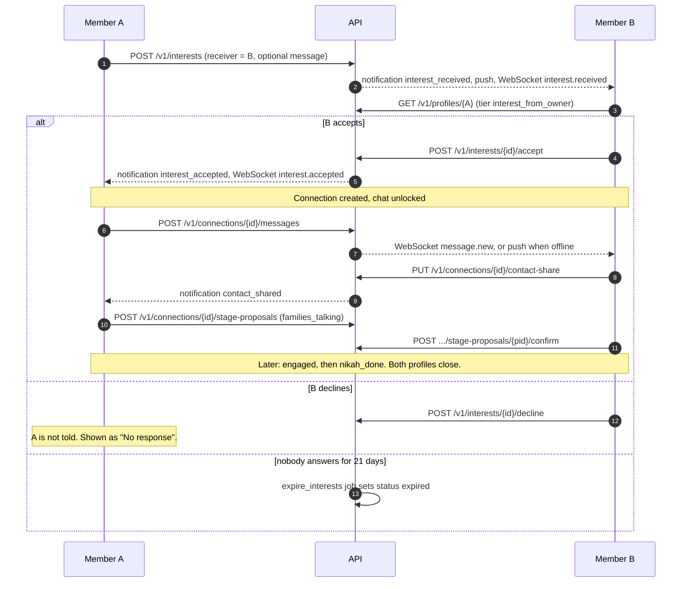

# 11. Interests, Connections and Chat

| | |
|---|---|
| Status | Design complete, not implemented |
| Related | [03-domain-model.md](03-domain-model.md) section 4 for the state machines, [09-privacy-and-visibility.md](09-privacy-and-visibility.md) for visibility and contact sharing, [13-safety-and-moderation.md](13-safety-and-moderation.md) for text rules and safety notices, [14-notifications.md](14-notifications.md), [15-api-contract.md](15-api-contract.md) sections 11 to 13, [19-jobs-and-realtime.md](19-jobs-and-realtime.md) |

This document describes the whole path from a first interest to a completed nikah: sending and answering interests, the connection that follows, chat, contact sharing, guardian involvement and the stages of a rishta. The state machines are in 03 section 4; this document adds the behaviour around them.

## 1. Overview

Vocabulary: the **sender** created the interest, the **receiver** got it. After acceptance both are **members** of the connection.

## 2. Sending an interest

### 2.1 Where

The "Send interest" button appears on `APP-PROFILE` and on cards. It is enabled only when `relation.can_send_interest` is true (09 section 7.2). Otherwise the client shows the reason text for `cannot_send_reason`.

### 2.2 Message

The interest may carry a short message (at most 300 characters). The send dialog offers templates and a free text field. Templates are client-side i18n strings; the chosen text is sent as plain `message`.

| Template key | English text | Offered when |
|---|---|---|
| `interest_template_1` | Assalam-o-Alaikum. I liked your profile and would like to take this forward with the blessing of our families. | Always |
| `interest_template_2` | Assalam-o-Alaikum. Our preferences seem to match well. Please have a look at my profile. | Always |
| `interest_template_3` | Assalam-o-Alaikum. I am writing on behalf of my family. We found your profile suitable and would like to connect. | The sender's `managed_by` is not `self` |
| `interest_template_none` | (no message) | Always |

Text rules (13 section 3) apply: no phone numbers, email addresses, links or social handles, and no abusive language. A violation returns `validation_failed` on field `message` with code `contains_contact_info` or `inappropriate`.

### 2.3 Server steps for `POST /v1/interests`

1. Run the checks of 15 section 11 in the listed order.
2. **Mutual interest:** if the receiver has a `pending` interest to the caller, do not create a row. Run the accept procedure of section 3.3 on that interest with the caller as the accepting side. Checks 5, 6 and 8 are skipped, the daily counter is not increased, and `message` is ignored. Return `201` with the accepted `interest` (direction `received` for the caller) and the new `connection`.
3. Otherwise, in one transaction:
   - Insert the interest with `status = 'pending'`, `expires_at = now() + interest.expiry_days`, and `compat_score` = the current `compat` of the pair (10 section 5.3).
   - Increase `usage_counters` (`interests_sent`, today in `Asia/Karachi`).
   - Delete the `match_recommendations` rows for the pair in both directions.
4. After commit: create the `interest_received` notification for the receiver, push `interest.received` and `counters` over WebSocket, enqueue the push and the daily email (14 sections 4 and 5).

### 2.4 Limits

| Limit | Setting | Default | Error |
|---|---|---|---|
| Interests per day | `limits.interests_per_day` | 10 | `limit_reached` |
| Interests per day, verified sender (`is_id_verified` or `is_photo_verified`) | `limits.interests_per_day_verified` | 20 | `limit_reached` |
| Pending sent interests at one time | `limits.pending_interests_max` | 50 | `limit_reached` |
| Active connections (checked for the sender at send time) | `limits.active_connections_max` | 30 | `limit_reached` |

`limit_reached` carries `details.limit` (the setting key), `used`, and `resets_at` (next midnight `Asia/Karachi` for daily limits, `null` for the others). `Me.usage` lets clients show "7 of 10 interests left today" before the member tries.

## 3. Receiving and responding

### 3.1 The lists

`APP-INTERESTS` has two boxes, each with three tabs backed by `GET /v1/interests?box=&status=`.

| Box | Tab | `status` parameter | Contents |
|---|---|---|---|
| Received | New | `pending` | Pending interests, newest first, unseen ones highlighted |
| Received | Accepted | `accepted` | Links to the chat |
| Received | Closed | `closed` | Declined by me, withdrawn by them, expired |
| Sent | Waiting | `pending` | Pending, and declined ones still shown as waiting (see 3.5) |
| Sent | Accepted | `accepted` | Links to the chat |
| Sent | Closed | `closed` | Withdrawn by me, and those past their expiry date |

`Interest.profile` is `null` when the other profile can no longer be opened (09 section 2). The client shows "No longer available" and no actions.

### 3.2 Seen

When received pending interests are rendered on screen, the client calls `POST /v1/interests/seen` with their ids (once per id). This sets `seen_at`. The sender sees `seen = true` only when both members have `send_read_receipts` on (09 section 9).

### 3.3 Accept

`POST /v1/interests/{interest_id}/accept`, in one transaction:

1. Lock the interest row (`SELECT ... FOR UPDATE`). It must be `pending` and the caller must be the receiver (`invalid_state`, `not_found`).
2. The sender must still be openable by the receiver (09 section 2). If not, set the interest to `expired` and return `invalid_state`.
3. Both members must have fewer than `limits.active_connections_max` active connections. Otherwise `limit_reached` with `details.side` = `you` or `them`. Client text for `them`: "This member cannot take new connections right now. Please try again later."
4. Set `status = 'accepted'`, `responded_at = now()`.
5. Insert the `connections` row (`profile_low_id` is the smaller id, `stage = 'chatting'`, `interest_id`), two `connection_members` rows, and one system message with `system_event = 'connected'`. Set `connections.last_message_at = now()`.
6. Delete `match_recommendations` rows for the pair in both directions.

After commit: notification `interest_accepted` for the sender; WebSocket `interest.accepted` to the sender, `connection.updated` to both, `counters` to both; push and email for the sender (14).

The accepting member lands in `APP-CHAT` for the new connection.

### 3.4 Decline

`POST /v1/interests/{interest_id}/decline` with optional `also_block`.

1. Set `status = 'declined'`, `responded_at = now()`.
2. If `also_block` is true, apply the block effects (15 section 13).
3. No notification, no push, no WebSocket event to the sender.

The decline dialog has a checkbox "Also block {name}" and the buttons "Decline" and "Cancel" (16 section 6.7). It states that the other member will not be notified.

### 3.5 Quiet decline

The sender never learns of a decline (03 section 4.7):

| Real status | What the sender's API response says | Shown in tab |
|---|---|---|
| `declined`, before `expires_at` | `status = 'pending'`, `display_status = 'no_response'` | Sent, Waiting, labelled "No response yet" |
| `declined`, after `expires_at` | `status = 'expired'`, `display_status = 'closed'` | Sent, Closed |
| `expired` | `status = 'expired'`, `display_status = 'closed'` | Sent, Closed |

Consequences the implementer must handle:

1. For the sender, `GET /v1/interests?box=sent&status=pending` includes declined interests whose `expires_at` is in the future.
2. A sender who tries to withdraw a declined interest gets a normal success response (the row stays `declined`; the response shows `withdrawn`). This avoids revealing the decline through an error.
3. A sender who tries to send again during the hidden period gets `interest_already_pending`. After `expires_at`, the 90-day decline cooldown applies, counted from `responded_at`, and returns `cooldown_active`.
4. `relation.interest` on the profile screen follows the same masking.

### 3.6 Expiry and reminder

| Job run | Action |
|---|---|
| `expire_interests`, every 15 minutes | `UPDATE interests SET status = 'expired' WHERE status = 'pending' AND expires_at <= now()`. No notification. Push `counters` to affected receivers who are online. |
| `expire_interests` with `{"remind": true}`, daily at 10:00 `Asia/Karachi` | For each receiver with pending interests whose `expires_at` falls on the date 3 days from today: create one `interest_received` notification with `reminder = true` and the count, and a push. One reminder per receiver per day. |

## 4. Withdrawal and cooldowns

`POST /v1/interests/{interest_id}/withdraw` (sender only, `pending` only): set `status = 'withdrawn'`, `responded_at = now()`; delete the receiver's `interest_received` notification for this interest; push `counters` to the receiver. The receiver is not told.

Cooldowns before the **same sender** may send to the **same receiver** again:

| Earlier outcome | Wait | Counted from | Setting |
|---|---|---|---|
| Declined | 90 days | `responded_at` | `interest.cooldown_after_decline_days` |
| Expired | 30 days | `expires_at` | `interest.cooldown_after_expiry_days` |
| Withdrawn | 7 days | `responded_at` | `interest.cooldown_after_withdraw_days` |
| Connection ended (either member, either direction) | 90 days | `ended_at` | `connection.cooldown_after_end_days` |

Rules:

1. The first three cooldowns bind only the original sender. The receiver may change their mind at any time: they open the profile from Received, Closed and send their own interest.
2. The error is `409 cooldown_active` with `details.retry_after_date`.
3. During these periods the pair is also left out of each other's recommendations and search (10 section 3, rule E7). A profile code lookup still works.

## 5. Connections

### 5.1 The chat list

`APP-CHATS` shows `GET /v1/connections`.

| Tab | `filter` | Contents |
|---|---|---|
| Chats | `active` | Active connections that are not archived |
| Archived | `archived` | Active connections with `is_archived = true` |
| Ended | `ended` | Ended connections, read-only |

Order: `last_message_at` descending; connections without messages by `created_at`. Each row shows the other member's card (photo per 09 section 6), `last_message_preview`, time, `unread_count`, a mute icon, and the stage when it is past `chatting`.

When `last_message_preview` is null (new connection, system event, or removed message) the client shows a fixed line: "You are now connected. Say salaam." for a connection with no text messages, otherwise "Open to see the latest update".

When `other` is `null` the client shows "Member no longer available" and a neutral avatar. This covers deleted, suspended and banned accounts without saying which.

### 5.2 Mute and archive

`PATCH /v1/connections/{connection_id}`:

| Flag | Effect |
|---|---|
| `is_muted` | No push for new messages in this connection, and it does not count in `counters.unread_chats`. Unread count on the row itself still shows. |
| `is_archived` | Moves the chat to the Archived tab. Cleared automatically for both members when a new message arrives. |

Both flags are per member and invisible to the other member.

### 5.3 The cap

A profile may have at most `limits.active_connections_max` (30) active connections. The cap is checked when sending an interest (the sender) and when accepting (both). Ending a connection frees a slot. The cap keeps conversations meaningful and limits what a bad actor can do.

### 5.4 Ending a connection

`POST /v1/connections/{connection_id}/end` with `reason` and optional `also_block`. In one transaction:

1. `status = 'ended'`, `ended_by_profile_id`, `ended_reason`, `ended_at = now()`.
2. Both `contact_shares` rows become `revoked`.
3. `photo_access` rows between the pair with `status = 'granted'` become `revoked` (both directions).
4. Any `pending` stage proposal becomes `cancelled`.
5. Insert a system message with `system_event = 'connection_ended'`.
6. If `also_block`, insert the block and apply its remaining effects.

After commit: WebSocket `connection.updated` and `counters` to both. No notification and no push: the other member finds the chat under Ended with the line "This conversation has ended."

Privacy of the reason:

| Field in `Connection` | For the member who ended it | For the other member |
|---|---|---|
| `ended_by` | `me` | `them`, or `system` when the cause was an account closure, ban or purge |
| `ended_reason` | The stored reason | Always `null` |

The other member is never told the reason, and a block looks the same as any other ending.

After ending: the chat is read-only for both, the tier falls back to `member` (names, photos and field groups follow the privacy settings again), and neither may send the other an interest for 90 days.

System endings:

| Cause | `ended_reason` | `ended_by_profile_id` |
|---|---|---|
| Block | `blocked` | The blocker |
| Ban or account purge | `account_closed` | The affected member |
| Nikah confirmed with someone else (9.4) | `found_someone_else` | The member who married |

## 6. Chat

### 6.1 Scope at launch

Text messages only, between the two members of an `active` connection. No images, voice notes, calls or links previews. Images and voice notes are a later phase (21).

### 6.2 Sending

`POST /v1/connections/{connection_id}/messages` with `body` and `client_message_id`.

1. The caller must be a member, the connection `active` (`connection_ended` otherwise), and the caller's profile `active` or `paused`.
2. The other member must be openable at tier `connection` (09 section 2). If their account is suspended or otherwise unavailable, return `409 invalid_state` with `details.status = 'other_unavailable'`. The client shows "This member is currently unavailable."
3. Limits: `limits.messages_per_minute` (in-memory limiter, `rate_limited`) and `limits.messages_per_day` (`usage_counters.messages_sent`, `limit_reached`).
4. `body` is trimmed; 1 to 2000 characters.
5. Run the safety detector (13 section 5) and store its result in `messages.safety_flag`. Detection never blocks a message.
6. In one transaction: insert the message with `id = Uuid::now_v7()`; set `connections.last_message_at = now()` and `last_message_preview` to the first 80 characters of `body`; add 1 to the other member's `unread_count`; set `is_archived = false` for both members.
7. After commit: WebSocket `message.new` to every socket of both members and `counters` to the other member; enqueue the push when the other member has no open socket and has not muted the connection (14 section 4); enqueue the delayed unread email (14 section 5).

**Idempotency.** `client_message_id` is a UUID created by the client for each new message and reused on every retry. The unique index on (`connection_id`, `sender_profile_id`, `client_message_id`) makes a retry return the original message with `200` and no side effects. Clients show a message as "sending" until the response arrives, do not retry automatically (except once after `rate_limited`, 16 section 6.11), and on failure show "Not sent. Tap to retry.", which sends again with the same id

**Order.** Messages are ordered by `id`. Ids are UUIDv7 generated by the single API process with `Uuid::now_v7()`, which is monotonic within a process, so id order equals creation order. Clients sort by `id` and never by local clock.

### 6.3 Reading history

`GET /v1/connections/{connection_id}/messages`:

| Use | Parameters | Result order |
|---|---|---|
| Open a chat | `limit=30` | Newest first, `has_more` tells whether older messages exist |
| Scroll up | `before=<oldest id held>` | Newest first |
| Catch up after a gap | `after=<newest id held>` | Oldest first; repeat while `has_more` |

Clients keep messages in a map keyed by `id`, so a message delivered twice (REST and WebSocket) is shown once.

### 6.4 Live delivery and fallback

| Situation | Mechanism |
|---|---|
| Socket connected | `message.new`, `message.deleted`, `message.read`, `typing`, `connection.updated` events (19 section 4) |
| Socket not connected, `APP-CHAT` open | Poll `GET .../messages?after=<newest id>` every 15 seconds, and `GET /v1/connections/{id}` every 60 seconds |
| Socket not connected, elsewhere in the app | Poll `GET /v1/me` every 60 seconds for counters |
| App in background (Android) | Push notification; on open, catch up with `after=` |
| After a reconnect | The resync steps in 19 section 4 |

REST is always the source of truth. A client must work correctly, only slower, with the WebSocket blocked.

### 6.5 Read state

1. When `APP-CHAT` is visible and messages from the other member are on screen, the client calls `POST .../read` with the newest message id, debounced to at most once per second.
2. The server sets `last_read_message_id` to the greater of the stored and the given id (it never moves backwards), sets `last_read_at`, and recomputes `unread_count` as the number of messages from the other member with a greater id.
3. System messages never count as unread (03 section 8, invariant 14). Their events have notifications instead.
4. Receipts: the other member sees "Read" under their last read message only when both have `send_read_receipts` on. Otherwise `their_last_read_message_id` is `null` and no `message.read` event is sent to them.

### 6.6 Typing indicator

While the member types, the client sends the WebSocket frame `{"type":"typing","connection_id":"..."}` at most once every 3 seconds. The server relays `typing` to the other member's sockets. The receiving client shows "typing..." for 5 seconds after the last event. Nothing is stored. No typing events are relayed for an ended connection.

### 6.7 Removing a message

`DELETE .../messages/{message_id}`: only the sender, only within 15 minutes of `created_at`, only `kind = 'text'`. The server sets `body = NULL` and `deleted_at = now()`. If it was the latest message, `last_message_preview` becomes NULL. Both clients show "Message removed". WebSocket `message.deleted` goes to both. If the message was already reported, the report keeps its own copy in `reports.context` (13 section 6).

There is no editing of messages.

### 6.8 System messages

System messages (`kind = 'system'`, `sender = 'system'`) record events inside the conversation. The client renders the text from `system_event` and `system_data`. `actor_profile_id` is compared with the member's own profile id to choose the "You" or the "They" wording.

| `system_event` | `system_data` | Text when I am the actor | Text when they are |
|---|---|---|---|
| `connected` | `{ "actor_profile_id": "<accepting profile>" }` | You accepted the interest. You can now chat. | Your interest was accepted. You can now chat. |
| `contact_shared` | `{ "actor_profile_id": "...", "items": ["phone", "whatsapp", "email", "guardian"] }` (only the shared ones) | You shared your contact details. | {name} shared contact details with you. |
| `contact_share_revoked` | `{ "actor_profile_id": "..." }` | You stopped sharing your contact details. | {name} stopped sharing contact details. |
| `stage_proposed` | `{ "actor_profile_id": "...", "proposal_id": "...", "stage": "families_talking" }` | You suggested: {stage text}. | {name} suggests: {stage text}. |
| `stage_confirmed` | `{ "actor_profile_id": "<confirming profile>", "proposal_id": "...", "stage": "..." }` | You confirmed: {stage text}. | {name} confirmed: {stage text}. |
| `stage_declined` | `{ "actor_profile_id": "...", "proposal_id": "...", "stage": "...", "cancelled": false }` | You did not confirm the suggestion. | {name} did not confirm the suggestion. |
| `stage_declined` with `cancelled: true` | Same shape, actor is the proposer | You withdrew your suggestion. | {name} withdrew the suggestion. |
| `connection_ended` | `{}` | This conversation has ended. | This conversation has ended. |

Stage texts: `families_talking` "Our families are in touch", `engaged` "Rishta confirmed", `nikah_done` "Nikah completed".

System messages set `last_message_at` and clear `last_message_preview`. They do not change unread counts.

### 6.9 Safety in chat

1. The first time a member opens `APP-CHAT` for any connection, show the dismissible first-chat tips card. Its text is defined once, in 13 section 11.2.
2. A message from the other member with `safety_notice` set is shown with an inline notice under it. Texts and patterns are in 13 section 5.
3. Every message has a "Report" action, and the chat header has "Report" and "Block". Reporting is described in 13 section 6.

### 6.10 Quiet chats

When an active connection in stage `chatting` has had no message for 7 days, the chat list row shows a hint: "No messages for a week. Say salaam, or end the conversation respectfully." The hint is computed on the client from `last_message_at`. There is no push for it.

## 7. Contact sharing

Rules and privacy are in 09 section 10. The flow:

1. In `APP-CONNECTION` the member taps "Share contact details".
2. The dialog lists the four items (phone, WhatsApp, email, guardian) with the stored value of each, a checkbox per item, and the fixed warning from 09 section 10.3. Items with no stored value show "Add" which opens `SET-CONTACTS`.
3. Confirm calls `PUT /v1/connections/{connection_id}/contact-share`.
4. The other member gets the `contact_shared` notification and system message, and sees the details in `APP-CONNECTION` with tap-to-call and tap-to-WhatsApp actions.
5. "Stop sharing" calls `DELETE .../contact-share`.

Sharing is never required. Neither member is prompted to share before stage `families_talking`; when that stage is confirmed, both see a one-time suggestion: "Families usually exchange contact details at this point."

## 8. Guardian involvement

The product is built for families, so a guardian can take part at every step.

| Feature | At launch |
|---|---|
| Profile managed by a family member | `managed_by` is shown on the profile ("Profile managed by a parent"). The manager operates the account. |
| Guardian contact | `guardian_name`, `guardian_relation`, `guardian_phone_e164` in `profile_contacts`. Shared through a contact share like any other item. |
| Preferred contact | `preferred_contact = 'guardian'` tells the other side whom to call first. Shown next to shared details: "Please contact the guardian first." |
| Suggestion to involve family | The chat safety panel and the `families_talking` stage both encourage it. |

**Later phase (not in the first release): guardian observer.** A member invites a guardian by email. The guardian gets read-only access to the member's chats, or a weekly transcript by email, and the other member sees a "Guardian is involved" label in the chat header. This needs a new table linking additional users to a profile, a consent step for both members, and email volume beyond the free tier. It is listed in 21.

## 9. Stages of a rishta

### 9.1 The stages

| `stage` | Member-facing name | Meaning |
|---|---|---|
| `chatting` | Getting to know each other | Default after acceptance |
| `families_talking` | Our families are in touch | Elders have spoken or met |
| `engaged` | Rishta confirmed | Both families have agreed (baat pakki or mangni) |
| `nikah_done` | Nikah completed | The marriage has taken place |

Stages only move forward and may skip (for example `chatting` to `engaged`).

### 9.2 Proposing

`POST /v1/connections/{connection_id}/stage-proposals` with `stage`.

1. `stage` must be later than the current stage (`invalid_state`).
2. No proposal may be `pending` on the connection (`already_exists`).
3. A member whose earlier proposal of the same stage on this connection was declined less than 7 days ago gets `cooldown_active` (15 section 12). This prevents pressure by repetition.
4. Insert the proposal, post the `stage_proposed` system message, create the `stage_proposed` notification for the other member, send `connection.updated` to both.

The proposal has no expiry. The proposer may cancel it (`DELETE .../stage-proposals/{proposal_id}`), which posts `stage_declined` with `cancelled: true`.

### 9.3 Answering

Only the member who did not propose may answer.

| Action | Effect |
|---|---|
| Confirm | Proposal `confirmed`; `connections.stage` and `stage_updated_at` updated; system message `stage_confirmed`; notification `stage_confirmed` to the proposer; `connection.updated` to both; then the stage effects of 9.4 |
| Decline | Proposal `declined`; system message `stage_declined`; `connection.updated` to both. No notification. |

### 9.4 Effects of reaching a stage

| Stage | Effect |
|---|---|
| `families_talking` | One-time suggestion to both members to share contact details (section 7) |
| `engaged` | Both clients show a dialog: "Congratulations. Would you like to pause your profile so you stop receiving new interests?" with "Pause my profile" (calls `POST /v1/me/profile/pause`) and "Not now". Nothing is automatic. |
| `nikah_done` | In the confirming transaction, for **both** members: set the profile to `closed` with `closed_reason = 'found_match_here'` and `closed_at = now()`; set every `pending` interest sent or received to `expired`; end every other active connection with `ended_reason = 'found_someone_else'`; delete their `match_recommendations` rows. The couple's own connection stays `active`, so they keep their chat history. Both clients show a congratulations screen with a link to `PUB-NIKAH` and, in a later phase, an invitation to share a success story. |

Because closed profiles cannot send messages (03 section 5), the couple's chat is read-only after `nikah_done`.

A member who reopens a profile closed this way must type a confirmation, and the connection is ended (03 section 4.2).

## 10. Nikah guide (`PUB-NIKAH`)

A static public page of general information. The platform does not conduct, arrange or register marriages, and the page says so at the top and the bottom.

Fixed notice: "This page gives general information for families in Pakistan. It is not legal or religious advice. Requirements differ between provinces and schools of thought. Please confirm the details with your local nikah registrar, union council and a scholar you trust."

Content outline, one short section each:

| # | Section | Points to cover |
|---|---|---|
| 1 | Before the nikah | Both families meet; verify what you were told (identity, marital status, job, family); never transfer money to a prospective match; involve elders |
| 2 | Free consent | The free consent of both bride and groom is essential; both must be adults (18 or older); a forced marriage is unlawful |
| 3 | Wali and witnesses | The role of the bride's wali; two adult witnesses; the nikah khwan who performs the ceremony |
| 4 | Mehr | Mehr is the bride's right; agree the amount and whether it is prompt or deferred, and write it in the nikahnama |
| 5 | The nikahnama | The standard marriage contract form; read every column before signing, including the columns on conditions and the delegated right of divorce; bride and groom, wali or vakil, and witnesses sign |
| 6 | Registration | The nikah must be registered through a licensed nikah registrar and the union council (or the relevant local office); keep your copy of the nikahnama |
| 7 | Marriage certificate | The computerised marriage registration certificate issued through the union council on NADRA's system; needed for passports, visas and updating CNIC records |
| 8 | Documents usually needed | CNICs of bride and groom, of the fathers or guardians, and of the witnesses; photographs; where applicable a divorce certificate or the death certificate of a previous spouse |
| 9 | Second marriages | A man who is already married needs written permission through the arbitration council under the law before another marriage |
| 10 | Overseas families | Registration and attestation steps differ for marriages involving a spouse living abroad; ask the embassy or mission concerned |
| 11 | Simple weddings | Encouragement of simple ceremonies without dowry demands |
| 12 | After your nikah | Mark the rishta as "Nikah completed" in the app so both profiles close |

The text is written and reviewed by the product owner before launch; this outline fixes the structure only.

## 11. Success stories (later phase)

After `nikah_done`, both members may be invited to share a short story and an optional photo for a public "Success stories" page. It needs explicit consent from both, moderation before publishing, and a new table. Not in the first release (21).

## 12. Shortlist and pass

| | Shortlist | Pass |
|---|---|---|
| Purpose | Private bookmark, "consider later" | "Not interested", stop showing this profile |
| Endpoints | `PUT`, `DELETE /v1/shortlist/{profile_id}`, `GET /v1/shortlist` | `PUT`, `DELETE /v1/passes/{profile_id}` |
| Note | Optional private note, at most 300 characters | None |
| Other member told | Never | Never |
| Effect on lists | Shown on `APP-SHORTLIST`, newest first; `relation.is_shortlisted` on cards | Removed from recommendations and search for `pass.duration_days` (180); `match_recommendations` row deleted; any shortlist entry removed |
| Can still open by code | Yes | Yes |
| Requires | Caller `active`, target openable | Caller `active`, target openable |
| Limits | 200 entries per profile (fixed) | None |
| Undo | Remove | On a list, an "Undo" button in place of the card until the member leaves the screen (16 section 6.4); on the profile screen, an "Undo" toast for 5 seconds; later through a profile code lookup and `DELETE` |
| When the target becomes unavailable | Entry stays with `profile = null`, shown as "No longer available" with a remove button | Nothing to show |

Shortlisting does not notify, does not count as a view, and does not affect ranking. Passing a profile to which the member has a pending sent interest is allowed and does not withdraw the interest; the client suggests withdrawing.

## 13. Edge cases

| # | Situation | Behaviour |
|---|---|---|
| 1 | A and B send each other an interest at the same moment | The unique index allows one pending row per ordered pair, so both inserts could succeed. Prevent it: the send transaction takes `pg_advisory_xact_lock` on a key derived from the ordered pair of profile ids, then re-checks for a pending interest from the other side. The second request becomes a mutual acceptance. |
| 2 | Double tap on "Send interest" | The second request fails with `interest_already_pending`. Clients disable the button while the request is in flight and treat this error as success. |
| 3 | Double tap on "Accept" | The second request finds the interest `accepted` and returns `invalid_state`. Clients treat it as success and open the chat. |
| 4 | Receiver blocks the sender while the interest is pending | Interest becomes `declined` (03 section 4.7). The sender sees it as "No response yet". |
| 5 | Sender blocks the receiver while pending | Interest becomes `withdrawn`. |
| 6 | Receiver pauses their profile | Pending interests stay. The receiver can still accept or decline. New interests cannot be sent to a paused profile (`not_found`). |
| 7 | Sender pauses their profile | Pending interests stay. If the receiver accepts, the connection is created and the paused sender can chat. |
| 8 | Either profile is closed, suspended or purged while an interest is pending | The interest becomes `expired` at that moment. |
| 9 | Sender is suspended, receiver opens the Received list | The interest was expired by the suspension. It appears under Closed with `profile = null`. |
| 10 | Other member's account is suspended during a connection | The connection stays `active`. `other` is `null`, messages cannot be sent (`invalid_state`, `other_unavailable`), history stays readable. When the suspension ends, everything works again. |
| 11 | Other member is banned or purged | Connection ended by the system with `account_closed`. Their messages show as "Message removed" after a purge. |
| 12 | Daily interest limit reached | `limit_reached` with `resets_at`. The profile screen already shows `cannot_send_reason = 'daily_limit'`. |
| 13 | Receiver at the connection cap tries to accept | `limit_reached` with `details.side = 'you'`. The dialog offers a link to the chat list to end an old conversation. |
| 14 | Sender at the cap when the receiver accepts | `limit_reached` with `details.side = 'them'`. The interest stays pending. |
| 15 | Message sent twice because of a retry | Same `client_message_id`: one row, the second response is `200` with the original. |
| 16 | Message sent while the connection is being ended | The end transaction locks the connection row. A message arriving after it gets `connection_ended`. |
| 17 | Member deletes a message after 15 minutes | `invalid_state`. The client hides the action after 15 minutes. |
| 18 | Read receipt sent for an id older than the stored one | Ignored; the stored id never moves backwards. |
| 19 | Contact share requested for an empty item | `validation_failed`, field code `required`; the client opens `SET-CONTACTS`. |
| 20 | Contact detail edited after sharing | The other member sees the new value on the next fetch. |
| 21 | Both members propose a stage at once | The unique index allows one pending proposal. The second request gets `already_exists`; the client refetches the connection and shows the other's proposal to confirm. |
| 22 | Stage proposal pending when the connection ends | The proposal becomes `cancelled`. |
| 23 | Interest accepted after the sender's `photo_visibility` changed | Photo rules are evaluated at read time; nothing is stored at accept time. |
| 24 | Receiver has `interest_permission = 'verified_only'` and the sender loses verification later | Existing pending interests are unaffected. |
| 25 | A member with a `married` status is accepted by someone who later removes `married` from their preferences | The existing connection is unaffected (relation paths ignore discovery rules, 09 section 2). |
| 26 | WebSocket down for both members | Chat works through REST with 15-second polling. |
| 27 | Clock differences between devices | Clients order by message `id` and show server `created_at`. |
