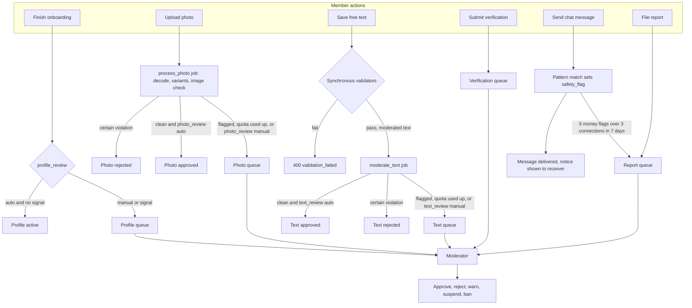

# 13. Safety and Moderation

| | |
|---|---|
| Status | Design complete, not implemented |
| Related | [03-domain-model.md](03-domain-model.md) sections 4.4, 4.5, 4.11 and 7, [04-database-schema.md](04-database-schema.md) section 9, [12-verification-and-trust.md](12-verification-and-trust.md), [15-api-contract.md](15-api-contract.md) sections 13 and 16, [18-admin-console.md](18-admin-console.md), [19-jobs-and-realtime.md](19-jobs-and-realtime.md) |

This document defines what is not allowed on the platform, how it is detected, who decides, and what happens next. It also holds the exact validation patterns the API applies to text.

## 1. Threat model

Each pattern below has been reported on Pakistani and South Asian matrimonial platforms. The right column is the control that addresses it.

| # | Pattern | Controls |
|---|---|---|
| T1 | **Fake profile** with stolen photos, used to extort or to waste time | Manual photo review at launch; photo verification by live selfie (12 section 4); identity verification (12 section 5); `fake_profile` and `impersonation` reports; `verified_only` filter and interest permission |
| T2 | **Advance-fee and "overseas suitor" fraud**: builds trust, then asks for money for a visa, customs fee, medical emergency or gift delivery | Chat safety notices for money requests (section 5); automatic system report on repeated money flags; `asking_for_money` report reason, handled first; safety tips (section 11); ban on first confirmed case |
| T3 | **Married man hiding his status** | Declared `marital_status = 'married'` is opt-in for viewers (03 section 8 rule 10); identity card shows a spouse's name on a married woman's card (12 section 5.3); `already_married` report reason; ban for a confirmed lie |
| T4 | **Marriage bureau or paid agent** posing as an individual to harvest contacts and charge fees | Not allowed at all (section 8); `managed_by` label on every profile; one profile per identity document; `marriage_bureau_or_agent` report reason; detection signals in section 8.2 |
| T5 | **Photo misuse**: saving and spreading a woman's photos, blackmail | Photo visibility modes and blurred variants (09); photos served only by short-lived signed URLs; screenshot blocking on Android; photo access revoked on block or connection end; no contact details in profile text (section 3) |
| T6 | **Harassment after rejection** | Declines are quiet (03 section 4.7); cooldowns before another interest; block makes both invisible; `harassment` report reason; chat only inside an accepted connection |
| T7 | **Pressure to move off-platform early** (WhatsApp, Telegram), where no reporting exists | Contact details hidden until the member chooses to share (09 section 10); `off_platform` chat safety notice (section 5); contact patterns rejected in profile text and interest messages (section 3) |
| T8 | **Sextortion and explicit content** | Automatic image check and manual photo review (section 4); chat is text-only at launch; `inappropriate_photo` and `offensive_content` reports; immediate ban |
| T9 | **Underage candidate** | 18+ rule at onboarding; date of birth checked against the identity card; `underage` report reason, handled first; suspension pending review |
| T10 | **Banned person returning** | `banned_identities` for identity number, email and phone; device signal (section 9) |
| T11 | **Scraping of profiles and photos** | No public profiles; opposite-gender-only visibility; `limits.profile_views_per_day`; rate limits; signed URLs |
| T12 | **Fake-bride and robbery gangs** who lure a family to a meeting | Safety tips on meeting (section 11); identity verification badge; reports; cooperation with law enforcement (section 10) |
| T13 | **Report abuse**: mass false reports against a rival or an ex | `limits.reports_per_day`; a report alone changes nothing; reporters with repeated dismissed reports are reviewed (section 6.6) |

## 2. Moderation pipeline

### 2.1 Overview



Moderators work from the five queues in the admin console (18 section 4). The users list (18 section 5.1) gives an overview of accounts; staff open an account only when a queue item or a support request needs it (18 section 10).

### 2.2 Settings

From 03 section 7. Changed in `ADM-SETTINGS`.

| Key | Values | Default | Effect |
|---|---|---|---|
| `moderation.profile_review` | `auto`, `manual` | `auto` | `manual`: every profile that finishes onboarding goes to `pending_review`. `auto`: it becomes `active` unless a signal in 2.3 fires. |
| `moderation.photo_review` | `auto`, `manual` | `manual` | `manual`: every photo that passes the automatic check goes to `pending_review`. `auto`: a clean photo becomes `approved` immediately. |
| `moderation.text_review` | `auto`, `manual` | `auto` | `manual`: every changed moderated text stays `pending` until a moderator decides. `auto`: clean text is approved by the job. |

Recommended path: launch with the defaults; switch `photo_review` to `auto` once the photo queue regularly takes more than a day and the automatic check has proved reliable; switch `profile_review` to `manual` during an attack of fake sign-ups.

### 2.3 Signals that send a profile to manual review under `auto`

Checked by `POST /v1/me/onboarding/complete`. Any one sends the profile to `pending_review`.

| Signal | Test |
|---|---|
| Returning-ban suspicion | An `open` or `in_review` report with `source = 'system'` exists for the profile (section 9) |
| Earlier rejection | The profile was `changes_requested` before (this is a resubmission; `POST /v1/me/profile/resubmit` always goes to `pending_review`) |

## 3. Text rules

Two layers. The synchronous validators run inside the request and reject bad input at once. The asynchronous check runs afterwards on the three moderated texts.

### 3.1 Which fields get which checks

| Group | Fields | Synchronous checks | Asynchronous check |
|---|---|---|---|
| A. Names | `first_name`, `last_name`, `manager_name`, `guardian_name` | Name pattern (3.3), banned words (3.6) | No |
| B. Short free text | `job_title`, `employer_name`, `institute_name`, `degree_title`, `father_occupation`, `mother_occupation`, `area`, `city_other`, `origin_other`, `caste_other`, `sub_caste_other`, `disability_details` | Character pattern (3.3), contact patterns (3.4, without `U2` for `employer_name` and `institute_name`), banned words | No |
| C. Long free text | `about_me`, `about_family`, partner `notes`, interest `message` | Contact patterns (3.4), banned words | Yes, for `about_me`, `about_family` and partner `notes`. Not for the interest `message`. |
| Not checked | Chat message `body`, `best_time_to_call`, the phone and email fields of `profile_contacts`, shortlist `note`, saved search `name`, report `details`, the reason typed on account deletion | Length limits only | No |

Chat messages are never subject to these rules. Members may exchange contact details in chat once connected; chat has its own notices (section 5).

### 3.2 Normalisation

Every synchronous check works on a normalised copy of the input. The stored value is the member's original text after trimming and collapsing whitespace.

```text
normalise(s):
  1. Apply Unicode NFKC (turns full-width digits and letters into ASCII).
  2. Replace Arabic-Indic digits U+0660..U+0669 and extended Arabic-Indic digits U+06F0..U+06F9
     with the ASCII digits 0..9.
  3. Remove zero-width characters U+200B, U+200C, U+200D, U+2060, U+FEFF.
  4. Convert to lowercase.
  5. Replace every run of whitespace (including line breaks) with one space. Trim.
```

### 3.3 Character patterns

Rust `regex` syntax. Applied to the trimmed original text.

| Name | Pattern | Used for |
|---|---|---|
| `N1` | `^[\p{L}\p{M}][\p{L}\p{M} .'\-]{0,38}[\p{L}\p{M}.]$` | Group A. Letters of any script, spaces, full stops, apostrophes, hyphens. 2 to 40 characters for `first_name` and `last_name`. For `manager_name` and `guardian_name` use the same pattern with a length of 2 to 80 (repetition `{0,78}`), the schema limit. Must start with a letter. No digits. |
| `S1` | `^[\p{L}\p{M}\p{N} .,'&()/+\-]+$` | Group B. Letters, digits and basic punctuation. |

Extra name rules: at least two letters; not the same letter repeated for the whole value; not only full stops and spaces. A failure of any character rule is field code `invalid`. Length failures are `too_short` or `too_long`.

Group C accepts any characters except control characters other than line breaks.

### 3.4 Contact patterns

All run on the normalised text. A match of any pattern gives field code `contains_contact_info` and the message: "Please remove phone numbers, email addresses, links and social media names. You can share contact details privately once you are connected."

**Step 1: exemptions.** Before the phone pattern runs, replace each match of these two patterns with a single space. They protect ordinary year ranges and dates.

| Name | Pattern | Example removed |
|---|---|---|
| `X1` | `\b(?:19\|20)\d{2} ?(?:-\|to\|till\|until) ?(?:19\|20)\d{2}\b` | `2015-2019`, `2019 to 2023` |
| `X2` | `\b\d{1,2}[/.\-]\d{1,2}[/.\-](?:19\|20)?\d{2}\b` | `12-05-1995`, `1/2/98` |

(The `\|` above is a literal `|` inside the pattern; it is escaped here only because the pattern sits in a table.)

**Step 2: phone numbers written with digits.**

| Name | Pattern | Meaning |
|---|---|---|
| `P1` | `(?:\d[ .\-_()*]{0,2}){8,}` | Eight or more digits, each followed by at most two separator characters (space, full stop, hyphen, underscore, bracket, asterisk) |

**Step 3: phone numbers written in words.** Not a regular expression.

```text
C0(text):
  tokens = split text on every run of characters that are not a-z or 0-9
  A token is a "number token" when it is 1 to 4 digits, or one of these words:
     zero sifar            -> 0        five panch paanch     -> 5
     one aik ek            -> 1        six chay chhay che    -> 6
     two do                -> 2        seven saat            -> 7
     three teen            -> 3        eight aath            -> 8
     four char chaar       -> 4        nine nau              -> 9
  "double" or "triple" directly before a number token belongs to the run
     and repeats that token's digits two or three times.
  Find every maximal run of consecutive number tokens.
  Match when a run has at least 6 tokens, at least 2 of them words, and at least 8 digits in total.
```

**Step 4: email addresses.**

| Name | Pattern |
|---|---|
| `E1` | `[a-z0-9._%+\-]+ ?@ ?[a-z0-9\-]+(?:\.[a-z0-9\-]+)*\.[a-z]{2,}` |
| `E2` | `[a-z0-9._%+\-]+(?: ?\(at\) ?\| ?\[at\] ?\| at )(?:gmail\|yahoo\|hotmail\|outlook\|icloud\|live\|ymail\|proton\|protonmail)\b` |
| `E3` | `\b(?:gmail\|hotmail\|yahoo\|outlook\|icloud\|ymail)\b ?(?:\.\|dot) ?com\b` |

**Step 5: links.**

| Name | Pattern | Note |
|---|---|---|
| `U1` | `(?:https?://\|www\.)\S+` | |
| `U2` | `\b[a-z0-9][a-z0-9\-]+\.(?:com\|net\|org\|pk\|io\|info\|biz\|app\|link)\b` | At least two characters before the dot, so degree names such as `b.com` and `m.com` pass. Not applied to `employer_name` and `institute_name`. |

**Step 6: social handles.**

| Name | Pattern |
|---|---|
| `H1` | `(?:^\|[^a-z0-9._%+\-])@[a-z0-9_.]{3,}` |
| `H2` | `\b(?:insta\|instagram\|snap\|snapchat\|fb\|facebook\|tiktok\|telegram\|whatsapp\|whats app\|watsapp\|wtsapp\|skype\|imo\|botim)\b[^.\n]{0,20}?(?:@\|\bid\b\|:\|\d)` |

`H2` means: a platform name followed, within 20 characters and before the end of the sentence, by an at-sign, the word "id", a colon or a digit. Merely mentioning a platform is allowed.

Order of evaluation: `X1`, `X2`, then `P1`, `C0`, `E1`, `E2`, `E3`, `U1`, `U2`, `H1`, `H2`. Stop at the first match. All patterns are compiled once at startup.

### 3.5 Test strings

These are the required unit tests for group C (`about_me`). "Contact" means `contains_contact_info`.

| # | Input | Expected | Why |
|---|---|---|---|
| 1 | `I am a software engineer from Lahore. My family is originally from Sialkot.` | Pass | |
| 2 | `Call me on 0300 1234567` | Contact | `P1`, 11 digits |
| 3 | `my number is 0 3 0 0 1 2 3 4 5 6 7` | Contact | `P1`, spaced digits |
| 4 | `0300-123-4567` | Contact | `P1` |
| 5 | `+92 (300) 1234567` | Contact | `P1`, brackets and spaces are separators |
| 6 | `zero three zero zero one two three four five six seven` | Contact | `C0`, 11 number words |
| 7 | `sifar teen sifar sifar aik do teen char panch chay saat` | Contact | `C0`, Roman Urdu number words |
| 8 | `zero three double zero 12 34 567` | Contact | `C0`, mixed words and digits, 11 digits |
| 9 | `I earn 150000 per month` | Pass | 6 digits |
| 10 | `Studied at NUST 2015-2019 then worked 2019 to 2023` | Pass | `X1` removes both ranges |
| 11 | `Born on 12-05-1995 in Karachi` | Pass | `X2` removes the date |
| 12 | `My height is 5 feet 6 inches and weight 60 kg` | Pass | Digits are separated by words |
| 13 | `House 12, street 4, block 5, phase 6 DHA` | Pass | A comma is not a separator in `P1` |
| 14 | `We are a respectable family with 3 brothers and 2 sisters` | Pass | |
| 15 | `email me at ayesha.khan@gmail.com` | Contact | `E1` |
| 16 | `ayesha khan at gmail dot com` | Contact | `E2` |
| 17 | `ayeshak (at) yahoo` | Contact | `E2` |
| 18 | `find me on gmail.com` | Contact | `E3` |
| 19 | `visit www.example.com` | Contact | `U1` |
| 20 | `my shop is myshop.pk` | Contact | `U2` |
| 21 | `I completed B.Com and M.Com from Punjab University` | Pass | One character before the dot |
| 22 | `Insta: ayesha_k` | Contact | `H2`, colon |
| 23 | `@ayesha_khan on all platforms` | Contact | `H1` |
| 24 | `whatsapp id 12345` | Contact | `H2`, the word "id" |
| 25 | `telegram: @rishta_agent` | Contact | `H2` |
| 26 | `I am not active on Facebook or any social media` | Pass | A platform name alone is allowed |
| 27 | `snapchat me anytime` | Pass | No trigger after the name |
| 28 | `０３００１２３４５６７` (full-width digits) | Contact | NFKC, then `P1` |
| 29 | `۰۳۰۰۱۲۳۴۵۶۷` (extended Arabic-Indic digits) | Contact | Digit mapping, then `P1` |
| 30 | `Annual turnover is PKR 15000000` | Contact | Known false positive: 8 digits in a row. The message tells the member to remove long numbers; they can write "1.5 crore". |
| 31 | `Looking for a hookup` | `inappropriate` | Banned phrase (3.6) |

Name tests for group A (`first_name`): `Ayesha` pass; `Muhammad Ali` pass; `O'Brien` pass; `عائشہ` pass; `A` `too_short`; `Ali123` `invalid`; `Ali 0300` `invalid`; `....` `invalid`; `aaaa` `invalid`.

### 3.6 Banned words

1. The list lives in `apps/api/src/moderation/banned_words.txt`, one lowercase phrase per line, `#` for comments. It is compiled into the binary and loaded at startup.
2. Matching is on the normalised text, whole words or whole phrases only (`\b` on both sides), so a banned word inside a longer innocent word does not match.
3. A match gives field code `inappropriate` and the message: "Please keep the wording respectful and suitable for a family platform."
4. The list has three parts:

| Part | Content |
|---|---|
| Intent that does not belong on a marriage platform | `hookup`, `hook up`, `one night stand`, `friends with benefits`, `sugar daddy`, `sugar mommy`, `sugar baby`, `escort`, `call girl`, `time pass`, `timepass`, `casual relationship`, `no strings attached`, `girlfriend wanted`, `boyfriend wanted` |
| Commercial solicitation | `marriage bureau`, `rishta service`, `rishta center`, `rishta centre`, `matchmaking service`, `fees apply`, `registration fee`, `contact our office` |
| Profanity and slurs in English and Roman Urdu | Maintained in the file only. Start from a standard English profanity list and add the common Roman Urdu abuse words. Not reproduced here. |

5. Changes to the list are ordinary code changes with review. Keep it short: the asynchronous check and the reports catch the rest.

### 3.7 Asynchronous check of moderated text

Applies to `about_me`, `about_family` and partner `notes`.

**On save** (inside the request, after the synchronous validators pass):

| Situation | Status written | Job |
|---|---|---|
| The text is unchanged | Unchanged | None |
| The new text is empty or `NULL` | `approved` | None |
| The text changed and is not empty | `pending` | Enqueue `moderate_text` with `{ "profile_id", "field" }` and `dedupe_key = profile_id + ":" + field` (19 section 2) |

`field` is `about_me`, `about_family` or `partner_notes`.

**The `moderate_text` job:**

```text
1. Load the current text and status for (profile_id, field).
2. If status is not 'pending': stop. Remember the text that was loaded: this is the text being checked.
3. If moderation.text_review is 'manual': stop. The text waits in the queue.
4. Call Azure AI Content Safety text analysis with the text
   (categories Hate, Sexual, Violence, SelfHarm; four severity levels 0, 2, 4, 6).
5. Decide with the table below, and write the result with a conditional update that only matches
   when the stored text still equals the checked text and the status is still 'pending'.
   If no row was updated, the member saved again during the check: enqueue the job again and stop.
6. On a quota error (HTTP 429 or a quota message) or any other failure after the queue's retries: stop.
   The text stays 'pending' and appears in the moderator queue.
```

| Category | Severity 0 | Severity 2 | Severity 4 | Severity 6 |
|---|---|---|---|---|
| Hate | Approve | Hold | Hold | Reject |
| Sexual | Approve | Hold | Hold | Reject |
| Violence | Approve | Approve | Hold | Hold |
| SelfHarm | Approve | Hold | Hold | Hold |

Take the strictest result over the four categories: Reject beats Hold beats Approve.

| Result | Effect |
|---|---|
| Approve | Set the status to `approved`. Set `match_stale = true` (the profile's completeness may have changed). |
| Hold | Leave `pending`. A moderator decides (18 section 4.3). |
| Reject | Set the status to `rejected`. Create a `text_rejected` notification with `data.field`. |

Notes:

- Self-harm content is never auto-rejected. A person should read it.
- The service is not trained on Urdu or Roman Urdu. Expect it to miss things in those languages; the banned-word list and the reports cover the gap.
- One text record is 1,000 characters. `about_me` can be 1,500 characters and then costs two records.
- Configuration: `AZURE_CONTENT_SAFETY_ENDPOINT` and `AZURE_CONTENT_SAFETY_KEY` in the API env file. When either is empty, step 4 is skipped and every text is held for a moderator.

Visibility while not approved follows 03 section 4.5: other members do not see `pending` or `rejected` text.

## 4. Photo moderation

### 4.1 Rules shown to members

Shown on `ONB-08` and `ME-PHOTOS`, and linked from every rejection.

| Do | Do not |
|---|---|
| Use recent, clear photos of the candidate | Photos of someone else, celebrities or stock images |
| Make the first photo show the face clearly, alone | Group photos as the first photo |
| Dress as you would to meet the other family | Revealing or suggestive photos |
| Use good light and a plain background | Heavy filters, face-changing edits, sunglasses or masks in the first photo |
| | Photos of children alone |
| | Text, phone numbers, social media names or watermarks on the photo |
| | Photos of documents, objects, scenery or pets |

### 4.2 Automatic check in `process_photo`

After the variants are created (08 section 5), the job sends the `medium` variant to Azure AI Content Safety image analysis.

| Category | Severity 0 | Severity 2 | Severity 4 | Severity 6 |
|---|---|---|---|---|
| Sexual | Clean | Flag | Reject | Reject |
| Violence | Clean | Clean | Flag | Flag |
| Hate | Clean | Flag | Flag | Flag |
| SelfHarm | Clean | Flag | Flag | Flag |

| Strictest result | `profile_photos.status` | Other effects |
|---|---|---|
| Reject | `rejected`, `rejection_reason = 'inappropriate'` | Notification `photo_rejected`. Two automatic rejections of this kind within 24 hours file a `system` report with reason `inappropriate_photo`. |
| Flag | `pending_review` | Shown at the top of the photo queue with the scores |
| Clean, and `moderation.photo_review = 'manual'` | `pending_review` | Normal queue |
| Clean, and `moderation.photo_review = 'auto'` | `approved` | No notification (the owner sees the change live through the `photo.updated` event; `photo_approved` is sent only after a manual review, 14 section 2); primary photo rules of 03 section 4.4 |
| Quota exhausted, service error, or not configured | `pending_review` | Normal queue |

The raw response is stored in `profile_photos.moderation` as `{ "provider": "azure_content_safety", "checked_at": "...", "categories": { "sexual": 0, "violence": 0, "hate": 0, "self_harm": 0 }, "result": "clean" | "flag" | "reject" | "unavailable" }`.

The automatic check cannot tell whether a photo shows a person, the right person, or a group. Those are manual criteria. That is why `photo_review` starts as `manual`.

### 4.3 Manual review criteria

The moderator applies the first matching row.

| Finding | Decision | `rejection_reason` |
|---|---|---|
| Nudity, underwear, suggestive pose, or anything sexual | Reject. Consider a sanction (section 7). | `inappropriate` |
| Violence, weapons pointed at the camera, hateful symbols | Reject | `inappropriate` |
| No person in the photo (scenery, object, pet, document, text image) | Reject | `not_a_person` |
| A celebrity, a stock photo, or clearly a different person from the other photos | Reject. If it is the only photo or a pattern, file a report for `fake_profile`. | `not_the_candidate` |
| A child alone | Reject | `not_the_candidate` |
| Phone number, social handle, link or large text on the image | Reject | `contains_contact_info` |
| The photo would be the first photo and shows several people so the candidate cannot be told apart | Reject | `group_photo` |
| Face hidden: back of the head, mask, heavy sunglasses, cropped away, extreme distance | Reject when it would be the first photo. Approve as a later photo if another photo shows the face. | `face_not_visible` |
| Too dark, too blurry, extreme filter, tiny resolution | Reject | `low_quality` |
| Anything else that breaks the rules | Reject | `other` |
| None of the above | Approve | |

A group photo is acceptable as a second or later photo when the profile already has an approved photo showing the candidate alone.

Member-facing message per reason:

| Reason | Message |
|---|---|
| `not_a_person` | This photo does not show a person. Please upload a photo of the candidate. |
| `face_not_visible` | The face is not clearly visible. Please use a photo that shows the face without sunglasses or a mask. |
| `group_photo` | Please use a photo of the candidate alone as the first photo. Group photos can be added afterwards. |
| `inappropriate` | This photo is not suitable for Khandani Rishta. Please read the photo guidelines. |
| `contains_contact_info` | Photos cannot contain phone numbers, social media names or other text. |
| `low_quality` | This photo is too blurry or too dark. Please upload a clearer one. |
| `not_the_candidate` | This photo does not appear to show the candidate. Only photos of the person the profile is for are allowed. |
| `other` | This photo could not be approved. Please read the photo guidelines and try another. |

## 5. Chat safety notices

### 5.1 Principles

1. Chat is never blocked, delayed, edited or pre-screened. Every message is delivered.
2. On send, the API matches the message against three pattern sets and stores at most one flag in `messages.safety_flag`.
3. The **receiver** sees a short notice under the flagged message (`Message.safety_notice`). The **sender** sees nothing, and `safety_notice` is always `null` on their own messages.
4. Flags are not shown to moderators unless a report brings the conversation to them, with one exception: the automatic report of 5.5.
5. Matching is plain string and pattern matching inside the API. No message leaves the server for analysis.

### 5.2 Matching

Normalise the body with section 3.2. Evaluate in this order and stop at the first hit:

| Order | Flag | Hit when |
|---|---|---|
| 1 | `money` | Any phrase of list M occurs as a whole word or phrase |
| 2 | `off_platform` | Any phrase of list O occurs as a whole word or phrase |
| 3 | `contact_info` | `P1`, `C0`, `E1`, `E2` or `E3` of section 3.4 matches (after the `X1` and `X2` exemptions) |

Precedence is therefore `money`, then `off_platform`, then `contact_info`. A message asking to send money to a number gets `money`.

**List M (money).** English and Roman Urdu. Lowercase, whole-phrase match.

```text
send money, send me money, transfer money, need money, lend me, loan, borrow,
easypaisa, easy paisa, jazzcash, jazz cash, bank account, account number, iban,
western union, moneygram, money gram, crypto, bitcoin, usdt, binance,
gift card, visa fee, customs fee, clearance fee, processing fee, courier fee,
investment, invest with me, urgent need, hospital bill, medical emergency,
mobile load, send load, balance bhej, load karwa, recharge,
paise bhej, paisay bhej, pese bhej, paisa bhej, paise chahiye, paisay chahiye,
udhaar, udhar, qarz, raqam bhej, account mein, paise transfer
```

**List O (off-platform).**

```text
whatsapp, whats app, watsapp, wtsapp, telegram, snapchat, snap id, instagram, insta,
imo, botim, skype, facebook, fb id, messenger, viber, signal app, video call karo,
call me on, text me on, msg me on, message me on,
number do, number dein, number dedo, number de do, number bhej, apna number, number send
```

Both lists live in `apps/api/src/moderation/chat_patterns.rs` as constant arrays and are changed by code review. Keep the phrases specific: a false notice on an innocent message costs trust.

### 5.3 Notice text

Shown under the message, in a muted style with a small shield icon. Fixed text per flag (i18n keys `chat.notice.money`, `chat.notice.off_platform`, `chat.notice.contact_info`).

| Flag | Notice |
|---|---|
| `money` | Be careful. Never send money or share bank details with someone you met here, whatever the reason. If this member asks for money, report them. |
| `off_platform` | No need to rush to another app. Here you can block and report; elsewhere you cannot. Move when you and your family are comfortable. |
| `contact_info` | This message seems to contain contact details. Share yours only when you and your family are ready. |

The `money` notice has a "Report" link that opens the report dialog with the reason `asking_for_money` and the message preselected. The same notice appears at most once per flag per conversation per day: on later flagged messages the same day, the client hides the repeated notice.

### 5.4 What the flag does not do

It does not reduce the sender's ranking, does not notify moderators, and does not limit the sender, with the single exception below.

### 5.5 Automatic report

After inserting a message with `safety_flag = 'money'`, in the same transaction:

```sql
SELECT count(*) AS flags, count(DISTINCT connection_id) AS connections
FROM messages
WHERE sender_profile_id = $1
  AND safety_flag = 'money'
  AND created_at > now() - interval '7 days';
```

If `flags >= 5` and `connections >= 3`, and no report with `source = 'system'`, `reason = 'asking_for_money'` and this `target_profile_id` was created in the last 7 days, insert:

| Column | Value |
|---|---|
| `source` | `system` |
| `reporter_profile_id` | `NULL` |
| `target_profile_id` | The sender |
| `subject_type` | `profile` |
| `reason` | `asking_for_money` |
| `details` | `Automatic: repeated money-related messages across several connections.` |
| `context` | `{ "trigger": "money_flags", "flags": n, "connections": m, "messages": [ up to 20 newest flagged messages as { "id", "connection_id", "body", "created_at" } ] }` |

The context contains only the sender's own flagged messages, never the other members' replies.

## 6. Reports

### 6.1 Who can report what

| Subject | Who | Condition |
|---|---|---|
| A profile | Any member who can open it | The caller has access level `connected` and the target is visible to them (15 section 13) |
| A photo | Any member who can see that photo (blurred or not) | `photo_id` belongs to the target |
| A message | A member of the connection | `message_id` is in a connection with the target, sent by the target |

A member cannot report themselves, and cannot report staff as such (a staff member's own profile can be reported like any other).

### 6.2 Reasons

The `report_reason` list of 05 section 2.42. The dialog shows them in that order with a free-text "Tell us more" (optional, up to 1,000 characters) and an "Also block this member" checkbox, ticked by default.

### 6.3 Context snapshot

Stored in `reports.context` at filing time, because content may be edited or deleted before a moderator looks.

| `subject_type` | `context` |
|---|---|
| `message` | `{ "connection_id": "...", "reported_message_id": "...", "messages": [ { "id", "sender": "reporter" \| "target" \| "system", "body", "safety_flag", "created_at" } ] }` holding the 20 messages before the reported one, the reported one, and the 5 after it, oldest first |
| `photo` | `{ "photo_id": "...", "status": "...", "is_primary": true, "key_large": "...", "key_medium": "..." }` |
| `profile` | `{ "first_name", "last_name", "managed_by", "manager_name", "marital_status", "about_me", "about_family", "partner_notes", "primary_photo_id", "job_title", "employer_name" }` as they are at that moment |

Rules:

1. A message report is the only way chat content reaches a moderator, and it reveals only the 26 messages around the reported one.
2. Deleted messages in the window appear with `"body": null`.
3. When the owner deletes a photo that has an `open` or `in_review` report, the R2 objects are kept for 30 more days: the delete handler enqueues `delete_objects` with `run_at = now() + 30 days` instead of now. The row is deleted as usual.

### 6.4 Filing

`POST /v1/reports` (15 section 13):

1. Check the subject is visible to the caller, otherwise `404 not_found`.
2. Check `limits.reports_per_day` (`usage_counters.counter = 'reports_filed'`), otherwise `429 limit_reached`.
3. If the caller already has an `open` or `in_review` report on the same target with the same `subject_type` and the same `photo_id` or `message_id`, return that report's id with `201` and create nothing.
4. Build the context, insert the report with status `open`.
5. If `also_block` is true, apply the block (15 section 13) in the same transaction.

The reporter sees: "Thank you. Our team will review this report. We do not tell the other member who reported them." No further message is sent to the reporter when the report is resolved.

### 6.5 Triage

The report queue is ordered by priority, then by age.

| Priority | Reasons | Target time to first decision |
|---|---|---|
| 1 | `underage`, `asking_for_money`, every `system` report | 12 hours |
| 2 | `harassment`, `inappropriate_photo`, `offensive_content`, `impersonation` | 24 hours |
| 3 | `fake_profile`, `already_married`, `misleading_information`, `marriage_bureau_or_agent`, `other` | 72 hours |

Content that is plainly unlawful (explicit images, threats, blackmail) is removed within 24 hours of the report whatever the queue order (section 10).

A target with 3 or more open reports from different reporters moves to priority 1.

### 6.6 Outcomes

| Outcome | `reports.status` | What the moderator does |
|---|---|---|
| Violation confirmed | `actioned` | Removes the content if any (reject the photo, reject the text) and applies the sanction from section 7. Writes `resolution_note`. |
| No violation, or not enough to act | `dismissed` | Writes `resolution_note`. Nothing changes for the target. |

The target is never told who reported them. When a sanction follows, the target is told the reason in general terms (section 7.3).

Protection against report abuse:

1. A report alone never hides or limits the target.
2. `limits.reports_per_day` caps volume.
3. The moderator view of a reporter shows their totals: filed, actioned, dismissed. A reporter with 5 or more dismissed reports and none actioned in 30 days is flagged on `ADM-USER`; a moderator may warn them for misuse.
4. Mutual reports between two members who were connected are read together.

## 7. Sanctions

### 7.1 Tools

| Sanction | Effect | Who |
|---|---|---|
| Content removal | The photo or text is rejected. No account effect. | Moderator |
| Warning | `sanctions.type = 'warning'`; `account_warning` notification and email. No status change. | Moderator |
| Suspension | `users.status = 'suspended'` until a date. Profile hidden. 06 section 8. | Moderator |
| Ban | `users.status = 'banned'`. Connections ended, identifiers blocked. 06 section 8. | Admin |

### 7.2 Ladder

"Repeat" means a second confirmed violation of any kind within 12 months.

| Violation | First time | Repeat |
|---|---|---|
| Unsuitable but not explicit photo, mild rudeness in profile text | Content removal | Warning |
| Contact details smuggled into photos or text | Content removal | Warning, then 7-day suspension |
| Offensive language in chat, persistent unwanted messages | Warning | 7-day suspension, then 30 days |
| Harassment with threats, hate speech | 30-day suspension | Ban |
| Misleading information (education, job, income, age by a few years) | Warning and correction | 30-day suspension |
| Hiding a current marriage | Ban | |
| Fake profile, impersonation, stolen photos | Ban | |
| Asking for money, any fraud attempt | Ban | |
| Explicit or sexual content, sextortion | Ban | |
| Marriage bureau or paid agent | Ban | |
| Candidate under 18 | Suspension at once, then ban after admin review | |
| Misuse of reports | Warning | 7-day suspension |
| Creating another account while suspended or banned | Ban of both | |

A moderator may go one step harder or softer with a note explaining why. Anything beyond that needs an admin.

### 7.3 What the member is told

`sanctions.reason` is shown to the member on `GATE-BLOCKED`, in the notification and in the email. Write it for the member: one or two plain sentences naming the rule, never naming the reporter, never quoting private content from another member. Examples:

| Situation | Reason text |
|---|---|
| Warning for language | Your recent messages broke our rule on respectful communication. Further incidents will lead to suspension. |
| Suspension for harassment | You continued to contact a member after they asked you to stop. |
| Ban for fraud | This account was closed for asking other members for money. |
| Ban for a fake profile | This account was closed because the profile did not represent a real marriage candidate. |

### 7.4 Appeals

1. A sanctioned member appeals by email to `support.email`, from the account's email address, within 30 days.
2. An admin who did not make the original decision reviews it (when the team has only one admin, that admin reviews it again after at least 24 hours).
3. The admin replies within 7 days. An upheld appeal lifts the sanction through the admin console (06 section 8.3), which records it.
4. One appeal per sanction.

## 8. Marriage bureaus and agents

### 8.1 Policy

Khandani Rishta is for candidates and their families. Marriage bureaus, rishta consultants and anyone operating profiles for a fee or for several unrelated people may not use it. A parent or sibling managing one family member's profile is welcome and is labelled by `managed_by`.

This is stated in the Community Guidelines (`PUB-GUIDELINES`), in the consent step of onboarding, and here. The sanction is a ban.

### 8.2 Detection signals

No single signal is proof. Two or more justify a moderator's look; the moderator decides.

| Signal | Where it shows |
|---|---|
| `managed_by` is `relative` or `friend` together with commercial wording in any text | Profile review, text queue |
| Banned phrases of the "commercial solicitation" part (3.6) | Rejected at save; repeated attempts are logged at `warn` level with the profile id |
| The same push token registered to several accounts over time | Section 9 |
| Many interests sent quickly to very different profiles (wide age range, several cities) | `ADM-USER` statistics |
| Chat messages that match list M or O in the first messages of most connections | The automatic report of 5.5 |
| Reports with reason `marriage_bureau_or_agent` | Report queue |
| The identity number step skipped repeatedly on new accounts from one device | Section 9 |

## 9. Duplicate accounts and returning banned users

| Layer | Mechanism | Limits |
|---|---|---|
| Identity document | `profile_identity.number_hash` is unique; a banned person's hash is in `banned_identities` (12 section 3.4) | Only works once the number is entered. That is why `onboarding.identity_required` defaults to true. |
| Email | The hash of a banned user's email is in `banned_identities`. A new account with that email is created already `banned` (06 section 5.1). | A new email address defeats it. |
| Phone | Same, for the Clerk-verified login phone | Not active until phone verification launches. |
| Device | See below | A new phone or a reinstall defeats it. |

**Device signal.** `user_devices.push_token` is unique, and `POST /v1/me/devices` moves a token to the current user. Before moving it, the handler looks at the previous owner:

```text
If the token currently belongs to another user whose status is 'banned' or 'suspended':
    insert a report with
        source = 'system', reporter_profile_id = NULL,
        target_profile_id = the caller's profile,
        subject_type = 'profile', reason = 'fake_profile',
        details = 'Automatic: this device was used by a banned or suspended account.',
        context = { "trigger": "device_of_sanctioned_user", "previous_user_id": "..." }
    (skip if such a report already exists for the caller)
```

The open system report sends the profile to manual review when onboarding completes (2.3). A shared family phone is a legitimate explanation, so the report is a prompt to look, never an automatic ban.

Hashes for the ban list: `HMAC-SHA256(IDENTITY_HASH_PEPPER, "email:" + lowercase email)`, `HMAC-SHA256(IDENTITY_HASH_PEPPER, "phone:" + E.164 number)`, and the identity hash of 12 section 3.4.

## 10. Legal and operational duties

This section is operational guidance drawn from research into Pakistani law (the Prevention of Electronic Crimes Act 2016 and its 2025 amendment, and the content removal rules). It is not legal advice. A lawyer qualified in Pakistan must review it before launch, in particular whether the platform must register with the social media regulator and what data localisation applies.

| Duty | Practice |
|---|---|
| Remove unlawful content quickly | Content that is plainly unlawful (intimate images, threats, blackmail, impersonation with someone's identity) is removed within 24 hours of a report, and the account is suspended pending review. |
| A working complaint mechanism | The in-app report flow, plus an abuse contact: `abuse@khandanirishta.app` shown on `PUB-SAFETY`, `PUB-CONTACT` and `SET-HELP`. It forwards to the admins. |
| Protect identity information | Identity numbers and images are collected with consent, encrypted, access-logged and deleted on schedule (12). They are never shared. |
| Preserve evidence | When a report concerns a possible crime, the admin exports the report with its context and the target's account record before any deletion, and keeps it for the retention period of 04 section 12 (2 years). |
| Law-enforcement requests | Handled by an admin only. Accept requests only in writing from an official channel of the competent agency (for cyber crime, the National Cyber Crime Investigation Agency) or by court order. Verify the sender through a publicly listed contact, never through contact details in the request itself. Disclose the minimum that the request lawfully requires. Record the request, the verification and what was disclosed in a private log outside the product. Never act on a phone call or a WhatsApp message. |
| Victims | A member who reports blackmail or threats is pointed to the agency's complaint channel on the report confirmation screen and in the safety tips. |
| Log retention | The law expects service providers to retain traffic data for a period (one year is the figure in the research). Sign-in history is held by Clerk. API request logs on the VMs are capped by size and will not cover a year. This gap is listed as an open question below. |
| Minors | No one under 18 may have a profile. A confirmed underage profile is removed and the account closed. |

## 11. Safety content shown in the product

### 11.1 Safety tips for `PUB-SAFETY`

1. **Never send money.** No genuine rishta needs your money for a visa, a ticket, customs, a gift parcel or a hospital bill. Report anyone who asks.
2. **Keep the conversation here at first.** In Khandani Rishta you can block and report. Scammers push to move to other apps quickly.
3. **Involve your family early.** Tell a family member who you are talking to. Share the profile with them.
4. **Prefer verified profiles.** Look for the identity and photo badges. Verification is free, so ask the other person to complete it.
5. **Check the story.** Ask simple questions over several days. Do the answers stay the same? Does the job, city and family match the profile?
6. **Ask for a video call with family present** before sharing your home address or meeting.
7. **Meet safely.** First meetings are in a public place or with families present. Never travel alone to another city to meet someone you only know online, and do not carry large amounts of cash or jewellery.
8. **Protect your photos and documents.** Do not send pictures of your CNIC, passport or bank cards to another member. We will never ask for them in chat.
9. **Be careful with photos.** Share extra photos only with people you trust. Never send anything you would not want others to see.
10. **Trust your discomfort.** If someone pressures, flatters excessively, gets angry at questions or wants secrecy, stop and report.
11. **Marriage bureaus are not allowed here.** If someone asks for a fee to arrange a match, report them.
12. **If you are threatened or blackmailed:** stop replying, keep the messages, report the member here, and file a complaint with the National Cyber Crime Investigation Agency. You are not at fault.

### 11.2 First-chat tips

Shown once per member, as a dismissible card at the top of the first conversation they ever open (`APP-CHAT`), and available later from the conversation menu.

> **Before you start**
> - Be respectful. This is a family platform.
> - Never send money, whatever the reason.
> - Share your phone number only when you and your family are comfortable.
> - You can block or report from the menu at any time.

### 11.3 Other places

| Place | Content |
|---|---|
| Contact share dialog | The fixed warning of 09 section 10.3: "Once shared, the other person may have saved your details. Stopping the share hides them in the app but cannot take them back." |
| Report confirmation | The text of 6.4, plus tip 12 when the reason is `harassment` or `asking_for_money` |
| Interest composer | "Do not include phone numbers or social media names." |
| `ONB-08` and `ME-PHOTOS` | The photo rules of 4.1 |

## 12. Azure quota planning

Free tier of Azure AI Content Safety: 5,000 text records and 5,000 images a month, with a hard stop at the cap (requests fail, nothing is billed).

### 12.1 Expected use

| Item | Assumption | Per 1,000 new profiles a month |
|---|---|---|
| Text at onboarding | `about_me` (often over 1,000 characters: 2 records), `about_family` (1), partner `notes` (1), filled by about 60% of members | About 2,400 records |
| Text edits | One edit per member per month on average, 1.5 records | About 1,500 records |
| Photos | 3 photos per member | About 3,000 images |
| Photo replacements | 0.5 per member per month | About 500 images |

At about 1,000 new profiles a month the project sits near 80% of both free quotas. Beyond that the fallback takes over without any code change.

### 12.2 Behaviour at the cap

| Service | What happens | Effect on members |
|---|---|---|
| Text | `moderate_text` stops approving; texts stay `pending` | New text is invisible to others until a moderator approves it. The text queue grows. |
| Images | `process_photo` marks the check as `unavailable` | Photos go to the manual queue as they already do under `photo_review = manual` |

### 12.3 Keeping within the quota

1. The `dedupe_key` on `moderate_text` means rapid repeated saves of one field cost one call.
2. Unchanged text is never re-checked.
3. Only the `medium` variant of a photo is sent, once.
4. Watch the usage chart of the Content Safety resource in the Azure portal weekly. There is no in-app counter.
5. If the text quota runs out regularly, set `moderation.text_review` to `manual` for the last days of the month, or accept the paid tier after the product owner approves the cost.

## Open questions

1. **Regulatory registration.** Whether a matrimonial platform with profiles and chat must enlist with Pakistan's social media regulator, and whether that regulator is operating, needs a lawyer's answer before launch.
2. **Log retention.** Meeting a one-year traffic-data expectation would need API access logs to be shipped off the VMs (for example a nightly upload of compressed logs to the backups bucket). Not designed here. The product owner should decide after legal advice.
3. **Second-marriage profiles.** Whether profiles with `marital_status = 'married'` should always go to manual review, whatever `moderation.profile_review` says.
