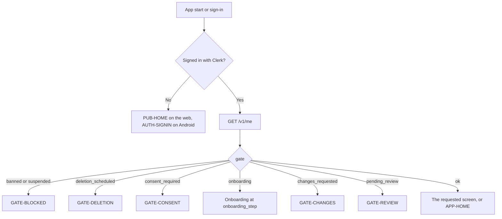
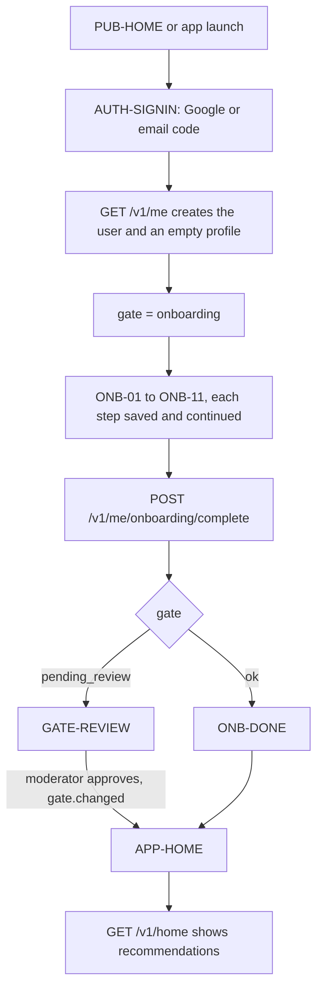
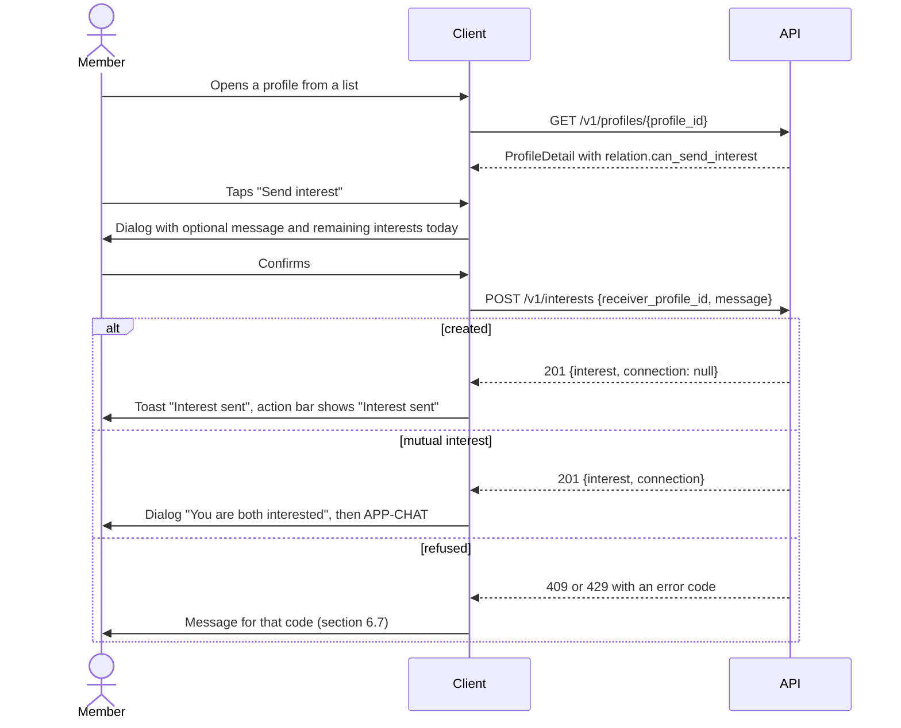
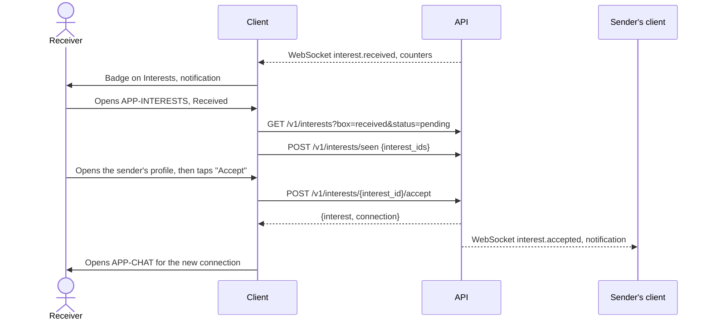
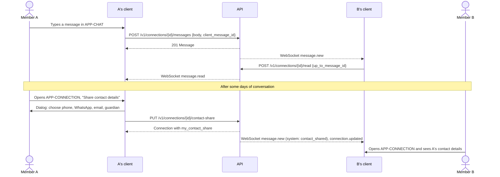
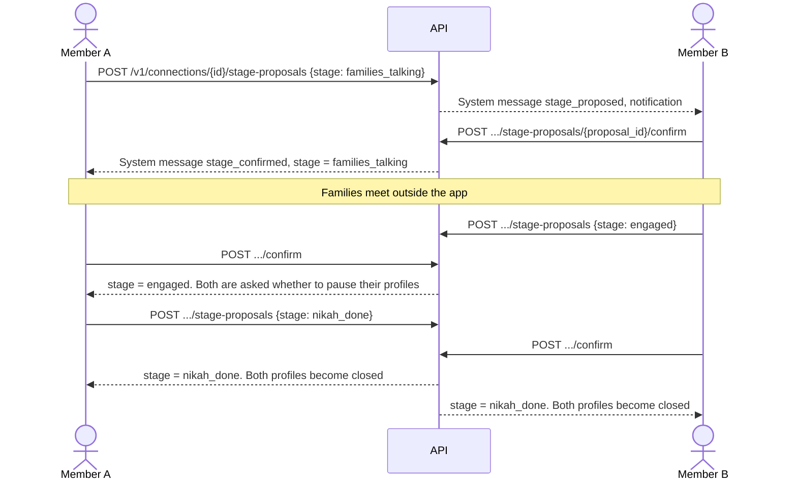
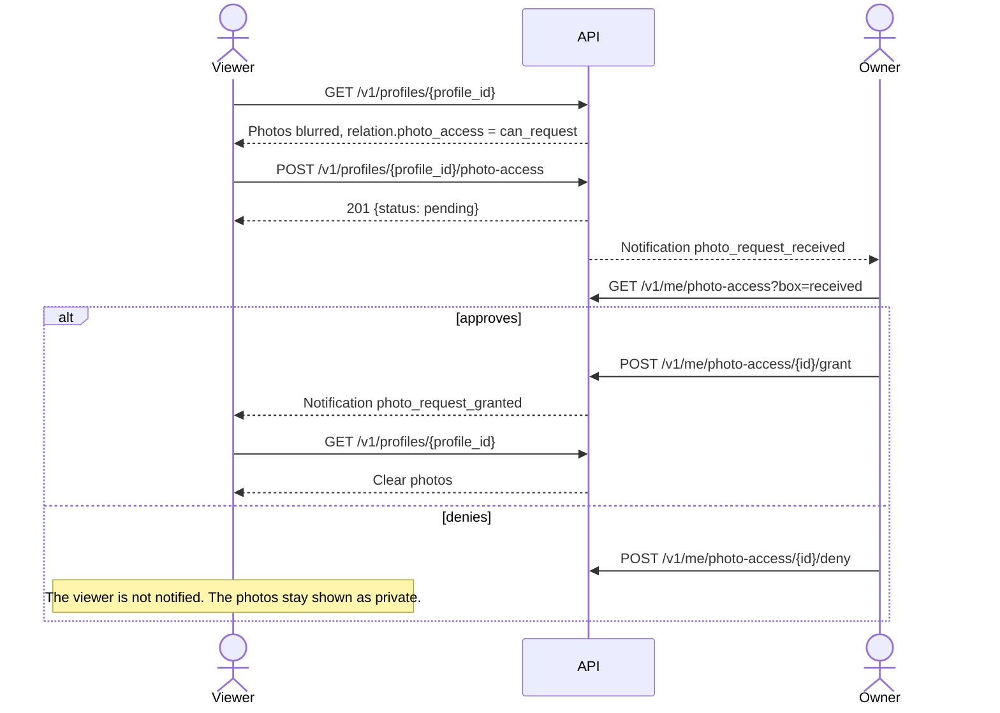
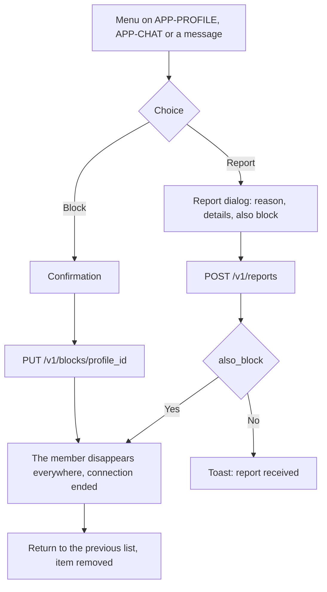
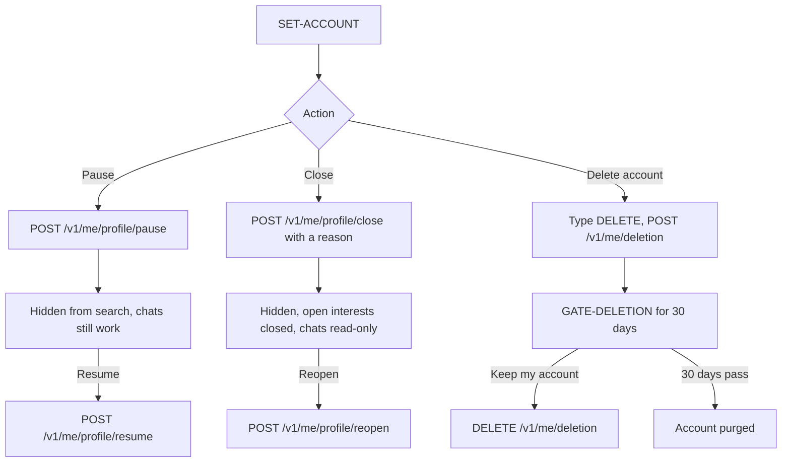
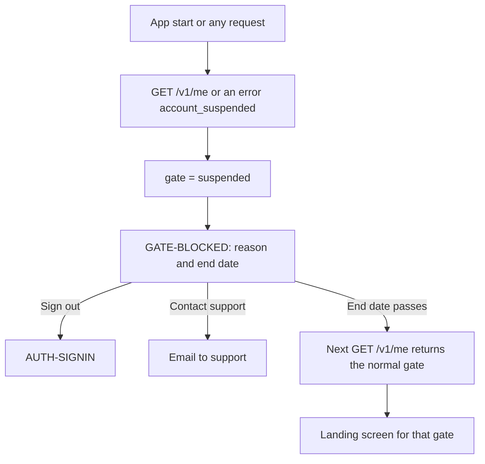

# 16. Screens and Flows

| | |
|---|---|
| Status | Design complete, not implemented |
| Related | [03-domain-model.md](03-domain-model.md) for states and gates, [15-api-contract.md](15-api-contract.md) for endpoints and types, [07-onboarding.md](07-onboarding.md) for the onboarding screens, [08-profile-and-photos.md](08-profile-and-photos.md) for own profile and photos, [09-privacy-and-visibility.md](09-privacy-and-visibility.md), [10-matching-and-discovery.md](10-matching-and-discovery.md), [11-interests-connections-chat.md](11-interests-connections-chat.md), [12-verification-and-trust.md](12-verification-and-trust.md), [13-safety-and-moderation.md](13-safety-and-moderation.md), [14-notifications.md](14-notifications.md), [17-web-app.md](17-web-app.md) for URLs, [22-android-app.md](22-android-app.md) for navigation keys, [18-admin-console.md](18-admin-console.md) for the admin screens |

This is the platform-neutral catalogue of every member-facing screen. The web app and the Android app implement the same screens with the same content, actions and copy. Screens are named by ID. Their URLs are defined in 17 and their Android navigation keys in 22. Admin screens (`ADM-*`) are in 18.

## 1. How to read this document, and global UI rules

### 1.1 Screen specification format

Each screen in section 6 is described with these parts:

| Part | Meaning |
|---|---|
| Purpose | One sentence. |
| Access | The access level from 15 section 3 that the screen's main endpoint needs, and the gates under which the screen can be opened (section 3). |
| Entry points | Every place the member can come from. |
| Data | The endpoints called, and when. |
| Content | The blocks of the screen from top to bottom, naming the fields of the API types that are shown. |
| Actions | A table: control, endpoint and body, what happens on success, what happens on each relevant error code. |
| States | Loading, empty (with exact copy) and error. |
| Platform differences | Only where web and Android must differ. |

Type and field names such as `ProfileCard.display_name` refer to 15 section 4. All copy is English and lives under i18n keys in the clients. Text in the `self` form follows the wording pattern of 07 section 3.2 where it talks about the candidate. On a managed profile that pattern has three additions: headings name the candidate instead of using a pronoun ("{first_name}'s matches", "Near {first_name}", "Viewed {first_name}'s profile"); "you both" becomes "them both" ("Age suits them both"); "my" becomes "his" or "her" ("Improve his profile"). Text addressed to the person at the screen keeps "you" ("You will not see this profile for 6 months."). Wherever copy says "{name}", it means the other member's `display_name`.

### 1.2 Global rules

| # | Topic | Rule |
|---|---|---|
| G1 | Loading | The first load of a screen shows a skeleton that matches the final layout. Never a blank screen. Spinners are used only inside buttons and for "load more". |
| G2 | Empty states | An icon, a title, one line of text and, where useful, one primary button. The exact copy is given per screen. |
| G3 | Screen-level errors | When the main request of a screen fails: title "Something went wrong", text "Please try again. If it keeps happening, contact support and mention the reference below.", a "Try again" button, and "Reference: {x-request-id}" in small type. |
| G4 | Action errors | Shown next to the control or as a toast. The form or list keeps its state. Section 1.3 lists the handling of error codes that can come from any request. |
| G5 | Refresh | Lists refetch when the screen is opened again after 60 seconds or more, on pull to refresh (Android and touch web), and through a "Refresh" control on wide web. |
| G6 | Pagination | Infinite scroll with `limit=20`. A spinner row at the end while loading. When `next_cursor` is `null`, nothing more is requested. |
| G7 | Optimistic updates | Allowed only for: shortlist on and off, pass and its undo, marking notifications or messages read, mute and archive, and the "sending" state of a chat message. On failure the change is reverted and a toast explains. Everything else waits for the server: sending, accepting, declining or withdrawing an interest, block, report, ending a connection, contact share, stage proposals, pause, close, delete, privacy changes and every form save. |
| G8 | Confirmation dialogs | Required before: decline, withdraw, block, unblock, end connection, stop sharing contact, remove photo, remove saved search, pause, close, reopen, delete account, sign out. The dialog names the consequence in one or two sentences. The confirming button repeats the verb ("Block", "End connection"). |
| G9 | Toasts | Short confirmations ("Interest sent", "Saved"). They disappear after 4 seconds. Errors that need a decision use a dialog instead. |
| G10 | Photos of other members | Use `PhotoView.thumb_url` in compact cards and rows, `medium_url` in full-size cards, in tiles and on the profile, and `large_url` only in the photo viewer. When `is_blurred` is true, show the image as received with a small lock icon. Never apply or remove blur on the device for another member's photo. When `photo` is `null`, show a neutral placeholder (a silhouette, different for male and female profiles). No save, share or download control exists for another member's photo. |
| G11 | Dates and times | Relative for the last 7 days ("5 min ago", "Yesterday"), then the date. Chat messages show the time; day separators show the date. All in the device's time zone. |
| G12 | Direction | Layouts use start and end, never left and right, so the Urdu phase can mirror them. |
| G13 | Accessibility | Every control has a text label. Touch targets are at least 48 by 48 dp on Android and 44 by 44 px on the web. Colour is never the only signal (statuses also have text or an icon). |
| G14 | Offline | A banner "You are offline" under the top bar. Buttons that need the network are disabled. Cached lists stay visible. |
| G15 | Live updates | The WebSocket events of 19 section 4 update the screens named in section 6 without a manual refresh. When the socket reconnects, the open screen refetches its data. |
| G16 | Status panel | When the member's own profile status does not allow a screen (03 section 5), the screen shows a panel in place of its content. See 1.4. |
| G17 | Screenshot protection | On Android, `APP-PROFILE`, `APP-PHOTOS`, `APP-CHAT`, `APP-CONNECTION`, `ME-VERIFY-ID` and `ME-VERIFY-SELFIE` set `FLAG_SECURE` (09 section 6). The web cannot prevent screenshots. |

### 1.3 Error codes handled the same way everywhere

| Error code | Handling |
|---|---|
| `unauthenticated` | Sign the member out locally and open `AUTH-SIGNIN`. After sign-in, return to the screen that was open. |
| `account_banned`, `account_suspended`, `account_deletion_scheduled`, `consent_required`, `onboarding_required` | Refetch `GET /v1/me` and route by `gate` (section 3). |
| `profile_not_active` | Refetch `GET /v1/me`. If the gate changed, route by it. Otherwise show the status panel (1.4). |
| `upgrade_required` | Open `GATE-UPGRADE` (Android). |
| `not_found` for a profile, interest or connection | Show "This is no longer available." with a "Go back" button, and remove the item from any cached list. |
| `rate_limited` | Toast: "You are going a little fast. Please try again in {retry_after_seconds} seconds." |
| `limit_reached` | Dialog with the text given for the action. If the action gives none: "You have reached a limit for today. It resets at midnight, Pakistan time." |
| `validation_failed` | Messages under the fields named in `fields`. |
| `internal_error`, `service_unavailable`, network failure | For a screen load: G3. For an action: toast "Something went wrong. Please try again." |

### 1.4 Status panel

Shown in place of the content of a screen whose access level the member's profile status does not meet.

| Own profile status | Screens affected | Panel title | Panel text | Button |
|---|---|---|---|---|
| `paused` | Screens that need `browse` | "The profile is paused" | "Resume it to see matches, search and send interests. Your chats are still available." | "Resume the profile" calls `POST /v1/me/profile/resume`, then reloads the screen |
| `closed` | Screens that need `browse` or `engage` | "The profile is closed" | "Reopen it to see matches and answer interests. You can still read your chats." | "Reopen the profile" opens `SET-ACCOUNT` |

### 1.5 The profile card

Lists of members use one shared component, fed by `ProfileCard`. It has two sizes and a small tile (below the table). A card shows only what helps a family decide whether to open the profile; the other details are on `APP-PROFILE`. When a card grows too tall, content leaves the card before text gets smaller.

| Element | Source | Full size (matches, search, "Your matches" on home) | Compact size (interests, shortlist, visitors, requests, "Near you" on home) |
|---|---|---|---|
| Photo | `photo` (`medium_url` in full size, `thumb_url` in compact) or the placeholder; a lock icon when `photo.is_blurred` | Yes | Yes |
| Photo count | `photo_count`, as "{n} photos", when 2 or more | Yes | No |
| Name and age | `display_name`, `age`, as "Ayesha K., 26" | Yes | Yes |
| Badges | `badges`, in the order `id_verified`, `photo_verified`, `phone_verified`, as words with a tick by the name: "ID verified", "Photo verified", "Phone verified", never as icons alone; `new` as a "New" label on the photo (12 section 1.2). Only earned badges appear. | Yes | Yes |
| Location | `city_name`, and the country name when `country_code` differs from the viewer's own | Yes | Yes |
| Work | Name of `profession_code`, or the label of `employment_type` when there is no profession | Yes | Yes |
| Marital status | Label of `marital_status` when it is not `never_married` | Yes | No |
| Managed by | "Profile managed by {label of managed_by}" when it is not `self` | Yes | No |
| Match | `compat` as "{n}% match" when not `null`; up to 3 reasons from `reasons` (labels in 10 section 7) | Yes | Percentage only |
| Relation hint | From `relation`: "Interest sent" (`interest_direction = 'sent'`), "Interested in you" (`'received'`), "Connected" (`tier = 'connection'`) | Yes | Yes |
| Shortlist control | A button with a heart and the label "Shortlist". When `relation.is_shortlisted` it is pressed, the heart is filled and the label reads "Shortlisted". | Yes | No |
| More | A button "More" that opens a menu with "Not interested" (6.4) | Yes | No |
| Education | Name of `education_level_code` | No, `APP-PROFILE` only | No |
| Height, religion or sect, caste | Height (07 section 4.3 format), name of `sect_code` or of `religion_code`, `caste_label` when not `null` | No, `APP-PROFILE` only | No |
| Activity | Label of `last_active` when not `null`: `online` "Online now", `today` "Active today", `this_week` "Active this week", `this_month` "Active this month", `earlier` "Active a while ago" | No, `APP-PROFILE` only | No |

Location, work and marital status share one line on the full size ("Lahore · Software and IT · Divorced"); location and work share one line on the compact size. `ProfileCard` still carries the fields of the last three rows (15 section 4); the card does not show them.

The tile is used only by "New members" on home, so that row stays small. It shows the photo (`medium_url`, because the thumb is a square crop) with the "New" label, the name and age, `compat` as "{n}% match" when not `null`, and the location and work on two lines. It has nothing else.

Tapping a card opens `APP-PROFILE` for `ProfileCard.id`. "Shortlist" calls `PUT /v1/shortlist/{profile_id}` with `{}` or `DELETE /v1/shortlist/{profile_id}` (optimistic, G7).

### 1.6 Copy owned by other documents

Several texts shown on these screens are defined once elsewhere so that the app, notifications and emails use the same words. This document names the place and does not restate them, except for short quotations marked as such.

| Text | Owner |
|---|---|
| Stage names. Written "{stage name}" below: `chatting` "Getting to know each other", `families_talking` "Our families are in touch", `engaged` "Rishta confirmed", `nikah_done` "Nikah completed" | 11 section 9.1 |
| Chat system message texts | 11 section 6.8 |
| Interest message templates | 11 section 2.2 |
| Chat safety notice texts | 13 section 5.3 |
| First-chat tips, safety tips | 13 section 11 |
| Photo rules and photo rejection messages | 13 sections 4.1 and 4.3 |
| Verification screens copy and verification rejection messages | 12 section 8 |
| Identity number consent text and validation messages | 12 sections 2.2 and 3.3 |
| Privacy setting labels and helper texts | 09 section 3 |
| Notification texts and targets | 14 section 3 |
| Notification preference labels | 14 section 6.1 |
| Blocked-account and deletion copy, sign-out steps | 06 sections 8.4, 9 and 10.1 |
| Match reasons | 10 section 7 |
| Option labels of every closed list | 05 section 2 |

## 2. Navigation structure

### 2.1 Primary destinations

| Destination | Screen | Badge |
|---|---|---|
| Home | `APP-HOME` | None |
| Search | `APP-SEARCH` | None |
| Interests | `APP-INTERESTS` | `Me.counters.pending_interests` |
| Chats | `APP-CHATS` | `Me.counters.unread_chats` |
| Me | `ME-PROFILE` | A dot when `Me.profile.completeness` is under 70 or `Me.counters.pending_photo_requests` is above 0 |

| Layout | Where the primary destinations are |
|---|---|
| Android, and web narrower than 768 px | A bottom bar with the five destinations, icon and label. |
| Web 768 px and wider | A top bar: the logo (opens `APP-HOME`), the five destinations as text links, the notification bell, and an avatar menu. |

The primary navigation is visible on the five destination screens and on the list screens reached from them (`APP-MATCHES`, `APP-SHORTLIST`, `APP-VISITORS`, `APP-NOTIFS`, `APP-PHOTO-REQUESTS`, `SET-HOME`). Detail screens (`APP-PROFILE`, `APP-PHOTOS`, `APP-CHAT`, `APP-CONNECTION`, `ME-EDIT`, `ME-PHOTOS`, `ME-PREFS`, the verification and settings sub-screens) show a back arrow and their title instead of the bottom bar. On wide web the top bar stays on every screen.

### 2.2 Secondary destinations

| Destination | Screen | Reached from | Badge |
|---|---|---|---|
| Notifications | `APP-NOTIFS` | The bell in the top bar of `APP-HOME` (Android and narrow web) or of every screen (wide web) | `Me.counters.unread_notifications` |
| All matches | `APP-MATCHES` | "See all" on `APP-HOME` | None |
| Shortlist | `APP-SHORTLIST` | The menu on `ME-PROFILE` (Android and narrow web); the avatar menu (wide web) | None |
| Who viewed me | `APP-VISITORS` | Same menu; the visitors row on `APP-HOME` | None |
| Photo requests | `APP-PHOTO-REQUESTS` | Same menu | `Me.counters.pending_photo_requests` |
| Settings | `SET-HOME` | A gear icon on `ME-PROFILE`; the avatar menu | None |

The menu on `ME-PROFILE` (Android and narrow web) is a list under the profile header: "Shortlist", "Who viewed me", "Photo requests", "Settings". The avatar menu on wide web lists: "My profile", "Shortlist", "Who viewed me", "Photo requests", "Settings", "Sign out".

### 2.3 Back behaviour

1. Back from a detail screen returns to the screen it was opened from, with its scroll position and filters intact.
2. Back from one of the five primary destinations goes to `APP-HOME`. Back on `APP-HOME` leaves the app (Android).
3. A screen opened from a notification or link has no history. Back goes to `APP-HOME`.
4. After sign-out, onboarding completion, account deletion or a gate change, the history is cleared so Back cannot return to a screen that is no longer allowed.

### 2.4 Badges

Badge numbers come from `Me.counters`. They are updated by the `counters` WebSocket event without refetching `GET /v1/me`, and by every response that returns `Me`. A count above 99 is shown as "99+". Zero shows no badge.

## 3. Routing by gate

### 3.1 The rule

The client keeps one cached `Me`. Its `gate` decides where the member may be. No other field is used for this decision.

### 3.2 Gate table

| `gate` | Landing screen | Other screens that may be opened | Everything else |
|---|---|---|---|
| `banned` | `GATE-BLOCKED` | `SET-HELP` and the public legal pages | Redirects to `GATE-BLOCKED` |
| `suspended` | `GATE-BLOCKED` | `SET-HELP` and the public legal pages | Redirects to `GATE-BLOCKED` |
| `deletion_scheduled` | `GATE-DELETION` | `SET-HELP` | Redirects to `GATE-DELETION` |
| `consent_required` | `GATE-CONSENT` | The public legal pages | Redirects to `GATE-CONSENT` |
| `onboarding` | The onboarding screen of `Me.profile.onboarding_step` | Earlier onboarding screens, `SET-HELP` | Redirects to onboarding |
| `changes_requested` | `GATE-CHANGES` | `ME-PROFILE`, `ME-EDIT`, `ME-PHOTOS`, `ME-PREFS`, `ME-VERIFY`, `ME-VERIFY-ID`, `ME-VERIFY-SELFIE`, `APP-NOTIFS`, all `SET-*` screens except `SET-BLOCKED`, which needs `connected` (its row on `SET-HOME` is not shown) | Redirects to `GATE-CHANGES` |
| `pending_review` | `GATE-REVIEW` | The same list as `changes_requested` | Redirects to `GATE-REVIEW` |
| `ok` | `APP-HOME` | Every screen. Individual screens then apply the status panel (1.4) for `paused` and `closed`. | |

On Android, `GATE-UPGRADE` takes priority over every gate (section 6.2).

A signed-in member who opens a public page on the web is not redirected, except from `PUB-HOME`, which sends a signed-in member to their landing screen.

### 3.3 When `GET /v1/me` is fetched

| Trigger | Action |
|---|---|
| App start with a Clerk session | Fetch, then route. Until it answers, show the splash screen (the logo), not a gate. |
| Sign-in or sign-up completed | Fetch, then route. |
| The app returns to the foreground, or the browser tab becomes visible, after 60 seconds or more | Fetch in the background. Route again only if `gate` changed. |
| A response returns `Me` (onboarding continue and complete, consents, pause, resume, close, reopen, deletion, locale change) | Replace the cache with it. Route again if `gate` changed. |
| Any request fails with a gate error code (1.3) | Fetch, then route. |
| The WebSocket event `gate.changed` arrives | Fetch, then route. |
| The WebSocket event `counters` arrives | Update `Me.counters` in the cache. No fetch. |

If `GET /v1/me` itself fails with a network or server error at start, show G3 with "Try again". Never guess a gate.

### 3.4 What a gate change looks like to the member

| From | To | Behaviour |
|---|---|---|
| `pending_review` | `ok` | Toast "The profile is approved and live." and open `APP-HOME`. |
| `pending_review` | `changes_requested` | Open `GATE-CHANGES`. |
| `ok` | `suspended` or `banned` | Close any open dialog, clear the history, open `GATE-BLOCKED`. |
| `ok` | `consent_required` | Open `GATE-CONSENT`. After acceptance, return to the previous screen. |
| Any | `deletion_scheduled` | Open `GATE-DELETION`. |

## 4. Deep-link targets

A deep link is any navigation that starts outside the screen flow: a push notification, an in-app notification, an email link or a shared profile code. Each target is a screen ID and parameters. 17 maps targets to URLs and 22 to Android intents.

### 4.1 Targets

The target of each notification type is defined in 14 section 3, and the `target` field of a push in 14 section 4. This table lists every target a client must be able to open, with its parameters.

| Target | Parameters | Used by |
|---|---|---|
| `APP-HOME` | None | `profile_approved` |
| `APP-MATCHES` | None | `new_matches` from recommendations; match digest email |
| `APP-SEARCH` | `saved_search_id` | `new_matches` from a saved search: the saved search is loaded and run. If it no longer exists, the empty search form is shown. |
| `APP-PROFILE` | `profile_id` | `interest_received` (the actor's profile, which shows "Accept" and "Decline"); `photo_request_granted`; a profile card in an email |
| `APP-PROFILE` by code | `public_code` | A shared profile code link. The client calls `GET /v1/profiles/by-code/{public_code}` and opens `APP-PROFILE` with the returned id. On `404`: "No profile with this code is available to you." |
| `APP-INTERESTS` | `box` (`received` or `sent`), optional `interest_id` to scroll to | The `interest_received` reminder (Received, New); the interest digest email |
| `APP-CHAT` | `connection_id` | `interest_accepted`; a chat push; the unread messages email |
| `APP-CONNECTION` | `connection_id` | `contact_shared`, `stage_proposed`, `stage_confirmed` |
| `APP-PHOTO-REQUESTS` | `box = received` | `photo_request_received` |
| `APP-VISITORS` | None | `profile_views_summary` |
| `APP-NOTIFS` | None | A push whose type the installed build does not know |
| `ME-PROFILE` | None | Profile reminders by email |
| `ME-PHOTOS` | None | `photo_approved`, `photo_rejected` |
| `ME-EDIT` | `section` | `text_rejected`: `lifestyle` when `data.field` is `about_me`, `family` when it is `about_family` |
| `ME-PREFS` | None | `text_rejected` when `data.field` is `partner_notes` |
| `ME-VERIFY` | None | `verification_approved`, `verification_rejected` |
| `GATE-CHANGES` | None | `profile_changes_requested` |
| `PUB-GUIDELINES` | None | `account_warning` (after its dialog, 6.15) |
| `SET-ACCOUNT` | None | The data export email ("Your file is ready") |
| External URL | `url` | `announcement` with a URL: opens in the browser or an in-app browser tab |

The parameter values come from the notification's `data` object (14 section 3) or from the link in the email.

### 4.2 Rules

1. A deep link opened while signed out leads to `AUTH-SIGNIN`. After sign-in, the gate is evaluated, then the target is opened if the gate allows it (3.2).
2. When the gate does not allow the target, the gate's landing screen is shown and the target is dropped.
3. A target whose resource no longer exists shows "This is no longer available." with a button to `APP-HOME`.
4. Opening an in-app notification marks it read (section 6.15).
5. A push or link with an unknown target opens `APP-NOTIFS`. A feed row with an unknown type is shown as "You have a new notification." and has no target (14 section 3). This keeps old app builds safe when new types are added.

## 5. End-to-end flows

### 5.1 Sign-up to the first match list

### 5.2 Sending an interest

### 5.3 Receiving and accepting an interest

Declining instead: `POST /v1/interests/{interest_id}/decline`. The sender is not told (03 section 4.7).

### 5.4 Chat to contact share

### 5.5 Stage proposal to nikah

### 5.6 Requesting photos

### 5.7 Report and block

### 5.8 Pause, close and delete

### 5.9 Returning with a suspended account

## 6. Screen catalogue

### 6.1 `AUTH-SIGNIN`

| Part | Specification |
|---|---|
| Purpose | Sign in or create an account with Clerk's prebuilt sign-in-or-sign-up UI. |
| Access | `public`. Shown only when there is no Clerk session. |
| Entry points | "Sign in" and "Create a free profile" on the public pages; app launch on Android without a session; any `unauthenticated` error; sign-out. |
| Content | The app logo and the line "Find a rishta the family way." Then Clerk's component with the launch methods: "Continue with Google" and email with a one-time code. Under it, small type: "By continuing you agree to the Terms of Use and Privacy Policy." with links to `PUB-TERMS` and `PUB-PRIVACY`. Configuration of the component is in 06. |
| Data | None from the API until sign-in completes. |
| After success | `GET /v1/me`, then route by `gate` (section 3). A remembered deep-link target is applied after routing. |
| States | Clerk renders its own loading and error states. If `GET /v1/me` fails afterwards: G3. |
| Platform differences | Web: Clerk's `<SignIn />` component. Android: Clerk's `AuthView`. Details in 06, 17 and 22. |

### 6.2 Gate screens

All gate screens need access level `auth`, show no primary navigation, and offer "Sign out" in a menu. They refetch `GET /v1/me` when opened and when the `gate.changed` event arrives.

#### `GATE-BLOCKED`

| Part | Specification |
|---|---|
| Purpose | Tell a suspended or banned member what happened. The copy is owned by 06 section 8.4. |
| Gate | `suspended`, `banned`. |
| Content | Suspended: title "Your account is suspended", body "Reason: {Me.user.status_reason}. Your account will be available again on {Me.user.suspended_until, as a date in the user's time zone}." Banned: title "Your account has been closed", body "Reason: {Me.user.status_reason}. If you believe this is a mistake, email us." Under both: the profile code `Me.profile.public_code` in small type, and links to `PUB-GUIDELINES` and `PUB-TERMS`. |
| Actions | "Contact support": opens an email to `Me.config.support_email` with the subject "Account review {public_code}". "Sign out" (the steps of 6.27). "Delete my data" (offered for both `banned` and `suspended`), which opens the confirmation sheet of 6.27 and calls `POST /v1/me/deletion`. The gate stays `banned` after this call (15 section 6), so the member stays on this screen, which then also shows "Your data will be deleted on {Me.user.purge_after, as a date}." (06 section 9.4). |
| Behaviour | When a suspension ends, the next `GET /v1/me` returns the normal gate and the client routes by it. The socket is closed by the server while the account is blocked (19 section 4), so this screen polls `GET /v1/me` once a minute while visible. |
| States | Loading: splash. Error: G3. |

#### `GATE-DELETION`

| Part | Specification |
|---|---|
| Purpose | Confirm a pending deletion and allow cancelling it (06 section 9.1 step 4). |
| Gate | `deletion_scheduled`. |
| Content | Title "Your account is scheduled for deletion". Text: "Your account will be deleted on {Me.user.purge_after, as a date}. Until then you can change your mind." Second line: "Your profile is hidden from everyone in the meantime." |
| Actions | "Keep my account": `DELETE /v1/me/deletion`, then route by the returned `gate`, with the toast "Welcome back. Your account is active again." "Sign out". |
| Errors | `invalid_state`: refetch `GET /v1/me` and route. |

#### `GATE-CONSENT`

| Part | Specification |
|---|---|
| Purpose | Collect acceptance of new versions of the legal documents. |
| Gate | `consent_required`. |
| Content | Title "We have updated our terms". One row per entry of `Me.consents_required`, each with the document name and a link to its public page: `terms` "Terms of Use", `privacy` "Privacy Policy", `community_guidelines` "Community Guidelines". A checkbox: "I have read and agree to the updated documents." |
| Actions | "Accept and continue" (enabled when the checkbox is ticked): `POST /v1/me/consents` with `{ "documents": Me.consents_required }`, then route by the returned `gate`. "I do not agree": a dialog explaining "You need to accept the updated documents to keep using Khandani Rishta. You can delete your account instead." with "Delete my account" (the deletion dialog of 6.27) and "Go back". "Sign out". |

#### `GATE-REVIEW`

| Part | Specification |
|---|---|
| Purpose | Tell the member their profile is waiting for a moderator, and keep them productive meanwhile. |
| Gate | `pending_review`. |
| Content | Title "The profile is being reviewed". Text: "Our team checks new profiles to keep everyone safe. This usually takes less than a day. We will notify you as soon as it is live." Then the three action cards of 07 section 15.1 (add a photo, verify your identity, review your privacy), with the same conditions. Then a button "View my profile" (`ME-PROFILE`). |
| Data | `GET /v1/me` on open, on `gate.changed`, and every 60 seconds while the screen is visible. |
| Behaviour | When the gate becomes `ok`: 3.4. |

#### `GATE-CHANGES`

| Part | Specification |
|---|---|
| Purpose | Show what a moderator asked the member to fix, and let them resubmit. |
| Gate | `changes_requested`. |
| Content | Title "A few changes are needed". Text: "Our team could not approve the profile yet. Please fix the following and send it for review again." Then `Me.profile.status_reason` in a highlighted box. |
| Actions | "Edit my profile": `ME-PROFILE`. "Resubmit for review": `POST /v1/me/profile/resubmit`, then route by the returned `gate` (normally `pending_review`, so `GATE-REVIEW`). |
| Errors | `invalid_state`: refetch `GET /v1/me` and route. `validation_failed`: show the messages and open the matching `ME-EDIT` section (07 section 14.3). |

#### `GATE-UPGRADE` (Android only)

| Part | Specification |
|---|---|
| Purpose | Force an update when the installed build is no longer supported. |
| Trigger | Any response `426 upgrade_required`, or `GET /v1/meta/app-release?platform=android` at launch returning a `min_supported_version_code` above the installed version code. It overrides every gate. |
| Content | Title "Please update the app". Text: "This version is no longer supported. Install the latest version to continue. Your account and chats are safe." Version line: "Latest version: {version_name}". The `release_notes`, when present. |
| Actions | "Download the update": opens `download_url` (from the error's `details.download_url` or the release). Installation steps are in 22. |
| Optional update | When a newer `version_code` exists but the installed build is still supported, `APP-HOME` shows a dismissible banner "A new version is available" with "Update". It is shown at most once a day. |

### 6.3 Onboarding screens

Specified in full in 07. One pointer per screen:

| Screen | Step | Specification |
|---|---|---|
| `ONB-01` | `account_for` | 07 section 3 |
| `ONB-02` | `basics` | 07 section 4 |
| `ONB-03` | `community` | 07 section 5 |
| `ONB-04` | `location` | 07 section 6 |
| `ONB-05` | `education_career` | 07 section 7 |
| `ONB-06` | `family` | 07 section 8 |
| `ONB-07` | `lifestyle` | 07 section 9 |
| `ONB-08` | `photos` | 07 section 10 |
| `ONB-09` | `preferences` | 07 section 11 |
| `ONB-10` | `identity` | 07 section 13 |
| `ONB-11` | `review` | 07 section 14 |
| `ONB-DONE` | After completion | 07 section 15 |

### 6.4 `APP-HOME`

**Purpose:** the daily starting point: the best matches, what needs attention, and what to do next.

**Access:** `browse`. Gate `ok`. Status panel for `paused` and `closed` (1.4).

**Entry points:** the Home destination; the logo; the end of onboarding; `profile_approved`.

**Data:** `GET /v1/home` on open, on pull to refresh, and when the cached answer is older than 5 minutes. `Me` from the cache.

**Content, top to bottom:**

| # | Block | Shown when | Content |
|---|---|---|---|
| 1 | Top bar | Always | App name. Notification bell with badge (Android and narrow web). |
| 2 | Announcement | `Me.config.announcement` is not `null` and not dismissed | `text_en` (or `text_ur` when the locale is `ur` and it is set). Tapping opens `url` when set. A close control hides it; the dismissal is stored on the device against the text. |
| 3 | Update banner | Android, a newer build exists | See `GATE-UPGRADE`. |
| 4 | Greeting | Always | "Welcome back, {Me.profile.first_name}". For a managed profile: "Welcome back. Managing {first_name}'s profile." |
| 5 | First-run tip | Once, 07 section 15.2 | The tip card. |
| 6 | Pending interests | `pending_interests` above 0 | "{n} members are interested in you" (singular: "1 member is interested in you") with the button "View". Opens `APP-INTERESTS`, Received. |
| 7 | "Your matches" | Always | Under the title, when the row is not empty: "They fit you, and you fit them". A horizontal row of full-size cards from `recommendations` (up to 10). Header link "See all" opens `APP-MATCHES`. Empty and exhausted states below. |
| 8 | Nudges | `nudges` not empty | A horizontal row of cards, one per nudge, in the given order, after the matches so that the first match is on the first screen. On phones a card shows its title, and its text is for screen readers. Texts and targets below. |
| 9 | "New members" | `new_members` not empty | A horizontal row of tiles (1.5). Header link "See all" opens `APP-SEARCH` with `joined_within_days = 7` and `sort = newest` applied. |
| 10 | "Near you" | `nearby` not empty | A list of compact cards, one column on phones and up to three on wide web. Header link "See all" opens `APP-SEARCH` with the viewer's own city in `city_ids` and `sort = best_match`. |
| 11 | "Viewed your profile" | `visitors_count_7d` above 0 | "{visitors_count_7d} members viewed the profile this week", up to 5 small photos from `recent_visitors`, link "See all" opens `APP-VISITORS`. |
| 12 | Completeness card | `completeness` under 70 | A ring with `completeness`, "Complete profiles receive more interest.", button "Improve my profile" opens `ME-PROFILE`. |
| 13 | Safety line | Always | "Never send money to anyone you meet here. Read the safety tips." Opens `PUB-SAFETY` or `SET-HELP`. |

Nudge cards (the selection rule is in 10 section 10.1):

| `code` | Title | Text | Opens |
|---|---|---|---|
| `add_photo` | "Add a photo" | "Profiles with a photo receive far more interest." | `ME-PHOTOS` |
| `verify_identity` | "Verify your identity" | "Verified profiles are trusted more and can send more interests each day." | `ME-VERIFY` |
| `add_about_me` | "Write about yourself" | "A few honest lines help families decide." | `ME-EDIT` with `section = lifestyle` |
| `set_preferences` | "Set your partner preferences" | "Tell us who you are looking for." | `ME-PREFS` |
| `verify_photo` | "Verify your photo" | "A quick selfie shows that the photos are really you." | `ME-VERIFY-SELFIE` |
| `add_contact_details` | "Add contact details" | "Needed before you can share your number with a connection. They stay private until you share." | `SET-CONTACTS` |
| `complete_profile` | "Complete the profile" | "The profile is {completeness}% complete." | `ME-PROFILE` |

**States of the "Your matches" row:**

| Situation | Display |
|---|---|
| `recommendations` empty, `pool_exhausted` false | "Finding your matches..." with a skeleton row. Refetch `GET /v1/home` after 5 seconds, at most 3 times. After that: "No matches yet. Try the search, or check back later." with the button "Search". |
| `recommendations` empty, `pool_exhausted` true | "No more members fit all your must-haves right now." with the buttons "Review preferences" (`ME-PREFS`) and "Search" (`APP-SEARCH`). |
| `recommendations` not empty, `pool_exhausted` true | The row, followed by a final card: "You have seen everyone who fits your must-haves. Loosen one to see more." with "Review preferences". |

When `pool_exhausted` is true, each entry of `relaxation_hints` (at most 2, returned by `GET /v1/home` and `GET /v1/recommendations`) adds one line under the exhausted text: "Changing your must-have for {dimension label} would show {extra_profiles} more profiles." The dimension labels are those of 6.7. When the array is empty, the exhausted text stands alone. The rule behind the hints and the extra line about the age range are in 10 section 8.7.

**Actions:**

| Control | Endpoint | On success | On error |
|---|---|---|---|
| Tap a card | None | Opens `APP-PROFILE` | |
| "Shortlist" on a card | `PUT /v1/shortlist/{profile_id}` with `{}`, or `DELETE /v1/shortlist/{profile_id}` | The button toggles between "Shortlist" and "Shortlisted" (optimistic) | Revert; toast "Could not update the shortlist." |
| Card menu, "Not interested" | `PUT /v1/passes/{profile_id}` | The card is replaced in place (optimistic) by a panel: "{name} is hidden from your matches.", "You will not see this profile for 6 months." and the button "Undo". The panel stays until the member leaves the screen, with no time limit. "Undo" calls `DELETE /v1/passes/{profile_id}` and restores the card (11 section 12). | Revert; generic toast |

**States:** loading: skeleton rows. Error: G3. Status panel per 1.4.

**Live updates:** `counters` updates block 6. `interest.received` refetches `GET /v1/home` in the background.

### 6.5 `APP-MATCHES`

**Purpose:** the full, ranked list of recommended matches.

**Access:** `browse`. Gate `ok`.

**Entry points:** "See all" on `APP-HOME`; the `new_matches` notification; the match digest email.

**Data:** `GET /v1/recommendations?limit=20`, then `cursor` pages.

**Content:**

| # | Block | Content |
|---|---|---|
| 1 | Header | Title "Your matches". Under it, when `refreshed_at` is not `null`: "Updated {relative time of refreshed_at}". A "Refresh" control. A link "Preferences" to `ME-PREFS`. |
| 2 | Refreshing banner | When `is_refreshing` is true: "Finding new matches..." The client refetches the first page after 5 seconds and again after 15 seconds, then stops. |
| 3 | List | Full-size profile cards, one per row on narrow screens, a grid of 2 or 3 columns on wide web. |
| 4 | End of list | When `next_cursor` is `null` and `pool_exhausted` is true: the exhausted card of 6.4. When `pool_exhausted` is false: "That is everyone for now. New members join every day." |

**Actions:**

| Control | Endpoint | On success | On error |
|---|---|---|---|
| "Refresh" | `POST /v1/recommendations/refresh` | `202`. Show the refreshing banner and refetch as in block 2. | `rate_limited`: toast "Matches were refreshed a few minutes ago." |
| Card tap, "Shortlist", "Not interested" | As on `APP-HOME` | | |

**States:** loading: skeleton cards. Empty (no items on the first page): the same texts as the "Your matches" row of 6.4. Error: G3.

### 6.6 `APP-SEARCH`

**Purpose:** find members with explicit filters, independent of the saved partner preferences.

**Access:** `browse`. Gate `ok`.

**Entry points:** the Search destination; "See all" links on `APP-HOME` with preset filters; "Search" buttons in empty states.

**Layout:** two views in one screen: the filter form and the results. Narrow screens show one at a time (the form first; "Search" switches to results; a "Filters" button with the count of active filters returns to the form). Wide web shows the form in a side column and the results beside it.

**Data:** `GET /v1/me/saved-searches` and `GET /v1/me/preferences` on open; `GET /v1/reference/bootstrap` from the cache; `POST /v1/search` on "Search" and for each further page.

#### Initial state

- The first time the screen opens in a session, the form is filled from the member's partner preferences (the "Use my preferences" action below), and no search runs until the member taps "Search".
- Afterwards the form keeps the last filters and sort for the rest of the session. They are kept in memory only.
- Presets passed by an entry point replace the form and run the search immediately.

#### Filter form

Every control maps to one key of `SearchFilters` (15 section 4.8). An untouched control sends nothing for its key.

| Group | Label | Control | `SearchFilters` key |
|---|---|---|---|
| Quick find | "Profile code" | Text field with a "Find" button, placeholder "KR..." | Not sent to search: see "Profile code" below |
| Basics | "Age" | Range slider, 18 to 80 | `age_min`, `age_max` |
| Basics | "Height" | Range slider, 4 ft 0 in to 7 ft 0 in | `height_min_cm`, `height_max_cm` |
| Basics | "Marital status" | Multi-select chips from `options.marital_status`. `married` is listed only when the viewer is female. | `marital_statuses` |
| Basics | "Children" | Select from `options.children_acceptance`, first entry "Any" (sends nothing) | `children_acceptance` |
| Community | "Religion" | Multi-select from `religions` | `religion_codes` |
| Community | "Sect" | Multi-select of the sects of the chosen religions | `sect_codes` |
| Community | "Caste or biradari" | Searchable multi-select of top-level `castes` | `caste_codes` |
| Community | "Mother tongue" | Multi-select from `languages` | `mother_tongue_codes` |
| Location | "Country" | Multi-select from `countries` | `country_codes` |
| Location | "Province or state" | Multi-select of regions of the chosen countries (`GET /v1/reference/regions`) | `region_ids` |
| Location | "City" | Search multi-select (`GET /v1/reference/cities`) | `city_ids` |
| Education and work | "Education, at least" | Select with one entry per distinct `rank` of `education_levels` (05 section 7), first entry "Any" | `education_min_rank` |
| Education and work | "Employment" | Multi-select from `options.employment_type` | `employment_types` |
| Education and work | "Profession" | Searchable multi-select from `profession_categories` | `profession_codes` |
| Education and work | "Monthly income, at least" | Select of the PKR `income_bands` by `rank`, labelled as in 05 section 10.3 ("At least 100,000 PKR a month or the equivalent abroad"), first entry "Any" | `income_min_rank` |
| Faith | "Religious practice" | Multi-select chips from `options.religiosity` | `religiosity_levels` |
| Faith | "Hijab" (viewer is male) | Multi-select chips from `options.hijab` | `hijab_types` |
| Faith | "Beard" (viewer is female) | Multi-select chips from `options.beard` | `beard_types` |
| Family | "Family values" | Multi-select chips from `options.family_values` | `family_values` |
| Family | "Family type" | Multi-select chips from `options.family_type` | `family_types` |
| Lifestyle | "Living after marriage" | Multi-select chips from `options.living_arrangement` | `living_arrangements` |
| Lifestyle | "Work after marriage" | Multi-select chips from `options.work_after_marriage` | `work_after_marriage_options` |
| Lifestyle | "Smoking" | Multi-select chips from `options.smoking` | `smoking_options` |
| Profile | "Profile managed by" | Multi-select chips from `options.managed_by` | `managed_by` |
| Profile | "With a photo only" | Switch | `has_photo: true` when on |
| Profile | "Verified members only" | Switch | `verified_only: true` when on |
| Profile | "Active" | Select: "Any time", "Today" (1), "This week" (7), "This month" (30) | `active_within_days` |
| Profile | "Joined" | Select: "Any time", "This week" (7), "This month" (30) | `joined_within_days` |

The groups "Basics", "Community" and "Location" are expanded. The others are collapsed with their count of active filters in the heading. There is no filter for complexion, weight or body type.

**Sort** (a select above the results): "Best match" (`best_match`, default), "Newest members" (`newest`), "Recently active" (`recently_active`).

#### Form actions

| Control | Behaviour |
|---|---|
| "Search" | `POST /v1/search` with `{ "filters": <form>, "sort": <sort>, "limit": 20 }`. Shows the results view. |
| "Reset" | Clears every control. Does not search. |
| "Use my preferences" | Copies the values of `Preferences` into the controls with the same key names (15 section 4.8). Importance values and `notes` are ignored. |
| "Save this search" (shown in the results view) | A dialog: a name field (1 to 60 characters, prefilled "Search {date}") and a switch "Notify me about new members who match". Calls `POST /v1/me/saved-searches` with `{ "name", "filters", "notify_new" }`. Success: toast "Search saved." `limit_reached`: "You can keep up to 10 saved searches. Remove one first." |

**Profile code.** "Find" calls `GET /v1/profiles/by-code/{public_code}` after trimming and converting to capitals. The code must match `KR` followed by 8 characters; otherwise show "A profile code looks like KR7F3K2QX9." Success opens `APP-PROFILE`. `404` shows "No profile with this code is available to you."

#### Saved searches

A row of chips above the form, one per saved search (`name`), newest first.

| Control | Behaviour |
|---|---|
| Tap a chip | Loads its `filters` into the form and runs the search. |
| Chip menu, "Rename" | `PATCH /v1/me/saved-searches/{id}` with `{ "name" }`. |
| Chip menu, "Notify me about new members" (a toggle) | `PATCH /v1/me/saved-searches/{id}` with `{ "notify_new" }`. |
| Chip menu, "Remove" | Confirmation "Remove this saved search?", then `DELETE /v1/me/saved-searches/{id}`. |

#### Results view

| # | Block | Content |
|---|---|---|
| 1 | Summary | "{total_estimate} profiles" when `total_estimate` is not `null`; "More than 500 profiles" when it is `null`. A chip per active filter; tapping a chip's close control removes that filter and searches again. |
| 2 | Sort select | Changing it searches again from the first page. |
| 3 | List | Full-size profile cards with the same card actions as `APP-HOME`. Further pages use `cursor`. |

**States:** loading: skeleton cards. Empty: "No profiles match these filters. Try removing a filter." with the button "Edit filters". Error: G3; `validation_failed` shows the messages on the form; `rate_limited` shows the toast of 1.3.

### 6.7 `APP-PROFILE`

**Purpose:** another member's full profile, and the place where interest is expressed.

**Access:** `connected` (15 section 10). The member's own profile must be `active`, or the target must be a connection or an interest counterpart. Gate `ok`.

**Parameter:** `profile_id`.

**Entry points:** any profile card; notifications; a profile code; the header of `APP-CHAT`.

**Data:** `GET /v1/profiles/{profile_id}` on open and after any action on this screen that changes `relation`.

**Errors on load:**

| Error | Display |
|---|---|
| `not_found` | Full screen: "This profile is not available." with "Go back". |
| `limit_reached` (profile views per day) | Dialog: "You have viewed the maximum number of profiles for today. The count resets at midnight, Pakistan time." with "OK", then go back. |
| `profile_not_active` | Status panel (1.4). |

#### Content, top to bottom

| # | Block | Source | Details |
|---|---|---|---|
| 1 | Photo gallery | `photos`, `relation.photo_access`, `locked` | A swipeable gallery, primary photo first, with a position indicator. `medium_url` is used. Tapping a photo opens `APP-PHOTOS`. With no photos: the placeholder and the caption "No photo added yet". When `locked` contains `photos`, the overlay of the "Photo access" table below is drawn over the blurred image. |
| 2 | Header | `card.display_name`, `card.age`, `card.badges`, `is_online`, `card.last_active`, `card.public_code`, `card.managed_by` | Name and age, followed by the badges (1.5). "Online now" when `is_online` is true, otherwise the `last_active` label (1.5) when not `null`. The profile code in small type with a copy control. "Profile managed by {label}" when `managed_by` is not `self`. |
| 2a | Verification | `card.badges` | Shown when at least one of the three verification badges is present. One line per earned badge, with the texts of 12 section 1.2: `id_verified` "Identity document checked by our team", `photo_verified` "Photos checked against a live selfie", `phone_verified` "Phone number confirmed". Checks that were not done are not listed. Under the lines, the fixed disclaimer: "Verification confirms identity details only. Always take your own care and involve your family." |
| 3 | Compatibility | `compatibility` | See "Compatibility block". Hidden when `compatibility` is `null`. |
| 4 | About | `about_me` | Title "About {name}". Hidden when `null`. |
| 5 | Basics | `basics`, `card.gender` | Rows: marital status; children ("No children", or "{children_count} children, living with {him/her}" / "not living with {him/her}"); current wives ("{current_wives_count} current wives", only when set); height (07 section 4.3 format); weight ("{n} kg"); complexion; build. |
| 6 | Religion and community | `community` | Rows: religion; sect; caste (`caste_label`, with `sub_caste_label` in brackets when set); mother tongue; other languages. |
| 7 | Location | `location` | Rows: "Lives in" (`city_name`, `region_name`, country name); area; nationality; residency status; "Family's home town" (`origin_label`); "Willing to relocate" (`relocation`). |
| 8 | Education and career | `education_career` | Rows: education level; field of study; degree; institute; employment; profession; job title; employer; monthly income (band label). |
| 9 | Family | `family` | Rows: father (status and occupation); mother (status and occupation); brothers ("{n}, {m} married"); sisters; family type; family status; family values; "Family lives in" (`family_city_name`); home (ownership, type, size as "{value} {unit label}"). Then `about_family` under the heading "About the family". |
| 10 | Faith and lifestyle | `lifestyle` | Rows: religious practice (`religiosity`); prayers; hijab or beard; religious education; smoking; living after marriage; work after marriage; "Hopes to marry" (`marriage_timeline`); view on jahez; hobbies (chips); blood group; disability (label and details). |
| 11 | Looking for | `looking_for`, `partner_notes` | See "Looking-for block". |
| 12 | Safety footer | None | Text links: "Report this profile", "Block". Small type: "Never send money to anyone you meet here." |
| 13 | Action bar | `relation` | Fixed to the bottom of the screen. See "Action bar". |

#### Rules for rows and locked groups

1. A row whose value is `null` is not shown, unless rule 3 applies. A block with no rows left is not shown.
2. Values are shown with the labels from the reference bootstrap.
3. When a group is listed in `locked`, its rows are replaced by one placeholder row with a lock icon. The text depends on the tier:

| `relation.tier` | Placeholder text |
|---|---|
| Not `connection` | "Visible after you connect" |
| `connection` | "Hidden by this member" |

By the rule of 09 section 5.5, a field group is listed in `locked` only when the owner set it to `connections`, the viewer is not yet a connection, and the owner has filled in at least one value. So "Visible after you connect" is always true when it is shown. A group the owner set to `nobody` is never listed: its values are simply `null` and its rows are left out like any unstated value. The second text is a safeguard for a `locked` entry that arrives at the tier `connection`; with the current rules it should not occur for field groups.

| `locked` entry | Placeholder appears in block | Row label |
|---|---|---|
| `caste` | 6 | "Caste" |
| `area` | 7 | "Area" |
| `career_details` | 8 | "Workplace and institute" |
| `income` | 8 | "Monthly income" |
| `family` | 9 | The whole block content is replaced by the placeholder |
| `home` | 9 | "Home" |
| `health` | 10 | "Health details" |
| `photos` | 1 | See "Photo access" |
| `full_name` | None | Nothing is shown. The reduced `display_name` is simply used. |

#### Photo access

Drawn over the gallery when `locked` contains `photos`.

| `relation.photo_access` | Overlay text | Control |
|---|---|---|
| `can_request` | "{name}'s photos are private" | Button "Request photos" |
| `requested` | "Photo request sent. You will be notified when it is approved." | None |
| `denied` | "{name}'s photos are private" | None |
| `requests_off` | "{name}'s photos are private" | None |
| `visible` | No overlay | |

| Control | Endpoint | On success | On error |
|---|---|---|---|
| "Request photos" | `POST /v1/profiles/{profile_id}/photo-access` | Toast "Request sent." Refetch the profile. | `not_permitted_by_member`: "This member is not accepting photo requests." `cooldown_active`: "You can ask again on {retry_after_date}." `limit_reached`: "You have sent the maximum number of photo requests for today." `invalid_state` and `already_exists`: refetch the profile. |

The checks behind these answers are in 09 section 6.3, and the mapping to `relation.photo_access` in 09 section 6.4.

#### Compatibility block

| Element | Source | Display |
|---|---|---|
| Headline | `compatibility.compat` | A ring with "{n}% match". |
| Reasons | `compatibility.reasons` | Up to 3, as a list without ticks (labels in 10 section 7). |
| Two bars | `viewer_fit`, `owner_fit` | "{name} fits {viewer_fit}% of what you are looking for" and "You fit {owner_fit}% of what {name} is looking for". |
| Detail list | `compatibility.dimensions` | Behind a control "See details". One row per dimension: the dimension label (table below), a tick when `matched` is true or a cross when false, and a "Must have" tag when `importance` is `must`. |

Dimension labels, used here and in the looking-for block:

| Key | Label | Key | Label |
|---|---|---|---|
| `age` | "Age" | `education` | "Education" |
| `height` | "Height" | `profession` | "Profession" |
| `marital_status` | "Marital status" | `income` | "Income" |
| `children` | "Children" | `religiosity` | "Religious practice" |
| `religion` | "Religion" | `appearance` | "Hijab or beard" |
| `sect` | "Sect" | `family` | "Family" |
| `caste` | "Caste" | `living_arrangement` | "Living after marriage" |
| `mother_tongue` | "Mother tongue" | `work_after_marriage` | "Work after marriage" |
| `location` | "Location" | `smoking` | "Smoking" |

#### Looking-for block

Title: "What {name} is looking for".

1. `partner_notes`, when not `null`, as a paragraph.
2. One row per entry of `looking_for.lines`: the dimension label; the values (`summary_values` are codes or numbers: show their labels joined with commas; an age pair as "25 to 32 years"; a height pair in the 07 section 4.3 format; a single rank as "At least {label}"; the exact shape per dimension, including the prefixed entries of `location`, `profession` and `family` and the empty string for an open height bound, is in 10 section 11.1); a "Must have" tag when `importance` is `must`; and at the end a tick when `viewer_matches` is true, a cross when false, nothing when `null`.
3. Summary line: "You match {matched} of {total}."
4. When `lines` is empty: "{name} has not set any preferences."

#### Action bar

The bar's content is decided by `relation`, evaluated top to bottom.

| # | Condition | Primary control | Secondary controls |
|---|---|---|---|
| 1 | `tier = 'connection'` | "Open chat" opens `APP-CHAT` with `connection_id` | Menu: "Connection details" (`APP-CONNECTION`), "Report", "Block" |
| 2 | `tier = 'interest_from_owner'` (they sent the viewer an interest) | "Accept" | "Decline"; "Shortlist"; menu: "Report", "Block". Above the bar: "{name} is interested in you" and the interest's `message` when set, with "Expires {date of expires_at}". |
| 3 | `tier = 'interest_to_owner'` (the viewer's interest is pending) | A disabled button "Interest sent" | "Withdraw"; "Shortlist"; menu |
| 4 | `tier = 'member'` and `can_send_interest` is true | "Send interest" | "Shortlist"; "Not interested"; menu: "Report", "Block" |
| 5 | `tier = 'member'` and `can_send_interest` is false | A disabled button with the text for `cannot_send_reason` below | "Shortlist"; "Not interested"; menu |

"Shortlist" is the labelled toggle of 1.5: "Shortlist", or "Shortlisted" while the profile is on the viewer's shortlist.

In rows 1 to 3 the menu also contains "Let {name} see my photos" when the viewer's own `photo_visibility` is not `members`. It calls `PUT /v1/me/photo-access/grants/{profile_id}` and shows the toast "{name} can now see your photos." Access given this way is listed, and can be removed, on `APP-PHOTO-REQUESTS`.

Text for `cannot_send_reason` (row 5):

| `cannot_send_reason` | Button text | Line under it |
|---|---|---|
| `already_pending` | "Interest sent" | |
| `already_connected` | "Connected" | |
| `cooldown` | "Send interest" | "You can send an interest again on {can_send_interest_after}." |
| `daily_limit` | "Send interest" | "You have used today's interests. More tomorrow." with the link "Verify to send more" (`ME-VERIFY`) when the viewer is not verified |
| `pending_limit` | "Send interest" | "You have many unanswered interests. Withdraw some to send more." with the link "View sent interests" |
| `connection_limit` | "Send interest" | "You have reached the maximum number of connections. End one to connect with someone new." |
| `not_permitted_by_member` | "Send interest" | Chosen by `cannot_send_detail` (09 section 7.2). `verified_only`: "This member accepts interests only from verified members." with the link "Get verified" (`ME-VERIFY`). `preference_match`: "This member accepts interests only from people who fit their preferences." |
| `own_profile_not_active` | "Send interest" | "Resume your profile to send interests." |

Actions:

| Control | Endpoint | On success | On error |
|---|---|---|---|
| "Send interest" | Opens the send dialog (below), then `POST /v1/interests` with `{ "receiver_profile_id", "message" }` | `connection` is `null`: toast "Interest sent", refetch the profile, refresh `Me.usage`. `connection` is set: dialog "You are both interested! You are now connected." with "Start chatting" (`APP-CHAT`) and "Later". | `already_connected`, `interest_already_pending`: refetch the profile. `cooldown_active`: "You can send an interest again on {retry_after_date}." `not_permitted_by_member` with `reason = 'verified_only'`: dialog "This member accepts interests only from verified members." with "Verify now" (`ME-VERIFY`). With `reason = 'preference_match'`: "This member accepts interests only from people who fit their preferences." `limit_reached`: the matching line of the table above. `validation_failed` on `message`: message under the field. `not_found`: 1.3. |
| "Accept" | `POST /v1/interests/{interest.id}/accept` | Toast "You are now connected." Open `APP-CHAT` for the returned connection. | `limit_reached` with `details.side = 'you'`: "You have reached the maximum number of connections. End one to accept." With `details.side = 'them'`: "This member cannot take new connections right now. Please try again later." `invalid_state`: refetch the profile. |
| "Decline" | Dialog: "Decline this interest? {name} will not be notified." with a checkbox "Also block {name}" and the buttons "Decline" and "Cancel". Then `POST /v1/interests/{interest.id}/decline` with `{ "also_block" }` | Toast "Interest declined." Go back. | `invalid_state`: refetch. |
| "Withdraw" | Dialog: "Withdraw your interest? You can send a new one after 7 days." Then `POST /v1/interests/{interest.id}/withdraw` | Toast "Interest withdrawn." Refetch the profile. | `invalid_state`: refetch. |
| "Shortlist" | `PUT /v1/shortlist/{profile_id}` with `{ "note" }` or `DELETE` | Optimistic. After adding, a snackbar offers "Add a note": a text field (at most 300 characters) saved with another `PUT`. | Revert. `limit_reached` (200 entries, 11 section 12): "Your shortlist is full. Remove some profiles first." |
| "Not interested" | `PUT /v1/passes/{profile_id}` | Toast "You will not see this profile for 6 months. Undo" for 5 seconds. Go back. "Undo" calls `DELETE /v1/passes/{profile_id}`. If the viewer has a pending interest to this member, the pass does not withdraw it; ask "You also have an open interest to {name}. Withdraw it?" with "Withdraw" and "Keep". | Generic toast. |
| "Report" | The report dialog of 6.11 with `subject_type = 'profile'` | | |
| "Block" | Dialog: "Block {name}? You will no longer see each other anywhere. Any connection and chat between you ends." Then `PUT /v1/blocks/{profile_id}` | Toast "Blocked." Go back and remove the profile from cached lists. | Generic toast. |

**Send dialog.** Title "Send an interest to {name}". Line: "{Me.usage.interests_per_day - Me.usage.interests_sent_today} of {Me.usage.interests_per_day} interests left today." An optional message field (at most 300 characters, counter shown) with the message templates of 11 section 2.2 as chips that fill the field (the third template only when the sender's profile is managed by someone else). Helper: "Do not include phone numbers or social media names." Buttons "Send interest" and "Cancel".

**States:** loading: skeleton of the gallery, header and three blocks. Error: G3.

**Platform differences:** Android sets `FLAG_SECURE`. On wide web the action bar sits in a side column beside the content instead of at the bottom.

### 6.8 `APP-PHOTOS`

| Part | Specification |
|---|---|
| Purpose | Look at a member's photos full screen. |
| Access | Same as `APP-PROFILE`. |
| Parameters | `profile_id`, `index` (the photo to start at). |
| Entry points | Tapping a photo on `APP-PROFILE`. |
| Data | The `photos` array already loaded by `APP-PROFILE`. No request of its own. If the cached data is older than 60 minutes, `GET /v1/profiles/{profile_id}` is refetched first (08 section 5.4). |
| Content | One photo at a time on a dark background: `large_url` when present, otherwise `medium_url` (blurred photos have no large version). Swipe between photos. Pinch to zoom on clear photos only. A position indicator "2 of 5". A close control. On a blurred photo, the overlay and control of the "Photo access" table of 6.7. |
| Actions | Swipe, zoom, close. "Request photos" as in 6.7. There is no save, share or download control. |
| States | A photo that fails to load shows the placeholder and "Could not load this photo." with "Try again", which refetches the profile once. |
| Platform differences | Android sets `FLAG_SECURE`. Web disables dragging and the context menu on the image. |

### 6.9 `APP-INTERESTS`

**Purpose:** see and answer received interests, and follow sent ones.

**Access:** `engage`. Gate `ok`. Status panel for `closed`.

**Entry points:** the Interests destination; the pending interests block on `APP-HOME`; the `interest_received` reminder notification (the first `interest_received` notification opens `APP-PROFILE`, section 4.1).

**Layout:** two tabs, "Received" (default, with the badge `Me.counters.pending_interests`) and "Sent". Under the tabs, a three-way filter.

| Tab | Filter | Request |
|---|---|---|
| Received | "New" (default) | `GET /v1/interests?box=received&status=pending` |
| Received | "Accepted" | `GET /v1/interests?box=received&status=accepted` |
| Received | "Closed" | `GET /v1/interests?box=received&status=closed` |
| Sent | "Waiting" (default) | `GET /v1/interests?box=sent&status=pending` |
| Sent | "Accepted" | `GET /v1/interests?box=sent&status=accepted` |
| Sent | "Closed" | `GET /v1/interests?box=sent&status=closed` |

**Item content** (from `Interest`):

| Element | Source |
|---|---|
| Compact profile card | `profile`. When `profile` is `null`: a grey row "This member is no longer available", with no action buttons (11 section 3.1). |
| Message | `message`, in quotes, when set |
| Match | `compat_score` as "{n}% match" when set |
| Time | "Received {relative created_at}" or "Sent {relative created_at}" |
| Expiry | For `pending`: "Expires in {n} days" from `expires_at`; in the last 3 days shown in an attention colour with an icon |
| Status label | From `display_status`: `pending` none; `accepted` "Accepted"; `no_response` "No response yet"; `closed` "Closed"; `withdrawn` "Withdrawn"; `declined` "Declined by you" |
| Unseen marker | A dot on received items whose `seen` is false |

**Actions:**

| Where | Control | Endpoint | On success | On error |
|---|---|---|---|---|
| Any item | Tap the card | None | Opens `APP-PROFILE` | |
| Received, pending | "Accept" | `POST /v1/interests/{interest_id}/accept` | Toast "You are now connected." Open `APP-CHAT` for the returned connection. The item leaves the list. | `limit_reached` with `details.side = 'you'`: "You have reached the maximum number of connections. End one to accept." With `details.side = 'them'`: "This member cannot take new connections right now. Please try again later." `invalid_state` or `not_found`: refetch the list. |
| Received, pending | "Decline" | The decline dialog of 6.7, then `POST /v1/interests/{interest_id}/decline` | The item leaves the list. Toast "Interest declined." | `invalid_state`: refetch. |
| Sent, pending | "Withdraw" | The withdraw dialog of 6.7, then `POST /v1/interests/{interest_id}/withdraw` | The item leaves the list. Toast "Interest withdrawn." | `invalid_state`: refetch. |
| Accepted | "Open chat" | None | Opens `APP-CHAT` with `connection_id` | |
| The "New" list becomes visible | None (automatic) | `POST /v1/interests/seen` with the ids of the items shown whose `seen` is false, sent once per batch after 1 second on screen | The dots disappear; `Me.counters` is refreshed by the `counters` event | Ignore failures |

**Empty states:**

| List | Copy |
|---|---|
| Received, New | "No new interests. A complete profile with a photo gets noticed more." with the button "Improve my profile" |
| Received, Accepted | "Interests you accept appear here." |
| Received, Closed | "Nothing here yet." |
| Sent, Waiting | "You have not sent any interests. Find someone you like and send one." with the button "See my matches" |
| Sent, Accepted | "When someone accepts your interest, it appears here and you can chat." |
| Sent, Closed | "Nothing here yet." |

**Live updates:** `interest.received` refetches the Received tab; `interest.accepted` refetches the Sent tab.

**States:** loading: skeleton rows. Error: G3.

### 6.10 `APP-CHATS`

**Purpose:** the list of connections, with the latest message of each.

**Access:** `connected`. Gate `ok`.

**Entry points:** the Chats destination.

**Layout:** a three-way filter at the top: "Chats" (default), "Archived", "Ended".

| Filter | Request |
|---|---|
| "Chats" | `GET /v1/connections?filter=active` |
| "Archived" | `GET /v1/connections?filter=archived` |
| "Ended" | `GET /v1/connections?filter=ended` |

**Item content** (from `Connection`):

| Element | Source |
|---|---|
| Photo | `other.photo` (`thumb_url`), or the placeholder. When `other` is `null`: the placeholder and the name "Member no longer available" (15 section 4.7). The same applies wherever `APP-CHAT` and `APP-CONNECTION` show `other`. |
| Name | `other.display_name` |
| Preview | `last_message_preview`, one line. When `null` and `last_message_at` is `null` (no message yet): "You are now connected. Say salaam." When `null` but `last_message_at` is set (the latest entry is a system message): "Open to see the latest update" (11 section 5.1). |
| Time | Relative `last_message_at`, or `created_at` when there is no message |
| Unread badge | `unread_count` when above 0; the name and preview are bold |
| Stage chip | The stage name (1.6) when `stage` is not `chatting` |
| Proposal marker | "Waiting for your answer" when `pending_stage_proposal.proposed_by` is `them` |
| Quiet hint | For an active connection in the stage `chatting` whose `last_message_at` is more than 7 days old: "No messages for a week. Say salaam, or end the conversation respectfully." Computed on the client (11 section 6.10). |
| Muted icon | When `is_muted` |
| Ended label | In the "Ended" filter: "Ended" |

**Actions:**

| Control | Endpoint | On success | On error |
|---|---|---|---|
| Tap an item | None | Opens `APP-CHAT` | |
| Item menu (long-press on Android, a menu button on web): "Mute" or "Unmute" | `PATCH /v1/connections/{connection_id}` with `{ "is_muted" }` | Optimistic | Revert |
| Item menu: "Archive" or "Unarchive" | `PATCH /v1/connections/{connection_id}` with `{ "is_archived" }` | Optimistic; the item moves between filters | Revert |

**Empty states:**

| Filter | Copy |
|---|---|
| "Chats" | "No conversations yet. When an interest is accepted you can chat here." with the button "See my matches" |
| "Archived" | "Archived chats appear here. A new message brings a chat back." |
| "Ended" | "Connections that have ended appear here." |

**Live updates:** `message.new` moves the connection to the top, updates the preview and the badge. `connection.updated` updates the item. `interest.accepted` refetches the list.

**States:** loading: skeleton rows. Error: G3.

### 6.11 `APP-CHAT`

**Purpose:** the conversation between two connected members.

**Access:** `connected` to read, `engage` to send. Gate `ok`.

**Parameter:** `connection_id`.

**Entry points:** `APP-CHATS`; "Open chat" on a profile or interest; message push; the `interest_accepted` notification.

**Data:**

| When | Request |
|---|---|
| On open | `GET /v1/connections/{connection_id}` and `GET /v1/connections/{connection_id}/messages?limit=30` |
| Scrolling to the oldest loaded message | `GET .../messages?before={oldest id}&limit=30` while `has_more` is true |
| WebSocket reconnect, or returning to the screen | `GET .../messages?after={newest id}&limit=100`, repeated while `has_more` is true |
| Live | The events `message.new`, `message.deleted`, `message.read`, `typing`, `presence`, `connection.updated` for this connection |

**Content:**

| # | Block | Content |
|---|---|---|
| 1 | Header | Back arrow. `other.photo` and `other.display_name`. Under the name: "Online now", or the `last_active` label, or "typing..." while a `typing` event is fresh. A stage chip when the stage is not `chatting`. Tapping the header opens `APP-CONNECTION`. A menu: "View profile", "Connection details", "Mute" or "Unmute", "Safety tips", "Report", "Block", "End connection". |
| 2 | Suggestion banner | When `pending_stage_proposal` is set. Suggested by them: "{name} suggests: {stage name}." with "Confirm" and "Not yet". Suggested by me: "You suggested: {stage name}. Waiting for {name}." with "Withdraw". Endpoints as in 6.12. |
| 3 | First-chat tips | The "Before you start" card of 13 section 11.2, at the top of the message list of the first conversation the member ever opens. It is shown once per member and is dismissible; the dismissal is stored on the device. The same card can be opened later from the menu entry "Safety tips". |
| 4 | Message list | Messages oldest at the top, newest at the bottom. Day separators. The member's own messages are aligned to the end side, the other member's to the start side, system messages are centred. An "Unread messages" divider above the first unread message when the screen opens. |
| 5 | Composer | A multi-line text field (grows to 5 lines), a send button, and a character counter that appears from 1,800 characters. Maximum 2,000. Disabled states below. |

**Message rendering:**

| Message | Display |
|---|---|
| `kind = 'text'`, `sender = 'me'` | Bubble with `body` and the time. Under the newest own message: the delivery state (below). |
| `kind = 'text'`, `sender = 'them'` | Bubble with `body` and the time. When `safety_notice` is set, the notice row under the bubble (below). |
| `is_deleted` true | A grey bubble "Message removed". |
| `kind = 'system'` | A centred line chosen by `system_event` (below). |

System messages. The texts and the shape of `system_data` are defined in 11 section 6.8. The client compares `system_data.actor_profile_id` with the member's own profile id to choose the wording, and fills "{stage text}" with the stage name (1.6). Quoted from 11 for convenience:

| `system_event` | Text when I am the actor | Text when they are |
|---|---|---|
| `connected` | "You accepted the interest. You can now chat." | "Your interest was accepted. You can now chat." |
| `contact_shared` | "You shared your contact details." | "{name} shared contact details with you." The line is a link to `APP-CONNECTION`. |
| `contact_share_revoked` | "You stopped sharing your contact details." | "{name} stopped sharing contact details." |
| `stage_proposed` | "You suggested: {stage text}." | "{name} suggests: {stage text}." |
| `stage_confirmed` | "You confirmed: {stage text}." | "{name} confirmed: {stage text}." |
| `stage_declined` | "You did not confirm the suggestion." | "{name} did not confirm the suggestion." |
| `stage_declined` with `cancelled: true` | "You withdrew your suggestion." | "{name} withdrew the suggestion." |
| `connection_ended` | "This conversation has ended." | "This conversation has ended." |
| Any unknown `system_event` | Not shown | Not shown |

Safety notice rows. Shown only to the receiver, under the flagged message, in a muted style with a small shield icon. The texts are fixed per flag and owned by 13 section 5.3. Quoted for convenience:

| `safety_notice` | Text | Control |
|---|---|---|
| `money` | "Be careful. Never send money or share bank details with someone you met here, whatever the reason. If this member asks for money, report them." | "Report": opens the report dialog with the reason `asking_for_money` and this message preselected |
| `off_platform` | "No need to rush to another app. Here you can block and report; elsewhere you cannot. Move when you and your family are comfortable." | None |
| `contact_info` | "This message seems to contain contact details. Share yours only when you and your family are ready." | None |

The same notice is shown at most once per flag, per conversation, per day: on later messages with the same flag on the same day the client hides the repeated notice (13 section 5.3).

Delivery state of the member's own messages:

| State | Display | Condition |
|---|---|---|
| Sending | A clock icon | The `POST` has not answered yet |
| Sent | "Sent" | The `POST` answered `201` |
| Read | "Read" | `their_last_read_message_id` is not `null` and is greater than or equal to the message id |
| Failed | "Not sent. Tap to retry" in an attention colour | The `POST` failed |

When `their_last_read_message_id` is `null` (read receipts are off on either side, 09), "Read" is never shown.

**Sending a message:**

1. Trim the text. Ignore an empty message.
2. Generate `client_message_id` (a UUID). Add the message to the list at once in the "Sending" state and clear the composer.
3. `POST /v1/connections/{connection_id}/messages` with `{ "body", "client_message_id" }`.
4. On `201` (or `200` for a repeat): replace the local message with the returned `Message`. If the `message.new` event for the same `client_message_id` arrived first, do not add a duplicate: messages are keyed by `id`, and a local message is matched by `client_message_id`.
5. On failure: mark the message "Failed". Tapping it retries with the same `client_message_id`. A long-press offers "Delete" (removes the local message only).

| Error on send | Behaviour |
|---|---|
| `connection_ended` | Mark failed, refetch the connection, the composer becomes disabled. |
| `rate_limited` | Mark failed with "Sending too fast". Retry automatically once after `retry_after_seconds`. |
| `limit_reached` | Mark failed. Banner over the composer: "You have reached today's message limit. It resets at midnight, Pakistan time." |
| `profile_not_active` | Mark failed. The composer becomes disabled with the closed-profile text. |
| `validation_failed` | Mark failed with the API message. |
| `invalid_state` with `details.status = 'other_unavailable'` | Mark failed. Refetch the connection; the composer becomes disabled with "This member is currently unavailable." |
| Network failure | Mark failed. Messages are not queued for automatic sending. |

**Other actions:**

| Control | Endpoint | On success | On error |
|---|---|---|---|
| Messages become visible on screen | `POST /v1/connections/{connection_id}/read` with `{ "up_to_message_id": <newest visible id> }`, at most once a second, only while the screen is in the foreground | The unread badge clears (optimistic) | Ignore |
| Typing in the composer | The WebSocket `typing` client message for this connection, at most once every 3 seconds while typing (19 section 4) | The other member sees "typing..." for 5 seconds after the last event | |
| Long-press an own message sent less than 15 minutes ago, "Remove message" | Confirmation "Remove this message for both of you?", then `DELETE /v1/connections/{connection_id}/messages/{message_id}` | The bubble becomes "Message removed" | `invalid_state`: toast "Messages can be removed only within 15 minutes." |
| Long-press any message, "Copy" | None | Copies the text | |
| Long-press a message from them, "Report message" | The report dialog below with `subject_type = 'message'` and `message_id` | | |
| Menu, "End connection" | The end dialog of 6.12 | | |
| Menu, "Block" | The block dialog of 6.7 | Return to `APP-CHATS` | |

**Composer disabled states.** The field is replaced by a grey bar with the text:

| Condition | Text |
|---|---|
| `Connection.status = 'ended'` | "This conversation has ended. You can still read the messages." |
| `Connection.other` is `null` | "This member is currently unavailable." (11 section 6.2) |
| The member's own profile is `closed` | "Your profile is closed. Reopen it to send messages." with the link "Reopen" (`SET-ACCOUNT`) |
| Offline | "You are offline." |

**Scrolling behaviour:**

1. The list opens at the "Unread messages" divider when there are unread messages, otherwise at the bottom.
2. When a new message arrives and the list is at the bottom, it stays at the bottom. Otherwise a pill "New messages" appears; tapping it scrolls to the bottom.
3. Loading older messages keeps the visible message in place.

**Report dialog** (used from every "Report" control in the app; rules in 13 section 6). Title "Report {name}". A required single choice of reason from `options.report_reason` in the order of 05 section 2.42. An optional field "Tell us more" (at most 1,000 characters). A checkbox "Also block this member", ticked by default. Buttons "Send report" and "Cancel". Calls `POST /v1/reports` with `{ "target_profile_id", "subject_type", "photo_id" or "message_id" when relevant, "reason", "details", "also_block" }`. Success: a confirmation with the text of 13 section 6.4, "Thank you. Our team will review this report. We do not tell the other member who reported them.", followed by safety tip 12 of 13 section 11.1 when the reason is `harassment` or `asking_for_money`; when the member was blocked, the client then returns to the previous list. `limit_reached`: "You have sent the maximum number of reports for today. For urgent safety concerns write to {support_email}."

**States:** loading: skeleton bubbles. Empty (no messages other than the system message): the `connected` system line and, under it, two chips that fill the composer: "Assalam-o-Alaikum" and "Thank you for accepting. May I know more about your family?". Error: G3.

**Platform differences:** Android sets `FLAG_SECURE`. On the web, Enter sends and Shift plus Enter makes a new line; on Android the keyboard's enter key makes a new line and the send button sends.

### 6.12 `APP-CONNECTION`

**Purpose:** everything about one connection that is not the conversation itself: the stage, shared contact details and ending it.

**Access:** `connected`. Sharing contact details and the stage controls need `engage`. Muting, archiving, stopping a share, ending the connection, reporting and blocking need only `connected` (15 sections 12 and 13), so a `closed` profile keeps them. Gate `ok`.

**Parameter:** `connection_id`.

**Entry points:** the header and menu of `APP-CHAT`; the menu on `APP-PROFILE`; notifications about contact sharing and stages.

**Data:** `GET /v1/connections/{connection_id}` on open and after each action; `GET /v1/me/profile` (cached) for the member's own contact values. Live: `connection.updated`.

**Content, top to bottom:**

| # | Block | Content |
|---|---|---|
| 1 | Member | The compact card of `other`, with "View profile". "Connected since {date of created_at}". |
| 2 | Stage tracker | Four steps in a row, labelled with the stage names (1.6) in the order `chatting`, `families_talking`, `engaged`, `nikah_done`. Steps up to `stage` are filled. Under it, the pending suggestion box or the suggest control (below). Rules in 11 section 9. |
| 3 | Your contact details | The state of `my_contact_share` (below). |
| 4 | Their contact details | The state of `their_contact` (below). |
| 5 | Chat settings | Switches "Mute notifications" (`is_muted`) and "Archive this chat" (`is_archived`), saved with `PATCH /v1/connections/{connection_id}`. |
| 6 | Help | Links: "Safety tips", "Nikah guide" (`PUB-NIKAH`). |
| 7 | Danger zone | "End connection", "Report", "Block". |

For an `ended` connection, blocks 2 to 5 are replaced by one line: "This conversation ended on {date of `ended_at`}." When `ended_by` is `me`, add "Reason you gave: {label of ended_reason from options.connection_end_reason}". For the other member `ended_reason` is always `null` (11 section 5.4), so nothing more is shown. Block 7 keeps "Report" and "Block".

#### Stage block

Stages only move forward and may skip a step. Moving needs one member to suggest and the other to confirm (11 section 9).

| Situation | Display and controls |
|---|---|
| No pending suggestion, stage is not `nikah_done` | Button "Suggest the next step". It opens a choice of the stages later than the current one, each with its stage name and one line of explanation (below). Choosing one and confirming calls `POST /v1/connections/{connection_id}/stage-proposals` with `{ "stage" }`. |
| `pending_stage_proposal.proposed_by = 'me'` | "You suggested: {stage name}. Waiting for {name} to confirm." Button "Withdraw": `DELETE /v1/connections/{connection_id}/stage-proposals/{proposal_id}`. |
| `pending_stage_proposal.proposed_by = 'them'` | "{name} suggests: {stage name}." Buttons "Confirm" (`POST .../stage-proposals/{proposal_id}/confirm`) and "Not yet" (`POST .../stage-proposals/{proposal_id}/decline`). |
| Stage is `nikah_done` | "{stage name}. Mubarak to both families!" No controls. |

Explanations in the stage choice:

| Stage | Line |
|---|---|
| `families_talking` | "The elders of both families have spoken or met." |
| `engaged` | "Both families have agreed (baat pakki or mangni)." |
| `nikah_done` | "The nikah has taken place. Both profiles will be closed." |

After a confirmation (for the member who confirms, and for the other member when the `connection.updated` event arrives). The effects are those of 11 section 9.4:

| New stage | Follow-up |
|---|---|
| `families_talking` | Toast "Marked: {stage name}." Then, once per connection, a suggestion card in block 3: "Families usually exchange contact details at this point." with the button "Share contact details". |
| `engaged` | Dialog: "Congratulations. Would you like to pause your profile so you stop receiving new interests?" with "Pause my profile" (`POST /v1/me/profile/pause`) and "Not now". Nothing is automatic. |
| `nikah_done` | A full-screen message: "Mubarak! May Allah bless this marriage." (for a non-Muslim profile: "Congratulations to both families!"). Text: "Both profiles are now closed and your other connections have ended. You can still read this conversation." Links: "Nikah guide" (`PUB-NIKAH`), "Close". Then refetch `GET /v1/me`. |

| Error | Behaviour |
|---|---|
| `invalid_state` (the stage is not later than the current one, or the suggestion is no longer pending) | Refetch the connection. |
| `already_exists` (a suggestion is already pending) | Refetch the connection. |
| `cooldown_active` (a suggestion for the same stage was declined less than 7 days ago, 15 section 12) | "You can suggest this again on {retry_after_date}." |
| `connection_ended` | Refetch the connection. |

#### Your contact details

| State | Display and controls |
|---|---|
| `my_contact_share` is `null` or `revoked` | Text: "You have not shared your contact details with {name}." Button "Share contact details" opens the share dialog. |
| `my_contact_share.status = 'active'` | "You are sharing:" followed by the shared items and their current values from the member's own `contacts` (phone, WhatsApp, email, guardian name with relation and phone). Buttons "Change" (the share dialog, prefilled) and "Stop sharing". |

**Share dialog.** Title "Share contact details with {name}". Four checkboxes, each showing the member's current value:

| Checkbox | Value shown | Body key |
|---|---|---|
| "Mobile number" | `contacts.phone_e164` | `share_phone` |
| "WhatsApp number" | `contacts.whatsapp_e164` | `share_whatsapp` |
| "Email address" | `contacts.contact_email` | `share_email` |
| "Guardian's contact" | `contacts.guardian_name`, relation, `contacts.guardian_phone_e164` | `share_guardian` |

An item without a value has its checkbox disabled and the link "Add", which opens `SET-CONTACTS` as described in 08 section 3.5 (the guardian item needs the guardian's name and phone number). Default ticks: when the profile's `managed_by` is not `self`, or `contacts.preferred_contact` is `guardian`, "Guardian's contact" is ticked and the others are not, with the line "Many families prefer that first contact goes through a parent or guardian." (09 section 10.2); otherwise "Mobile number" is ticked. Fixed warning text from 09 section 10.3: "Once shared, the other person may have saved your details. Stopping the share hides them in the app but cannot take them back." Buttons "Share" (enabled when at least one box is ticked) and "Cancel".

| Control | Endpoint | On success | On error |
|---|---|---|---|
| "Share" | `PUT /v1/connections/{connection_id}/contact-share` with the four booleans | Toast "Contact details shared." Refetch the connection. | `validation_failed` with code `required`: 08 section 3.5. `connection_ended`: refetch. |
| "Stop sharing" | Confirmation: "Stop sharing your contact details with {name}?" followed by the same fixed warning text of 09 section 10.3. Then `DELETE /v1/connections/{connection_id}/contact-share` | Toast "You stopped sharing." Refetch. | Generic toast. |

#### Their contact details

| State | Display |
|---|---|
| `their_contact` is `null` | "{name} has not shared contact details with you." |
| `their_contact` is set | When `preferred_contact` is `guardian`: the line "Please contact the guardian first." (11 section 8). Then one row per non-null item: "Mobile" (`phone_e164`, tap to call), "WhatsApp" (`whatsapp_e164`, tap opens WhatsApp for that number), "Email" (`contact_email`, tap to email), "Guardian" (`guardian.name`, the label of `guardian.relation`, `guardian.phone_e164`, tap to call). `best_time_to_call` as "Best time to call: {text}". Under the rows: "Shared with you privately. Please do not pass these details on." |

#### End connection

Dialog: title "End this connection?". A required single choice of reason:

| `reason` | Choice text |
|---|---|
| `not_compatible` | "We are not a good match" |
| `family_declined` | "The families did not agree" |
| `no_response` | "No response" |
| `found_someone_else` | "I found someone else" |
| `inappropriate_behaviour` | "Inappropriate behaviour" |
| `other` | "Another reason" |

A checkbox "Also block {name}" (ticked automatically when the reason is `inappropriate_behaviour`). The choice texts above are this dialog's wording of the member-selectable rows of `options.connection_end_reason` (05 section 2.41). Text: "The chat becomes read-only for both of you, and any shared contact details and photo access are withdrawn. {name} is not told the reason. A new interest is possible after 90 days." Buttons "End connection" and "Cancel". Calls `POST /v1/connections/{connection_id}/end` with `{ "reason", "also_block" }`. Success: toast "The conversation has ended." and return to `APP-CHATS`. The other member receives no notification (11 section 5.4). When the reason is `inappropriate_behaviour`, offer afterwards: "Would you like to report {name}?" with "Report" and "No".

**States:** loading: skeleton blocks. Error: G3.

**Platform differences:** Android sets `FLAG_SECURE`.

### 6.13 `APP-SHORTLIST`

| Part | Specification |
|---|---|
| Purpose | The member's private list of saved profiles. |
| Access | `browse`. Gate `ok`. |
| Entry points | The Me menu or the avatar menu. |
| Data | `GET /v1/shortlist`, paginated. |
| Content | Title "Shortlist" and the line "Only you can see this list." Then one row per item: the compact profile card of `profile`, the `note` in italics when set, and "Saved {relative created_at}". When `profile` is `null`: a grey row "No longer available" with a "Remove" control, which calls `DELETE /v1/shortlist/{profile_id}` with the item's `profile_id`. |
| States | Loading: skeleton rows. Empty: "No saved profiles yet. Tap Shortlist on a profile to save it for later." with the button "See my matches". Error: G3. |

| Control | Endpoint | On success | On error |
|---|---|---|---|
| Tap a row | None | Opens `APP-PROFILE` | |
| "Edit note" | A dialog with a text field (at most 300 characters), then `PUT /v1/shortlist/{profile_id}` with `{ "note" }` | The note updates | Generic toast |
| "Remove" | `DELETE /v1/shortlist/{profile_id}` | The row leaves the list (optimistic) with the toast "Removed. Undo"; "Undo" calls `PUT` again with the previous note | Revert |

### 6.14 `APP-VISITORS`

| Part | Specification |
|---|---|
| Purpose | See who viewed the profile, and the member's own viewing history. |
| Access | `browse`. Gate `ok`. |
| Entry points | The Me menu or the avatar menu; the visitors block on `APP-HOME`; the `profile_views_summary` notification. |
| Layout | Two tabs: "Viewed me" (default) and "I viewed". |
| Data | "Viewed me": `GET /v1/me/visitors`. "I viewed": `GET /v1/me/visited`. Both paginated, last 30 days. |
| Content | One row per item: the compact profile card of `profile`, "Viewed {relative last_viewed_at}", and "{view_count} times" when `view_count` is above 1. |
| Private browsing | When the "Viewed me" response has `hidden_because_private: true`: a panel in place of the list. Title "You are browsing privately". Text: "Because your visits are hidden from others, you also cannot see who viewed you. Turn on 'Let members see that I viewed their profile' to see this list." Button "Open privacy settings" (`SET-PRIVACY`). |
| Actions | Tap a row: `APP-PROFILE`. |
| States | Loading: skeleton rows. Empty "Viewed me": "No one has viewed the profile in the last 30 days. Adding a photo and completing the profile helps." Empty "I viewed": "Profiles you open appear here for 30 days." Error: G3. |

### 6.15 `APP-NOTIFS`

**Purpose:** the in-app notification feed.

**Access:** `open`. Gates `ok`, `pending_review`, `changes_requested`.

**Entry points:** the bell; push notifications without a more specific target.

**Data:** `GET /v1/notifications`, paginated. Live: `notification.new` adds an item at the top.

**Content:** title "Notifications" and a control "Mark all as read". One row per item: the actor's photo (`actor.photo`, or an app icon when `actor` is `null`), the text for the `type`, the relative time, and a dot when `is_read` is false.

The English text, the `data` fields and the target screen of every `type` are defined in one place, 14 section 3. The client keeps one i18n string per type (two where 14 gives a variant) and fills the placeholders from `actor` and `data`. Rules for rendering:

| Rule | Detail |
|---|---|
| `{actor}` | `actor.display_name`. When `actor` is `null` for a type that expects one (the member is no longer visible), use "A member". |
| `{stage text}` | The stage name (1.6) for `data.stage`. |
| `{reason text}` | For `photo_rejected`: the label of `data.rejection_reason` in `options.photo_rejection_reason`. For `verification_rejected`: the label in `options.verification_rejection_reason`. |
| `{count}` | `data.count`. |
| Variants | `interest_received` with `data.reminder = true`, `new_matches` with `data.source = 'saved_search'`, and `verification_approved` by `data.kind` use the variant texts of 14 section 3. |
| `account_warning` | The row shows "A notice about your account: {data.reason}." Tapping opens a dialog with the full reason and the buttons "Community Guidelines" (`PUB-GUIDELINES`) and "I understand". |
| `text_rejected` | The row shows the text of 14 section 3. When `data.note` is set, the moderator's note is shown under it. |
| `announcement` | The row shows `data.text_ur` when the locale is `ur` and it is set, otherwise `data.text_en`. Tapping opens `data.url` when set. |
| Unknown `type` | "You have a new notification." with no target. Unknown keys in `data` are ignored. |

Examples, quoted from 14: `interest_accepted` reads "{actor} accepted your interest. You can chat now." and opens `APP-CHAT`; `profile_views_summary` reads "{count} people viewed your profile today." and opens `APP-VISITORS`.

| Control | Endpoint | On success |
|---|---|---|
| Tap a row | `POST /v1/notifications/read` with `{ "ids": [id] }` (optimistic), then open the target | The dot clears |
| "Mark all as read" | `POST /v1/notifications/read` with `{ "all": true }` | All dots clear; the bell badge clears |

**States:** loading: skeleton rows. Empty: "No notifications yet." Error: G3.

### 6.16 `APP-PHOTO-REQUESTS`

**Purpose:** answer requests to see the member's photos, and follow the member's own requests.

**Access:** `engage`. Gate `ok`.

**Entry points:** the Me menu or the avatar menu; the `photo_request_received` notification; the link on `SET-PRIVACY`.

**Layout:** two tabs, "Received" (default, with the badge `Me.counters.pending_photo_requests`) and "Sent". Under "Received", a two-way filter: "Waiting" (default) and "Approved".

| Tab and filter | Request |
|---|---|
| Received, Waiting | `GET /v1/me/photo-access?box=received&status=pending` |
| Received, Approved | `GET /v1/me/photo-access?box=received&status=granted` |
| Sent | `GET /v1/me/photo-access?box=sent&status=pending`, then `status=granted` listed under it |

**Item content:** the compact profile card of `profile` ("This member is no longer available" when `null`), "Asked {relative created_at}", and for sent items a status label: `pending` "Waiting", `granted` "Approved".

**Actions:**

| Where | Control | Endpoint | On success | On error |
|---|---|---|---|---|
| Received, Waiting | "Approve" | `POST /v1/me/photo-access/{id}/grant` | The item moves to "Approved". Toast "{name} can now see your photos." | `invalid_state` or `not_found`: refetch |
| Received, Waiting | "Not now" | `POST /v1/me/photo-access/{id}/deny` | The item leaves the list. The requester is not notified. | Same |
| Received, Approved | "Remove access" | Confirmation "Stop {name} from seeing your photos?", then `DELETE /v1/me/photo-access/grants/{profile_id}` | The item leaves the list. Toast "Access removed." | Generic toast |
| Any | Tap the card | None | Opens `APP-PROFILE` | |

A member can also give access without a request from the menu of `APP-PROFILE`: "Let {name} see my photos" calls `PUT /v1/me/photo-access/grants/{profile_id}`. The entry is offered only when the member's own `photo_visibility` is not `members`.

**Empty states:** Received, Waiting: "No one is waiting for an answer." Received, Approved: "Members you approve appear here." Sent: "You have not asked to see anyone's photos."

**States:** loading: skeleton rows. Error: G3.

### 6.17 `ME-PROFILE`

Specified in 08 section 1. On Android and narrow web it also carries the Me menu of 2.2 and the gear icon to `SET-HOME`.

### 6.18 `ME-EDIT`

Specified in 08 section 2, using the field specifications of 07 sections 3 to 9.

### 6.19 `ME-PHOTOS`

Specified in 08 section 5.5. The upload flow is 08 section 5.2.

### 6.20 `ME-PREFS`

| Part | Specification |
|---|---|
| Purpose | Edit the partner preferences. |
| Access | `open`. Gates `ok`, `pending_review`, `changes_requested`. |
| Entry points | The "Looking for" card on `ME-PROFILE`; "Preferences" on `APP-MATCHES`; exhausted-pool messages; the `set_preferences` nudge. |
| Data | `GET /v1/me/preferences`; `GET /v1/reference/bootstrap` from the cache. |
| Content | The form of 07 section 11 (both tiers, the importance controls, the must-have notes and the notes field with its moderation label from 08 section 1.4). At the top: "Must-haves hide everyone who does not fit. Everything else only changes the order of your matches." |
| Actions | "Save": `PUT /v1/me/preferences` with the full `Preferences`. Success: toast "Preferences saved. Your matches are being updated.", invalidate the cached home, recommendations and search data, go back. `validation_failed`: messages of 07 section 16.8. "Cancel" and Back ask "Discard changes?" when there is unsaved input. |
| States | Loading: form skeleton. Error: G3. |

### 6.21 `ME-VERIFY`

**Purpose:** the verification centre: what is verified, what is pending, and how to verify the rest. The rules, the review process and all member-facing copy are in 12 (copy in 12 section 8.1, rejection messages in 12 section 8.3).

**Access:** `open`. Gates `ok`, `pending_review`, `changes_requested`. A `closed` profile can view but not submit (03 section 5).

**Entry points:** the "Verification" card on `ME-PROFILE`; the `verify_identity` nudge; `ONB-DONE`; `GATE-REVIEW`; verification notifications; "Verify now" links.

**Data:** `GET /v1/me/verifications` on open and when returning from a sub-screen.

**Content, top to bottom:**

| # | Block | Content |
|---|---|---|
| 1 | Title and intro | The title and intro of 12 section 8.1. |
| 2 | Row "Identity document" | Its state text from 12 section 8.1, chosen with the table below. Under it, when `identity` is set: the document type label and `number_masked`. |
| 3 | Row "Photo check" | Its state text from 12 section 8.1, chosen with the table below. |
| 4 | Row "Phone number" | Shown only when phone verification is available (06 section 11): "Confirmed" when `phone_verified` is true, otherwise "Confirm your number", which opens Clerk's account UI (06 section 12). Not shown at launch. |
| 5 | Footer | The footer text of 12 section 8.1 about who sees the documents and when they are deleted. |
| 6 | History | Behind a control "Past requests": one line per entry of `requests`: kind ("Identity document" or "Photo check"), status, date, and for a rejected one the message of 12 section 8.3 for its `rejection_reason`. `reviewer_note` is never shown. |

Row states. "Newest request" means the first entry of `requests` with that `kind`.

| Row | Condition, evaluated top to bottom | State of 12 section 8.1 | Control |
|---|---|---|---|
| Identity document | `id_verified` is true | Verified, with the date `identity.verified_at` | None |
| Identity document | The newest `id_document` request is `pending` | Under review | "Cancel request": confirmation "Cancel this verification request?", then `DELETE /v1/me/verifications/{request_id}` |
| Identity document | The newest `id_document` request is `rejected` | Not approved, with the message of 12 section 8.3 | "Try again" opens `ME-VERIFY-ID` |
| Identity document | `identity` is `null` | Not started | "Start" opens `ME-VERIFY-ID` at its first step |
| Identity document | Otherwise (number added) | Number added | "Upload the card" opens `ME-VERIFY-ID` at its second step. A text link "Change the number" opens the first step; it is offered only while `identity.status` is `unverified` or `rejected` (12 section 3.6). |
| Photo check | `photo_verified` is true | Verified | None |
| Photo check | The newest `selfie` request is `pending` | Under review | "Cancel request", as above |
| Photo check | The newest `selfie` request is `rejected` | Not approved, with the message of 12 section 8.3 | "Try again" opens `ME-VERIFY-SELFIE` |
| Photo check | The profile has no `approved` photo | Add a photo first | "Add a photo" opens `ME-PHOTOS` |
| Photo check | Otherwise | Not started | "Take a selfie" opens `ME-VERIFY-SELFIE` |

**States:** loading: skeleton rows. Error: G3.

### 6.22 `ME-VERIFY-SELFIE`

**Purpose:** submit a live selfie showing a requested gesture, so a moderator can confirm that the profile photos show the candidate. Rules in 12 section 4; copy in 12 section 8.4.

**Access:** `open`. Preconditions of 12 section 4.1.

**Entry points:** `ME-VERIFY`; the `verify_photo` nudge; the `photo_verified` hint.

**Data:** `GET /v1/me/verifications/selfie-challenge` on open.

**Steps:**

| # | Step | Content and behaviour |
|---|---|---|
| 1 | Explain | The title and body of 12 section 8.4. For a managed profile, the line of 12 section 4.7: "This selfie must be of {first_name}, the person this profile is for." Button "Continue". |
| 2 | Show the gesture | The line drawing and the instruction for the returned `gesture`, from the table in 12 section 4.2 (for example `peace_sign`: "Hold up two fingers next to your face"). Button "Open camera". |
| 3 | Capture | The front camera, following the capture rule for the platform in 12 section 4.3. A fresh capture only; no gallery. |
| 4 | Review | The captured image with "Use this photo" and "Retake". |
| 5 | Upload and submit | Prepare the image as in 12 section 4.3 (at most 1,600 pixels on the long side, JPEG). `POST /v1/me/verifications/uploads` with `{ "slot": "selfie", "content_type": "image/jpeg", "size_bytes" }`, `PUT` the file to `upload_url`, then `POST /v1/me/verifications` with `{ "kind": "selfie", "selfie_key": <upload_key>, "gesture": <gesture from step 2> }`. The button carries the "Submit" text of 12 section 8.4. One progress indicator covers the three calls. |
| 6 | Done | The success text of 12 section 8.4. Button "Done" returns to `ME-VERIFY`. |

| Error | Behaviour |
|---|---|
| Camera permission denied | The text of 12 section 8.4, with a button that opens the system settings (Android) or explains how to allow the camera (web). |
| `invalid_state` (no approved photo) | "Add a photo first." with the button "Add a photo" (`ME-PHOTOS`). |
| `already_exists` | "A selfie is already being reviewed." Return to `ME-VERIFY`. |
| `validation_failed` on `gesture` with code `mismatch` (the challenge is older than yesterday's) | Fetch the challenge again and restart at step 2 with: "The requested gesture has changed. Please take a new selfie." |
| `payload_too_large` | "This photo is too large. Please retake it." |
| Upload failure | "The upload failed. Check your connection and try again." with "Try again", keeping the captured image. |

**Platform differences:** exactly the three capture rules of 12 section 4.3 (Android in-app front camera; web on a phone through the camera file input; web on a desktop through the browser camera, with no file upload). Android sets `FLAG_SECURE`.

### 6.23 `ME-VERIFY-ID`

**Purpose:** register the identity number if it is missing, then submit photos of the document and a live selfie for identity verification. Rules in 12 sections 3 and 5; copy in 12 section 8.2.

**Access:** `open`. Preconditions of 12 section 5.1.

**Entry points:** `ME-VERIFY`; the `id_verified` and `identity` hints of 08 section 6.2.

**Data:** `GET /v1/me/verifications` (for `identity`) and `GET /v1/me/verifications/selfie-challenge`.

**Steps** (headings, tips and button texts are those of 12 section 8.2):

| # | Step | Content and behaviour |
|---|---|---|
| 1 | Document number | Shown when `identity` is `null`, or when the member chose "Change the number". The consent text of 12 section 2.2, then the document type and number fields exactly as on `ONB-10` (07 section 13.1 and 13.2), with the managed-profile note. "Continue" calls `PUT /v1/me/identity`. Errors and messages as in 07 section 13.4. When an identity already exists and was not opened for change, this step is skipped and the masked number is shown at the top of step 2. |
| 2 | Photo of the card | Front of the card, then the back. Each is captured with the back camera or picked from the gallery, then reviewed with "Use this photo" and "Retake". The back is skipped when `document_type` is `passport`, where the front is the photo page. The tips of 12 section 8.2 are shown above the capture control. |
| 3 | Selfie | The gesture step and capture of 6.22 steps 2 to 4, with the step 3 body of 12 section 8.2. |
| 4 | Submit | Three upload rounds (two for a passport): `POST /v1/me/verifications/uploads` with `slot` `front`, `back`, `selfie`, each followed by the `PUT`. Then `POST /v1/me/verifications` with `{ "kind": "id_document", "front_key", "back_key", "selfie_key", "gesture" }`, where `back_key` is `null` for a passport. One progress indicator with the slot names. |
| 5 | Done | The success text of 12 section 8.2. Button "Done" returns to `ME-VERIFY`. |

Files: each image at most 10 MB, JPEG, PNG or WebP (12 section 5.2). Card photos are prepared like profile photos (08 section 5.1) so that the text stays readable: at most 2,048 pixels on the long side.

| Error | Behaviour |
|---|---|
| `invalid_state` on submit (no identity number, or the identity is already `pending` or `verified`) | Refetch `GET /v1/me/verifications` and show the matching state on `ME-VERIFY`. |
| `already_exists` | "A request is already being reviewed." Return to `ME-VERIFY`. |
| `validation_failed` on `back_key` with code `required` | Return to the back-of-card capture. |
| `validation_failed` on `gesture` with code `mismatch` | As in 6.22. |
| `payload_too_large` | "This photo is too large. Please retake it." |
| Upload failure | Retry only the failed round, keeping the captured images. |

**Platform differences:** Android sets `FLAG_SECURE`. On the web, step 2 uses a file picker (which offers the camera on phones); step 3 follows 6.22.

### 6.24 `SET-HOME`

| Part | Specification |
|---|---|
| Purpose | The settings menu. |
| Access | `open`. |
| Entry points | The gear icon on `ME-PROFILE`; the avatar menu. |
| Content | A list of rows, each opening a screen: "Privacy" (`SET-PRIVACY`), "Notifications" (`SET-NOTIFS`), "Contact details" (`SET-CONTACTS`), "Blocked members" (`SET-BLOCKED`), "Account" (`SET-ACCOUNT`), "Help and safety" (`SET-HELP`). At the bottom: "Sign out" and the app version. |
| Actions | "Sign out": the sign-out flow of 6.27. |

### 6.25 `SET-PRIVACY`

**Purpose:** every privacy choice in one place. The meaning, the exact labels and the helper texts of every setting are owned by 09 section 3. This section specifies the screen: grouping, controls, saving and confirmations. The strings are repeated from 09 so the screen can be built from this page; if they ever differ, 09 wins.

**Access:** `open`.

**Entry points:** `SET-HOME`; the "Privacy" card on `ME-PROFILE`; `ONB-DONE`; links from `ME-PHOTOS` and `APP-VISITORS`.

**Data:** `GET /v1/me/privacy` on open.

**Saving:** each control saves by itself with `PATCH /v1/me/privacy` carrying only its key. While the request runs, the control shows a small spinner and is disabled. On success the control shows the new value and a brief "Saved" mark. On failure the control returns to the previous value with the toast "Could not save. Please try again." No optimistic update (G7).

**Top of the screen:** the link "Preview how others see the profile" (08 section 4).

#### Group 1: "Who can find me" (09 section 3.1)

Two settings, each a set of radio cards.

"Profile visibility" (`discovery_visibility`):

| Value | Label | Helper text |
|---|---|---|
| `everyone` | "Everyone" | "Your profile appears in matches and search for all members." |
| `preference_match` | "Only people who fit my must-haves" | "Only members who meet every preference you marked as a must-have can find or open your profile." |
| `hidden` | "Hidden" | "Nobody can find you. Only people you send an interest to, and your connections, can open your profile." |

Choosing `hidden` first asks: "Hide the profile from matches and search? You will receive no new interests unless you send one first." with "Hide" and "Cancel".

"Who can send me an interest" (`interest_permission`):

| Value | Label | Helper text |
|---|---|---|
| `everyone` | "Anyone" | "Any member can send you an interest." |
| `verified_only` | "Verified members only" | "Only members with a verified photo or verified ID can send you an interest." |
| `preference_match` | "Only people who fit my must-haves" | "Only members who meet every preference you marked as a must-have can send you an interest." |

Both "must-haves" options carry a text link "Review my must-haves" to `ME-PREFS`.

#### Group 2: "Name and photos" (09 section 3.2)

"Name shown to members" (`name_display`), radio cards. Each example is rendered with the member's own name and profile code (shown here for "Ayesha Khan", `KR7F3K2QX9`).

| Value | Label | Example |
|---|---|---|
| `full_name` | "Full name" | "Ayesha Khan" |
| `first_name_last_initial` | "First name and initial" | "Ayesha K." |
| `first_name_only` | "First name only" | "Ayesha" |
| `initials` | "Initials" | "A. K." |
| `code_only` | "Profile code only" | "KR7F3K2QX9" |

Fixed note under the cards: "Your connections always see your full name." (09 section 4 has the full rule.)

"Who can see my photos" (`photo_visibility`), radio cards:

| Value | Label | Helper text |
|---|---|---|
| `members` | "All members" | "Every member who can open your profile sees your photos." |
| `interests_and_connections` | "People I show interest in" | "Photos are blurred. They become clear for people you send an interest to and for your connections." |
| `connections` | "Connections only" | "Photos are blurred until you and the other person are connected." |
| `approved_only` | "Only people I approve" | "Photos are blurred for everyone. You approve each person who may see them, including connections." |

Fixed note under the cards (09 section 6.6): "No app can fully stop someone from photographing their screen. Share clear photos only with people you trust."

| Control | Key | Label and helper text |
|---|---|---|
| Switch | `allow_photo_requests` | "Let members ask to see my photos". Helper: "When your photos are blurred, members can send you a request. You decide each one." |
| Link | None | "Photo requests" opens `APP-PHOTO-REQUESTS`. |

#### Group 3: "Details I share" (09 section 3.3)

Seven rows. Each is a three-way select with the same options:

| Value | Option text |
|---|---|
| `members` | "All members" |
| `connections` | "Connections only" |
| `nobody` | "Nobody" |

| Row title | Key | Helper text |
|---|---|---|
| "Caste and sub-caste" | `caste_visibility` | "If you hide this from members, people who search or match by caste will not find you through it." |
| "Income" | `income_visibility` | "If you hide this from members, it is not used to match you with people who ask for a minimum income." |
| "Family details" | `family_visibility` | "Parents, siblings, family type and values, and your 'about my family' text. If hidden from members, family values are not used in matching." |
| "Job title, employer and institute" | `career_details_visibility` | "Your education level and profession category are always visible." |
| "Home details" | `home_visibility` | "Ownership, type and size of the family home." |
| "Neighbourhood" | `area_visibility` | "Your city is always visible. This controls the area within the city." |
| "Health details" | `health_visibility` | "Disability information and blood group." |

Note under the group: "Age, height, marital status, religion, sect, mother tongue, city, education level and profession are always visible to members who can open your profile. To hide the whole profile, change 'Profile visibility' or pause the profile."

#### Group 4: "Activity" (09 section 3.4)

Four switches. Each helper states the two-way rule of 09 sections 8 and 9.

| Switch title | Key | Helper text |
|---|---|---|
| "Show when I was last active" | `show_last_active` | "If you turn this off, you also will not see when others were last active. Search can still order members by recent activity." |
| "Show when I am online" | `show_online_status` | "If you turn this off, you also will not see who is online." |
| "Let members see that I viewed their profile" | `record_my_visits` | "If you turn this off you browse privately, your earlier visits are hidden too, and you cannot see who viewed your profile." |
| "Read receipts" | `send_read_receipts` | "If you turn this off, others will not see when you have read their messages or opened their interest, and you will not see it for theirs." |

**States:** loading: skeleton groups. Error: G3.

### 6.26 `SET-NOTIFS`

**Purpose:** choose which push notifications and emails to receive. The meaning of each switch (which events it controls) and the labels are in 14 section 6.1; quiet hours in 14 section 6.2.

**Access:** `open`.

**Data:** `GET /v1/me/notification-preferences` on open.

**Saving:** every change sends the complete object with `PUT /v1/me/notification-preferences`, after a pause of 500 ms without further changes. On failure, revert and toast "Could not save. Please try again."

| Group | Control and label (14 section 6.1) | Key | Default |
|---|---|---|---|
| "Push notifications" | Switch "Interests" | `push_interests` | On |
| "Push notifications" | Switch "Messages and connection updates" | `push_messages` | On |
| "Push notifications" | Switch "Photo requests" | `push_photo_requests` | On |
| "Push notifications" | Switch "New matches" | `push_matches` | On |
| "Push notifications" | Switch "Profile views" | `push_profile_views` | Off |
| "Email" | Switch "Interests" | `email_interests` | On |
| "Email" | Switch "Unread messages" | `email_messages` | Off |
| "Email" | Select "Match digest": "Off", "Daily", "Weekly" (`options.email_match_digest`) | `email_match_digest` (`off`, `daily`, `weekly`) | Weekly |
| "Email" | Switch "News and announcements" | `email_announcements` | On |
| "Quiet hours" | Switch "Quiet hours" with two time pickers "From" and "To" | `quiet_hours_start`, `quiet_hours_end`: both set, or both `null` when the switch is off. Values offered when first turned on: 22:00 and 07:00. | Off |

Helper under "Quiet hours": "No push notifications are sent between these times. They arrive when the quiet hours end, and they are always in the app." A window whose start is later than its end crosses midnight (14 section 6.2).

Helper under "Email": "Messages about your account and safety are always sent."

Helper at the top of the screen: "These switches only control push notifications and emails. Everything still appears in the app."

**Platform differences:** on Android, when the system notification permission is not granted, a banner above the push group reads "Notifications are turned off for this app on this phone." with the button "Open phone settings". On the web the push group carries the note "Push notifications are available in the Android app." (14 section 6.1).

**States:** loading: skeleton rows. Error: G3.

### 6.27 `SET-ACCOUNT`

**Purpose:** account-level actions: sign-in details, language, profile status, data and deletion.

**Access:** `open`. The deletion action only needs `auth`.

**Data:** `Me` from the cache; `GET /v1/me/exports/latest` on open (a `404` means no export exists).

**Content, top to bottom:**

| # | Group | Content and controls |
|---|---|---|
| 1 | "Sign-in and security" | "Email: {Me.user.email}" with a tick when `email_verified`. "Phone: {Me.user.phone_e164}" when set. The row opens Clerk's prebuilt account UI (`<UserProfile />` on the web, `UserProfileView` on Android; 06 section 12), where the member changes the email address and sees the linked Google account and active devices. That UI has no delete option; deletion is group 5. |
| 2 | "Language" | A select with "English" and "Urdu". At launch "Urdu" is disabled with the caption "Coming soon". Changing it calls `PATCH /v1/me` with `{ "locale" }` and reloads the UI strings. |
| 3 | "Profile status" | The status line and actions of 08 section 7. |
| 4 | "Your data" | Button "Download my data" and the state of the latest export (below). |
| 5 | "Delete account" | Button "Delete my account" (below). |
| 6 | "Sign out" | Button "Sign out" (below). |

#### Download my data

| State of `GET /v1/me/exports/latest` | Display | Control |
|---|---|---|
| `404` | "Get a copy of everything stored about you as a file." | "Download my data": `POST /v1/me/exports` |
| `queued` | "Your file is being prepared. This can take a few minutes. We will email you when it is ready." | None. Refetch every 15 seconds while the screen is visible. |
| `ready` | "Your file is ready until {date of expires_at}." | "Download": opens `download_url`. "Request a new file": `POST /v1/me/exports`. |
| `failed` | "The file could not be prepared." | "Try again": `POST /v1/me/exports` |
| `expired` | "The previous file has expired." | "Download my data": `POST /v1/me/exports` |

`limit_reached` on `POST /v1/me/exports`: "You can request your data once every 24 hours." What the file contains is in 09 section 12.1.

#### Delete my account

The flow and its copy are owned by 06 section 9.

1. Tapping "Delete my account" first shows the gentler options (06 section 9.1): a sheet with "Pause my profile" (08 section 7.1), "Close my profile" (08 section 7.3) and "Continue to delete".
2. The confirmation sheet shows the copy of 06 section 9.5 ("Delete your account?" and its bullet points), with the deletion date computed from `account.deletion_grace_days` (never a hard-coded "30"), an optional free-text field "Why are you leaving? (optional)" of at most 300 characters, and a required field "Type DELETE to confirm". The button "Delete my account" is enabled only when the field contains exactly `DELETE`.
3. Call `POST /v1/me/deletion` with `{ "reason": "<text or omitted>", "confirm": "DELETE" }`.
4. Success: the returned `Me` has the gate `deletion_scheduled`. Clear the history and open `GATE-DELETION`.
5. Error `invalid_state`: refetch `GET /v1/me` and route.

#### Sign out

1. Confirmation: "Sign out of Khandani Rishta?" with "Sign out" and "Cancel".
2. Then the steps of 06 section 10.1 in order: close the WebSocket; on Android call `DELETE /v1/me/devices/{push_token}` for this device's token and ignore a failure; sign out of Clerk; clear every cached response and the in-memory search filters; open `PUB-HOME` (web) or `AUTH-SIGNIN` (Android) with the history cleared.

**States:** loading: skeleton groups. Error: G3.

### 6.28 `SET-CONTACTS`

Specified in 08 section 3.

### 6.29 `SET-BLOCKED`

| Part | Specification |
|---|---|
| Purpose | See and undo blocks. |
| Access | `connected`. |
| Entry points | `SET-HOME`. |
| Data | `GET /v1/blocks`, paginated. |
| Content | Title "Blocked members". Text: "Blocked members cannot see you, and you cannot see them." One row per item: `display_name`, `public_code`, "Blocked {relative created_at}" and the button "Unblock". No photo and no link to the profile. |
| Actions | "Unblock": confirmation "Unblock {display_name}? You will be able to see each other again. A connection or chat that ended is not restored." Then `DELETE /v1/blocks/{profile_id}`. Success: the row leaves the list, toast "Unblocked." |
| States | Loading: skeleton rows. Empty: "You have not blocked anyone." Error: G3. |

### 6.30 `SET-HELP`

| Part | Specification |
|---|---|
| Purpose | Help, safety and legal information inside the app. |
| Access | `auth`. Reachable under every gate except `consent_required` (3.2). |
| Entry points | `SET-HOME`; links on gate screens; "Safety tips" links. |
| Content | A list of rows: "Safety tips" (`PUB-SAFETY`), "How Khandani Rishta works" (`PUB-HOW`), "Questions and answers" (`PUB-FAQ`), "Nikah guide" (`PUB-NIKAH`), "Community Guidelines" (`PUB-GUIDELINES`), "Terms of Use" (`PUB-TERMS`), "Privacy Policy" (`PUB-PRIVACY`), "Contact support". Then "About": the app version, the profile code, and the line "City data from GeoNames, licensed under CC BY 4.0." |
| Actions | Each page row opens the public page: in the same app on the web; in an in-app browser tab on Android. "Contact support" opens an email to `Me.config.support_email` with the subject "Support request {public_code}" and a body that ends with the app version and platform. |

### 6.31 Public pages

The public pages are web only and need no session. Their content is outlined in section 7. Common parts of every public page:

| Part | Specification |
|---|---|
| Access | `public`. |
| Header | The logo (opens `PUB-HOME`), links "How it works", "Safety", "Download the app", and two buttons: "Sign in" and "Create a free profile". Both buttons open `AUTH-SIGNIN`. For a signed-in visitor the buttons are replaced by "Open the app" (the landing screen of the member's gate). |
| Footer | Section 7.11. |
| Data | None, except `PUB-DOWNLOAD` (7.8). |
| Rendering | Rendered on the server for search engines and fast first paint (17). Profile data is never part of a public page. |

| Screen | Purpose | Content outline |
|---|---|---|
| `PUB-HOME` | Explain the product and invite sign-up | 7.1 |
| `PUB-HOW` | Explain the steps in detail | 7.2 |
| `PUB-SAFETY` | Safety advice | 7.3 |
| `PUB-TERMS` | Terms of Use | 7.4 |
| `PUB-PRIVACY` | Privacy Policy | 7.5 |
| `PUB-GUIDELINES` | Community Guidelines | 7.6 |
| `PUB-CONTACT` | How to reach support | 7.7 |
| `PUB-DOWNLOAD` | Get the Android app | 7.8 |
| `PUB-NIKAH` | A plain guide to the nikah process | 7.9 |
| `PUB-FAQ` | Questions and answers | 7.10 |

## 7. Public pages content outlines

The outlines say what each page covers, section by section. Final wording is written by the product owner. Legal pages need review by a lawyer before launch; only their clause structure is given here.

### 7.1 `PUB-HOME`

| # | Section | Content |
|---|---|---|
| 1 | Hero | Headline: "Rishta, the khandani way." Sub-headline: "A respectful place for families and individuals in Pakistan and abroad to find a life partner. Free to use." Primary button "Create a free profile". Secondary link "How it works". A calm illustration; no stock photos of couples. |
| 2 | Three promises | Three short cards: "Your privacy, your rules" (choose who sees your photos, name and family details); "Checked by people" (identity and photos are reviewed by our team); "For marriage only" (no casual chatting, no agents, no hidden fees). |
| 3 | How it works | Three numbered steps with one line each: 1 "Create a profile for yourself or a family member." 2 "See matches that fit both sides, and send an interest." 3 "When an interest is accepted, chat, involve the families and share contact details when you are ready." Link "Read more" to `PUB-HOW`. |
| 4 | Privacy promise | A list: photos can stay blurred until you choose; your full name can stay hidden until you connect; your phone number is never shown unless you share it with one person; your CNIC number is never shown to anyone; you can pause or delete at any time. |
| 5 | Verification | What "ID verified" and "Photo verified" mean, that verification is free, and that verified members can be filtered for. |
| 6 | For families | "Parents and siblings are welcome." Profiles can be created and managed by family, and every profile shows who manages it. A guardian's contact can be shared in place of the candidate's. |
| 7 | Safety | Three points: never send money; report and block in two taps; our team reviews reports. Link to `PUB-SAFETY`. |
| 8 | Download the app | "Get the Android app" with a button to `PUB-DOWNLOAD`. A note that the web app works on any phone or computer. |
| 9 | Questions | Four of the most common questions from `PUB-FAQ`, expandable, with a link to all. |
| 10 | Closing call to action | "Start your search today." Button "Create a free profile". |

### 7.2 `PUB-HOW`

| # | Section | Content |
|---|---|---|
| 1 | Create a profile | Who can create one (yourself, a parent, a sibling, a relative, a friend, with the candidate's agreement), what is asked, about 5 minutes, why the identity number is asked and that it is never shown. |
| 2 | Photos and privacy | The four photo choices in plain words, name display choices, hidden details. |
| 3 | Matches | How matches are chosen: your preferences and the other side's preferences both count; must-haves are respected strictly; the match percentage and the reasons shown. |
| 4 | Interests | Sending an interest with a short message, the daily limit, what the other side sees, that a decline is private. |
| 5 | Connections and chat | Chat opens only after an acceptance; safety notices; reporting. |
| 6 | Involving families and sharing contact | Contact details are shared by choice, per connection; guardian contact; stopping sharing. |
| 7 | From rishta to nikah | Marking the stages "Our families are in touch", "Rishta confirmed" and "Nikah completed"; pausing and closing profiles; link to `PUB-NIKAH`. |
| 8 | Verification | The two verifications, how long they take, what happens to the images. |
| 9 | Cost | Free. No payment is ever asked for verification. |

### 7.3 `PUB-SAFETY`

The safety tips themselves are owned by 13 section 11.1 (twelve numbered tips). This page presents them in the sections below.

| # | Section | Content |
|---|---|---|
| 1 | Introduction | One paragraph: most people here are genuine families, a few are not, and these habits keep you safe. |
| 2 | The safety tips | The twelve tips of 13 section 11.1, in that order, each with its bold heading and one or two sentences. |
| 3 | Your tools in the app | Blurred photos, name display, block, report, ending a conversation, stopping contact sharing. One line each on where to find it. |
| 4 | If something goes wrong | Report in the app; write to support; for threats, blackmail or fraud contact the National Cyber Crime Investigation Agency or the police; keep the messages as evidence (tip 12). |
| 5 | For parents | Advice for parents managing a profile for a son or daughter: get their agreement, share decisions, respect their answer. |

### 7.4 `PUB-TERMS` (clause outline)

1. Who may use the service: age 18 or over; for marriage only; one profile per person; profiles made for someone else need that person's agreement.
2. Account and identity: accurate information; the identity number; verification is a check, not a guarantee.
3. Rules of conduct: honesty; respect; no harassment; no requests for money; no contact details in public text; no commercial use; no marriage bureaus or paid agents.
4. Content: the member owns their content and grants the service the right to store and show it according to their privacy settings; content may be reviewed and removed.
5. Moderation: warnings, suspension and bans; how to appeal.
6. No guarantees: the service does not run background checks, does not guarantee any member's statements or any outcome; members are responsible for their own decisions and meetings.
7. Cost: free at launch; any future paid feature will be announced and optional.
8. Ending: how a member can pause, close or delete; what the service keeps and for how long (pointer to the Privacy Policy).
9. Liability limits.
10. Governing law and disputes: Pakistan.
11. Changes to the terms: notice in the app and a new acceptance.
12. Contact.

### 7.5 `PUB-PRIVACY` (clause outline)

1. Who is responsible for the data, and how to contact them.
2. What is collected: account data (email, phone), profile data including religion, sect and caste, family details, photos, the identity number, verification images, preferences, messages, reports, device and log data.
3. Why each kind is used: matching, safety, verification, communication.
4. Who can see what: the privacy settings; what is never shown (identity number, contact details unless shared).
5. Staff access: moderators see what is needed to review; identity numbers are seen only during verification and every access is recorded.
6. Service providers that process data: sign-in (Clerk), hosting, storage and automated content checks (Microsoft Azure, Cloudflare), error reporting (Sentry), email (Resend), push notifications (Firebase).
7. Where data is stored and transfers outside Pakistan.
8. Retention: the periods of 04 section 12 in plain words, including the 30-day deletion period and the 30-day deletion of verification images.
9. Security: encryption of identity numbers, private photo storage, short-lived photo links.
10. Your choices: privacy settings, download your data, correct it, pause, close, delete.
11. Children: not for anyone under 18.
12. Requests from authorities: only through lawful process.
13. Changes to the policy.

### 7.6 `PUB-GUIDELINES`

| # | Section | Content |
|---|---|---|
| 1 | Be honest | Real name, age, marital status, education and work. Recent photos of the candidate only. |
| 2 | Be respectful | Polite language; accept a "no"; no pressure; no insults about religion, sect, caste, colour or family. |
| 3 | For marriage only | No casual chatting, no business, no promotion. |
| 4 | Photos | One person, face visible, modest, no contact details, no children alone, no celebrities. |
| 5 | Keep contact details private | No phone numbers, emails, links or social media names in profile text or photos. Use contact sharing. |
| 6 | No money | Never ask another member for money, gifts or financial details. |
| 7 | No agents | Marriage bureaus and paid matchmakers may not create or run profiles. |
| 8 | Report problems | How to report; reports are confidential. |
| 9 | What happens when rules are broken | Content removed, a warning, suspension, or a permanent ban, depending on the case (13 section 7). |

### 7.7 `PUB-CONTACT`

| # | Section | Content |
|---|---|---|
| 1 | Support email | The support address as a link. "We usually answer within 2 working days." |
| 2 | What to include | The profile code, the email used to sign in, and a description. Never the CNIC number or a password. |
| 3 | Safety and abuse | A separate line for urgent safety reports and requests to remove content, with the same address and the subject "Urgent". Advice to contact local authorities in an emergency. |
| 4 | Requests from authorities | How official requests should be sent. |

There is no contact form at launch.

### 7.8 `PUB-DOWNLOAD`

| # | Section | Content |
|---|---|---|
| 1 | Download | Loaded from `GET /v1/meta/app-release?platform=android`. "Version {version_name}" and a button "Download for Android" linking to `download_url`. On `404`: "The Android app is coming soon. You can use Khandani Rishta in your browser now." with "Create a free profile". |
| 2 | Requirements | Android 8.0 or later. |
| 3 | How to install | Numbered steps: download the file; open it; allow "Install unknown apps" for the browser when asked; tap Install. A note that the phone may show a warning for apps installed outside the Play Store, and why. |
| 4 | Updates | The app tells you when a new version is available and links back here. |
| 5 | Prefer the browser? | The web app has the same features. Button "Open in the browser". |

### 7.9 `PUB-NIKAH`

The structure of this page is owned by 11 section 10: the fixed notice shown at the top and the bottom ("This page gives general information for families in Pakistan. It is not legal or religious advice. ..."), and twelve short sections:

| # | Section (11 section 10) |
|---|---|
| 1 | Before the nikah |
| 2 | Free consent |
| 3 | Wali and witnesses |
| 4 | Mehr |
| 5 | The nikahnama |
| 6 | Registration |
| 7 | Marriage certificate |
| 8 | Documents usually needed |
| 9 | Second marriages |
| 10 | Overseas families |
| 11 | Simple weddings |
| 12 | After your nikah |

Page layout: the notice, a table of contents linking to the twelve sections, the sections, the notice again, and a closing line with links to `PUB-SAFETY` and `PUB-FAQ`. The platform does not conduct, arrange or register marriages, and the page says so.

### 7.10 `PUB-FAQ`

Questions, grouped. Each has a two to four sentence answer.

| Group | Questions |
|---|---|
| Getting started | "Is Khandani Rishta free?" "Who can create a profile?" "Can I create a profile for my son or daughter?" "Why do you ask for a CNIC number?" "Who can see my CNIC number?" |
| Privacy | "Who can see my photos?" "Can I hide my name?" "Who can see my phone number?" "Can I hide my profile for a while?" "Can people take screenshots?" |
| Matches and interests | "How are matches chosen?" "What is a must-have?" "How many interests can I send?" "Will someone know if I decline?" "Why can I not send an interest to a member?" |
| Verification and safety | "What does 'ID verified' mean?" "How do I verify?" "What happens to my document photos?" "How do I report someone?" "Are marriage bureaus allowed?" |
| Account | "How do I pause or close my profile?" "How do I delete my account?" "How do I get a copy of my data?" "I found a match. What now?" |

### 7.11 Footer (every public page)

| Column | Links |
|---|---|
| Khandani Rishta | "How it works" (`PUB-HOW`), "Safety" (`PUB-SAFETY`), "Questions and answers" (`PUB-FAQ`), "Nikah guide" (`PUB-NIKAH`) |
| Get started | "Create a free profile" (`AUTH-SIGNIN`), "Sign in" (`AUTH-SIGNIN`), "Download the app" (`PUB-DOWNLOAD`) |
| Legal | "Terms of Use" (`PUB-TERMS`), "Privacy Policy" (`PUB-PRIVACY`), "Community Guidelines" (`PUB-GUIDELINES`), "Contact" (`PUB-CONTACT`) |

Under the columns: the copyright line and "City data from GeoNames, licensed under CC BY 4.0."

## 8. Copy guidelines

### 8.1 Tone

1. Respectful and calm. The reader may be a parent, an elder or a young person searching with their family's knowledge. Write as a trusted family friend would speak.
2. Plain words and short sentences. Many members read English as a second language.
3. Serious about marriage. Nothing playful about relationships, no urgency tricks, no pressure.
4. Honest about limits. Say plainly when something is not available, when a pool is exhausted, and what a setting cannot undo.
5. Private by default in wording too. Never show another member's choice as a judgement ("declined", "rejected you"). Describe the state, not the person.
6. Inclusive of who is reading. Use the wording pattern of 07 section 3.2 so a parent is not addressed as the candidate.

### 8.2 Vocabulary

| Use | Avoid | Why |
|---|---|---|
| "rishta", "proposal" | "date", "dating", "hook up" | The product is for marriage. |
| "interest", "send an interest" | "like", "swipe", "super like", "crush" | Considered, not casual. |
| "connection", "connected" | "match" as a noun for a person ("your match Ali") | "Matches" is used only for the recommended list and the percentage. |
| "member" | "user", "single" | Warmer, and parents are not "singles". |
| "life partner", "spouse" | "boyfriend", "girlfriend", "partner" alone | Clear intent. |
| "family", "guardian" | "chaperone" | Familiar words. |
| "the profile", "the person the profile is for" | "your profile" when the reader may be a parent | Works for both cases where the pattern cannot be applied. |
| "not approved" | "rejected", "banned content" | Softer, and leaves room to fix. |
| "no response yet", "closed" | "declined", "ignored" | A decline stays private. |
| "blurred", "private" | "locked", "premium", "unlock" | Nothing is sold. |
| "verify", "ID verified", "Photo verified" | "KYC", "authenticate" | Plain words. |
| "Mubarak" for good news | "Congrats", emoji | Culturally natural; emoji are not used in system copy. |

### 8.3 Rules for specific kinds of text

| Kind | Rule | Example |
|---|---|---|
| Buttons | A verb, at most three words, sentence case | "Send interest", "Share contact details" |
| Dialog titles | A question for a choice, a statement for information | "End this connection?" |
| Destructive confirmations | Name the consequence and whether it can be undone | "They may already have saved them." |
| Errors | Say what happened and what to do next, never blame | "Something went wrong. Please try again." |
| Empty states | Say why it is empty and offer one next step | "No conversations yet. When an interest is accepted you can chat here." |
| Limits | State the limit and when it resets | "You have used today's interests. More tomorrow." |
| Privacy helpers | Say who can see it, in one sentence | "Only your connections see this unless you change it." |
| Religious phrases | Use sparingly and only where natural; provide a neutral variant for non-Muslim profiles | "Mubarak!" and "Congratulations!" |
| Numbers | Digits, with units | "3 of 10 interests left today" |
| Names of other members | Always the `display_name` given by the API, never built from other fields | |

### 8.4 Examples

| Situation | Write | Do not write |
|---|---|---|
| An interest was accepted | "Ayesha K. accepted your interest. You can chat now." | "It's a match!" |
| The member's interest was declined | Nothing. The list shows "No response yet". | "Ayesha declined you." |
| Photos are blurred | "Ayesha K.'s photos are private." | "Unlock photos" |
| A hidden detail | "Visible after you connect" | "Upgrade to see" |
| A photo was not approved | "This photo does not follow the photo guidelines." | "Photo rejected: violation." |
| The pool is exhausted | "You have seen everyone who fits your must-haves. Loosen one to see more." | "No results." |
| A parent finishing onboarding | "The profile is live." | "You are live!" |
| Suspension | "Your account is suspended until 12 March. Reason: ..." | "You have been punished." |
