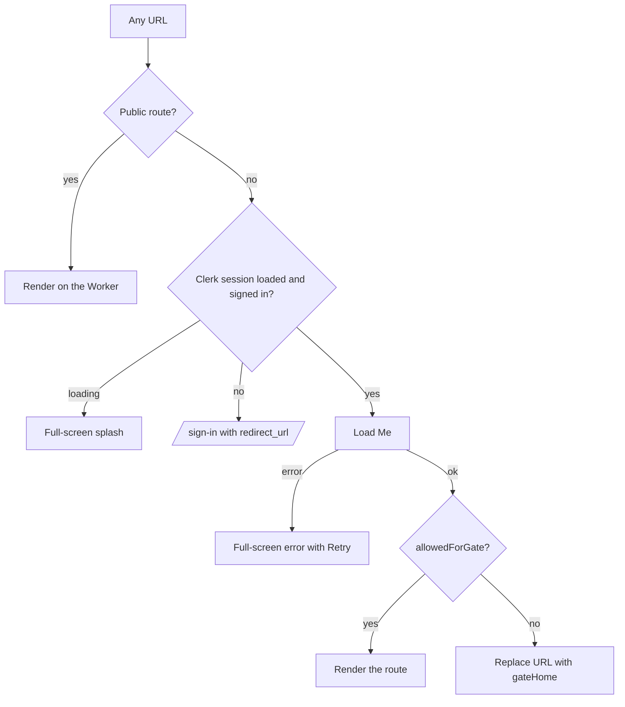

# 17. Web App

| | |
|---|---|
| Status | Design complete, not implemented |
| Applies to | `apps/web` (TanStack Start, React 19, TypeScript, Tailwind CSS, shadcn/ui, Cloudflare Workers) |
| Related | [16-screens-and-flows.md](16-screens-and-flows.md) for what each screen contains, [15-api-contract.md](15-api-contract.md), [06-auth-and-accounts.md](06-auth-and-accounts.md), [18-admin-console.md](18-admin-console.md), `docs/tech-stack.md` section 8 |

Document 16 says what every screen shows and does, by screen ID. This document says how the web app is built around those screens: URLs, files, guards, data fetching, real-time updates, forms, layout and platform details. It does not repeat screen content.

## 1. Principles

1. **Public pages are server-rendered, the application is client-rendered.** Routes under the public layout render on the Worker for fast first paint and SEO. Every signed-in route sets `ssr: false` and renders in the browser (tech stack section 8).
2. **The browser talks to the API directly.** No business logic and no data access in the Worker. Server functions are used only for the signed-in check on the landing page.
3. **One source of truth for routing: the gate.** After sign-in, where the user may go is decided only by `Me.gate` from `GET /v1/me` (03 section 5.1).
4. **Server state lives in TanStack Query.** No global store for API data. Small UI-only state (typing indicators, presence, toasts) lives in tiny stores.
5. **No member data on public URLs.** Nothing about a member is reachable without a session, and application routes are marked `noindex`.
6. **Right-to-left ready.** Only logical CSS properties (`ms-*`, `me-*`, `ps-*`, `pe-*`, `text-start`, `text-end`). No `left` or `right` in layout code.

## 2. Source layout

```text
apps/web/src/
├── routes/                      file-based routes (section 3)
├── features/                    one folder per product area, each with components, hooks, queries
│   ├── auth/                    AuthGate, sign-in page wrapper, token wiring
│   ├── onboarding/              step forms, progress header
│   ├── profile/                 profile screen, cards, locked placeholders
│   ├── me/                      own profile, edit forms, photos, preferences, verification
│   ├── discovery/               home, matches, search, filters
│   ├── interests/
│   ├── chat/                    chat list, conversation, composer, connection details
│   ├── settings/
│   ├── notifications/
│   └── admin/                   lazy-loaded, see 18
├── components/
│   ├── ui/                      shadcn/ui primitives (generated)
│   ├── layout/                  PublicShell, AppShell, nav bars
│   └── common/                  shared building blocks (section 10)
├── lib/
│   ├── api.ts                   typed API client (exists today; extended in section 6)
│   ├── query.ts                 QueryClient, query keys, error helpers
│   ├── realtime.ts              WebSocket client (section 7)
│   ├── reference.ts             reference data hooks and label helpers
│   ├── gate.ts                  pure routing functions (section 4)
│   ├── track.ts                 client events (section 6.5)
│   ├── i18n.ts                  i18next setup
│   ├── format.ts                age, height, dates, relative times
│   └── image.ts                 client-side photo downscaling
├── locales/
│   ├── en/*.json
│   └── ur/*.json                added in the Urdu phase
├── start.ts                     request middleware: CSRF, then clerkMiddleware()
├── router.tsx                   exists today
└── styles/app.css               Tailwind entry and design tokens
```

Rules:

- A file in `routes/` only wires a route: path, guard options, search-param schema, and one component imported from `features/`.
- Components never call `fetch` or the API client directly. They use hooks from their feature's `queries.ts`.
- Everything a user reads comes from `locales/`, including error messages.

## 3. Route map

### 3.1 Public (server-rendered)

| URL | Route file | Screen | Notes |
|---|---|---|---|
| `/` | `routes/_public/index.tsx` | `PUB-HOME` | A signed-in visitor is redirected to `/home` (section 4.4) |
| `/how-it-works` | `routes/_public/how-it-works.tsx` | `PUB-HOW` | Prerendered |
| `/safety` | `routes/_public/safety.tsx` | `PUB-SAFETY` | Prerendered |
| `/nikah-guide` | `routes/_public/nikah-guide.tsx` | `PUB-NIKAH` | Prerendered |
| `/faq` | `routes/_public/faq.tsx` | `PUB-FAQ` | Prerendered |
| `/download` | `routes/_public/download.tsx` | `PUB-DOWNLOAD` | Loads `GET /v1/meta/app-release?platform=android` on the server |
| `/contact` | `routes/_public/contact.tsx` | `PUB-CONTACT` | Prerendered |
| `/terms` | `routes/_public/terms.tsx` | `PUB-TERMS` | Prerendered |
| `/privacy` | `routes/_public/privacy.tsx` | `PUB-PRIVACY` | Prerendered |
| `/community-guidelines` | `routes/_public/community-guidelines.tsx` | `PUB-GUIDELINES` | Prerendered |

`routes/_public.tsx` is the layout: public header (logo, links, "Sign in" and "Create profile" buttons) and footer.

### 3.2 Sign-in

| URL | Route file | Screen | Notes |
|---|---|---|---|
| `/sign-in/$` | `routes/sign-in.$.tsx` | `AUTH-SIGNIN` | Clerk's combined sign-in-or-sign-up component. The splat lets Clerk own its sub-paths. Accepts `?redirect_url=`. |

There is no separate sign-up URL. "Create profile" links go to `/sign-in`.

### 3.3 Signed-in (client-rendered, `ssr: false`)

`routes/_authed.tsx` is the layout that requires a session and loads `Me` (section 4).

| URL | Route file under `routes/_authed/` | Screen |
|---|---|---|
| `/account/blocked` | `account/blocked.tsx` | `GATE-BLOCKED` |
| `/account/deletion` | `account/deletion.tsx` | `GATE-DELETION` |
| `/account/consent` | `account/consent.tsx` | `GATE-CONSENT` |
| `/account/review` | `account/review.tsx` | `GATE-REVIEW` |
| `/account/changes` | `account/changes.tsx` | `GATE-CHANGES` |
| `/onboarding` | `onboarding/index.tsx` | Redirects to the current step |
| `/onboarding/$step` | `onboarding/$step.tsx` | `ONB-01` to `ONB-11` |
| `/onboarding/done` | `onboarding/done.tsx` | `ONB-DONE` |
| `/home` | `_app/home.tsx` | `APP-HOME` |
| `/matches` | `_app/matches.tsx` | `APP-MATCHES` |
| `/search` | `_app/search.tsx` | `APP-SEARCH` |
| `/profiles/$profileId` | `_app/profiles/$profileId.tsx` | `APP-PROFILE` |
| `/profiles/$profileId/photos` | `_app/profiles/$profileId.photos.tsx` | `APP-PHOTOS` |
| `/p/$publicCode` | `_app/p.$publicCode.tsx` | Resolves the code, then replaces the URL with `/profiles/$profileId` |
| `/interests` | `_app/interests.tsx` | `APP-INTERESTS` |
| `/chats` | `_app/chats/index.tsx` | `APP-CHATS` |
| `/chats/$connectionId` | `_app/chats/$connectionId.tsx` | `APP-CHAT` |
| `/chats/$connectionId/details` | `_app/chats/$connectionId.details.tsx` | `APP-CONNECTION` |
| `/shortlist` | `_app/shortlist.tsx` | `APP-SHORTLIST` |
| `/visitors` | `_app/visitors.tsx` | `APP-VISITORS` |
| `/notifications` | `_app/notifications.tsx` | `APP-NOTIFS` |
| `/photo-requests` | `_app/photo-requests.tsx` | `APP-PHOTO-REQUESTS` |
| `/me` | `_app/me/index.tsx` | `ME-PROFILE` |
| `/me/edit/$section` | `_app/me/edit.$section.tsx` | `ME-EDIT` |
| `/me/photos` | `_app/me/photos.tsx` | `ME-PHOTOS` |
| `/me/preferences` | `_app/me/preferences.tsx` | `ME-PREFS` |
| `/me/verification` | `_app/me/verification/index.tsx` | `ME-VERIFY` |
| `/me/verification/identity` | `_app/me/verification/identity.tsx` | `ME-VERIFY-ID` |
| `/me/verification/selfie` | `_app/me/verification/selfie.tsx` | `ME-VERIFY-SELFIE` |
| `/settings` | `_app/settings/index.tsx` | `SET-HOME` |
| `/settings/privacy` | `_app/settings/privacy.tsx` | `SET-PRIVACY` |
| `/settings/notifications` | `_app/settings/notifications.tsx` | `SET-NOTIFS` |
| `/settings/contacts` | `_app/settings/contacts.tsx` | `SET-CONTACTS` |
| `/settings/blocked` | `_app/settings/blocked.tsx` | `SET-BLOCKED` |
| `/settings/account` | `_app/settings/account.tsx` | `SET-ACCOUNT` |
| `/settings/help` | `_app/settings/help.tsx` | `SET-HELP` |
| `/admin/...` | `admin/*.tsx` | `ADM-*` (section 16) |

`routes/_authed/_app.tsx` is the application shell layout (navigation, section 9). `routes/_authed/onboarding.tsx` is the onboarding layout (progress header, no navigation).

URL parameter values:

| Parameter | Values |
|---|---|
| `$step` | The onboarding step key with underscores replaced by hyphens: `account-for`, `basics`, `community`, `location`, `education-career`, `family`, `lifestyle`, `photos`, `preferences`, `identity`, `review` |
| `$section` | `account-for`, `basics`, `community`, `location`, `education-career`, `family`, `lifestyle` (same conversion; the API takes the underscore form) |

Search parameters (validated with Zod through `validateSearch`):

| Route | Parameters |
|---|---|
| `/sign-in/$` | `redirect_url?: string` (must be a same-origin path, otherwise ignored) |
| `/onboarding/$step` | `edit?: boolean` (true when the step was opened from the review step's "Edit" link: the button reads "Save" and returns to the review step, 07 section 2) |
| `/interests` | `box: 'received' | 'sent'` (default `received`), `status: 'pending' | 'accepted' | 'closed'` (default `pending`), `interest_id?: string` (row to scroll to) |
| `/chats` | `filter: 'active' | 'archived' | 'ended'` (default `active`) |
| `/search` | `q?: string`, a URL-safe base64 JSON of `{ filters, sort }`, so a search can be bookmarked and restored; `saved_search_id?: string` (load and run this saved search) |
| `/photo-requests` | `box: 'received' | 'sent'` (default `received`) |
| `/profiles/$profileId/photos` | `index?: number` (photo to open first) |
| `/settings/contacts` | `focus?: string` (field to focus), `return_connection_id?: string` (go back to that connection's details after saving, 08 section 3) |

### 3.4 Deep-link URLs

16 section 4 lists every target a notification, email or shared link can open. On the web each target is a URL. Emails always use these URLs with `WEB_BASE_URL` in front.

| Target (16 section 4.1) | URL |
|---|---|
| `APP-HOME` | `/home` |
| `APP-MATCHES` | `/matches` |
| `APP-SEARCH` with `saved_search_id` | `/search?saved_search_id=<id>` |
| `APP-PROFILE` with `profile_id` | `/profiles/<profile_id>` |
| `APP-PROFILE` by code | `/p/<public_code>` |
| `APP-INTERESTS` | `/interests?box=<box>&interest_id=<id>` |
| `APP-CHAT` | `/chats/<connection_id>` |
| `APP-CONNECTION` | `/chats/<connection_id>/details` |
| `APP-PHOTO-REQUESTS` | `/photo-requests?box=received` |
| `APP-VISITORS` | `/visitors` |
| `APP-NOTIFS` | `/notifications` |
| `ME-PROFILE` | `/me` |
| `ME-PHOTOS` | `/me/photos` |
| `ME-EDIT` with `section` | `/me/edit/<section slug>` |
| `ME-PREFS` | `/me/preferences` |
| `ME-VERIFY` | `/me/verification` |
| `GATE-CHANGES` | `/account/changes` |
| `PUB-GUIDELINES` | `/community-guidelines` |
| `SET-ACCOUNT` | `/settings/account` |
| `SET-NOTIFS` (unsubscribe links in emails) | `/settings/notifications` |

A link opened while signed out goes through `/sign-in` with `redirect_url` set to the link, then the gate decides (section 4).

## 4. Guards and redirects

### 4.1 Layers



Guards are implemented as one component, `AuthGate`, rendered by `routes/_authed.tsx` around its `<Outlet />`. It uses Clerk's `useAuth()` and the `useMe()` query. This is done in a component, not in `beforeLoad`, because the session state comes from Clerk's React hooks in the browser.

```tsx
// features/auth/AuthGate.tsx (behaviour, not final code)
function AuthGate({ children }) {
  const { isLoaded, isSignedIn } = useAuth()
  const location = useLocation()
  const me = useMe({ enabled: isLoaded && isSignedIn })

  if (!isLoaded) return <Splash />
  if (!isSignedIn) return <Navigate to="/sign-in/$" search={{ redirect_url: location.href }} replace />
  if (me.isPending) return <Splash />
  if (me.isError) return <FullScreenError error={me.error} onRetry={me.refetch} />

  const target = resolveRedirect(me.data, location.pathname)
  if (target) return <Navigate to={target} replace />
  return children
}
```

### 4.2 Pure routing functions (`lib/gate.ts`)

These three functions hold all routing rules and must have unit tests for every row of the tables below.

```ts
/** Where a user with this gate starts. */
function gateHome(me: Me): string

/** Whether the path may be shown for this Me. */
function allowedForGate(me: Me, pathname: string): boolean

/** null when the path is allowed, otherwise the path to go to. */
function resolveRedirect(me: Me, pathname: string): string | null {
  return allowedForGate(me, pathname) ? null : gateHome(me)
}
```

`gateHome`:

| `gate` | Path |
|---|---|
| `banned`, `suspended` | `/account/blocked` |
| `deletion_scheduled` | `/account/deletion` |
| `consent_required` | `/account/consent` |
| `onboarding` | `/onboarding/<slug of me.profile.onboarding_step>` |
| `changes_requested` | `/account/changes` |
| `pending_review` | `/account/review` |
| `ok` | `/home` |

`allowedForGate` (a path matches a prefix when it equals it or continues with `/`):

This table is the web form of the gate table in 16 section 3.2 and must stay equal to it.

| `gate` | Allowed paths |
|---|---|
| `banned`, `suspended` | `/account/blocked`, `/settings/help` |
| `deletion_scheduled` | `/account/deletion`, `/settings/help` |
| `consent_required` | `/account/consent` |
| `onboarding` | `/onboarding/<slug>` for the current step and every earlier step. `/onboarding` itself is allowed and redirects to the current step. Later steps are not allowed. Also `/settings/help`. |
| `changes_requested` | `/account/changes`, `/me` (all own-profile routes), `/settings` (all settings routes except `/settings/blocked`, whose data needs an active profile), `/notifications` |
| `pending_review` | `/account/review`, and the same list as `changes_requested` |
| `ok` | Every `_app` route. Not `/onboarding`, not `/account/*`, except `/onboarding/done` which is allowed once. |
| Any gate except `banned`, `suspended`, `deletion_scheduled` | `/admin`. The admin layout itself renders "Not found" unless `me.user.role` is `moderator` or `admin` (section 16), so the role is not checked here. |

Public pages (legal texts, safety, FAQ) are never guarded, so every gate can open them. When the gate is not `ok`, the app shell shows no primary navigation: allowed `_app` routes render with only a back link to the gate's landing screen.

Onboarding step order for the comparison: `account_for`, `basics`, `community`, `location`, `education_career`, `family`, `lifestyle`, `photos`, `preferences`, `identity`, `review`.

### 4.3 Inside the gate `ok`: profile status

`gate = 'ok'` covers the profile statuses `active`, `paused` and `closed`. Routes are not redirected by status. Instead, a screen whose access level the profile status does not meet renders the status panel in place of its content. The panel's texts and buttons are defined once, in 16 section 1.4. Which screens are affected follows from each screen's access level (15 section 3):

| `me.profile.status` | Screens replaced by the panel |
|---|---|
| `paused` | Those that need `browse`: `APP-HOME`, `APP-MATCHES`, `APP-SEARCH`, `APP-SHORTLIST`, `APP-VISITORS`, and `APP-PROFILE` for a profile that is not a connection or interest counterpart |
| `closed` | The same, plus those that need `engage`: `APP-INTERESTS`, `APP-PHOTO-REQUESTS` |

Implement the panel as one component, `StatusPanel`, chosen by a helper `requiredLevel(screen)` and `me.profile.status`, not by per-screen conditions. Navigation items for unavailable destinations stay visible but lead to the panel, so the layout does not jump.

### 4.4 Other redirects

| Situation | Behaviour |
|---|---|
| Signed-in visitor opens `/` | The route's server-side `beforeLoad` calls a server function that reads Clerk's `auth()`. When authenticated it redirects to `/home`. This is the only server-side auth check. |
| Signed-in visitor opens `/sign-in` | Clerk's component redirects to `redirect_url` if it is a same-origin path, otherwise to `/home`. `AuthGate` then applies the gate. |
| After sign-in or sign-up | Clerk redirects to `redirect_url` or `/home`. Configure `signInFallbackRedirectUrl` and `signUpFallbackRedirectUrl` as `/home`. New users arrive at `/home`, `AuthGate` sees `gate = 'onboarding'` and sends them to the first step. |
| Any API response with a gate error code (`account_banned`, `account_suspended`, `account_deletion_scheduled`, `consent_required`, `onboarding_required`, `profile_not_active`) | The API client invalidates the `['me']` query (section 6.4). `AuthGate` re-evaluates and redirects. |
| `401 unauthenticated` | Retry once with a fresh token. If it fails again, sign out and go to `/sign-in` with `redirect_url` set to the current path, so that the member returns to the same screen after signing in (16 section 1.3). |
| Sign-out | In the order of 06 section 10.1: close the WebSocket, `signOut()` from Clerk, clear the query cache, go to `/`. |
| Unknown URL | The existing `NotFound` component. Inside `_app` it is shown within the shell. |
| `/onboarding/done` when `gate` is not `ok` | Redirect by `gateHome` (covers `pending_review`). |

## 5. Clerk integration

| Piece | Where |
|---|---|
| `clerkMiddleware()` | `src/start.ts`, after the CSRF middleware, as Clerk's TanStack Start quickstart requires |
| `<ClerkProvider>` | `routes/__root.tsx`, wrapping the document body |
| Sign-in UI | `<SignIn />` in `routes/sign-in.$.tsx`, centred on a plain page with the logo and a link back to `/` |
| Session state in components | `useAuth()` (`isLoaded`, `isSignedIn`, `getToken`) |
| Token for API calls | `getToken()` from `useAuth()`, handed to the API client once (section 6.1) |
| Account menu | A custom menu in the app shell (not Clerk's `<UserButton />`), with links to `/me`, `/settings` and "Sign out", so that account deletion and profile actions go through our own screens |
| Appearance | Clerk's `appearance` prop set to the brand colours and font from section 9.3 |

Clerk's `<UserProfile />` component is used in exactly one place: the "Sign-in and security" row on `SET-ACCOUNT` opens it in a dialog, for changing the email address, connected Google account and active devices (06 section 12). Its delete-account section is switched off in the Clerk dashboard (06 section 2), so deletion always goes through our own flow.

## 6. Data layer

### 6.1 API client

`lib/api.ts` keeps the existing `openapi-fetch` client and adds one middleware:

1. **On request:** await the token getter and set `Authorization: Bearer <token>`. The getter is registered once by a root effect: `setTokenGetter(() => getToken())`. Public endpoints (`/v1/reference/*`, `/v1/meta*`) are called without a token.
2. **On response:** when the status is not 2xx, parse the error body (15 section 2) and throw an `ApiError { status, code, message, fields, details, requestId }`.

Regenerate the types with `pnpm generate:api-client` whenever `openapi.json` changes. Never hand-write request or response types.

### 6.2 Query keys

All keys are built by functions in `lib/query.ts`. No inline key arrays.

| Key | Endpoint | `staleTime` |
|---|---|---|
| `['me']` | `GET /v1/me` | 60 s, refetch on window focus (16 section 3.3) |
| `['reference', 'bootstrap']` | `GET /v1/reference/bootstrap` | 24 h, persisted to `localStorage` with its `version` and revalidated with `If-None-Match` at every app start (15 section 5) |
| `['reference', 'regions', countryCode]` | `GET /v1/reference/regions` | 24 h |
| `['reference', 'cities', params]` | `GET /v1/reference/cities` | 10 min |
| `['me', 'profile']` | `GET /v1/me/profile` | 0 |
| `['me', 'profile', 'preview', as]` | `GET /v1/me/profile/preview?as=...` | 0 (always refetched when the preview opens) |
| `['me', 'preferences']` | `GET /v1/me/preferences` | 0 |
| `['me', 'privacy']` | `GET /v1/me/privacy` | 0 |
| `['me', 'photos']` | `GET /v1/me/photos` | 0 |
| `['me', 'identity']` | `GET /v1/me/identity` | 0 |
| `['me', 'verifications']` | `GET /v1/me/verifications` | 0 |
| `['me', 'notification-preferences']` | `GET /v1/me/notification-preferences` | 0 |
| `['home']` | `GET /v1/home` | 5 min (16 section 6.4) |
| `['recommendations']` | `GET /v1/recommendations` (infinite) | 60 s |
| `['search', filters, sort]` | `POST /v1/search` (infinite) | 60 s |
| `['saved-searches']` | `GET /v1/me/saved-searches` | 5 min |
| `['profile', profileId]` | `GET /v1/profiles/{id}` | 60 s |
| `['interests', box, status]` | `GET /v1/interests` (infinite) | 60 s |
| `['connections', filter]` | `GET /v1/connections` (infinite) | 60 s |
| `['connection', connectionId]` | `GET /v1/connections/{id}` | 30 s |
| `['messages', connectionId]` | `GET /v1/connections/{id}/messages` (infinite, pages go backwards in time) | `Infinity` (kept fresh by the WebSocket, section 7) |
| `['shortlist']` | `GET /v1/shortlist` (infinite) | 60 s |
| `['visitors']`, `['visited']` | `GET /v1/me/visitors`, `GET /v1/me/visited` (infinite) | 60 s |
| `['blocks']` | `GET /v1/blocks` (infinite) | 60 s |
| `['photo-access', box, status]` | `GET /v1/me/photo-access` (infinite) | 60 s |
| `['notifications']` | `GET /v1/notifications` (infinite) | 60 s |
| `['admin', ...]` | Admin endpoints | 0 |

Default options for the `QueryClient`: `retry` up to 2 times for network errors and 5xx only (never for 4xx), `refetchOnWindowFocus: true`, `gcTime` 10 minutes.

### 6.3 Mutations and invalidation

After a successful mutation, update or invalidate exactly these keys. Where the endpoint returns the fresh object, write it into the cache with `setQueryData` and skip the refetch.

| Mutation | Cache effect |
|---|---|
| `PUT /v1/me/profile/sections/*` | Set `['me', 'profile']` from the response; invalidate `['me']`, `['home']`, `['recommendations']` |
| `POST /v1/me/onboarding/continue`, `.../complete`, profile `pause`, `resume`, `close`, `reopen`, `resubmit`, consents, deletion | Set `['me']` from the response |
| `PUT /v1/me/preferences` | Set `['me', 'preferences']`; invalidate `['home']`, `['recommendations']`, every `['profile', *]` |
| `PATCH /v1/me/privacy` | Set `['me', 'privacy']` |
| `PUT /v1/me/identity`, verification submit or cancel | Invalidate `['me', 'identity']`, `['me', 'verifications']`, `['me', 'profile']`, `['me']` |
| Photo confirm, primary, order, delete | Set or invalidate `['me', 'photos']`; invalidate `['me', 'profile']`, `['me']` |
| `POST /v1/interests` | Set `['profile', id]` relation optimistically then invalidate it; invalidate `['interests', 'sent', *]`, `['me']`; if a connection came back, also `['connections', *]` |
| Interest accept | Invalidate `['interests', *]`, `['connections', *]`, `['me']`, `['profile', id]`; navigate to the chat |
| Interest decline, withdraw | Invalidate `['interests', *]`, `['me']`, `['profile', id]` |
| `POST .../messages` | Optimistic append (section 7.3); update `['connections', *]` preview |
| `POST .../read` | Set `unread_count` to 0 in `['connection', id]` and `['connections', *]`; adjust `['me']` counters |
| Contact share, stage proposal and responses, connection settings, end | Set `['connection', id]` from the response; invalidate `['connections', *]`; for `end` also `['profile', id]` and `['me']` |
| Shortlist add or remove | Optimistic toggle of `is_shortlisted` in `['profile', id]` and in list caches; invalidate `['shortlist']` |
| Pass | Remove the card from `['home']`, `['recommendations']` and search caches; invalidate `['profile', id]` |
| Block | Invalidate `['connections', *]`, `['interests', *]`, `['shortlist']`, `['home']`, `['recommendations']`, `['blocks']`, `['me']`; remove `['profile', id]`; navigate back |
| Photo access request, grant, deny, revoke | Invalidate `['photo-access', *]`, `['profile', id]`, `['me']` |
| Notifications read | Update `['notifications']` items and `['me']` counters |
| Saved search create, update, delete | Invalidate `['saved-searches']` |

Optimistic updates are allowed only for the cases of 16 section 1.2 rule G7: the `sending` state of a chat message, shortlist on and off, pass and its undo, marking notifications or messages read, mute and archive. Everything else waits for the server.

### 6.4 Error handling

`lib/query.ts` exports `handleApiError(error)` used by the global `QueryCache` and `MutationCache` `onError` callbacks:

| `error.code` | Behaviour |
|---|---|
| Gate codes (4.4) | Invalidate `['me']`. No toast. |
| `unauthenticated` | Section 4.4. |
| `validation_failed` | Not handled globally. The form maps `fields` onto inputs (section 8.3). |
| `limit_reached` | Dialog (`LimitDialog`) with the text 16 gives for the action, or the default text of 16 section 1.3 when the action gives none. `details` carries `limit`, `used` and `resets_at`. |
| `rate_limited` | Toast "You are going a little fast. Please try again in {retry_after_seconds} seconds." (16 section 1.3), with the number from `details.retry_after_seconds`. |
| `cooldown_active` | Toast with the date from `details.retry_after_date`. |
| `not_found` on a profile or connection | Screen-level "No longer available" state (16). |
| `upgrade_required` | Not expected on web. Treat as `internal_error`. |
| `internal_error`, `service_unavailable`, network failure | Toast "Something went wrong. Please try again." with the request id in small text. Report to Sentry. |
| Any other code | The screen's action table in 16 says what to do; otherwise a toast with `error.message`. |

### 6.5 Client events

`lib/track.ts` exports `track(name, properties)` as specified in 20 section 8.3: an in-memory buffer flushed to `POST /v1/events` at 20 events, every 30 seconds, and on `visibilitychange` to hidden (using `fetch` with `keepalive: true`). It does nothing when the user is signed out. The only events at launch are the onboarding funnel events in 07 section 17.

## 7. Real-time client

`lib/realtime.ts` exports one `RealtimeClient` started by `AuthGate` once `Me` has loaded, under every gate except `banned`, `suspended` and `deletion_scheduled` (the server refuses those sockets with close code 4403), and stopped on sign-out. Members in onboarding or under review are connected too, so that they receive `photo.updated` and `gate.changed` (19 section 4.2). Protocol details (frames, close codes, payload shapes) are in 19 section 4.

### 7.1 Connection

1. URL: the API base URL with `http` replaced by `ws`, path `/v1/ws`.
2. On open, send `{"type":"auth","token":"<fresh Clerk token>"}`.
3. Wait for `ready`. Then send `ping` every 30 seconds. Treat 45 seconds without a `pong` as a dead connection: close and reconnect (19 section 4.3).
4. Reconnect with exponential backoff and jitter: 1 s, 2 s, 4 s, up to 30 s (19 section 4.8). Reconnect immediately when the browser comes back online or the tab becomes visible. Close the socket after the tab has been hidden for 60 seconds (19 section 4.9).
5. After every `ready` that follows a disconnect, resynchronise as 19 section 4.8 says: write the `counters` object of `ready` into `['me']` and refetch `['me']` only when it is stale; invalidate `['connections', *]`, `['interests', *]` and `['notifications']`; for the open conversation, fetch `GET /v1/connections/{id}/messages?after=<newest known id>`, repeat while `has_more`, merge, then invalidate `['connection', id]`.
6. While the socket is down and a conversation is open, poll that conversation every 15 seconds with the same `after` request and `GET /v1/connections/{id}` every 60 seconds. Elsewhere in the app, refetch `['me']` every 60 seconds for the counters (11 section 6.4).

### 7.2 Event handling

| Event | Cache effect |
|---|---|
| `message.new` | Append to `['messages', connectionId]` if that query exists (deduplicate by `id` and by `client_message_id`); update preview, time and unread count in `['connections', *]` and `['connection', id]`; if the conversation is open and the tab is visible, call `POST .../read` |
| `message.deleted` | Mark the message with that `message_id` as removed in `['messages', connectionId]` (`body: null`, `is_deleted: true`) |
| `message.read` | With `reader: "them"`: set `their_last_read_message_id` in `['connection', id]`. With `reader: "me"` (read on another tab or device): set `unread_count` to 0 in `['connection', id]` and `['connections', *]` |
| `typing` | Write to the typing store (cleared after 5 seconds without a new event) |
| `presence` | Write to the presence store |
| `connection.updated` | Invalidate `['connection', id]` and `['connections', *]` |
| `interest.received`, `interest.accepted` | Invalidate `['interests', *]`, `['home']`, `['me']`; show an in-app toast with a link |
| `notification.new` | Invalidate `['notifications']`. The bell badge is not increased locally: it follows the `counters` event (14 section 8.2) |
| `counters` | Write the counters into `['me']` |
| `photo.updated` | Invalidate `['me', 'photos']`, `['me', 'profile']`, `['me']` |
| `gate.changed` | Invalidate `['me']` |

### 7.3 Sending a message

1. Generate `client_message_id` with `crypto.randomUUID()`.
2. Append an optimistic message with status `sending` to `['messages', connectionId]`.
3. `POST /v1/connections/{id}/messages`.
4. On success, replace the optimistic entry with the returned `Message` (match on `client_message_id`). The later `message.new` event for the same message is ignored by the deduplication.
5. On failure, mark the entry `failed` with a "Retry" control that repeats the request with the same `client_message_id`. On `connection_ended`, remove the composer and invalidate `['connection', id]`.

Typing: send `{"type":"typing","connection_id":"..."}` at most once every 3 seconds while the composer has focus and text is changing.

## 8. Forms

### 8.1 Stack

TanStack Form with Zod schemas. One schema per API section body, in `features/<area>/schemas.ts`, mirroring the validation rules in 07 and 08. The server remains the authority: client validation is for speed, server errors are always shown.

### 8.2 Shared field components (`components/common/fields/`)

| Component | Used for |
|---|---|
| `TextField`, `TextAreaField` (with a character counter) | Free text |
| `SelectField` | A closed list from `reference.options.<list>` |
| `SearchSelectField` | Long lists with search: caste, sub-caste, profession, language |
| `MultiSelectField` | Languages, hobbies, preference sets (chips) |
| `CityPickerField` | Country, region, then city search against `GET /v1/reference/cities`, with "My city is not listed" |
| `DateOfBirthField` | Three selects (day, month, year). No free typing. |
| `HeightField` | Feet and inches selects, value in cm |
| `PhoneField` | Dial-code select plus number, value in E.164 |
| `IdentityNumberField` | Masked input for CNIC-style numbers |
| `RangeField` | Age and height ranges (two selects, not a slider, for accessibility) |
| `ImportanceField` | The four importance choices as a segmented control |
| `RadioCardsField` | Choices that need an explanation each (photo visibility, discovery visibility, `managed_by`) |
| `ConsentCheckbox` | A checkbox whose label contains links |

Every field component takes `name`, `label`, `helpText`, `required`, and renders its own error text underneath with `aria-describedby`.

### 8.3 Server errors on forms

On `validation_failed`, map each `fields[i].field` to the form field of the same name and show a translated message chosen by `fields[i].code` (falling back to `fields[i].message`). Scroll to and focus the first invalid field. Errors whose `field` does not exist in the form are shown in a summary box at the top of the form.

### 8.4 Reference data

`lib/reference.ts`:

| Export | Purpose |
|---|---|
| `useReference()` | The bootstrap object (from the query above). The app shell waits for it before rendering forms. |
| `useOptions(list)` | `{ code, label }[]` for a closed list, in the current language (`label_ur` when the locale is `ur` and it is not null, otherwise `label`) |
| `labelOf(list, code)` | Display label for a stored code. Unknown codes render as the code with underscores replaced by spaces, so a newer API value never breaks an older client. |
| `useCastes()`, `useSects(religionCode)`, `useIncomeBands(currencyCode)` | Filtered lookups |

## 9. Layout and visual language

### 9.1 Breakpoints

| Name | Width | Layout |
|---|---|---|
| Narrow | below 768 px | Single column. Bottom navigation bar with five items. Chat list and conversation are separate screens. |
| Wide | 768 px and above | Top navigation bar. Content column up to 1,120 px, centred. Chats use two panes (list and conversation). Profile screen uses two columns (photos and summary, then details). |

### 9.2 App shell

| Element | Narrow | Wide |
|---|---|---|
| Primary navigation | Bottom bar: Home, Search, Interests, Chats, Me | Top bar with the same five items after the logo |
| Badges | Interests: `counters.pending_interests`. Chats: `counters.unread_chats`. Me: the dot defined in 16 section 2.1. | Same |
| Notifications | Bell in the top bar of `APP-HOME` only (16 section 2.2), badge from `counters.unread_notifications` | Bell in the top bar |
| Secondary destinations (Shortlist, Visitors, Photo requests, Settings) | The menu and the gear icon on `ME-PROFILE`, and the visitors row on `APP-HOME` (16 section 2.2) | Avatar menu in the top bar (16 section 2.2) |
| Announcement banner | Under the top bar on `APP-HOME` when `me.config.announcement` is set | Same |
| Offline banner | Thin bar at the top when `navigator.onLine` is false | Same |

### 9.3 Design tokens

[DESIGN.md](../DESIGN.md) is the source of every design token (colour, type, shape, space, size, elevation and motion) and of the anatomy of the components. `styles/app.css` defines the tokens once, as CSS variables mapped into Tailwind's theme, and components use only those token classes, never a raw value. The Android app keeps the values of 22 section 12 until it adopts its own part of DESIGN.md section 10.

A dark theme is not part of the launch.

## 10. Shared components (`components/common/`)

| Component | Purpose |
|---|---|
| `ProfileCard` | Renders a `ProfileCard` object in the full or compact size, or as the tile, of 16 section 1.5, which lists what each size shows. Education, height, religion or sect, caste and activity are not on cards; they are on the profile. One component for every list. |
| `MemberPhoto` | Renders a `PhotoView`: correct variant by size, a lock overlay and "Photo is private" label when `is_blurred`, a neutral silhouette (by gender) when `photo` is null. Disables drag and the context menu. |
| `CompatBadge` | "N% match" pill |
| `BadgeRow` | Verification badges as words with a tick (12 section 1.2). The "New" label sits on the photo. |
| `ReasonChips` | Reason codes to a translated list (10 section 7) |
| `LockedValue` | Placeholder for a value hidden by privacy, with the text from 16 |
| `SectionCard` | Titled card with an optional "Edit" action |
| `StatusBanner` | Coloured banner for profile and moderation states |
| `EmptyState`, `ErrorState`, `ListSkeleton`, `CardSkeleton` | Standard states (16 section 1) |
| `InfiniteList` | Wraps an infinite query: renders items, a "Load more" sentinel using `IntersectionObserver`, and the states above |
| `ConfirmDialog` | Destructive confirmations, optionally with a typed phrase |
| `LimitDialog` | Shown on `limit_reached` |
| `ReportDialog`, `BlockDialog` | Shared by profile and chat screens |
| `RelativeTime` | "2 hours ago", updating once a minute |

## 11. Photos and camera on the web

**Choosing and shrinking a photo** (`lib/image.ts`):

1. `<input type="file" accept="image/jpeg,image/png,image/webp">`.
2. Reject files of another type before any upload.
3. Decode with `createImageBitmap(file, { imageOrientation: 'from-image' })`. Reject images smaller than 400 by 400 pixels.
4. If the long side is over 2,048 pixels, draw to a canvas scaled to 2,048 on the long side.
5. Export with `canvas.toBlob(cb, 'image/jpeg', 0.9)`. Reject the result if it is still over 10 MB: the limit applies to the prepared file, not to the original (08 section 5.1).
6. Upload with `XMLHttpRequest` (for a progress bar) to the presigned URL with the headers from the API, then confirm (08 section 5.2).

**Selfie for verification:** on phones, `<input type="file" accept="image/*" capture="user">` opens the front camera. On desktop, show a live preview with `navigator.mediaDevices.getUserMedia({ video: { facingMode: 'user' } })` and a capture button; if the camera is unavailable or refused, explain that the Android app or a phone browser is needed. Do not offer a gallery picker for the selfie.

**Protection:** member photos are rendered with `draggable={false}` and `onContextMenu` prevented, and there is no download control. This is a deterrent only (09 section 6).

## 12. Internationalisation

- `i18next` with `react-i18next`. Namespaces per feature (`common`, `onboarding`, `profile`, `chat`, and so on). English is bundled; Urdu is loaded on demand when added.
- The language comes from `me.user.locale` once signed in, otherwise from `localStorage`, otherwise the browser language, falling back to `en`. Changing it on `SET-ACCOUNT` calls `PATCH /v1/me` and switches immediately.
- `<html lang>` and `<html dir>` follow the language (`rtl` for `ur`).
- Numbers stay in Western digits in both languages. Dates use `Intl.DateTimeFormat` with the active locale.
- Enumeration labels come from the API (section 8.4), not from locale files. Everything else comes from locale files.
- Keys are stable, descriptive paths, for example `chat.composer.placeholder`. No English sentences as keys.

## 13. SEO and public pages

| Item | Rule |
|---|---|
| Titles and descriptions | Each public route sets its own through `head()` |
| Open Graph | Title, description and one static brand image. Never member photos. |
| `robots.txt` | Allow `/`. Disallow `/home`, `/matches`, `/search`, `/profiles`, `/p`, `/interests`, `/chats`, `/shortlist`, `/visitors`, `/notifications`, `/photo-requests`, `/me`, `/settings`, `/onboarding`, `/account`, `/admin`, `/sign-in`. |
| `X-Robots-Tag: noindex` | Sent for every signed-in route |
| `sitemap.xml` | Public routes only |
| Structured data | `Organization` and `FAQPage` on the landing and FAQ pages |
| `/.well-known/assetlinks.json` | A static file listing the Android package name and the release certificate's SHA-256 fingerprint, so that Android App Links open in the app (22 section 3.4) |
| Attribution | GeoNames is credited for city data in the footer of every public page (16 section 7.11) and on `SET-HELP`, as its licence requires (05 section 12) |

## 14. Web security

| Control | Detail |
|---|---|
| Tokens | Never stored by our code. Clerk manages the session; the API token is fetched per request and kept in memory only. |
| Content Security Policy | `default-src 'self'`; `connect-src` the API origin (https and wss), Clerk's Frontend API, the R2 S3 endpoint, Sentry; `img-src 'self' data:` plus the R2 S3 endpoint and Clerk's image host; `script-src 'self'` plus Clerk's script host and `https://challenges.cloudflare.com`; `frame-src https://challenges.cloudflare.com`; `frame-ancestors 'none'`. Set as a response header from the Worker. |
| Other headers | `Referrer-Policy: strict-origin-when-cross-origin`, `X-Content-Type-Options: nosniff`, `Permissions-Policy: camera=(self), microphone=(), geolocation=()` |
| External links | `rel="noopener noreferrer"`, and none inside member-generated text (links are not rendered as links) |
| Member text | Always rendered as plain text. Never as HTML. |
| Open redirect | `redirect_url` is accepted only when it starts with a single `/` |
| Logging | No personal data in Sentry breadcrumbs: scrub request bodies and query strings |

## 15. Environment variables

| Name | Where | Secret | Meaning |
|---|---|---|---|
| `VITE_API_BASE_URL` | `.env.local`, Wrangler vars | No | API origin (exists today) |
| `VITE_CLERK_PUBLISHABLE_KEY` | `.env.local`, Wrangler vars | No | Clerk publishable key for the environment |
| `CLERK_SECRET_KEY` | `.dev.vars`, Workers secret | Yes | Used by `clerkMiddleware()` on the Worker |
| `CLERK_SIGN_IN_URL` | Wrangler vars | No | `/sign-in` |
| `CLERK_SIGN_IN_FALLBACK_REDIRECT_URL` | Wrangler vars | No | `/home`. Used when no `redirect_url` is present. |
| `CLERK_SIGN_UP_FALLBACK_REDIRECT_URL` | Wrangler vars | No | `/home` |
| `VITE_APP_ENV` | Wrangler vars | No | `local`, `staging` or `production` |
| `VITE_SENTRY_DSN` | Wrangler vars | No | Empty disables reporting |

Add each to `apps/web/.env.example` or `.dev.vars.example` with a placeholder. The Clerk variable names follow Clerk's TanStack Start guide (06 section 13); confirm the exact spelling of the redirect variables against that guide when wiring them, because Clerk has renamed them between SDK versions. The fallback form is used, not the force form, so that a `redirect_url` is honoured.

## 16. Admin area

- Lives under `/admin`, files in `routes/_authed/admin/` and `features/admin/`, loaded lazily so members never download it.
- `routes/_authed/admin.tsx` is its layout: a side navigation with the queues and a guard that renders "Not found" unless `me.user.role` is `moderator` or `admin`. Admin-only items are hidden for moderators. The API enforces the same rules.
- Screens, actions and keyboard shortcuts are specified in 18.

| URL | Screen |
|---|---|
| `/admin` | `ADM-HOME` |
| `/admin/profiles`, `/admin/profiles/$profileId` | `ADM-PROFILES`, `ADM-PROFILE` |
| `/admin/photos` | `ADM-PHOTOS` |
| `/admin/texts` | `ADM-TEXTS` |
| `/admin/verifications`, `/admin/verifications/$requestId` | `ADM-VERIFICATIONS`, `ADM-VERIFICATION` |
| `/admin/reports`, `/admin/reports/$reportId` | `ADM-REPORTS`, `ADM-REPORT` |
| `/admin/users`, `/admin/users/$userId` | `ADM-USERS`, `ADM-USER` |
| `/admin/castes` | `ADM-CASTES` |
| `/admin/settings` | `ADM-SETTINGS` |
| `/admin/releases` | `ADM-RELEASES` |
| `/admin/announcements` | `ADM-ANNOUNCE` |
| `/admin/audit-log` | `ADM-AUDIT` |

## 17. Performance budgets

| Item | Budget |
|---|---|
| Landing page | Largest Contentful Paint under 2.5 s on a mid-range phone on 4G; under 100 KB of JavaScript before interaction |
| App shell | Under 250 KB gzipped JavaScript for the first signed-in screen; feature routes split by route |
| Lists | Render at most 20 new cards per page; images use `loading="lazy"` and explicit `width` and `height` |
| Card photos | `thumb_url` in compact cards and rows, `medium_url` in full-size cards, in tiles and on the profile, `large_url` only in the full-screen viewer (16 rule G10) |
| Chat | Virtualise the message list beyond 200 messages |
| Worker CPU | Signed-in routes do no server work; public pages are prerendered where the table in 3.1 says so |

## 18. Tests

| Level | What |
|---|---|
| Unit (Vitest) | `lib/gate.ts` (every row of section 4.2), `lib/format.ts`, `lib/image.ts` size logic, Zod schemas against the examples in 07, `labelOf` fallbacks, the message deduplication in the real-time handler |
| Component (Vitest, Testing Library) | `AuthGate` for each gate, `ProfileCard` with blurred and missing photos and locked values, each onboarding step form with valid and invalid input, server error mapping |
| End to end (Playwright, the existing `e2e` package) | Smoke only: landing page renders, sign-in page renders, unknown URL shows Not Found. Signed-in journeys run against staging with a Clerk test user. |
