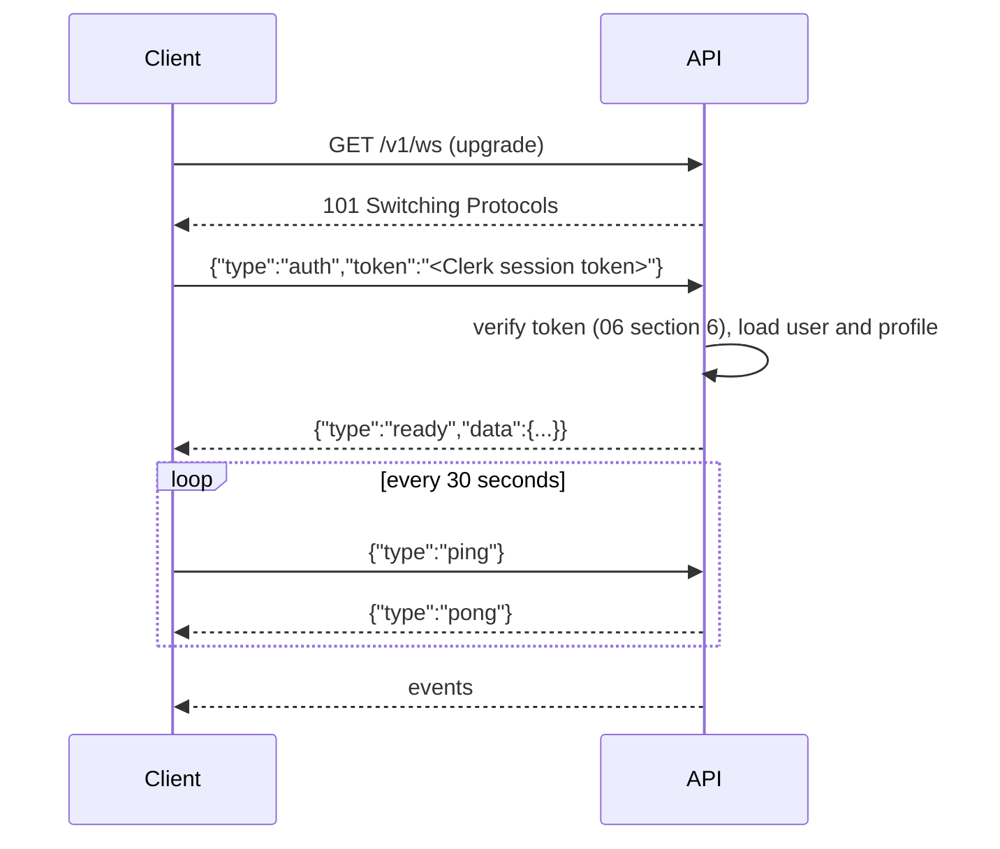

# 19. Background Jobs and Realtime

| | |
|---|---|
| Status | Design complete, not implemented |
| Related | [04-database-schema.md](04-database-schema.md) section 11 for the `jobs` table, [10-matching-and-discovery.md](10-matching-and-discovery.md) section 8, [11-interests-connections-chat.md](11-interests-connections-chat.md) section 6, [14-notifications.md](14-notifications.md), [15-api-contract.md](15-api-contract.md) |

The API is one binary that runs three things as Tokio tasks: the HTTP and WebSocket server, a background job worker, and a scheduler (see `docs/tech-stack.md` section 6). This document specifies the job system, every job kind, the schedule, and the WebSocket protocol. There is no Redis and no message broker: jobs live in PostgreSQL and realtime fan-out is in process.

## 1. Job system

### 1.1 Model

A job is one row of `jobs` (04 section 11).

| Column | Use |
|---|---|
| `kind` | Which handler runs it (section 2) |
| `payload` | JSON arguments for the handler |
| `status` | `queued`, `running`, `succeeded`, `dead` (there is no `failed` status, see 1.5) |
| `run_at` | Earliest time the job may run |
| `attempts`, `max_attempts` | Attempts made so far and the limit |
| `dedupe_key` | Optional. At most one `queued` job per (`kind`, `dedupe_key`) |
| `locked_at` | When a worker claimed it |
| `last_error` | Last failure text, or a `skipped:<reason>` note on a job that chose not to act |
| `finished_at` | When it reached `succeeded` or `dead` |

Guarantee: **at least once**. A job can run twice (after a crash or a timeout), so every handler must be idempotent: running it again must not duplicate an email, a notification or a row.

### 1.2 Enqueue

One helper, usable inside the caller's transaction so that the job exists only if the change committed:

```rust
pub struct NewJob {
    pub kind: &'static str,
    pub payload: serde_json::Value,
    pub run_at: Option<OffsetDateTime>,   // None: now
    pub dedupe_key: Option<String>,
    pub max_attempts: i16,                // default per kind, section 2.1
}

/// Returns false when an identical queued job already existed.
pub async fn enqueue<'e>(db: impl sqlx::PgExecutor<'e>, job: NewJob) -> sqlx::Result<bool>;
```

```sql
INSERT INTO jobs (id, kind, payload, run_at, max_attempts, dedupe_key)
VALUES ($1, $2, $3, COALESCE($4, now()), $5, $6)
ON CONFLICT (kind, dedupe_key) WHERE status = 'queued' AND dedupe_key IS NOT NULL
DO NOTHING;
```

After a successful insert outside a transaction (or after commit), call `worker.wake()` so an idle worker picks the job up at once (a `tokio::sync::Notify`).

### 1.3 Claim

```sql
WITH next AS (
    SELECT id
    FROM jobs
    WHERE status = 'queued' AND run_at <= now()
    ORDER BY run_at, id
    LIMIT 1
    FOR UPDATE SKIP LOCKED
)
UPDATE jobs j
SET status = 'running', locked_at = now(), attempts = j.attempts + 1
FROM next
WHERE j.id = next.id
RETURNING j.id, j.kind, j.payload, j.attempts, j.max_attempts;
```

`SKIP LOCKED` lets several workers claim different jobs without waiting on each other. The partial index `jobs_claim_idx` serves the scan.

### 1.4 Worker loop

Two worker tasks run in the API process (concurrency 2, chosen for a 1 GiB host and a database pool of 10).

```text
loop:
    if shutdown requested: break
    match claim():
        Some(job) =>
            result = timeout(job_timeout(job.kind), run_handler(job))
            match result:
                Ok(Done)            => mark_succeeded(job.id, note = None)
                Ok(Skipped(reason)) => mark_succeeded(job.id, note = "skipped:" + reason)
                Err(error) | Timeout => mark_failed(job, error)
        None =>
            wait for wake() or 2 seconds, whichever comes first
```

Rules:

1. A handler receives the `AppState` (database pool, R2 client, hub, config) and the payload. It returns `Done`, `Skipped(reason)` or an error.
2. Each handler runs inside a `tracing` span with `job_id`, `kind` and `attempt`.
3. A handler never holds a database transaction open while calling an external service (R2, Azure, FCM, Resend, Clerk). Read first, call out, then write.
4. A panic inside a handler is caught (`tokio::task::spawn` and join) and treated as an error.

### 1.5 Completion, retries and backoff

```sql
-- success
UPDATE jobs SET status = 'succeeded', finished_at = now(), locked_at = NULL, last_error = $2 WHERE id = $1;

-- failure with attempts left
UPDATE jobs SET status = 'queued', locked_at = NULL, last_error = $2,
       run_at = now() + make_interval(secs => $3) WHERE id = $1;

-- failure, no attempts left
UPDATE jobs SET status = 'dead', finished_at = now(), locked_at = NULL, last_error = $2 WHERE id = $1;
```

Backoff after a failure is `30 s * 4^n`, where `n` is the number of failures before this one, capped at 1 hour:

| Failure number | Delay before the next attempt |
|---|---|
| 1 | 30 seconds |
| 2 | 2 minutes |
| 3 | 8 minutes |
| 4 | 32 minutes |
| 5 and later | 1 hour |

A job becomes `dead` when `attempts = max_attempts` and the attempt fails. Every `dead` job is reported to Sentry with its kind and last error. Dead jobs are kept 30 days for inspection; an admin can requeue one with `UPDATE jobs SET status = 'queued', attempts = 0, run_at = now() WHERE id = ...`.

The schema has no `failed` status (04 section 11): a failed attempt goes straight back to `queued` or to `dead`.

### 1.6 Recovery of stuck jobs

If the process dies while a job is `running`, the row stays `running`. Every minute the scheduler runs:

```sql
UPDATE jobs
SET status = CASE WHEN attempts >= max_attempts THEN 'dead' ELSE 'queued' END,
    finished_at = CASE WHEN attempts >= max_attempts THEN now() ELSE NULL END,
    locked_at = NULL,
    last_error = 'recovered: worker stopped'
WHERE status = 'running' AND locked_at < now() - interval '10 minutes';
```

Ten minutes is longer than any job timeout (2.1), so a job that is still legitimately running is never taken.

### 1.7 Graceful shutdown

On SIGTERM (a deploy restarts the service):

1. Stop claiming new jobs.
2. Let running jobs finish for up to 20 seconds.
3. Jobs still running after that are abandoned; 1.6 recovers them after the restart.

Because jobs are idempotent, an abandoned job that had already done part of its work is safe to run again.

### 1.8 Housekeeping

`cleanup_old_rows` deletes `succeeded` jobs after 7 days and `dead` jobs after 30 days. The email budget (14 section 5.2) and the scheduler's "already ran" check (section 3.2) both rely on `succeeded` rows being kept for at least 7 days.

## 2. Job kinds

### 2.1 Summary

| Kind | Payload | Enqueued by | Dedupe key | Max attempts | Timeout |
|---|---|---|---|---|---|
| `process_photo` | `{ "photo_id" }` | `POST /v1/me/photos` | `photo_id` | 3 | 120 s |
| `delete_objects` | `{ "keys": [...] }` or `{ "prefix": "..." }` | Photo deletion, purge, cleanup | None | 5 | 120 s |
| `moderate_text` | `{ "profile_id", "field" }` | Saving changed free text | `<profile_id>:<field>` | 3 | 60 s |
| `refresh_recommendations` | `{ "profile_id", "notify" }` or `{ "fanout": true }` | Onboarding completion, profile approval, manual refresh, scheduler | `profile_id`, or `fanout:<date>` | 2 | 120 s |
| `send_push` | `{ "user_id", "type", "data", "collapse_key", "ttl_seconds" }` | `notify` helper, message creation | None, or `msg:<connection_id>:<user_id>` for chat | 4 | 30 s |
| `send_email` | `{ "user_id", "template", "priority", "data" }` | `notify` helper, other jobs, account actions | Per template (14 section 5.4) or none | 5 | 30 s |
| `expire_interests` | `{}` or `{ "remind": true }` | Scheduler | Period key | 3 | 120 s |
| `lift_suspensions` | `{}` | Scheduler | Period key | 3 | 60 s |
| `purge_accounts` | `{}` | Scheduler, itself | Period key | 3 | 300 s |
| `purge_verification_media` | `{}` | Scheduler | Period key | 3 | 120 s |
| `cleanup_uploads` | `{}` | Scheduler | Period key | 3 | 300 s |
| `cleanup_old_rows` | `{}` | Scheduler | Period key | 3 | 300 s |
| `build_export` | `{ "export_id" }` | `POST /v1/me/exports` | `export_id` | 3 | 300 s |
| `match_digest` | `{ "frequency": "daily" \| "weekly" }` | Scheduler | Period key | 2 | 120 s |
| `saved_search_alerts` | `{}` | Scheduler | Period key | 2 | 300 s |
| `profile_views_summary` | `{}` | Scheduler | Period key | 2 | 120 s |
| `announcement_fanout` | `{ "announcement", "after_user_id", "send_email" }` | `POST /v1/admin/announcements`, itself | None | 3 | 120 s |
| `sync_clerk_user` | `{ "clerk_user_id", "deleted"? }` | Clerk webhook, user creation | `clerk_user_id`, or `clerk_user_id:deleted` when `deleted` is true | 5 | 30 s |
| `revoke_clerk_sessions` | `{ "clerk_user_id", "ban" }` | Suspension, ban | `clerk_user_id` | 5 | 60 s |
| `delete_clerk_user` | `{ "clerk_user_id" }` | Purge | `clerk_user_id` | 8 | 30 s |

All ids in payloads are UUID strings. An unknown `kind` makes the job `dead` at once.

### 2.2 `process_photo`

Turns an uploaded file into the stored variants. The full pipeline (file rules, sizes, quality) is in 08 section 5; the automated check is in 13 section 4.

1. Load the `profile_photos` row. If its status is not `processing`, return `Skipped("not processing")`.
2. Download the object at `upload_key` (`tmp/photos/{profile_id}/{uuid}`). If it is missing, unreadable or below the minimum size, set `status = 'failed'`, send `photo.updated`, done.
3. Decode, apply orientation, and produce `large.jpg`, `medium.jpg`, `thumb.jpg`, `blur_medium.jpg`, `blur_thumb.jpg`. Upload them under `photos/{profile_id}/{photo_id}/`.
4. Run the automated image check and store its result in `moderation`.
5. Decide the status: `rejected` when the check is certain; `pending_review` when `moderation.photo_review = 'manual'` or the check flagged it or the check was unavailable; otherwise `approved`.
6. In one transaction: update the row (keys, `width`, `height`, `status`); when approved, make it primary if the profile has no primary photo, set `profiles.has_approved_photo = true`, recompute `completeness` and set `match_stale = true`.
7. Delete the upload object. Send `photo.updated` to the owner. Create a `photo_rejected` notification when the result is `rejected`.

Idempotency: step 1 guards against a second run after success; uploads to fixed keys overwrite.

### 2.3 `delete_objects`

Deletes R2 objects. With `keys`: delete those keys (batches of 1,000). With `prefix`: list and delete everything under the prefix, page by page. Missing objects are not an error.

### 2.4 `moderate_text`

Checks one free-text field after the member changed it. Rules and thresholds are in 13 section 3.

1. `field` is `about_me`, `about_family` or `partner_notes`. Load the text and its status column (`about_me_status`, `about_family_status`, `notes_status`).
2. If the status is not `pending`, return `Skipped`. If the text is empty, set `approved`.
3. If `moderation.text_review = 'manual'`, return `Skipped("manual review")`: the text stays `pending` for a moderator.
4. Call the automated text check on the loaded text. Pass: set `approved`, recompute `completeness` and set `match_stale = true` (13 section 3.7). Certain violation: set `rejected` and notify (13 section 3). Flagged: leave `pending` (it now shows in the moderator queue). Every status write is conditional on the stored text still being the text that was checked; if the member saved again meanwhile, enqueue the job again. Service unavailable or monthly quota used up: fail the attempt; after the last attempt the text simply stays `pending`.

The dedupe key means several quick edits cause one check, which reads the latest text.

### 2.5 `refresh_recommendations`

Form `{ "profile_id", "notify" }`: runs the refresh of 10 section 8 for one profile.

1. If the profile is not `active`, return `Skipped`.
2. If `notify` is true and `match_refreshed_at` is within the last 20 hours and `match_stale` is false, return `Skipped("fresh")`.
3. Remember the candidate ids currently cached. Run the pool query, the scoring pass and the write.
4. If `notify` is true: count new candidates with `compat >= 70`. When at least 1, call `notify(user, 'new_matches', None, { source: "recommendations", count, saved_search_id: null })` subject to the 20-hour duplicate rule (14 section 7.2).

Form `{ "fanout": true }`: the nightly batch. It runs one statement and finishes:

```sql
INSERT INTO jobs (id, kind, payload, dedupe_key, max_attempts)
SELECT uuidv7(), 'refresh_recommendations',
       jsonb_build_object('profile_id', p.id, 'notify', true),
       p.id::text, 2
FROM profiles p
WHERE p.status = 'active'
  AND p.last_active_at > now() - interval '7 days'
  AND (p.match_refreshed_at IS NULL OR p.match_refreshed_at < now() - interval '20 hours')
ON CONFLICT (kind, dedupe_key) WHERE status = 'queued' AND dedupe_key IS NOT NULL DO NOTHING;
```

### 2.6 `send_push`

Sends one push type to every Android device of a user. Content rules are in 14 section 4.

1. Load the user and `notification_preferences`. If the user is not `active`, return `Skipped`.
2. If the event has a preference column and it is false, return `Skipped("preference")`.
3. If the current local time is inside the user's quiet hours, set `run_at` to the end of the window and return the job to `queued` without counting an attempt (decrease `attempts` by 1).
4. For `type = "message"`: return `Skipped` unless the connection is `active`, not muted by the user, has `unread_count > 0` for the user, and the user has no open socket.
5. Load `user_devices` with `platform = 'android'`. None: `Skipped("no devices")`.
6. Get an access token with `gcp_auth` (cached until it expires) and `POST https://fcm.googleapis.com/v1/projects/{project_id}/messages:send` once per device.
7. Per device result: success, continue. `404 UNREGISTERED` or `400 INVALID_ARGUMENT`: delete that device row. `429` or `5xx`: remember the failure.
8. If any device had a retryable failure, fail the attempt (devices that succeeded may get the push twice; collapse keys make that harmless).

### 2.7 `send_email`

Sends one email through Resend. Templates, priorities and the daily budget are in 14 section 5.

1. Load the user. No `email`, or a user who is `deleted`: `Skipped`.
2. Apply the template's own skip rules (14 section 5.4) and its preference column.
3. Apply the daily budget for the job's `priority`. Over the ceiling: reschedule (priorities 1 and 2) or return `Skipped("budget")`.
4. Render the subject, HTML and text. Call the Resend API with an idempotency key equal to the job id.
5. On a rate-limit or server error, fail the attempt.

### 2.8 `expire_interests`

Without `remind`:

```sql
UPDATE interests SET status = 'expired'
WHERE status = 'pending' AND expires_at <= now()
RETURNING receiver_profile_id;
```

Then send `counters` to each affected receiver who is online.

With `{ "remind": true }` (once a day): for each receiver who has pending interests whose `expires_at`, as a date in `Asia/Karachi`, is exactly 3 days after today, call `notify(receiver, 'interest_received', sender_of_earliest, { interest_id, reminder: true, count })`.

### 2.9 `lift_suspensions`

For every user with `status = 'suspended'` and `suspended_until <= now()`: set `users.status = 'active'` (or `'deletion_scheduled'` when `purge_after` is set, because the user asked for deletion while suspended, 06 section 9.4), clear `status_reason` and `suspended_until`; set the profile from `suspended` to `active`, or to `pending_review` when `first_activated_at` is null (it was never approved, 03 section 4.2), and `match_stale = true`; enqueue the `account_suspended` email in its "active again" form. Account rules are in 06 section 8.

### 2.10 `purge_accounts`

1. Select up to 20 users with `status` `deletion_scheduled`, `banned` or `suspended` and `purge_after <= now()` (a banned or suspended user who asked for deletion keeps that status, 03 section 4.1).
2. For each, run the purge of 04 section 12 steps 1 to 6 in one transaction. Collect the R2 prefixes before deleting the rows.
3. After commit: enqueue `delete_clerk_user`, and `delete_objects` for the prefixes `photos/{profile_id}/`, `tmp/photos/{profile_id}/`, `verification/{profile_id}/` and `exports/{user_id}/`. Close the user's sockets.
4. If 20 users were processed, enqueue `purge_accounts` again (no dedupe key) to continue.

The account flow around it is in 06 section 9.

### 2.11 `purge_verification_media`

For each `verification_requests` row with `media_purge_after <= now()` and `media_purged_at IS NULL`: delete the objects at `front_key`, `back_key` and `selfie_key`, then set the three keys to NULL and `media_purged_at = now()`. The decision itself is kept.

### 2.12 `cleanup_uploads`

1. List objects under `tmp/` whose last-modified time is more than 24 hours ago and delete them.
2. List objects under `verification/` older than 24 hours that are not referenced by any `verification_requests` row (`front_key`, `back_key`, `selfie_key`) and delete them.
3. Set `profile_photos` rows that have been `processing` for more than 1 hour to `failed` and send `photo.updated`.

### 2.13 `cleanup_old_rows`

Applies the retention table of 04 section 12. One statement per line, each limited to 5,000 rows per run so no single transaction is large:

| Target | Condition |
|---|---|
| `profile_views` | `last_viewed_at < now() - interval '90 days'` |
| `notifications` | `created_at < now() - interval '90 days'` |
| `match_recommendations` | `computed_at < now() - interval '14 days'` |
| `usage_counters` | `day < current_date - 30` |
| `passes` | `expires_at < now()` |
| `jobs` | `status = 'succeeded'` and `finished_at < now() - interval '7 days'`; `status = 'dead'` and `finished_at < now() - interval '30 days'` |
| `webhook_events` | `received_at < now() - interval '30 days'` |
| `messages` | Connection `ended` and `ended_at < now() - interval '12 months'` |
| `user_devices` | `last_seen_at < now() - interval '90 days'` |
| `data_exports` | `status = 'ready'` and `expires_at < now()`: set `expired`, clear `file_key`, enqueue `delete_objects` for the file |
| `reports`, `sanctions`, `admin_audit_log`, `banned_identities`, `user_consents` | Belonging to users with `deleted_at < now() - interval '2 years'` |

### 2.14 `build_export`

1. Load the `data_exports` row; if it is not `queued`, `Skipped`.
2. Collect the data listed in 09 section 12.1 into one JSON document.
3. Upload it to `exports/{user_id}/{export_id}.json` with content type `application/json`.
4. Set `status = 'ready'`, `file_key`, `expires_at = now() + interval '7 days'`. Enqueue the `export_ready` email.
5. On the final failed attempt set `status = 'failed'`.

### 2.15 `match_digest`

For `frequency` `daily` or `weekly`: select users whose `email_match_digest` equals the frequency, who have an email, an `active` profile, and at least 3 `match_recommendations` rows with `shown_count = 0`. For each, enqueue `send_email` with template `match_digest`, priority 5, `dedupe_key = "match_digest:<user_id>"`, carrying the top 5 candidate ids by `rank_score`. The email job renders names and cities at send time and skips candidates that can no longer be opened.

### 2.16 `saved_search_alerts`

For each `saved_searches` row with `notify_new = true` whose profile is `active`: run the search of 10 section 9 with the extra condition `first_activated_at > COALESCE(last_notified_at, created_at)`. When at least one profile matches, call `notify(user, 'new_matches', None, { source: "saved_search", count, saved_search_id, saved_search_name })` and set `last_notified_at = now()`. Process at most 500 saved searches per run, oldest `last_notified_at` first.

### 2.17 `profile_views_summary`

For each profile with `record_my_visits = true` that has at least one non-private view with `last_viewed_at` in the last 24 hours: count distinct viewers and call `notify(user, 'profile_views_summary', None, { count })`. The one-per-day duplicate rule applies (14 section 7.2).

### 2.18 `announcement_fanout`

Payload: `{ "announcement": { "text_en", "text_ur", "url" }, "after_user_id": null, "send_email": true }` (the `data` of the `announcement` notification, 14 section 3).

1. Select the next 500 users whose `users.status` is `active`, with an `active` or `paused` profile and `id > after_user_id`, ordered by id.
2. Insert an `announcement` notification for each (one multi-row insert), send `notification.new` to those online, and enqueue one `send_push` per user.
3. When `send_email` is true, enqueue `send_email` (priority 6) for users with `email_announcements = true`. The budget ceiling stops them when it is reached.
4. If 500 users were processed, enqueue the job again with `after_user_id` set to the last id. Otherwise finish.

### 2.19 `sync_clerk_user`

Without `deleted`: fetch the Clerk user through the Clerk Backend API (`https://api.clerk.com/v1/users/{clerk_user_id}`) and copy the primary email, primary phone and their verification states into `users`; set `profiles.is_phone_verified` from the phone verification state. If the `users` row does not exist yet, create it with the provisioning steps of 06 section 5. A `404` from Clerk means the user is gone: return `Skipped`. With `"deleted": true` (sent for the `user.deleted` webhook): if our user is not already `deleted`, start the purge at once. The full procedure is in 06 section 7.

### 2.20 `revoke_clerk_sessions`

Using the Clerk Backend API (base `https://api.clerk.com/v1`, not our own API): list the user's active sessions (`/sessions?user_id=...&status=active`) and call the revoke operation (`/sessions/{session_id}/revoke`) for each. When `ban` is true and the env flag `CLERK_BAN_ENABLED` is true, also call Clerk's ban operation for the user. Then close the user's WebSocket connections with code 4403. Used on suspension and ban (06 section 8). A deletion request does not revoke sessions, because the member must be able to sign in to cancel (06 section 9.2); its sockets are closed directly.

### 2.21 `delete_clerk_user`

`DELETE https://api.clerk.com/v1/users/{clerk_user_id}`. A `404` counts as success. It has 8 attempts because a failure here would leave a login for a purged account.

## 3. Scheduled work

### 3.1 The scheduler

One Tokio task wakes every 30 seconds. It holds a static table of entries (3.3). For each entry it computes the current period and enqueues the job if that period has not been handled yet.

Day-based schedules use `Asia/Karachi`, which is UTC+5 all year with no daylight saving. Compute it with a fixed `+05:00` offset; no time zone database is needed.

### 3.2 Exactly one job per period

Each scheduled job is enqueued with `dedupe_key = "<entry name>:<period>"`:

| Schedule type | Period value | Example key |
|---|---|---|
| Every N minutes | `floor(unix_minutes / N)` | `expire_interests:29541234` |
| Daily at a time | The date in `Asia/Karachi` | `cleanup_old_rows:2026-11-20` |
| Weekly at a day and time | ISO year and week | `match_digest_weekly:2026-W47` |

```sql
INSERT INTO jobs (id, kind, payload, dedupe_key, max_attempts)
SELECT $1, $2, $3, $4, $5
WHERE NOT EXISTS (SELECT 1 FROM jobs WHERE kind = $2 AND dedupe_key = $4)
ON CONFLICT (kind, dedupe_key) WHERE status = 'queued' AND dedupe_key IS NOT NULL DO NOTHING;
```

The `NOT EXISTS` test sees jobs in every status (finished jobs are kept 7 days), and the partial unique index covers the race between two inserts. So even if two API instances ran, a period would produce one job.

Timing rules:

1. A daily or weekly entry is due from its scheduled time until the end of that day. If the API was down at the scheduled time, the job runs when the API is back the same day; after midnight the period is skipped.
2. An interval entry is due during its whole period.
3. The scheduler itself does no work other than these inserts and the stuck-job recovery of 1.6.

### 3.3 Schedule

| Entry name | Kind and payload | Schedule (`Asia/Karachi`) |
|---|---|---|
| `expire_interests` | `expire_interests {}` | Every 15 minutes |
| `lift_suspensions` | `lift_suspensions {}` | Every 15 minutes |
| `interest_reminders` | `expire_interests { "remind": true }` | Daily 10:00 |
| `purge_accounts` | `purge_accounts {}` | Daily 03:00 |
| `purge_verification_media` | `purge_verification_media {}` | Daily 03:10 |
| `cleanup_uploads` | `cleanup_uploads {}` | Daily 03:20 |
| `cleanup_old_rows` | `cleanup_old_rows {}` | Daily 03:30 |
| `recommendations_fanout` | `refresh_recommendations { "fanout": true }` | Daily 04:00 |
| `match_digest_daily` | `match_digest { "frequency": "daily" }` | Daily 09:00 |
| `match_digest_weekly` | `match_digest { "frequency": "weekly" }` | Sunday 10:00 |
| `saved_search_alerts` | `saved_search_alerts {}` | Daily 18:00 |
| `profile_views_summary` | `profile_views_summary {}` | Daily 19:00 |
| (stuck job recovery) | Direct SQL, section 1.6 | Every minute |

Heavy work is placed between 03:00 and 05:00, when few members are online. Notifications that members see are placed in the day and early evening.

## 4. WebSocket protocol

### 4.1 Purpose and limits

The socket delivers events to an open app so screens update without polling. It never accepts product actions: sending a message, marking as read and every other change go through REST. If the socket is unavailable, the app still works through REST (11 section 6.4).

Delivery is best effort and at most once. Events sent while a client is disconnected are lost; the client resynchronises through REST after reconnecting (4.8).

### 4.2 Connecting

| Item | Value |
|---|---|
| URL | `wss://api.<domain>/v1/ws` (`ws://localhost:8787/v1/ws` locally) |
| Subprotocol | None |
| Frames | UTF-8 JSON text frames. Binary frames close the connection with 4400. |
| Origin check | The `Origin` header, when present, must be one of the allowed web origins; otherwise the upgrade is refused with `403`. Android sends no `Origin`. |

Browsers cannot set an `Authorization` header on a WebSocket, so authentication is the first frame on every platform:



Rules:

1. The client must send `auth` within 10 seconds of the upgrade, or the server closes with 4401. Any other frame before `auth` closes with 4401.
2. The token is verified exactly like a REST bearer token. The user must be `active` and the profile not `suspended` (access level `open`, 15 section 3). Members in onboarding or under review may connect, so they receive `photo.updated` and `gate.changed`.
3. The token is checked once. The socket stays authorised after the 60-second token expires. To bound stale sessions the server closes every socket after 6 hours with 4440; the client reconnects with a fresh token.
4. A user may have at most 3 authenticated sockets. When a fourth authenticates, the oldest is closed with 4409.
5. The upgrade endpoint is rate limited to 20 attempts per minute per IP.

### 4.3 Heartbeat

The client sends `{"type":"ping"}` every 30 seconds; the server answers `{"type":"pong"}`. Cloudflare closes idle connections, so the ping is required. The server closes a socket with 4408 when it has received no frame for 75 seconds. The client treats 45 seconds without a `pong` as a dead connection and reconnects.

### 4.4 Frame format and size

Every frame is an object with a `type` string. Server frames carry their payload in `data`.

```json
{ "type": "message.new", "data": { "message": { "id": "...", "sender": "them", "body": "Assalam-o-Alaikum" } } }
```

| Limit | Value | On breach |
|---|---|---|
| Client frame size | 4 KiB | Close 1009 |
| Server frame size | 32 KiB | Never exceeded by design |
| Client frames | 30 per 10 seconds | Close 4429 |
| Malformed JSON or unknown `type` from the client | 3 per connection | Close 4400 |

Clients must ignore server frames with an unknown `type` and unknown keys in `data`.

### 4.5 Client to server frames

| `type` | Shape | When | Server behaviour |
|---|---|---|---|
| `auth` | `{ "type": "auth", "token": "<jwt>" }` | First frame only | Section 4.2. A second `auth` on the same socket is ignored. |
| `ping` | `{ "type": "ping" }` | Every 30 seconds | Replies `pong`. Also counts as activity for `last_active_at` (section 5). |
| `typing` | `{ "type": "typing", "connection_id": "<uuid>" }` | While the member is typing, at most once every 3 seconds | If the sender is a member of that `active` connection, relays `typing` to the other member. Otherwise ignored. |

### 4.6 Server to client frames

Objects named `Message`, `Connection`, `Interest`, `OwnPhoto`, `Gate` and the counters object are the types of 15 section 4, rendered for the receiving member (so `Message.sender` is `me` or `them` from the receiver's side, and names and photos follow 09).

| `type` | `data` | Sent to | When |
|---|---|---|---|
| `ready` | `{ "profile_id": "<uuid>", "server_time": "<timestamp>", "heartbeat_seconds": 30, "counters": { ... } }` | The socket | After a successful `auth` |
| `pong` | (no `data`) | The socket | Reply to `ping` |
| `message.new` | `{ "message": Message }` | All sockets of both members | A message is created, including system messages |
| `message.deleted` | `{ "connection_id": "<uuid>", "message_id": "<uuid>" }` | Both members | The sender removed a message |
| `message.read` | `{ "connection_id": "<uuid>", "reader": "me" \| "them", "up_to_message_id": "<uuid>" }` | The reader's other sockets with `reader: "me"`; the other member with `reader: "them"` only when both have read receipts on | `POST .../read` |
| `typing` | `{ "connection_id": "<uuid>" }` | The other member | A `typing` frame was relayed. Show for 5 seconds. |
| `presence` | `{ "profile_id": "<uuid>", "is_online": true }` | Online connections of that profile, when both sides have `show_online_status` | The profile's first socket opens, or its last socket has been closed for 30 seconds |
| `connection.updated` | `{ "connection": Connection }` | Both members, each with their own rendering | Connection created, stage or proposal changed, contact share changed, muted or archived (only to the member who did it), ended |
| `interest.received` | `{ "interest": Interest }` | The receiver | An interest is created |
| `interest.accepted` | `{ "interest": Interest, "connection": Connection }` | The sender | The interest is accepted |
| `notification.new` | `{ "notification": { id, type, actor, data, is_read, created_at } }` | The recipient | A feed row is created (14 section 7.1) |
| `counters` | The `Me.counters` object | The affected user | Any change listed in 14 section 8.2 |
| `photo.updated` | `{ "photo": OwnPhoto }` | The owner | A photo changes status |
| `gate.changed` | `{ "gate": Gate }` | The user | Profile approved or sent back, account suspended, banned, scheduled for deletion, or a new legal version is required. The client refetches `GET /v1/me`. |

Events are sent only after the database transaction that caused them has committed.

### 4.7 Close codes

| Code | Meaning | Client action |
|---|---|---|
| 1000 | Normal close by the client | None |
| 1001 | Server is shutting down (deploy) | Reconnect with backoff |
| 1009 | Frame too large | Reconnect; report a bug |
| 4400 | Bad frames | Reconnect; report a bug |
| 4401 | Not authenticated in time, or the token was invalid | Get a fresh token, then reconnect. If no token can be obtained, the session is over: go to `AUTH-SIGNIN`. |
| 4403 | The account may not connect (suspended, banned, deletion scheduled) | Do not reconnect. Refetch `GET /v1/me` and follow the gate. |
| 4408 | Heartbeat timeout | Reconnect |
| 4409 | Replaced by a newer connection of the same user | Do not reconnect automatically on this device until the app is brought to the foreground again |
| 4413 | The client was too slow to receive (send buffer full) | Reconnect and resync |
| 4429 | Too many client frames | Reconnect after 30 seconds |
| 4440 | Maximum connection age reached | Reconnect at once with a fresh token |

The server closes all sockets of a user with 4403 when the user is suspended, banned or requests deletion, right after sending `gate.changed`. On sign-out the client closes its own socket with 1000 before clearing the session; `revoke_clerk_sessions` closes any others.

### 4.8 Reconnecting and resync

Reconnect delays: 1, 2, 4, 8, 16, then 30 seconds, each with random jitter of plus or minus 20 percent. The sequence resets after a connection has stayed `ready` for 30 seconds. Do not reconnect while the device is offline; wait for the network callback.

After every `ready` that follows a disconnect, the client resynchronises through REST, because events may have been missed:

1. Replace counters with the `counters` object from `ready`.
2. If `APP-CHAT` is open: call `GET /v1/connections/{id}/messages?after=<newest id held>` and repeat while `has_more`; then refetch `GET /v1/connections/{id}`.
3. If `APP-CHATS` is visible: refetch the first page of `GET /v1/connections`.
4. If `APP-INTERESTS` or `APP-NOTIFS` is visible: refetch its first page.
5. If `GET /v1/me` was last fetched more than 60 seconds ago: refetch it.

Clients keep messages keyed by id, so a message received both by event and by REST appears once.

### 4.9 Platform notes

| Platform | Socket lifetime |
|---|---|
| Web | Open while a signed-in tab is visible. Closed after the tab has been hidden for 60 seconds, reopened when it becomes visible. One socket per tab. |
| Android | Open while the app is in the foreground. Closed 30 seconds after it goes to the background. Push covers the background. |

## 5. Presence and last active

| Value | How it is maintained |
|---|---|
| Open sockets per profile | Kept by the hub in memory (section 6) |
| `profiles.last_active_at`, `users.last_seen_at` | Updated by API middleware on any authenticated REST request, and on the WebSocket `auth` and `ping` frames, at most once every 5 minutes per profile. The "last written" time per profile is kept in a `moka` cache (capacity 50,000 entries, 10 minute time to live) so most requests cause no write. |
| Is online | True when the hub has at least one authenticated socket for the profile, or `last_active_at` is within 5 minutes (03 section 6) |

Presence events:

1. When a profile's first socket authenticates, send `presence` with `is_online: true` to each of its active connections who is online, provided both have `show_online_status = true`.
2. When its last socket closes, wait 30 seconds. If no new socket appeared, send `is_online: false` to the same audience. The delay hides brief reconnects.
3. Presence is only ever sent between connected members. Online status of other profiles is read from `ProfileDetail.is_online` and the `online` label when a profile or list is fetched (09 section 9).

After a restart of the API the hub is empty; clients reconnect within seconds and presence rebuilds itself.

## 6. The hub

### 6.1 Design

The hub is the in-process registry of open sockets and the only way the rest of the code sends realtime events.

```rust
pub trait Realtime: Send + Sync {
    /// Queue an event for every socket of a profile. Never blocks on a slow client.
    fn send_to_profile(&self, profile_id: Uuid, event: ServerEvent);
    /// True when the profile has at least one authenticated socket.
    fn is_online(&self, profile_id: Uuid) -> bool;
    /// Close every socket of a user with the given close code.
    fn close_user(&self, user_id: Uuid, code: u16);
}
```

The launch implementation, `LocalHub`:

| Part | Detail |
|---|---|
| Registry | `std::sync::RwLock<HashMap<Uuid, Vec<SocketHandle>>>` keyed by profile id. The lock is held only for short map operations, never across an `.await`, so the trait methods are plain synchronous functions. |
| `SocketHandle` | `{ socket_id, user_id, connected_at, sender: mpsc::Sender<Outbound> }` with a bounded channel of 64 frames |
| Per socket tasks | One reader task (parses client frames) and one writer task (drains the channel into the socket). Both end when either ends. |
| Slow clients | `try_send` on a full channel closes that socket with 4413. A slow client never delays others. |
| Registration | After a successful `auth`: insert the handle, enforce the 3-socket limit, send `ready`, emit presence. |
| Removal | On close: remove the handle, start the 30-second offline timer if it was the last one. |
| Rendering | Callers build the event for each recipient before calling `send_to_profile`, because the same fact looks different to each side (`sender: "me"` or `"them"`, names and photos under 09). |
| Memory | About 10 KiB per socket. 1,000 concurrent sockets are about 10 MiB, well inside a 1 GiB host. |

Usage rule for handlers: commit first, then call the hub. A hub call never fails the request; if the recipient is offline it does nothing.

### 6.2 Single instance assumption

The tech stack runs one API instance per environment. `LocalHub` and the in-memory rate limiter, caches and refresh guards all rely on that. They sit behind small traits (`Realtime` here) so that a second instance can be added later without touching handlers:

| Component | With more than one instance |
|---|---|
| `Realtime` | An implementation that publishes events on Redis (or Valkey) pub/sub channels per profile, with each instance delivering to its own sockets |
| Presence | A shared set with expiry in Redis |
| Job workers | No change: `FOR UPDATE SKIP LOCKED` already supports many workers |
| Scheduler | No change: period keys already prevent double runs |
| Rate limits and `moka` caches | Per instance (limits become approximate), or moved to Redis |

Until then, a deploy restarts the single process: sockets drop with 1001, clients reconnect within a few seconds and resync (4.8), and jobs in flight are recovered (1.6).
