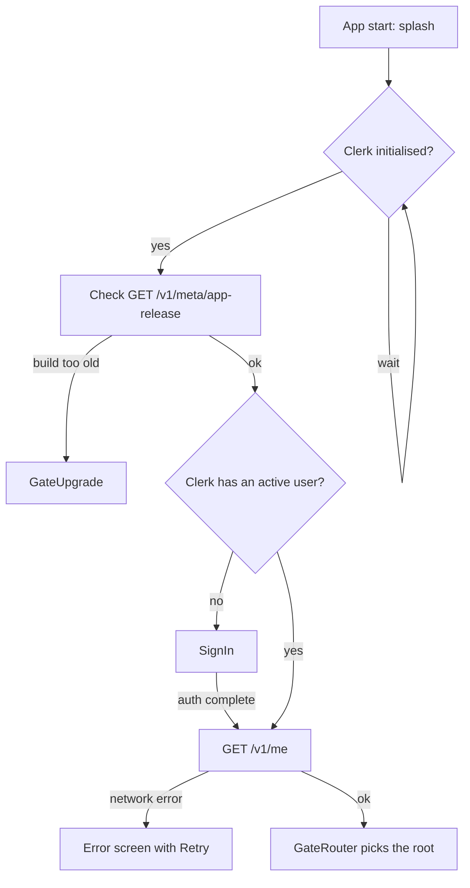

# 22. Android App

| | |
|---|---|
| Status | Implemented (`apps/android`, 2026-11-21); Mehfil Heritage design applied 2026-11-22 |
| Applies to | `apps/android` (Kotlin, Jetpack Compose, Material 3, Hilt, Navigation 3, Retrofit, OkHttp) |
| Related | [16-screens-and-flows.md](16-screens-and-flows.md) for what each screen contains, [17-web-app.md](17-web-app.md) for the web counterpart, [15-api-contract.md](15-api-contract.md), [06-auth-and-accounts.md](06-auth-and-accounts.md), [14-notifications.md](14-notifications.md), `docs/tech-stack.md` section 9 |

Document 16 says what every screen shows and does, by screen ID. This document says how the Android app is built around those screens. The Android app implements every member screen. It does not implement the public pages (`PUB-*`) or the admin console (`ADM-*`).

## 1. Principles

1. **Same behaviour as the web app.** Same screens, same rules, same wording. When this document and 17 differ, it is only where the platform differs.
2. **Thin client.** No business rules on the device. The API decides; the app displays and sends.
3. **The gate decides where the user is.** `Me.gate` from `GET /v1/me` (03 section 5.1) selects the root of the navigation.
4. **Nothing sensitive at rest.** No member data is written to disk except the image cache and reference data. Tokens are held by the Clerk SDK.
5. **Privacy on the device.** Screenshots are blocked on profile, photo, chat and verification screens.
6. **Right-to-left ready.** `start` and `end` everywhere, never `left` and `right`.
7. **One design, native parts.** [DESIGN.md](../DESIGN.md) decides how the app looks. Screens use its tokens through the Compose theme and the shared composables of section 11, and Material 3 widgets wherever Android has one.

## 2. Package layout

```text
apps/android/app/src/main/java/com/khandanirishta/app/
├── KhandaniApplication.kt        Hilt entry, Clerk and Sentry setup, notification channels
├── MainActivity.kt               single activity, handles notification and link intents
├── core/
│   ├── network/                  generated API client, interceptors, ApiError, ErrorMapper
│   ├── realtime/                 RealtimeClient (OkHttp WebSocket), event models
│   ├── data/                     repositories, one per product area
│   ├── datastore/                AppPreferences (DataStore)
│   ├── push/                     KhandaniMessagingService, NotificationFactory, DeepLinkResolver
│   ├── media/                    photo picking, downscaling, upload with progress
│   └── util/                     formatters (age, height, relative time)
└── ui/
    ├── KhandaniApp.kt            root composable: start-up, gate routing, navigation host
    ├── Screens.kt                every key and its screen
    ├── AppBottomBar.kt           the five destinations
    ├── LinkOpener.kt             Custom Tabs, in the app's colours
    ├── navigation/               Keys.kt, GateRouter.kt, AppNavigator.kt, DeepLinkResolver.kt
    ├── theme/                    Color, Type, Shape, Dimens, Motion, Theme, AuthTheme (section 12)
    ├── text/                     labels, the wording of 07 section 3.2, placeholders
    ├── messages/                 toasts and limit dialogs sent from view models
    ├── components/               shared composables (section 11)
    └── feature/
        ├── auth/                 AUTH-SIGNIN
        ├── gates/                GATE-*
        ├── onboarding/           ONB-*
        ├── home/                 APP-HOME, APP-MATCHES
        ├── search/               APP-SEARCH
        ├── profile/              APP-PROFILE, APP-PHOTOS
        ├── interests/            APP-INTERESTS, APP-PHOTO-REQUESTS
        ├── chat/                 APP-CHATS, APP-CHAT, APP-CONNECTION
        ├── lists/                APP-SHORTLIST, APP-VISITORS
        ├── notifications/        APP-NOTIFS
        ├── me/                   ME-*
        └── settings/             SET-*
```

Each feature folder holds, per screen: `XxxScreen.kt` (collects the state and hands it to stateless content that takes state and callbacks), and `XxxViewModel.kt` with its immutable `XxxUiState`. A large screen keeps its parts in files named after them (`HomeTop.kt`, `ProfileHero.kt`). Previews and their sample data live in `src/debug`, so they never ship.

## 3. Navigation

### 3.1 Keys

Navigation 3 with serializable keys, extending the existing `KhandaniApp.kt`. Every screen ID has exactly one key.

| Screen | Key | Arguments |
|---|---|---|
| `AUTH-SIGNIN` | `SignIn` | |
| `GATE-BLOCKED` | `GateBlocked` | |
| `GATE-DELETION` | `GateDeletion` | |
| `GATE-CONSENT` | `GateConsent` | |
| `GATE-REVIEW` | `GateReview` | |
| `GATE-CHANGES` | `GateChanges` | |
| `GATE-UPGRADE` | `GateUpgrade` | `downloadUrl: String` |
| `ONB-01` to `ONB-11` | `OnboardingStep` | `step: String` (the API step key, for example `education_career`), `edit: Boolean` (true when opened from the review step, 07 section 2) |
| `ONB-DONE` | `OnboardingDone` | |
| `APP-HOME` | `Home` (exists today, repurposed) | |
| `APP-MATCHES` | `Matches` | |
| `APP-SEARCH` | `Search` | `savedSearchId: String?` |
| `APP-PROFILE` | `Profile` | `profileId: String` |
| `APP-PHOTOS` | `PhotoViewer` | `profileId: String`, `index: Int` |
| `APP-INTERESTS` | `Interests` | `box: String` (`received` or `sent`), `interestId: String?` (row to scroll to) |
| `APP-CHATS` | `Chats` | |
| `APP-CHAT` | `Chat` | `connectionId: String` |
| `APP-CONNECTION` | `ConnectionDetails` | `connectionId: String` |
| `APP-SHORTLIST` | `Shortlist` | |
| `APP-VISITORS` | `Visitors` | |
| `APP-NOTIFS` | `Notifications` | |
| `APP-PHOTO-REQUESTS` | `PhotoRequests` | `box: String` |
| `ME-PROFILE` | `MyProfile` | |
| `ME-EDIT` | `EditSection` | `section: String` |
| `ME-PHOTOS` | `MyPhotos` | |
| `ME-PREFS` | `MyPreferences` | |
| `ME-VERIFY` | `Verification` | |
| `ME-VERIFY-ID` | `VerifyIdentity` | |
| `ME-VERIFY-SELFIE` | `VerifySelfie` | |
| `SET-HOME` | `Settings` | |
| `SET-PRIVACY` | `PrivacySettings` | |
| `SET-NOTIFS` | `NotificationSettings` | |
| `SET-CONTACTS` | `ContactDetails` | `focus: String?`, `returnConnectionId: String?` (08 section 3) |
| `SET-BLOCKED` | `BlockedMembers` | |
| `SET-ACCOUNT` | `AccountSettings` | |
| `SET-HELP` | `Help` | |

Legal and help content (`PUB-TERMS`, `PUB-PRIVACY`, `PUB-GUIDELINES`, `PUB-SAFETY`, `PUB-NIKAH`, `PUB-FAQ`) opens the web page in a Chrome Custom Tab.

### 3.2 Start-up and gate routing



`GateRouter` (`ui/navigation/GateRouter.kt`) is a pure function, unit-tested for every row:

| `gate` | Root of the back stack |
|---|---|
| `banned`, `suspended` | `GateBlocked` |
| `deletion_scheduled` | `GateDeletion` |
| `consent_required` | `GateConsent` |
| `onboarding` | `OnboardingStep(me.profile.onboarding_step)` |
| `changes_requested` | `GateChanges` (with access to `MyProfile` and `Settings` stacks from its buttons) |
| `pending_review` | `GateReview` (same access) |
| `ok` | The tabbed application, starting on `Home` |

Rules:

- Which other screens each gate may open is defined once, in 16 section 3.2 (for example `Help` from the blocked and onboarding screens, and the own-profile, settings and notification screens while under review). `GateRouter` also exposes `isAllowed(gate, key)`, tested against every row of that table; a key that is not allowed is never pushed.
- Whenever `Me.gate` changes (after any refresh), replace the whole back stack with the new root. Do not animate this as a normal push.
- Refresh `Me` as 16 section 3.3 says: at start, after sign-in, when the app returns to the foreground after 60 seconds or more, after any API error with a gate code (17 section 4.4 lists them), and on the `gate.changed` WebSocket event. The `counters` WebSocket event only replaces `Me.counters` in memory; it causes no fetch.
- `gate = 'ok'` with `profile.status` `paused` or `closed` uses the same status panels as the web app (17 section 4.3).

### 3.3 Tabs and back behaviour

- Five top-level destinations in Material 3's `ShortNavigationBar` (`DESIGN.md` 6.17): `Home`, `Search`, `Interests`, `Chats`, `MyProfile`. Interests is the envelope. Badges on Interests and Chats from `Me.counters`, and the gold diamond on Me, as defined in 16 section 2.1; each is said in words to TalkBack. At larger text the labels take a second row and none is cut. The bar steps aside while the keyboard is open.
- `TopLevelBackStacks` keeps one back stack per tab so that switching tabs preserves where the user was. Selecting the current tab again pops that tab to its root.
- The bar is shown only on the screens 16 section 2.1 names: the five destinations and the list screens reached from them (`Matches`, `Shortlist`, `Visitors`, `Notifications`, `PhotoRequests`, `Settings`). Every other screen (the detail screens, `OnboardingStep`, the gate screens) shows a back arrow and its title instead.
- System Back pops the current tab's stack. At a tab root that is not `Home`, Back goes to `Home`. At `Home`, Back leaves the app.
- In onboarding, Back goes to the previous step screen and never signs the user out. On `ONB-01`, Back leaves the app.

### 3.4 Links and notification taps

`DeepLinkResolver` turns an incoming target into a list of keys to place on the stack (root first), then applies the gate (16 section 4.2): if `isAllowed(gate, key)` is false for the target, the target is dropped and the gate root is shown. A target the gate allows is opened, for example `MyPhotos` while the gate is `pending_review`.

| Source | Form | Resolves to |
|---|---|---|
| Push notification tap | Intent extras `target` and parameters, copied from the push `data` keys defined in 14 section 4 | The screen ID's key with its arguments, on top of the matching tab root |
| App Link | `https://khandanirishta.app/profiles/{profileId}` | `Profile(profileId)` |
| App Link | `https://khandanirishta.app/p/{publicCode}` | Call `GET /v1/profiles/by-code/{publicCode}`, then `Profile(profileId)` |
| App Link | `https://khandanirishta.app/chats/{connectionId}` | `Chat(connectionId)` on the Chats tab |
| App Link | `https://khandanirishta.app/interests` | `Interests("received")` |

App Links need `android:autoVerify="true"` intent filters for the production and staging hosts, and a `/.well-known/assetlinks.json` file served by the web app listing the package name and the release certificate's SHA-256 fingerprint. Other URLs of the site open in the browser. A push whose `target` this build does not know opens `Notifications` (16 section 4.2).

## 4. Authentication

| Piece | Implementation |
|---|---|
| SDK | `com.clerk:clerk-android-ui` (includes the API artefact), configured in `KhandaniApplication` with the publishable key from `BuildConfig` |
| Sign-in screen | Clerk's `AuthView` composable, full screen under a small header with the logo. `onAuthComplete` triggers the `Me` refresh. |
| Methods shown | Whatever is enabled in the Clerk dashboard: Google and email code at launch (06 section 2) |
| Token for API calls | `AuthInterceptor` (section 5.2) calls `Clerk.auth.getToken()` |
| Sign-out | From `AccountSettings`, in the order of 06 section 10.1: close the WebSocket, `DELETE /v1/me/devices/{push_token}` (ignore a failure), `Clerk.auth.signOut()`, clear repositories and the image cache, show `SignIn` |
| Sign-in and security | The "Sign-in and security" row on `SET-ACCOUNT` opens Clerk's `UserProfileView` for the email address, connected Google account and devices (06 section 12). `UserButton` is not used. |
| Account deletion | Always through our own flow (`SET-ACCOUNT`, 06 section 9). The delete row inside `UserProfileView` is hidden because self-deletion is switched off in the Clerk dashboard. |

Google sign-in on Android needs the OAuth clients and fingerprints described in 06 section 4.

## 5. Networking

### 5.1 Client

- Retrofit service interfaces and kotlinx.serialization models generated from `packages/api-contract/openapi.json` by `scripts/generate-android-client.mjs` (`pnpm generate:android-client`) into `core/network/generated/`, one file per type and one interface per tag. CI fails when they are out of date. Never hand-write request or response models. Enumerations carry an `UNKNOWN` entry for values a newer API may add; a union request body (`SectionBody`, `SubmitVerification`) gets one method per variant.
- One `OkHttpClient` for the API (and a second one, without the auth interceptor, for uploads to presigned R2 URLs).
- Timeouts: connect 10 s, read 30 s, write 30 s.

### 5.2 Interceptors, in order

| Interceptor | Behaviour |
|---|---|
| `AppHeadersInterceptor` | Adds `x-app-platform: android`, `x-app-version-code: <BuildConfig.VERSION_CODE>`, `Accept-Language: <current locale>` |
| `AuthInterceptor` | For every request except `/v1/meta*`, `/v1/reference/*`, `/healthz`: obtains a token with `Clerk.auth.getToken()` (blocking on the OkHttp thread) and adds `Authorization: Bearer`. On a `401` response, fetches a token with the cache skipped and retries once. A second `401` signs the user out. |
| Sentry OkHttp integration | Breadcrumbs without bodies or query strings |

### 5.3 Errors

`ErrorMapper` converts a failed response into `ApiError(status, code, message, fields, details, requestId)` by parsing the body from 15 section 2. Repositories return `Result<T>` with this error. The handling table is the same as the web app's (17 section 6.4), with these Android specifics:

| `code` | Android behaviour |
|---|---|
| `upgrade_required` | Navigate to `GateUpgrade(details.download_url)` |
| Gate codes | Refresh `Me`; the gate router replaces the stack |
| `limit_reached` | A dialog composable shared by all screens |
| Network failure (`IOException`) | Inline "No connection" state with Retry; a snackbar for actions |

## 6. State and data

| Topic | Rule |
|---|---|
| Screen state | One immutable `UiState` data class per screen, exposed as `StateFlow` from the ViewModel, collected with `collectAsStateWithLifecycle()` |
| Repositories | `MeRepository`, `ReferenceRepository`, `ProfileRepository` (own profile, photos, preferences, privacy, identity, verification), `DiscoveryRepository`, `InterestRepository`, `ConnectionRepository`, `RelationRepository` (shortlist, pass, block, photo access, reports), `NotificationRepository`. Singletons provided by Hilt. |
| Shared state | `MeRepository.me: StateFlow<Me?>` is the single holder of `Me`, counters included. `ConnectionRepository` holds the chat list and open conversations in memory. |
| Lists | `Paginator` (`core/data/Paginator.kt`) per cursor endpoint: the items stay in memory so screens can apply the optimistic changes of rule G7 directly, and `PagedList` draws the standard states. Pull to refresh on every list. |
| Refresh rules | Mirror the web invalidation table (17 section 6.3): after a mutation, refresh the same data the web app invalidates. |
| Optimistic updates | Only for the cases of 16 section 1.2 rule G7: the "sending" state of a chat message, shortlist on and off, pass and its undo, marking notifications or messages read, mute and archive |
| Recomposition | State classes are `@Immutable`. The generated models, `Option`, `Instant` and `LocalDate` are declared stable in `app/compose-stability.conf`. Lazy lists and rows give a `key` and a `contentType`. What is said relative to now reads `rememberNow()`, as an unchanged row is skipped. A composable value is read on every pass, never only behind a nested `&&` or `||`: that gives what follows another place in the composition, and a field there loses focus. |
| "Not interested" on lists | The view model keeps the passed cards of the visit (`PassedCards`), so the panel with Undo stays in the card's place across refetches and ends when the member leaves the screen (16 section 6.4). The cards are taken out on return, once the list has found its saved place again. The profile keeps its toast. |
| Offline | `LocalOnline` is provided at the root: the banner of rule G14 shows, and every control that needs the network is disabled. |
| Persistence | No Room database. Nothing from the member APIs is written to disk. |
| Reference data | `ReferenceRepository` stores the bootstrap JSON and its `version` in a file in the app's private storage and revalidates with `If-None-Match` at start. Label lookup falls back to the code with underscores replaced by spaces. |
| Process death | Screen arguments survive through the serializable keys. Form input in onboarding survives through `rememberSaveable` and, more importantly, through the server: each step is saved when the user continues. |
| Client events | `Tracker.track(name, properties)` as specified in 20 section 8.3: an in-memory buffer flushed to `POST /v1/events` at 20 events, every 30 seconds, and when the app goes to the background. The only events at launch are the onboarding funnel events in 07 section 17. |

`AppPreferences` (DataStore) holds only: `locale`, `lastUpdatePromptAt`, `notificationPermissionAsked`, `pushToken`.

## 7. Real-time

`RealtimeClient` wraps an OkHttp `WebSocket`. Protocol: 19 section 4. Behaviour mirrors 17 section 7.

| Topic | Rule |
|---|---|
| When connected | While the app is in the foreground (`ProcessLifecycleOwner` started) and `Me.gate` is not `banned`, `suspended` or `deletion_scheduled` (the server refuses those sockets with close code 4403). Members in onboarding or under review are connected too, so that they receive `photo.updated` and `gate.changed` (19 section 4.2). Disconnect 30 seconds after the app goes to the background. Push notifications cover the background. |
| Handshake | On open, send the `auth` frame with a fresh token; wait for `ready` |
| Keep-alive | `ping` every 30 seconds; treat 45 seconds without a `pong` as a dead connection and reconnect (19 section 4.3) |
| Reconnect | Backoff 1 s, 2 s, 4 s, up to 30 s, with jitter (19 section 4.8). Reconnect at once when connectivity returns (`ConnectivityManager` callback). |
| After reconnect | The resync steps of 19 section 4.8: take the counters from `ready`; refresh `Me` only when it was last fetched more than 60 seconds ago; refresh the chat list, the interests list or the notification feed when that screen is visible; for an open conversation fetch messages with `after=<newest known id>` while `has_more`, then refetch the connection |
| Fallback | While disconnected with a conversation open, poll that conversation every 15 seconds and `GET /v1/connections/{id}` every 60 seconds. Elsewhere in the app, refresh `Me` every 60 seconds for the counters (11 section 6.4). |
| Events | Exposed as a `SharedFlow<RealtimeEvent>`; repositories subscribe and update their in-memory state exactly as the web table in 17 section 7.2 describes |
| Sending | Messages go through `POST /v1/connections/{id}/messages` with a `client_message_id` (`UUID.randomUUID()`), optimistic entry, replace on success, "Retry" on failure with the same id |
| Suppressing push | When a `message.new` event arrives for the conversation currently on screen, no notification is shown |

## 8. Push notifications

Payload shapes, notification types and channels are defined in 14 section 4. This section covers the device side.

| Topic | Rule |
|---|---|
| Service | `KhandaniMessagingService : FirebaseMessagingService` |
| Token registration | In `onNewToken`, after every successful sign-in, and on every app start with a session (14 section 4.4), call `POST /v1/me/devices` with `platform = "android"`, the token, `app_version` and `device_model`. Store the token in `AppPreferences`. |
| Token removal | On sign-out, `DELETE /v1/me/devices/{push_token}` |
| Message type | Data messages only. `onMessageReceived` builds the notification locally from `type` and `data`, with text from string resources in the device language. |
| Privacy of content | Never show message text or a display name: the payload carries neither (14 section 4.1). The title is the app name and the body is the fixed string for the push `type` (14 section 4.2). Set `VISIBILITY_PRIVATE` with a generic public version ("New activity on Khandani Rishta") for the lock screen. |
| Channels | Created at start with the ids and importance from 14 section 4 |
| Tap | A `PendingIntent` to `MainActivity` carrying `target` and its parameters; `DeepLinkResolver` handles it (section 3.4) |
| Grouping | Every push uses the collapse key of 14 section 4.2 as its Android tag, so chat notifications are one notification per connection (tag `msg_<connection_id>`), updated in place |
| Foreground | If the target screen is already visible, do not show a notification. A `message` push that arrives while the socket is open shows nothing (14 section 4.3). |
| Permission (Android 13 and later) | Ask for `POST_NOTIFICATIONS` on `ONB-DONE`, after a short explanation screen. If refused, show a one-line reminder on `SET-NOTIFS` with a button to system settings. Ask at most once automatically (`notificationPermissionAsked`). |
| Devices without Google Play services | Push is unavailable. The app works; counters update while it is open. |

`google-services.json` is not committed. It is provided by CI from a secret and placed locally by each developer (add it to `.gitignore`).

## 9. Photos and camera

| Task | Implementation |
|---|---|
| Choosing profile photos | The system Photo Picker (`PickVisualMedia`, images only). No storage permission. |
| Preparing a photo | Exactly as 08 section 5.1 describes: decode with sampling, rotate according to the EXIF orientation, reject below 400 by 400 pixels, scale so the long side is at most 2,048 pixels, compress to JPEG quality 90 into the app cache directory. If preparation fails on the device, upload the original file when it is within the limits. |
| Uploading | `POST /v1/me/photos/uploads`, then `PUT` to the presigned URL with a progress-reporting `RequestBody` and the headers from the response, then `POST /v1/me/photos`. Delete the temporary file. Rules: 08 section 5. |
| Selfie for verification | CameraX with the front camera, an on-screen frame and the day's gesture illustrated. Capture only: no gallery option. Needs the `CAMERA` permission, requested on `ME-VERIFY-SELFIE` with an explanation. |
| Identity document photos | CameraX with the back camera and a card-shaped guide, or the Photo Picker |
| Displaying member photos | Coil. Use the URL without its query string as the memory and disk cache key, because the signature in the query string changes every hour while the object path (which contains the photo id and the variant name) does not (08 section 5.4). |
| Privacy of member photos | The image is drawn as received. The veil, inner arch, monogram and lock are layers over the image the API already blurred; the device never blurs or unblurs (16 rule G10). |
| Size | Coil decodes at the size of the arch it is drawn in. The arch has its size before the image loads, so nothing moves. |
| Image cache | Coil's disk cache in the app's private cache directory, capped at 100 MB, cleared on sign-out |

## 10. Privacy protections on the device

| Protection | Where |
|---|---|
| `WindowManager.LayoutParams.FLAG_SECURE` (blocks screenshots and screen recording, and hides the screen in the recent-apps view) | Applied while the screens of 16 section 1.2 rule G17 are on screen: `Profile`, `PhotoViewer`, `Chat`, `ConnectionDetails`, `VerifyIdentity`, `VerifySelfie`. Implemented as a `SecureScreen` composable effect that sets the flag on entry and clears it on exit. |
| No copy of shared contact details to logs | Never log response bodies |
| Clipboard | Copying a shared phone number is allowed (the member chose to share it). Chat text can be copied by long-press. |
| Backups | Keep the existing backup rules: exclude DataStore and caches from cloud backup and device transfer |
| Biometric app lock | Not at launch |

## 11. Shared composables (`ui/components/`)

The Android equivalents of the web components in 17 section 10, with the same names where possible. Their anatomy is `DESIGN.md` section 6. A screen does not draw its own copy of one.

| Group | Composables |
|---|---|
| Layout | `Band` (page, sand, success, primary, inverse), `TonalPanel`, `AdaptiveRow` (stacks when its children do not fit), `SectionHeading`, `SectionCard`, `Disclosure`, `RowDivider` |
| Members | `ProfileCardView` (the full size), `ProfileRow` (compact), `ProfileTile` (New members only), `PassedCard`, `MemberPhoto` and `MemberAvatar` (always a 4:5 arch), `CompatBadge`, `BadgeRow`, `ReasonChips`, `RelationHint`, `ShortlistButton` |
| Facts | `InfoRow`, `LockedRow`, `LockedValue`, `MetaLine`, `MemberText` (a member's own words, in their own direction), `QuoteBlock`, `ExpiryNote`, `ProgressRing`, `KrMeter` |
| Controls | `KrButton` (primary, secondary, quiet, inverse, ink, danger), `KrTextLink`, `KrIconButton`, `KrChoiceChip`, `KrTabs` (chips that wrap where a label would break inside a word), `NavRow`, `NudgeCard`, `SwitchRow`, `CheckboxRow`, `RadioRow`, `RadioCardRow`, `KrMenu` |
| Bars | `HomeTopBar`, `TabTopBar`, `DetailTopBar` (the title wraps), `ProfileTopBar` (the one place a name is cut), `KrActionBar` with `AnswerRow` |
| States | `EmptyState`, `ErrorState`, `NoLongerAvailable`, `StatusPanel`, `StatusBanner`, `DismissibleBanner`, `OfflineBanner`, `StatusPill`, `PagedList`, skeletons for cards, rows and forms |
| Layers | `KrSheet`, `KrDialog`, `ConfirmDialog`, `LimitDialog`, `DeclineDialog`, `ReportDialog`, `BlockDialog`, `NoteDialog`, `KrSnackbarHost` (4 seconds, 5 with Undo; above the screen's action bar, never over its main button or the composer; an open sheet repeats the toasts that come while it covers them) |
| Effects | `SecureScreen` (section 10), `LightSystemBarIcons` (the inverse screens: photo viewer and camera) |

Where Android has a better affordance than the web, it is used: sheets for decline, report, notes and sending an interest, dialogs for short decisions, pull to refresh, the system Back, and Material pickers.

Form fields mirror 17 section 8.2: `KrTextField`, `SelectField` (a modal bottom sheet list), a search sheet for long lists and cities, `MultiSelectField`, `ChoiceChips` (chips wrap where segmented buttons would be cut), `DateOfBirthField` (three pickers, not the Material calendar, because scrolling decades in a calendar is slow), `HeightField`, `PhoneField`, the identity number field (with a visual transformation for the mask), `RangeField`, `ImportanceField`, `RadioCardsField`, `ConsentCheckbox`.

Server validation errors map onto fields exactly as on the web (17 section 8.3).

## 12. Theme, language, accessibility

[DESIGN.md](../DESIGN.md) (Mehfil Heritage) is the source of every design token. `ui/theme` holds them once and everything else reads the theme.

| Topic | Rule |
|---|---|
| Colours | `LightColors` and `ExtendedColors` in `ui/theme/Color.kt` (`DESIGN.md` 2.5). It is the only file that writes a colour. `KrTheme.tonal` is the fill that stands out on the band behind it. Dynamic colour is off so the brand is consistent. Light theme only, whatever the phone is set to. |
| Outside Compose | The window, splash screen, launcher and notification colours are in `res/values/colors.xml`, with the same values. The system bars are transparent with dark icons, light on the inverse screens. Force dark is off. Custom Tabs and Clerk's screens (`rememberClerkTheme`) take the same colours and type. |
| Typography | `AppTypography` and `KrType` (`DESIGN.md` 3.4): Source Sans 3 for the interface, Instrument Serif for display, wordmark and monograms. Body 17, nothing that carries meaning under 15 (14 for legal lines). The font files and their licences are bundled in `res/font` and `assets/licenses`; downloadable fonts from Google Play services are not used. |
| Shapes and space | `AppShapes`, the pill and the arches (`DESIGN.md` 4.1), `Spacing` and `Sizes` (section 5). |
| Elevation | Content is flat: tonal bands and hairlines. Only menus, sheets and action bars cast a shadow. No gradients and no scrims on photos. |
| Motion | `Motion.fast` (150 ms) and `Motion.base` (200 ms). When the animator duration scale is off, transitions end at once and skeletons stay still. |
| Text scaling | Honour the system font scale up to 200% without clipping: rows stack, buttons go full width and then wrap, names and titles wrap. Heights are minimums. Over the keyboard in little room, a sheet's answers scroll with its body and the Done of an option sheet moves beside its title. |
| Edge to edge | Top bars own the status bar inset, action bars the navigation bar and keyboard. Bands run from edge to edge; the column inside stops growing on wide windows. Content scrolls on behind the navigation bar or the action bar and adds its height at the end (`exceptBottom`). A form stops above its bar and the keyboard. |
| Touch targets | At least 48 dp, 8 dp apart. Primary actions are 56 dp tall. |
| Meaning | Never colour alone: every status has an icon and words. The tick means verified, the envelope an interest, the heart Shortlist only. |
| Language | Per-app language with `AppCompatDelegate.setApplicationLocales`. The choice on `SET-ACCOUNT` calls `PATCH /v1/me` and switches the app. `android:supportsRtl="true"` stays on. Urdu strings (`values-ur`) are added in the Urdu phase. |
| Strings | The copy shared with the web app is generated from `apps/web/src/locales/en` into `res/values/copy.xml` (`pnpm generate:android-strings`): resource name = namespace and key path, for example `chat_composer_placeholder`; i18next placeholders become named placeholders such as `{name}`, filled by name with `ui/text/Text.kt`. A managed profile picks the `_male`, `_female` and `_named` variants with `rememberCandidate()`. Android-only text lives in `strings.xml` and `strings_<area>.xml`. Enumeration labels come from the reference data, not from resources. |
| Content descriptions | Every icon button and every member photo that stands alone ("Photo of <display name>", "Private photo" or "No photo added yet"). Inside a card the photo is decoration, and its state and count are read after the name. |
| TalkBack | Profile cards are one focusable item with a combined description; Shortlist and "Not interested" are custom accessibility actions. A row that is one control is one node with its role and state. Headings are marked. Errors and results are live regions. |
| Numbers and dates | Western digits, tabular where they are compared; dates with `java.time` and the active locale |

## 13. Updates

The app is distributed as an APK outside the Play Store (tech stack section 9).

| Check | Behaviour |
|---|---|
| At start and once every 24 hours in the foreground | `GET /v1/meta/app-release?platform=android` |
| `min_supported_version_code > BuildConfig.VERSION_CODE` | `GateUpgrade`: a blocking screen with the release notes and a "Download update" button that opens `download_url` in the browser. No way past it. |
| `version_code > BuildConfig.VERSION_CODE` otherwise | A dismissible banner on `APP-HOME`, "A new version is available" with "Update", at most once a day (`lastUpdatePromptAt`; 16 section 6.2) |
| Any API response `426 upgrade_required` | `GateUpgrade` with `details.download_url` |

`GATE-UPGRADE` explains in one sentence that Android will ask for permission to install from the browser.

## 14. Build configuration

| Item | Value |
|---|---|
| `BuildConfig.API_BASE_URL` | Debug: from `local.properties` (key `API_BASE_URL`), default `http://10.0.2.2:8787` for the emulator. Release: Gradle property or environment variable `RELEASE_API_BASE_URL`, default `https://api.khandanirishta.app` |
| `BuildConfig.CLERK_PUBLISHABLE_KEY` | Debug: from `local.properties` (key `CLERK_PUBLISHABLE_KEY`), see 06 section 13. Release: `RELEASE_CLERK_PUBLISHABLE_KEY`, which CI sets to the Production key. A signed build fails unless the key starts with `pk_live_` |
| `BuildConfig.WEB_BASE_URL` | Debug: from `local.properties` (key `WEB_BASE_URL`). Release: `RELEASE_WEB_BASE_URL`, default `https://khandanirishta.app`. Used for legal pages and share links |
| `BuildConfig.SENTRY_DSN` | Gradle property or environment variable `SENTRY_DSN` (CI), else `local.properties` (key `SENTRY_DSN`), optional |
| Version | `-PversionCode` (CI: the run number) and `-PversionName` (CI: the tag without `android-v`), default `1` and `0.1.0` |
| Build types | `debug` (local API, cleartext allowed to `10.0.2.2` only), `release` (production API, minified, signed in CI with the permanent release key) |
| Network security config | Cleartext traffic off, except the emulator host in debug |
| Permissions | `INTERNET`, `ACCESS_NETWORK_STATE`, `POST_NOTIFICATIONS`, `CAMERA`. No location, contacts or storage permissions. Debug builds also declare `ACCESS_LOCAL_NETWORK` and ask for it at start: Android 17 blocks private network addresses (the local API at `10.0.2.2`) for apps targeting it. |

## 15. Tests

| Level | What |
|---|---|
| Design (JUnit) | Contrast of every colour pairing, the 15 sp floor, `colors.xml` against the theme, and a scan of `ui/` for colours, gradients, blurs, shadows, font sizes or left and right written outside the theme; the six `FLAG_SECURE` screens; monograms, wording variants, reasons and the pass-in-place list |
| Unit (JUnit) | `GateRouter` for every gate, `DeepLinkResolver` for every row of 3.4, `ErrorMapper`, formatters (age, height in feet and inches, relative time), the identity number visual transformation, message deduplication in `ConnectionRepository` |
| ViewModel | Each onboarding step ViewModel: valid save, validation error mapping, continue. Chat ViewModel: send, fail, retry, incoming event. |
| Compose UI | `ProfileCard` with long names, blurred and missing photos, its custom actions and offline; locked values and the photo access states; the interest action bar for each `Relation` state; shared components right to left and at 200% font on 320 and 360 dp, with no text cut; onboarding step forms |
| Previews | `src/debug/.../ui/preview`: shared components and key states as a phone, a small phone at 200% font, and right to left |
| Manual release checklist | Sign-in with Google and with email; onboarding end to end; photo upload; push received in background and tap opens the right screen; screenshot blocked on profile and chat; key screens at 200% font scale on a 360 dp phone and with TalkBack; forced update screen; language switch |
